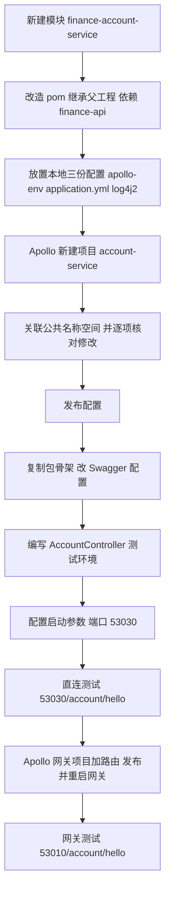
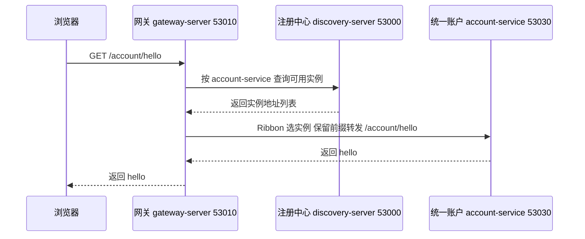

# 新建统一账户微服务：从空模块到经网关访问通的全过程

> 🔒 安全提示：文中示例的口令/密钥均为课程教学环境演示口径，生产环境的安全要求见《安全与合规须知》。

注册时序图把两个准备工作摆上了台面：统一账户微服务还不存在，验证码服务还没部署。本课先把前者从零建起来，后一课再部署后者。新建一个微服务远不止「New 一个 Module」：模块怎么命名才和已有工程一致、pom 里哪个版本号会炸、本地配置为什么几乎留白、Apollo 上怎么把公共配置一个个关联进来、哪些项要改哪些不能动、网关的路由加在哪里，任何一环漏掉，服务就起不来或者通了直连通不过网关。这一整套动作以后每新建一个微服务都要重复，值得一次性学标准。

## 先给结论

- 新建微服务的固定动作是六件：建模块、改 pom、放三份本地配置、Apollo 上建项目并关联公共名称空间、复制包骨架改 Swagger 配置、写一个测试 Controller。
- 本地配置几乎留白是刻意设计：`application.yml` 里只写 `app.id`、应用名与日志配置，业务配置全部进 Apollo，直接启动必然失败，先把 Apollo 侧配好再启动。
- Apollo 侧新建项目 `account-service`，对照用户中心逐个关联公共名称空间，关联完逐项过：上下文路径改 `/account`、数据源指向 `p2p_account` 库，其余沿用；改完必须发布才生效。
- 端口按课程资料中的服务端口约定执行，统一账户是 53030，用启动参数配置：`-Denv=dev -Dapollo.cluster=DEFAULT -Dserver.port=53030`。
- 验证分两级：直连 `http://localhost:53030/account/hello` 返回 hello 是第一级；经网关 `http://localhost:53010/account/hello` 也返回 hello 才算整条链路通，后者要在 Apollo 的网关项目里加一条路由并重启网关。

## 新服务接入的完整路线图

把两个视频的内容合起来看，新服务从无到有走的是同一条流水线：



这张图上最容易断的三处：Apollo 配置忘了发布、网关路由加错了地方、端口随手乱设。后面每一步都会把对应的坑点标出来。

## 建模块：命名向用户中心看齐

在 IDEA 里用 Spring Initializr 新建模块，类型选 Maven 工程，JDK 用 1.8。命名不要即兴发挥，打开用户中心的模块对照着写：模块名起 `finance-account-service`，与 `finance-consumer-service` 同一套语式；Group 对齐 `com.study.finance`，包名落在 `com.study.finance.account`，与用户中心的 `com.study.finance.consumer` 一致。统一账户服务管理的是账号信息，`account` 这个词在时序图上已经反复出现，拿它命名天经地义。

命名一致不是洁癖，是实实在在的工程收益。整个项目几十个模块，模块名、包名、应用名保持同一套语式之后，看到 `finance-xxx-service` 就知道是可运行微服务，看到 `com.study.finance.xxx` 就知道代码住哪，找类、扫依赖、排日志的效率完全不同。反过来，如果新模块随手叫 `account1` 或者 `myAccountModule`，一个月后连自己都要翻目录确认它是干什么的。向导生成的工程骨架只是个起点，有几处要立刻清理：向导自动填的描述与无用文件可以删掉；启动类由向导生成，先留着，后面要往上加注解。

## 改 pom：继承父工程，依赖 api 工程

新模块的 pom 按用户中心的 pom 改造，三件事必须做对。**第一，parent 指向父工程**，版本管理全部交给父工程 `finance`，模块自身不声明版本。**第二，依赖 `finance-api`**，api 已依赖 common，依赖传递会把公共工具类一并带进来，新服务不需要再单独引 common。**第三，版本号用 `${project.version}`**，不要手写死值。向导自动生成的依赖里如果写死了版本号，而父工程的版本是 `0.0.1-SNAPSHOT`，两边对不上就会报错，这是新手最常踩的一个坑，把版本换成占位符或直接删掉，交给父工程统一：

```xml
<parent>
    <artifactId>finance</artifactId>
    <groupId>com.study.finance</groupId>
    <version>0.0.1-SNAPSHOT</version>
</parent>
<modelVersion>4.0.0</modelVersion>

<artifactId>finance-account-service</artifactId>

<dependencies>
    <!-- api 已依赖 common，依赖传递自动带入公共能力 -->
    <dependency>
        <groupId>com.study.finance</groupId>
        <artifactId>finance-api</artifactId>
        <version>${project.version}</version>
    </dependency>

    <!-- 注册到 Eureka 必备 -->
    <dependency>
        <groupId>org.springframework.cloud</groupId>
        <artifactId>spring-cloud-starter-netflix-eureka-client</artifactId>
    </dependency>

    <!-- Apollo 客户端：启动时从配置中心拉取配置 -->
    <dependency>
        <groupId>com.ctrip.framework.apollo</groupId>
        <artifactId>apollo-client</artifactId>
    </dependency>

    <!-- 其余依赖照抄用户中心：web、log4j2、mysql、redis、rocketmq、okhttp 等 -->
</dependencies>
```

依赖清单整体照抄用户中心即可，本课先把环境跑通，业务依赖以后用到了再增删。打包插件 `spring-boot-maven-plugin` 也要保留，没有它最后打不出可执行 jar。

启动类补上注册中心的客户端开关，统一账户要把自己注册到 Eureka：

```java
package com.study.finance.account;

import org.springframework.boot.SpringApplication;
import org.springframework.boot.autoconfigure.SpringBootApplication;
import org.springframework.cloud.client.discovery.EnableDiscoveryClient;

@SpringBootApplication
@EnableDiscoveryClient
public class AccountService {

    public static void main(String[] args) {
        SpringApplication.run(AccountService.class, args);
    }
}
```

## 本地配置：三份文件，只改两处

打开用户中心的 `src/main/resources`，把三个文件复制过来：`apollo-env.properties`、`application.yml`、`log4j2-dev.xml`。逐个过：

**`apollo-env.properties` 一个字都不用改。** 它回答「配置中心在哪」，开发环境连的就是本机那份 Apollo，`dev.meta=http://localhost:8080` 沿用即可。

**`application.yml` 改两处身份信息**：`app.id` 与 `spring.application.name` 都换成 `account-service`，对应 Apollo 上的项目名。其余保持模板原样：

```yaml
# 启动参数见注释：-Denv=dev -Dapollo.cluster=DEFAULT -Dserver.port=53030
app:
  id: account-service
apollo:
  bootstrap:
    enabled: true
    namespaces: application,micro_service.spring-boot-http,micro_service.spring-eureka,micro_service.spring-hystrix,micro_service.spring-ribbon,micro_service.spring-boot-redis,micro_service.spring-boot-druid

spring:
  application:
    name: account-service

logging:
  config: classpath:log4j2-dev.xml
```

**`log4j2-dev.xml` 原样复制**，日志模板各服务通用。

注意 `namespaces` 清单的口径：`application` 是项目默认的私有名称空间，`micro_service.` 打头的是从公共项目关联过来的名称空间，清单里写哪个才读哪个。此刻清单先按上面这份列，Apollo 侧马上要照它逐个关联。

这时候如果直接启动，必然失败，而且失败得很有道理：本地文件里几乎没有业务配置，数据库地址、上下文路径、连接池参数全在 Apollo 上，`account-service` 这个项目在 Apollo 里还不存在，客户端取不到配置，Spring 容器起不来。所以下一步去 Apollo。

## Apollo 侧：建项目、关联名称空间、逐项核对

**建项目。** 登录 Apollo 控制台创建项目：应用 ID 填 `account-service`，必须与 `application.yml` 里的 `app.id` 完全一致，这是客户端取配置的钥匙；应用名称填统一账户服务；负责人选管理员，环境用开发环境，集群用默认的 default。

**关联公共名称空间。** 项目建好后进入配置页，添加名称空间时选「关联公共名称空间」而不是新建：公共项目 `common` 里沉淀了大量各微服务共用的配置，HTTP 编码、注册中心、熔断、负载均衡、Redis、连接池都在那里，谁用谁关联，一份配置全体受益。关联哪些、怎么排清单？打开 Apollo 上用户中心的项目对照，它关联了哪些，统一账户就关联哪些，Apollo 目前只能一个个添加，略显繁琐，但这是每个新服务都要走的一遍的活，做完就受益。本课用到的名称空间对应清单里的六项：`spring-boot-http`、`spring-eureka`、`spring-hystrix`、`spring-ribbon`、`spring-boot-redis`、`spring-boot-druid`。

关联与复制是两种境界。把用户中心的配置逐项抄成文本再贴进新项目，公共配置一改就要同步几十个服务，漏一个就是一场线上事故；关联则只有一份真身，公共项升级，所有关联方自动跟进。这也是 Apollo 把名称空间设计成可关联引用的原因，配置治理和代码复用是同一个思路。

**逐项核对，该改的改，不该动的不动。** 关联完成不等于万事大吉，公共配置是按用户中心的样子写的，直接用会张冠李戴。逐个名称空间过一遍：

| 名称空间 | 是否修改 | 修改内容 |
|---|---|---|
| `micro_service.spring-boot-http` | 要改 | `server.servlet.context-path` 改为 `/account` |
| `micro_service.spring-boot-druid` | 要改 | 数据源指向统一账户库 `p2p_account` |
| `micro_service.spring-eureka` | 不动 | 注册中心地址沿用 |
| `micro_service.spring-hystrix` | 不动 | 暂未用到熔断，参数沿用 |
| `micro_service.spring-ribbon` | 不动 | 负载均衡参数沿用 |
| `micro_service.spring-boot-redis` | 不动 | 暂未用到 Redis，参数沿用 |

上下文路径是微服务工程自己的访问路径，用户中心是 `/consumer`，统一账户必须是 `/account`，这一项不改，网关转发永远 404。数据源改动落在连接信息四件套上：

```properties
# 数据源：从用户中心的库切换到统一账户的库
spring.datasource.url=jdbc:mysql://localhost:3306/p2p_account?useUnicode=true&characterEncoding=UTF-8
spring.datasource.username=root
spring.datasource.password=123456
spring.datasource.driver-class-name=com.mysql.cj.jdbc.Driver
```

`p2p_account` 是课程资料数据库清单里登记的统一账户库，账号信息将来就落在这里，数据源还指着用户中心的库，后面注册的数据会落错地方。核对的方法不神秘，控制台里每个名称空间点开逐条看值，对照本服务应是什么样：地址类配置看指向，路径类配置看前缀，连接类配置看库名。核对完之后点击发布，Apollo 的配置改了不发布就不生效，这个动作在控制台的界面上是显式的，每次修改后都要记得点。发布这个动作容易被漏，原因也简单：本地文件改完保存即生效的习惯在这里不成立，控制台把「编辑」和「生效」拆成了两步，用配置中心就要接受它的规矩。

## 包骨架、Swagger 配置与测试 Controller

配置齐了，代码骨架照用户中心复制。用户中心里建好的那一排包，`controller`、`service`、`config`、`dto`、`entity`、`convert`、`agent`，直接整体拷到 `com.study.finance.account` 下，一个一个手建纯属浪费时间，反正里面大多是空的。拷过来之后有一处必须改：Swagger 配置类。

```java
package com.study.finance.account.config;

import org.springframework.boot.autoconfigure.condition.ConditionalOnProperty;
import org.springframework.context.annotation.Bean;
import org.springframework.context.annotation.Configuration;
import springfox.documentation.builders.ApiInfoBuilder;
import springfox.documentation.builders.PathSelectors;
import springfox.documentation.builders.RequestHandlerSelectors;
import springfox.documentation.service.ApiInfo;
import springfox.documentation.spi.DocumentationType;
import springfox.documentation.spring.web.plugins.Docket;
import springfox.documentation.swagger2.annotations.EnableSwagger2;

@Configuration
@ConditionalOnProperty(prefix = "swagger", value = {"enable"}, havingValue = "true")
@EnableSwagger2  // 开启 swagger 注解支持
public class SwaggerConfiguration {

    @Bean
    public Docket buildDocket() {
        return new Docket(DocumentationType.SWAGGER_2)
                .apiInfo(buildApiInfo())
                .select()
                // 要扫描的 API 基础包
                .apis(RequestHandlerSelectors.basePackage("com.study.finance"))
                .paths(PathSelectors.any())
                .build();
    }

    private ApiInfo buildApiInfo() {
        return new ApiInfoBuilder()
                .title("万信金融P2P平台-统一账户服务API文档")
                .description("包含统一账户服务api")
                .version("1.0.0").build();
    }
}
```

标题从用户服务改成统一账户服务，扫描的基础包保持 `com.study.finance` 不变，`@ConditionalOnProperty` 上的 `swagger.enable` 开关由 Apollo 配置控制，沿用即可。这个类报错的地方就是该改的地方，过一遍就知道改了什么。

然后写测试 Controller。环境配得再齐也要拉出来遛一圈，用户中心当初是用一个 hello 接口验的，统一账户照方抓药：

```java
package com.study.finance.account.controller;

import io.swagger.annotations.Api;
import io.swagger.annotations.ApiOperation;
import org.springframework.web.bind.annotation.GetMapping;
import org.springframework.web.bind.annotation.RestController;

@RestController
@Api(value = "统一账户服务", tags = "Account", description = "统一账户服务API")
public class AccountController {

    @ApiOperation("测试")
    @GetMapping("/hello")
    public String hello() {
        return "hello";
    }
}
```

`@Api` 描述整个类，`@ApiOperation` 描述方法，路径 `/hello` 是 GET 请求。类上加 `@RestController` 别忘，少了它请求进来匹配不到处理器，页面只会给你一个 404。

## 启动验证：直连通过，网关也要通过

启动顺序维持老规矩：Apollo 已在跑，注册中心 53000 先启动，统一账户随后。启动参数在 Run/Debug Configurations 里配置，这一步千万别忘也别抄错：

```text
-Denv=dev -Dapollo.cluster=DEFAULT -Dserver.port=53030
```

三个参数各管一事：`-Denv=dev` 指定环境，`-Dapollo.cluster=DEFAULT` 指定集群，`-Dserver.port=53030` 指定端口。端口为什么是 53030，不能自己拍脑袋：课程资料里有一份服务端口约定表，每个微服务的端口都已登记在案，统一账户 53030、用户中心 53050、网关 53010，照表执行，谁的端口都不能抢。

控制台无报错、日志出现 Tomcat started on port 53030，直连测试：浏览器访问 `http://localhost:53030/account/hello`，返回 hello，说明 Apollo 配置拉取、注册中心注册、上下文路径三项全部正常。第一级验证通过。

第二级走网关。为什么直连通了还要验网关：前端所有请求的统一入口是网关，用户永远不直接打 53030，网关这层转发不通，功能等于没上线。直连验证的是服务本身，网关验证的是「路由、注册发现、负载均衡」这条完整链路，两级缺一不可。

网关的路由不是本地配的，统一账户的好多配置都在 Apollo 里，网关也不例外。打开 Apollo 上网关项目，在 `application` 名称空间里仿照用户中心那条路由补两条配置：

```properties
zuul.routes.account-service.path=/account/**
zuul.routes.account-service.stripPrefix=false
```

路由含义与用户中心那条完全平行：路径匹配 `/account/**` 的请求转发给名为 `account-service` 的服务，`stripPrefix=false` 表示转发时保留 `/account` 前缀，恰好对上统一账户自己的上下文路径。改完发布，重启网关，然后访问 `http://localhost:53010/account/hello`，依然返回 hello，两级验证才都通过：



直连通、网关不通，问题大概率不在服务而在路由：Apollo 上的路由配置没加、没发布，或者网关没重启。顺手看一眼 Eureka 控制台，实例列表里应该多出 `ACCOUNT-SERVICE`，状态 UP，注册关系一目了然。控制台里实例条目形如 `account-service:192.168.x.x:53030`，应用名、IP、端口拼在一起，一眼定位归属；周期出现的心跳日志说明客户端与注册中心的续约正常。从这一刻起，统一账户在注册中心眼里和用户中心没有任何区别，别的服务按服务名就能找到它。

这套流程走完，最有价值的收获不是这个服务本身，而是可以复用的模板。以后每新建一个微服务，Apollo 里建项目加名称空间、网关里加路由、按端口约定表配启动参数，三件事都是固定套路，第二遍做起来会快很多。到这里，统一账户微服务算是真正「住了进来」：本地骨架、Apollo 配置、注册发现、网关路由四样齐备。后一课把验证码服务也部署起来，注册功能的第一段链路就凑齐了参与者。

## 常见误区

- **依赖版本写死成 `1.0`。** 错例：向导生成的 api 依赖带着固定版本号，与父工程 `0.0.1-SNAPSHOT` 对不上，Maven 直接报错。正解：版本一律用 `${project.version}` 或删除，交给父工程统一管理。
- **改了配置不点发布，网关路由加错地方。** 错例：Apollo 里改完上下文路径与数据源就重启服务，改动静默失效；或者把网关路由追加到网关工程本地 `application.yml`，重启后毫无反应。正解：Apollo 每次修改都要发布才生效，网关的配置已托管到 Apollo，路由加在 Apollo 网关项目的 `application` 名称空间里，改完发布并重启网关。
- **上下文路径忘改，端口随意分配。** 错例：沿用公共配置里的 `/consumer`，直连时 404；启动参数里随手写个 8080，与别的服务抢端口。正解：每个微服务的 `context-path` 是自己的访问路径，统一账户必须是 `/account`，与网关路由前缀一一对应；端口按课程资料的服务端口约定表执行，统一账户 53030。
- **数据源还指着用户中心的库。** 错例：连接池配置原样沿用，启动正常，后面注册的账号数据全写进了 `p2p_consumer`。正解：数据源必须切到 `p2p_account`，配错库是启动时发现不了、运行后才爆的隐性错误。

## 面试可能被问到的问题

1. 面试官追问：「你们新建一个微服务模块，标准流程是什么？」
   答：六步：建模块并与既有服务命名对齐；pom 继承父工程、依赖 api 工程，版本用占位符交给父工程；放置本地三份配置，只写 app.id 与应用名；Apollo 上建项目、关联公共名称空间、逐项核对后发布；复制包骨架并修改 Swagger 文档信息；写测试 Controller 做直连与网关两级验证。
2. 面试官追问：「为什么本地配置文件里几乎什么都没有？」
   答：项目的配置治理策略是配置中心集中管理，本地只保留应用身份信息。好处是配置修改不用改代码不用重新打包，多环境切换只靠启动参数；代价是新服务上线前必须先在 Apollo 建好项目并发布配置，否则启动必然失败，这本身就是一道防呆检查。
3. 面试官追问：「Apollo 的公共名称空间解决了什么问题？」
   答：多个微服务的配置大量重复，比如同一个注册中心地址、同一套连接池参数。把通用配置抽到公共项目的名称空间里，各项目按需关联，一处修改处处生效；私有名称空间只放本服务特有的配置。清单里写哪个才读哪个，不会把无关配置拉进来。
4. 面试官追问：「网关加了路由却转发 404，你怎么排查？」
   答：按链路从后往前查。先看统一账户直连通不通，直连都不通查 Apollo 配置有没有发布、上下文路径是不是 `/account`；直连通再看网关侧，路由配置是否在 Apollo 上、path 是否 `/account/**`、`stripPrefix` 是否 false，最后确认网关改配置后重启过。前缀被误裁剪与服务上下文路径不匹配是最典型的 404 原因。
5. 面试官追问：「微服务端口为什么有的写死在配置文件，有的用启动参数？」
   答：看角色稳定性。注册中心角色固定、端口基本不变，写死省事；业务微服务的端口可能按环境调整，用启动参数配置可以同一份代码换端口部署，也避免每个人改配置文件造成冲突。项目里还维护了一张端口约定表，所有服务的端口都有登记，不允许私自占用。

## 配套资料

- 代码：`materials/code/10/wanxinp2p/`，微服务基础工程，正文 pom 与启动类的原型出自其中的用户中心工程；`materials/code/10/wanxinp2p_apollo/`，接入 Apollo 后的工程，正文 `application.yml`、`apollo-env.properties`、Swagger 配置的原型均在该工程内；内层目录保留原始命名，引用路径列到工程目录为止。
- 讲义：`materials/docs/10/万信金融-生产环境-部署文档.md`，其中的服务端口表登记了统一账户 53030、用户中心 53050、网关 53010 等约定，端口不许自行乱设的出处即此。
- 讲义：`materials/docs/10/万信金融-第1章-讲义-开发环境搭建v1.0.md`，数据库清单中 `p2p_account` 为统一账户数据，正文数据源配置指向该库。
- 说明：统一账户微服务是课程中随堂新建的工程，资料包内无成品源码，正文中的 pom、启动类、Apollo 配置与 Controller 均按画面线与基础工程既有写法补全；资料归档在 `materials/docs/10/` 与 `materials/code/10/`，目录编号与相邻阶段共用。
