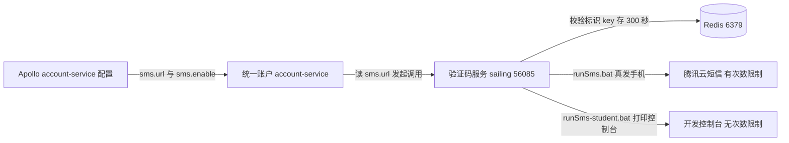

# 部署短信验证码服务：现成的 sailing 双模式与两行接入配置

注册时序图上还缺两个服务：UAA 认证服务和短信验证码服务。UAA 是登录段的参与者，编号 17 以后才出场，先放一放；验证码服务在注册第一段的第 3 步就要被调用，绕不过去。好消息是这个服务完全不用自己开发：它是一个已经实现好、打包好的开源项目，部署运行照着指南做即可。本课要弄明白三件事：它依赖什么环境、怎么把它跑起来、统一账户这一侧怎么接入它。

## 先给结论

- 验证码服务是现成的开源项目 sailing，基于腾讯云短信能力实现发送，资料包里已备好 jar 与启动脚本，不需要写一行代码。
- 运行前先备好 Redis：生成的验证码会往 Redis 存一份，有效期 300 秒，将来校验就靠它比对；本机 Redis 默认 6379 端口，配置文件里 `requirepass` 保持注释状态（免密）。
- 两个启动脚本对应两种模式：`runSms.bat` 把验证码真发到手机（受腾讯云使用次数限制，体验用）；`runSms-student.bat` 把验证码打印到服务控制台（无次数限制，开发期用）。
- 服务固定占用 56085 端口，上下文路径 `/sailing`，启动日志里这两项都打得明明白白。
- 统一账户侧接入只要两行配置：`sms.url` 指向验证码服务地址，`sms.enable` 是功能总开关，配在 Apollo 的 `account-service` 项目 `application` 名称空间里，改完必须发布；开发期可把 `sms.enable` 设为 `false` 切换到密码模式。

## 为什么现在就部署它

回看时序图第一段：前端获取验证码的请求打到统一账户，统一账户远程调用验证码服务，验证码服务生成验证码发短信，并把校验标识逐级返回。注册要发码，登录也要发码，这个服务是注册登录两条链路的公共依赖。它不在我们的开发清单里，而在部署清单里，原因很简单：发送短信对接的是运营商与短信平台，功能稳定且与业务无关，做成独立服务、随取随用，正是微服务拆分思想的落点。

## Redis：验证码的第二站

验证码的流转有两站。第一站发到用户手机，人能看见；第二站存进 Redis，机器比对用。将来用户填完验证码点登录，前端把手机号、验证码连同校验标识一起送到服务端，服务端拿着校验标识去 Redis 里把当初存的验证码取出来比对，对上了才算过。用 Redis 而不是数据库存它，是因为验证码天然是短命的临时数据，带过期时间、高频读写，Redis 的内存存储与过期机制正好对口。

sailing 源码里这条链路写得清清楚楚，验证码生成后立即落库：

```java
// AbstractVerificationHandler：生成验证码，存入 Redis 并返回校验信息
public VerificationInfo generateVerificationInfo(Map<String, Object> payload, int effectiveTime) {
    effectiveTime = effectiveTime > 0 ? effectiveTime : getEffectiveTime();
    String key = getVerificationKeyGenerator().generate(getName() + ":");  // UUID 校验标识
    String code = getVerificationCodeGenerator().generate();               // 数字验证码
    String content = confusion(payload, key, code);                        // 发短信或打印控制台
    getVerificationStore().set(key, code, effectiveTime);                  // 存入 Redis 带有效期
    return new VerificationInfo(key, content);
}
```

短信验证码处理器的有效期是 300 秒，`getEffectiveTime()` 返回 300，验证码五分钟不填就作废。环境要求只有两条：本机装有 Redis 并启动，端口 6379 未被占用。安装解压后在命令行启动：

```bash
cd C:\work\Redis-x64-3.2.100
redis-server.exe redis.windows.conf
```

一个细节容易栽跟头：把 Redis 配置文件里的 `requirepass` 保持注释状态。Redis 默认不开密码校验，这行配置一旦启用，客户端连接时必须带密码，而 sailing 侧没有配密码，验证码服务就连不上 Redis，生成验证码时直接报错。改配置文件前搜一下 `requirepass`，确认它前面是 `#` 注释状态。

## 部署 sailing：四个文件，两对脚本

sailing 是一个独立的开源项目，源码在 GitHub 上可以自行获取，指南里附有地址。它对接腾讯云短信服务，正式发短信需要四样参数：应用的 `appId`、密钥 `appKey`、短信 `templateId` 与短信 `sign` 签名，都需要在短信平台注册审核后获得。这些参数在服务的配置文件里落位：

```yaml
server:
  port: 56085
  servlet:
    context-path: /sailing

spring:
  redis:
    host: localhost
    port: 6379

sms:
  qcloud:
    appId: example-appid        # 短信平台应用 ID
    appKey: example-appkey      # 短信平台密钥
    templateId: example-templateid
    sign: example-sign          # 短信签名
```

课程资料已经把服务打包成 jar，连启动脚本一起给了，资料文件夹里四个文件，两两一对：`runSms.bat` 启动 `sailing.jar`，验证码真发到手机；`runSms-student.bat` 启动 `sailing-student.jar`，验证码不发手机，直接打印在服务自己的控制台上。为什么要两对：真发短信对接的是腾讯云，平台侧有使用次数限制，开发期反复注册登录很快就会把次数耗光；打印到控制台的模式没有任何次数限制，验证码随取随看，日常开发全靠它。两种模式在源码里的差别只是一行调用：

```java
// SmsNumberVerificationHandler：发送环节的两种实现
@Override
String confusion(Map<String, Object> payload, String key, String code) {
    String mobile = String.valueOf(payload.get("mobile"));
    // 真发短信：使用腾讯云发送，受平台次数限制
    // smsService.send(mobile, code, getEffectiveTime());
    // 控制台模式：验证码直接打印到服务控制台，无次数限制
    smsService.sendOnConsole(mobile, code, getEffectiveTime());
    return null;
}
```

体验阶段可以跑一次 `runSms.bat` 感受真机收码，之后日常开发都用 `runSms-student.bat`。脚本一启动就能看到熟悉的 Spring Boot 日志，重点盯两行：`Tomcat started on port(s): 56085 (http) with context path '/sailing'`，端口与上下文路径对上了，服务就绪；student 模式下控制台还会打印一条「给手机号发送验证码」的日志，验证码就是从那里抄的。sailing 同样基于 Spring Boot 实现， swagger 文档开关也已备好，想看它的接口说明可以访问 `http://localhost:56085/sailing/swagger-ui.html`。

## 接入：统一账户侧的两行配置

验证码服务跑起来了，统一账户还不知道它存在。统一账户是独立微服务，验证码服务也是独立微服务，前者要远程调用后者，就得知道它的访问地址。这个地址配到 Apollo 上，项目选 `account-service`，名称空间用默认的 `application`，加两行配置：

```properties
# 短信验证码服务地址
sms.url = http://localhost:56085/sailing/
# 开启短信验证码功能
sms.enable = true
```

`sms.url` 正是启动日志里那两个值的拼接，56085 加上 `/sailing/`。将来编码到「统一账户获取验证码」这一步时，代码里读这个配置项发起 HTTP 调用，验证码服务的部署地址变了，只改配置不动代码。`sms.enable` 是整个验证码功能的总开关：`true` 表示启用，注册登录都要收码校验；`false` 表示功能关掉。改完照例要发布，Apollo 的配置不发布不生效。

`sms.enable = false` 之后系统走什么？密码模式。验证码功能关了，登录框里验证码那格填的东西换了个含义：不再是短信验证码，而是密码。注册实现里会把手机号当成新用户的默认登录密码，于是关闭验证码功能期间，账号输手机号、密码格再输一次手机号，照样能登录。这是刻意为开发期设计的通道：每次启动新功能都要先登录，每次登录都收码实在耽误事，切密码模式一步到位。项目上线时这个开关必须回到 `true`，短信验证码是身份校验的防线，生产环境不能关。

两种模式摆在一起看：



这张图把本课的三件事串在了一起：Apollo 上的两行配置决定了统一账户怎么找到验证码服务、要不要走验证码；sailing 内部按脚本选择发送通道；生成的验证码带着校验标识在 Redis 里等校验环节来取。

## 常见误区

- **改完 Apollo 不发布。** 错例：`sms.url`、`sms.enable` 都填好了，没点发布就继续编码，统一账户读到的永远是空值。正解：Apollo 的每次修改都要发布才生效，把发布当成修改动作的一部分。
- **`requirepass` 启用了密码。** 错例：Redis 配置文件里 `requirepass` 处于启用状态，sailing 未配密码，生成验证码时连接 Redis 报错。正解：保持 `requirepass` 为注释状态，或两边密码配置保持一致，课程环境按免密处理。
- **开发期一直用 `runSms.bat`。** 错例：每次测试都真发短信，腾讯云次数限制很快耗尽，服务发不出码。正解：体验一次真机收码即可，开发期固定用 `runSms-student.bat` 从控制台抄验证码。
- **Redis 没启动或端口被占。** 错例：验证码服务起来了，一发码就报 Redis 连接失败；或者 6379 被其他进程占用。正解：部署前确认 Redis 已启动、6379 未被占用，验证码存取依赖 Redis，这一环断掉整个功能不可用。

## 面试可能被问到的问题

1. 面试官追问：「验证码为什么存 Redis 而不是数据库或本地内存？」
   答：验证码是短命的高频临时数据，需要带过期时间、高频读写、多实例共享。数据库写它太重，本地内存又绑死单实例，服务一扩容校验就找不到数据。Redis 的过期机制与集中式存储正好匹配，五分钟有效期一到自动作废，还能防暴力猜测。
2. 面试官追问：「校验标识 key 有什么用，为什么由服务端生成、前端保管？」
   答：key 把一次验证码会话串起来。生成验证码时以 key 为键存进 Redis，校验时前端把 key 与用户填的码一起送回来，服务端按 key 取出当初的码比对。key 由服务端生成避免用户伪造，前端只保管不解释，同一用户的多次获取互不干扰。
3. 面试官追问：「把验证码功能做成独立微服务有什么好处？」
   答：发送短信对接外部平台，逻辑稳定且与具体业务无关。独立成服务后，注册、登录乃至其他业务线都可以复用同一套验证码能力，配置一处管理；发送通道、有效期这些策略集中调整，不用动业务代码；它挂了也只影响验证码环节，便于定位。
4. 面试官追问：「开发期关闭验证码功能切密码模式，生产环境为什么不能这么用？」
   答：密码模式是开发效率通道，用手机号当默认密码，绕过短信依赖加快联调。生产环境身份校验必须依赖短信验证码或正式密码体系，关闭验证码等于把仅凭手机号就能登录的口子敞开，任何人知道手机号即可冒用身份，安全上不可接受，上线前开关必须复位。
5. 面试官追问：「验证码接口要防哪些滥用？」
   答：至少三道。有效期限制，超时作废，示例实现是 300 秒；获取频率限制，前端倒计时配合后端按手机号限流，防刷短信；校验失败次数限制，连续错若干次作废重发，防止拿 key 暴力枚举六位数字。

## 配套资料

- 代码：`materials/code/10/sailing/`，验证码服务源码工程，正文引用的 `AbstractVerificationHandler`、`SmsNumberVerificationHandler`、`VerificationController` 与 `application.yml` 均为该工程真实文件；内层目录保留原始命名，引用路径列到工程目录为止。
- 讲义：`materials/docs/10/验证码服务使用指南.md`，Redis 安装启动、验证码服务部署与控制台取码为本课出处。
- 讲义：`materials/docs/10/Redis安装指南.md`，Redis 安装与启动细节。
- 讲义：`materials/docs/10/万信金融-生产环境-部署文档.md`，服务端口表中 sailing 占用 56085 的登记。
- 说明：资料包内另提供打包好的 jar 与 `runSms.bat`、`runSms-student.bat` 启动脚本；正文配置示例中的短信平台参数均为 `example-*` 占位，实际部署时以短信平台申请到的真实值为准。
