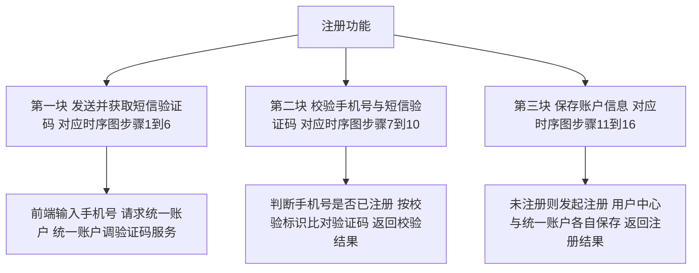

# 获取短信验证码的接口定义：注册功能编码的第一刀

统一账户微服务搭好了，验证码服务跑起来了，万事俱备，开始编码。动手前先定拆解方案：注册功能按着时序图切成三块，一块一块击破，第一块是发送并获取短信验证码。而按项目立下的开发步骤，编码的起点不是实现而是契约：先把接口定义出来，前端依据它做页面，后端依据它写逻辑，谁也不用等谁。

## 先给结论

- 注册功能按时序图拆成三块：发送并获取短信验证码（步骤 1 到 6）、校验手机号与短信验证码（步骤 7 到 10）、保存账户信息（步骤 11 到 16），本课做第一块的接口定义。
- 项目的接口全部定义在 `finance-api` 模块，按服务分包，统一账户的接口放进 `com.study.finance.api.account` 包，接口名 `AccountAPI`。
- 方法签名抓两要素：参数是手机号，验证码得知道发给谁；返回是 `RestResponse`，校验标识 `key` 放在 `result` 里回传。
- `RestResponse` 是全项目统一的响应包装，三个字段 `code`、`msg`、`result`，微服务凡是往前端响应一律用它，不允许各接口自造结构。
- 接口定义完顺手在统一账户工程里实现 `AccountController`，先空实现占位，Swagger 注解同步加好，并行开发与接口文档立刻就有了锚点。

## 注册功能的三块拆解

拆解不是拍脑袋，是把时序图按消息往来切段：



三块对应三段交互，每块有自己的输入输出，能独立开发、独立自测。第一块的产出是验证码与校验标识，第二块消费校验标识做比对，第三块落库注册数据，前一块的输出正好是后一块的输入。本课聚焦第一块，而聚焦的方式不是直接写实现，是定义接口。

## 接口定义：包、接口、方法

项目早有约定：所有接口定义全部放 `finance-api`，且按服务分包，用户中心的接口进 `consumer` 包，统一账户的接口进 `account` 包，将来各服务再多也是同样规矩，便于管理。在 `com.study.finance.api.account` 包下新建接口 `AccountAPI`：

```java
package com.study.finance.api.account;

import com.study.finance.common.domain.RestResponse;
import io.swagger.annotations.ApiOperation;
import io.swagger.annotations.ApiImplicitParam;
import org.springframework.web.bind.annotation.GetMapping;
import org.springframework.web.bind.annotation.PathVariable;

import java.util.Map;

/**
 * 注册功能拆成三块：注册、登录、开户
 * 注册只保存用户基本信息，例如手机号，此时可以登录浏览，但不能交易；
 * 交易前必须开户，提供身份证、银行卡等要素。
 * 用户模型：姓名、性别、手机号等；账号信息：账号、密码、权限等。
 * 注册三步：1 发送并获取短信验证码 2 校验手机号和短信验证码 3 保存账户信息
 */
public interface AccountAPI {

    @ApiOperation("获取手机验证码")
    @ApiImplicitParam(name = "mobile", value = "手机号", required = true, dataType = "String")
    @GetMapping("/sms/{mobile}")
    RestResponse<Map<String, String>> getSMSCode(@PathVariable("mobile") String mobile);
}
```

方法名 `getSMSCode`，得到短信验证码，语义直白。两个要素值得抠一遍。**参数是手机号**：发送验证码的前提是知道发往哪个手机，前端把用户填的手机号通过路径传进来，`@GetMapping("/sms/{mobile}")` 与前端请求 `account/sms/手机号` 的调用方式一致，`@PathVariable` 负责从路径里取值。**返回是 `RestResponse`**：响应里除了成败状态，还要把本次校验标识 `key` 交给前端暂存，登录提交时前端会把它一起送回，所以泛型用 `Map` 承载键值对，`result` 中携带 `key`，与前端代码里 `res.data.result.key` 的取值口径对得上。接口与实现类的完整成品要等下一课功能实现后才有，此处按画面与本课写法补全，方法签名与路径以讲义和前端调用为准。

## RestResponse：微服务统一的响应包装

编码规范里反复强调一件事：整个项目后端微服务凡是向前端响应，数据一律封装进 `RestResponse`，这是全项目统一的安排，不是可选项。这个类在公共工程里，三个属性撑起整个结构：

```java
package com.study.finance.common.domain;

@JsonInclude(Include.NON_NULL)
@ApiModel(value = "RestResponse<T>", description = "响应通用参数包装")
public class RestResponse<T> {

    @ApiModelProperty("响应错误编码,0为正常")
    private int code;

    @ApiModelProperty("响应错误信息")
    private String msg;

    @ApiModelProperty("响应内容")
    private T result;

    public static <T> RestResponse<T> success() {
        return new RestResponse<T>();
    }

    public static <T> RestResponse<T> success(T result) {
        RestResponse<T> response = new RestResponse<T>();
        response.setResult(result);
        return response;
    }

    public static <T> RestResponse<T> validfail(String msg) {
        RestResponse<T> response = new RestResponse<T>();
        response.setCode(-2);
        response.setMsg(msg);
        return response;
    }

    @JsonIgnore
    public Boolean isSuccessful() {
        return this.code == 0;
    }
}
```

三个字段各司其职：`code` 是状态码，0 表示正常，非 0 表示异常，比如参数校验失败用 -2；`msg` 是提示信息，注册成功、验证码错误这类文案从后端给；`result` 是真正的业务数据，用泛型承载，放对象就是对象，放集合就是集合，灵活而不失约束。类里的一组静态方法是给调用方的便利封装：`success()` 表达成功无数据，`success(result)` 表达成功带数据，`validfail(msg)` 表达校验失败，前端取数时从 `result` 里拿，判断成败只看 `code`。响应结构全项目一个样，前端才能写出统一的请求封装与错误处理，这也是它被列为编码规范的原因。

## 表现层接口与顺手实现的 Controller

这个接口属于哪一层？前后端分离架构下，前端发请求直达后端的表现层，所以定义的这批接口全部是表现层接口。明确了层级，实现类的位置也就定了：不在 api 工程，在统一账户服务的 `controller` 包里。定义完接口顺手把实现类骨架搭出来，空实现占位：

```java
package com.study.finance.account.controller;

import com.study.finance.api.account.AccountAPI;
import com.study.finance.common.domain.RestResponse;
import io.swagger.annotations.Api;
import io.swagger.annotations.ApiImplicitParam;
import io.swagger.annotations.ApiOperation;
import lombok.extern.slf4j.Slf4j;
import org.springframework.web.bind.annotation.GetMapping;
import org.springframework.web.bind.annotation.PathVariable;
import org.springframework.web.bind.annotation.RestController;

import java.util.HashMap;
import java.util.Map;

@Slf4j
@RestController
@Api(value = "统一账户服务", tags = "Account", description = "统一账户服务API")
public class AccountController implements AccountAPI {

    @Override
    @ApiOperation("获取手机验证码")
    @ApiImplicitParam(name = "mobile", value = "手机号", required = true, dataType = "String")
    @GetMapping("/sms/{mobile}")
    public RestResponse<Map<String, String>> getSMSCode(@PathVariable("mobile") String mobile) {
        // 功能实现待业务层代码完成后填充，此处空实现占位
        return null;
    }
}
```

类上三样东西缺一不可：`@RestController` 声明它处理请求并返回数据；`implements AccountAPI` 实现刚定义的接口；`@Api` 描述整个类的用途。方法上的注解分两类：Swagger 注解 `@ApiOperation` 描述方法功能、`@ApiImplicitParam` 说明参数含义与类型，它们不改逻辑，只负责生成接口文档；Spring MVC 注解 `@GetMapping` 配置访问路径，手机号正是从路径占位符里取出来的。启动服务后打开 Swagger 页面，接口文档已经能看到这条定义，前端同学不用等实现就能开工。

空实现不是偷懒，是节奏。接口定义好、实现类挂上、文档生成出来，契约就算立住了；业务逻辑（读 `sms.url` 调验证码服务、拼校验标识）属于下一课的活，留 `return null` 占位，等业务代码完成后再填。这套「定义接口、顺手实现、空着业务」的节奏，后面每一个功能都会重复。

## 常见误区

- **接口定义进服务工程。** 错例：把 `AccountAPI` 写进 `finance-account-service` 里。正解：接口放 `finance-api` 并按服务分包，调用方与服务方共用一份契约；定义进服务工程，其他服务要调用时反而依赖不上。
- **返回类型随手定。** 错例：方法直接返回 `String` 或裸 `Map`。正解：统一返回 `RestResponse`，状态、提示、数据三段结构全项目一致，前端统一的请求封装才有依据。
- **实现类忘加 `@RestController` 或忘实现接口。** 错例：Controller 只写了方法没实现 `AccountAPI`，请求进来匹配不到；或者注解漏了，服务启动正常但接口 404。正解：类上 `@RestController` 加 `implements AccountAPI` 一起落，方法签名与接口保持一致。
- **路径变量取不出来。** 错例：`@GetMapping("/sms/{mobile}")` 里写了占位符，方法参数上却漏了 `@PathVariable`，拿到的值是空的。正解：占位符与参数一一对应，`@PathVariable` 别忘，前端调用路径 `account/sms/手机号` 要与之一致。

## 面试可能被问到的问题

1. 面试官追问：「接口为什么单独放一个 api 模块，直接写在服务里不行吗？」
   答：api 模块是契约的集中地。服务方实现它，调用方依赖它，一份接口双方共用，Feign 远程调用时它就是客户端契约。写在服务内部，调用方要么重复定义要么直接依赖服务实现包，耦合就回来了。公共实体类同理放 api，与接口配套流转。
2. 面试官追问：「统一响应包装的价值是什么？」
   答：全项目前后端对响应结构的约定只有一份：状态码、提示信息、数据三段。前端可以写出统一的请求拦截与错误处理，判断成败看 `code`，提示用户看 `msg`，渲染数据取 `result`；后端新接口不用发明新结构，异常处理器也能按统一格式兜底。
3. 面试官追问：「你们说的表现层接口是什么意思？」
   答：前后端分离下前端请求直达后端的表现层，也就是 Controller 层，所以对外定义的接口都是表现层接口。它描述的是 HTTP 契约：路径、参数、返回，而不是内部 Service 方法。Service 是业务编排层，它的方法签名随实现自由，不对外承诺。
4. 面试官追问：「接口定义完为什么先写空实现？」
   答：为了并行开发。空实现让契约提前落地：Swagger 文档随注解生成，前端可以按文档开工，后端自测环境可以先起；业务代码随后填充，不影响契约。完成一个测一个的纪律也建立在骨架先行之上。
5. 面试官追问：「获取验证码接口的参数和返回，设计时要注意什么？」
   答：参数只留手机号，验证码发给谁由它决定；返回必须携带校验标识，前端暂存并在登录时回传，服务端靠它到 Redis 里取出当初的码比对。返回还要考虑验证码服务不可用的情况，用统一响应的非 0 状态码加提示表达失败，而不是抛裸异常给前端。

## 配套资料

- 代码：`materials/code/10/wanxinp2p_apollo/`，公共工程 `wanxinp2p-common` 内含真实 `RestResponse` 响应包装类（对应正文的 `finance-common`），工具类族也在其中；内层目录保留原始命名，引用路径列到工程目录为止。
- 代码：`materials/code/10/wanxinp2p_front/`，前端真实工程，`pages/user/login.vue` 中获取验证码后按 `res.data.result.key` 暂存校验标识、以 `account/sms/手机号` 发起 GET 请求，为正文接口签名的口径依据。
- 讲义：`materials/docs/10/万信金融-第2章-讲义-开户v1.0.md`，接口定义在 `AccountAPI`、实现落在 `AccountController` 的口径与讲义一致。
- 说明：统一账户工程为课程随堂新建，资料包内无 `AccountAPI` 与 `AccountController` 成品源码，正文两段代码为按画面线与本课写法补全的示例，包名按本系列 `com.study.finance` 口径改写；资料归档在 `materials/docs/10/` 与 `materials/code/10/`，目录编号与相邻阶段共用。
