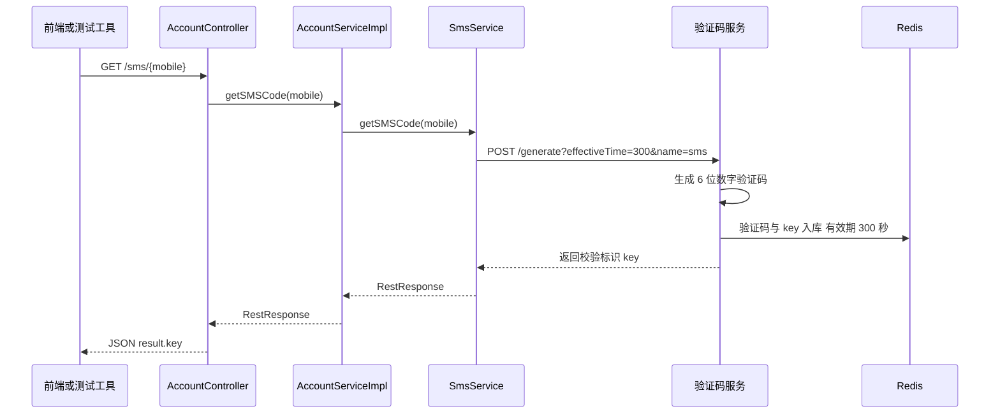
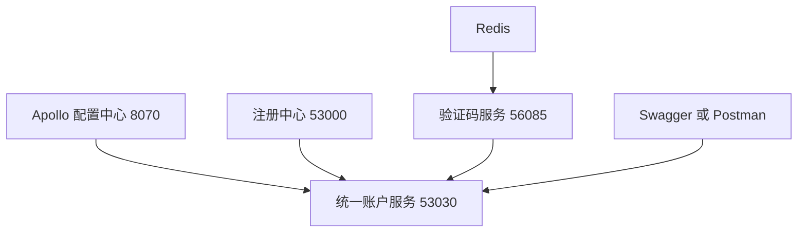

# 短信验证码的实现与测试：统一账户服务把生成的活儿转交给验证码服务

登录页上点一下「点击发送」，60 秒倒计时转起来了，请求也发出去了，后端却还在返回 null。获取短信验证码的接口此前已经按约定定义在表现层，前后端各自开工，现在轮到把空实现补成能跑的代码。真正动手时新的难点摆在面前：验证码并不由统一账户服务自己生成，而是要去调用一个第三方独立部署的验证码服务，这个服务没有注册进注册中心，顺手就能用的 Feign 在这里派不上用场。

更现实的考验在测试环节：五个进程要按依赖关系拉起来，Swagger 与 Postman 各测一遍，中间还穿插了一次远程调用超时的排障和一处少写 `$` 的低级失误。把这条链路完整走一遍，之后每个功能的测试都是同样的套路。

## 先给结论

- 分层落位很清晰：Controller 只做参数接收与转发，账户业务进 AccountService，验证码相关代码独立成 SmsService，获取与后续校验两处都能复用。
- 跨服务调用走 OkHttp：验证码服务是第三方独立部署的服务，没有注册到注册中心，Feign 按服务名调用的前提不成立；请求地址与功能开关全部从 Apollo 读取，不写死在代码里。
- 验证码由验证码服务生成并存入 Redis，有效期 300 秒；返回给调用方的是校验标识 key，验证码本身只流向用户手机或开发环境的控制台。
- 功能测试用两大神器各来一遍：Swagger 适合打开页面就点，Postman 适合把请求归档成集合反复执行；测试前按依赖顺序启动 Apollo、注册中心、Redis、验证码服务、统一账户服务五个进程。
- 排障两条主线：远程调用超时先确认目标服务是否存活；`@Value` 占位符少写 `$` 会让配置变成死字符串，读不到配置中心的真实值。

## 分层落位：Controller 之外的活儿交给谁

定义接口有一个约定俗成的口径：说「接口」指的就是表现层接口。前后端分离架构里，能跟前端打交道的是表现层，表现层的载体就是 Controller。接口一旦定下来，微服务这边按契约编写后端代码，前端按同一份契约编写页面代码，互不等待。现在 AccountController 里只剩一个返回 null 的空方法，补齐它的过程正好把三层职责重新排一遍。

这一步有个先天的好消息：获取验证码不碰数据库，数据访问层整个省掉，工作量集中在业务层。业务层在项目里延续「接口加实现类」的写法，先建业务接口 AccountService，把方法签名定下来：

```java
// 账户业务接口：方法签名与表现层接口保持一致
public interface AccountService {
    // 获取手机短信验证码
    RestResponse getSMSCode(String mobile);
}
```

参数与返回值都有讲究。参数 mobile 对应手机号，与 Controller 从路径里取到的变量同名同义。返回值不是验证码：验证码发到了用户的手机上，绝不能作为返回值回传前端；真正要回传的是一个校验标识，而且表现层接口已经约定了返回类型是 RestResponse，业务层照着这个口径设计即可。

写实现类之前先想清楚代码放哪。AccountServiceImpl 今后承载的是账户相关业务，验证码的获取、将来的校验虽然与账户有关，但逻辑上足够独立，塞进账户实现类里会让它越长越胖。于是把验证码相关的代码单独抽成一个业务类 SmsService，同样挂上 `@Service` 注解，获取验证码与校验验证码两个方法都放这里，AccountServiceImpl 只做一次委托：

```java
@Service
public class AccountServiceImpl implements AccountService {

    @Autowired
    private SmsService smsService;

    @Override
    public RestResponse getSMSCode(String mobile) {
        return smsService.getSMSCode(mobile);
    }
}
```

Controller 侧则保持着最薄的样子，路径变量接收后原样下传：

```java
@RestController
@Api(value = "统一账户服务", tags = "Account")
public class AccountController implements AccountAPI {

    @Autowired
    private AccountService accountService;

    @Override
    @ApiOperation("获取手机验证码")
    @ApiImplicitParam(name = "mobile", value = "手机号", dataType = "String")
    @GetMapping("/sms/{mobile}")
    public RestResponse getSMSCode(@PathVariable String mobile) {
        return accountService.getSMSCode(mobile);
    }
}
```

表现层接口 AccountAPI 在接口定义阶段已经给出，Controller 实现它并补上 Swagger 注解，文档页面上就能看到这个方法的请求方式、路径与参数说明。分层到这一步就位：Controller 管协议，AccountService 管账户业务的编排，SmsService 管验证码这一个领域的所有细节。

这条链上还有一层容易忽略的角色：网关。前端页面发出的真实请求其实先到网关（53010 端口），网关按路由规则把 `/account` 前缀的请求转发给统一账户服务，这是前后端约定好的统一入口。本课为了让问题聚焦在功能本身，测试时用工具直连统一账户服务的 53030 端口，绕过网关与用户中心，把变量降到最少。两种入口的区别只在中间是否多经过一跳，Controller 收到的请求一模一样；等链路上的服务都稳定了，再切回网关入口做联调，排查范围会小很多。

## 调用验证码服务：OkHttp、Apollo 与一条远程链路

SmsService 的核心问题是：怎么把「生成并发送短信验证码」这件事交给验证码服务去做。把整条链路画出来，后续编码、测试、排障都对着这张图走：



关键路径读一遍：验证码的生成与存储全部发生在验证码服务一侧，它把 6 位数字验证码连同 key 一起写进 Redis 并设置有效期，回给统一账户服务的只有 key。注册流程时序图上的前六步正好对应这条链，用户手机或开发环境的控制台能看到验证码，统一账户服务拿到的是那把「对答案用的钥匙」。

key 的设计也有细节可看。返回值以 sms 为前缀开头，说明验证码服务在 Redis 里给不同业务形态划了命名空间：同一套存储将来还要容纳图形、邮件等形态的验证信息，前缀把彼此隔离开，互不干扰。300 秒有效期交给 Redis 的过期机制保证，时间一到记录自动清除，验证码服务不需要写任何清理任务，这也是把「有效期」作为参数传给 `/generate` 的用意，不同业务可以给出不同的时效。

### 为什么用 OkHttp 而不是 Feign

Feign 面向的是注册中心里的服务名，要求被调方注册进来。验证码服务是第三方提供的独立服务，没有注册到 Eureka，Feign 的前提不成立，只能老老实实发 HTTP 请求。OkHttp 是专门干这件事的工具，基础工程的公共模块已经把它封装成了工具类 OkHttpUtil，对外暴露一个静态方法 `post(请求地址, JSON 参数)`，返回值直接就是 RestResponse，调用方不用碰任何 OkHttp 的原生 API。要在工程里使用它，先把依赖引入，坐标来自 OkHttp 官方：

```xml
<dependency>
    <groupId>com.squareup.okhttp3</groupId>
    <artifactId>okhttp</artifactId>
</dependency>
```

### 请求地址与功能开关都交给 Apollo

验证码服务部署在哪台机器、哪个端口，随时可能变化，这正是当初把它的基本访问路径放进 Apollo 的原因。地址写死在代码里，配置中心就白搭了。同一批配置里还有一个开关：短信验证码功能开还是关。关掉时系统走密码登录模式，代码里也要尊重这个开关。两个配置项都用 `@Value` 注入：

```java
@Service
public class SmsService {

    // 验证码服务的基本访问路径，来自 Apollo
    @Value("${sms.url}")
    private String smsURL;
    // 短信验证码功能开关，来自 Apollo
    @Value("${sms.enable}")
    private Boolean smsEnable;

    public RestResponse getSMSCode(String mobile) {
        // 短信验证码关闭时走密码登录模式，直接返回成功
        if (!smsEnable) {
            return RestResponse.success();
        }
        // 携带手机号的 JSON 参数，引号需要转义
        String params = "{\"mobile\":\"" + mobile + "\"}";
        // effectiveTime 单位为秒，300 即 5 分钟；name=sms 表示短信验证码
        return OkHttpUtil.post(smsURL + "/generate?effectiveTime=300&name=sms", params);
    }
}
```

请求路径的两段拼法要拆开看。`sms.url` 存的是基本访问路径，具体到「生成验证码」这个动作，还要拼上验证码服务暴露的子路径 `/generate`，并附带两个查询参数：`effectiveTime=300` 声明验证信息有效期 300 秒，短信里那句「验证码 5 分钟内有效」就是它换算出来的；`name=sms` 选择业务形态，验证码服务把短信、图形、邮件等多种验证码方式做成了可扩展的处理器，目前只实现了短信，参数固定传 sms。第二个参数是业务携带数据，JSON 格式的手机号。手工拼 JSON 字符串的写法有点绕，外层引号包住整段字符串，内部的引号全部用反斜杠转义，少一个转义符请求体就变了形。

Apollo 控制台里统一账户服务的 application 名称空间下，加上这几个配置项：

```properties
sms.url = http://localhost:56085/sailing
sms.enable = true
```

`sms.url` 指向本机 56085 端口、上下文路径为 `/sailing` 的验证码服务；`sms.enable` 打开短信功能。若暂时没申请到真实的短信通道，验证码服务可以工作在控制台输出模式，验证码不进手机、直接打印在服务日志里，功能测试照样能跑通。

## 功能测试：启动清单与两大神器

代码写完不代表功能完成，功能测试要先回答一个问题：这次要启动哪些程序。答案不用背，对着调用链看参与者就行：



图上有两条依赖支线：验证码服务依赖 Redis 存放验证码，统一账户服务依赖 Apollo 拿配置、依赖注册中心做服务治理。Apollo 属于每次测试必起的基础设施，从引入配置中心那天起就是固定开场，剩下四个进程按依赖顺序拉起，控制台没有报错再动手测试。

测试工具用两大神器各来一遍。Swagger 这边，前提是 Apollo 里统一账户服务的配置已经包含 `swagger.enable = true`，以及 Spring MVC 全局异常捕获的那一条固定配置；这两个配置几乎每个微服务工程都要配，检查一遍没有就补上。浏览器打开 `http://localhost:53030/account/swagger-ui.html`，53030 是统一账户服务的端口，`/account` 是它的基本访问路径，`swagger-ui.html` 是文档页的固定写法。展开「获取手机验证码」这一项，页面上明明白白标着 GET 请求、路径参数 mobile、字符串类型。点 Try it out，输入一个真实可用的手机号（示例用 `13xxxxxxxxx` 占位），点 Execute：

```json
{
  "code": 0,
  "msg": "",
  "result": {
    "key": "sms:xxxxxxxx"
  },
  "content": null
}
```

状态码 200，响应体里 `result.key` 就是校验标识，以 sms 为前缀的一大串字符，将来校验验证码时凭它去对答案。验证码本身此刻已经出发：控制台输出模式下，验证码服务把 6 位数字直接打印在自己的日志里；真实短信模式下，用户手机收到一条写着验证码与有效期的短信。开发阶段用控制台模式最方便，看到日志里的 `xxxxxx` 就能继续往下走。

Postman 这边把同样的请求归档成资产。在统一账户服务的集合下新建请求，命名为获取短信验证码，请求方式选 GET，URL 直接从 Swagger 页面抄：`http://localhost:53030/account/sms/13xxxxxxxxx`。手机号拼在路径里，这是 REST 风格的路径参数，Params 区不用再填。点 Send，返回的 JSON 与 Swagger 完全一致。两个工具测的是同一个接口，Postman 的价值在于请求可保存、可重放，后续每实现一个接口就往集合里添一条，回归测试时逐条点过去。

两个工具的分工不必纠结成单选题。Swagger 强在「所见即所测」，接口的注解写完文档就生成，参数含义、类型一目了然，适合第一次验证一个新接口；Postman 强在「请求是资产」，集合、命名、环境变量都可以沉淀下来，适合把已经稳定的功能圈起来反复跑。本课之后的习惯是每个接口先在 Swagger 上点通，再在 Postman 里归档，两边都绿才算测试通过，后面篇幅里就不再每次双份演示，以 Postman 为主。

## 排障实录：一次超时与一处少写的 `$`

Postman 点 Send 后出现了意外：请求超时，响应迟迟不回来。看调用栈，异常落在了工具类的远程调用处，含义很直接：统一账户服务连不上验证码服务。沿着链路逐段核对，Redis 在、Apollo 在、统一账户服务在，唯独验证码服务的进程停了。重新拉起验证码服务，再点一次 Send，key 正常返回，控制台也打出了新的验证码。这次排障给出的经验值得固化：远程调用超时，按调用链从发起方逐段往目标排查，先确认目标服务是否存活，再看地址与端口是否一致，最后才怀疑代码。

编码过程中的另一个插曲是占位符少写了一个 `$`。`@Value` 里写的是 `{sms.url}` 而不是 `${sms.url}`，少了 `$` 之后花括号不再是占位符语法，Spring 把它当成普通字符串注入，配置中心里的真实值永远进不来，Boolean 类型的开关还会因为字符串无法转换在启动时直接报错。这类问题编译器查不出来，属于典型的细心活，写配置注入时把 `${}` 当成一个整体记。

## 常见误区

- **把验证码当接口返回值。** 错例：getSMSCode 返回验证码字符串，前端顺手展示在页面上。正解：返回 RestResponse 包裹的校验标识 key，验证码只在验证码服务与用户手机（或开发环境控制台）之间流动，接口响应里永远不出现明文验证码。
- **把验证码服务地址写死在代码里。** 错例：`OkHttpUtil.post("http://localhost:56085/sailing/generate?...", params)` 直接硬编码。正解：地址存进 Apollo 的 `sms.url`，用 `@Value` 注入后拼接子路径，换环境只改配置不改代码。
- **忘了开 Swagger 的开关就去测接口。** 错例：文档页打不开或 404，回头怀疑工程搭建有问题。正解：哪个工程要用 Swagger，哪个工程在 Apollo 的配置里就要有 `swagger.enable = true` 与全局异常捕获配置，测之前先检查这两项。
- **把 key 当成验证码，或者把两者混在一个概念里说。** 正解：key 是服务端用来定位 Redis 中验证码记录的标识，随接口返回给前端暂存；验证码是发给用户的那串数字，提交时与 key 一起送回服务端比对，二者缺一不可但角色完全不同。

## 面试可能被问到的问题

1. 面试官追问：「调用验证码服务为什么用 OkHttp 而不用项目里现成的 Feign？」
   答：Feign 基于注册中心按服务名发起调用，前提是双方都注册进了注册中心。验证码服务是第三方独立部署的服务，不在 Eureka 里，Feign 的服务发现帮不上忙，只能直接发 HTTP 请求。工程里用封装好的 OkHttp 工具类，调用方式收敛成一个静态方法，地址与开关交给配置中心管理。
2. 面试官追问：「接口为什么不把验证码直接返回，而要返回一个 key？」
   答：验证码是发给用户输入用的凭据，回传到前端等于把答案同时给了答题人和出题人所在页面，自动化脚本可以直接读取，验证码就失去了意义。服务端生成验证码后存入 Redis 并关联一个 key，接口只返回 key；校验时用户提交验证码，服务端凭 key 取出答案比对，明文验证码不进入不必要的环节。
3. 面试官追问：「`/generate?effectiveTime=300&name=sms` 这两个参数分别控制什么？」
   答：effectiveTime 是验证信息在服务端的有效期，单位秒，300 秒对应短信文案里的 5 分钟内有效，过期即失效；name 用来选择验证码的业务形态，服务端按 name 路由到不同的处理器，目前支持短信形态，将来扩展图形、邮件验证码时不必改调用方的代码结构，换个 name 即可。
4. 面试官追问：「短信验证码接口怎么防刷？」
   答：多层手段叠加。前端做手机号格式校验与 60 秒倒计时按钮，压住连点；验证码有效期短，出错次数与发送频率可在服务端限制；功能开关提供降级能力，把短信验证码关掉后系统切换到密码登录模式；真实生产还要叠加图形验证码或 IP 维度的频控，防止同一号码被脚本反复触发。
5. 面试官追问：「如果验证码服务不可用，用户端会感知到什么，服务端能做什么？」
   答：用户端表现为点击发送后长时间无响应或提示失败，前端允许稍后重试。服务端要给远程调用设置超时时间，失败时记录错误日志并返回友好提示，而不是无限等待；配置中心的 `sms.enable` 开关可以把短信验证码整体降级，配合密码登录模式保证主流程可用，同时接入告警让运维尽快恢复验证码服务。

## 配套资料

- 讲义：`materials/docs/10/万信金融-第2章-讲义-开户v1.0.md`，注册功能的业务流程与时序图为本课调用的依据，验证码相关步骤对应其中实现注册功能部分。
- 讲义：`materials/docs/10/验证码服务使用指南.md`，验证码服务的部署方式、生成与校验两个接口的参数表（name、payload、effectiveTime）为正文调用参数的出处。
- 代码：`materials/code/10/sailing/`，验证码服务源码归档，生成与校验的接口定义、Redis 存储实现均可对照；内层目录保留原始命名，引用路径列到工程目录为止。
- 代码：`materials/code/10/wanxinp2p/`，统一账户服务的 OkHttp 依赖坐标出自该归档工程的父级 pom；内层目录保留原始命名，路径只列到该层级。
- 说明：统一账户服务与短信业务类的代码随课程编码完成，资料归档未单独收录，正文按画面线与本课写法补全，包名按 `com.study.finance` 系改写；OkHttpUtil 工具类出自课程基础工程公共模块，归档中未含其源码，调用方式以画面线为准。
