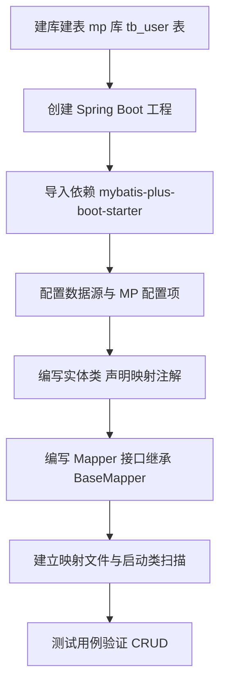

# MyBatis-Plus 简介与快速入门：不写 SQL 的单表增删改查从哪来

> 🔒 安全提示：文中示例的口令/密钥均为课程教学环境演示口径，生产环境的安全要求见《安全与合规须知》。

注册功能推进到第二块：校验手机号与验证码。判断手机号是不是新用户，绕不开查账户表，操作数据库的能力成了必需品。可以用 JDBC 手写连接与结果集映射，可以用 MyBatis 写接口配 XML，也可以用一种更省力的方式。这个项目选择了 MyBatis-Plus，一套建立在 MyBatis 之上、号称「只做增强不做改变」的框架。对它的疑问通常有两类：它凭什么不写 SQL 就能增删改查，以及它和 MyBatis 的关系到底是什么。把定位、特性与一套完整跑通的入门案例摆在一起，这两问就有答案了。

## 先给结论

- MyBatis-Plus（简称 MP）是 MyBatis 的增强工具，在 MyBatis 的基础上只做增强、不做改变，MyBatis 原有的用法全部保留，学习成本低，由苞米豆（baomidou）组织开源。
- 它不写 SQL 的底气来自注解与 SQL 模板：实体类用注解声明表名与字段映射，框架反射提取注解信息，按模板生成基本 CRUD 的 SQL，再注入 MyBatis 环境。
- 自定义 Mapper 接口只要继承 BaseMapper 并把实体类作为泛型传入，插入、删除、更新、按主键查询等通用方法立即拥有。
- 快速入门七步：建库建表、建 Spring Boot 工程、导依赖、写配置、编实体、编 Mapper、改启动类；MP 相关配置起步只需 `mapper-locations` 与 `type-aliases-package` 两条。
- 简单的 CRUD 操作甚至可以不用 XML，但接口对应的映射文件仍然是常规配置，`@MapperScan` 扫描包路径一个都不能少。

## MP 是什么：MyBatis 的搭档，不是替代者

MP 的官方定义只有一句话：MyBatis 的增强工具，在 MyBatis 的基础上只做增强不做改变，为简化开发、提高效率而生。拆开看有两个关键词。「增强」意味着它不是一套全新的持久层框架，Mapper 接口、映射文件、`#{}` 占位符、动态 SQL 这些 MyBatis 的家当原封不动地继续用；「不做改变」意味着引入 MP 不会破坏现有工程，已有的 MyBatis 代码一行不用改，加依赖就能跑。对开发者最直接的好处是上手快：MyBatis 会什么，MP 就会什么，多出来的是一整套不用手写的通用能力。

它出自苞米豆（baomidou）组织，开源在 GitHub 与码云上，官网提供完整的配置手册。讲义里给它的定位写得很形象：愿做 MyBatis 最好的搭档，像双人配合的游戏里搭档互补、效率翻倍。合作的前提是分工明确，MP 负责把重复的样板代码接走，MyBatis 依然是底层引擎。

数据库支持面也比想象中宽。MySQL、MariaDB、Oracle、DB2、H2、HSQL、SQLite、PostgreSQL、SQL Server 都在支持之列，国产数据库如达梦、人大金仓同样适配，背后靠的是不同数据库方言的 SQL 模板。学习阶段用 MySQL 即可，知道这个边界在选型讨论时有用：换了存储不等于换框架。

回到项目视角，选它还有一层顺理成章的原因。微服务基础工程的通用配置里，早已按类别划分好名称空间，其中一格就是留给 MyBatis-Plus 的，持久层的路线在工程骨架搭建阶段已经规划完毕。现在轮到账户相关功能要动数据库，把这条路线真正用起来，既补齐了校验手机号功能需要的查库能力，也让后续发标、投标等重数据库的业务有了统一的持久层方案。

按模块看它的构成更清楚：

- **core 核心模块**：在 MyBatis 之上封装的基础能力，内置通用 Mapper 与 Lambda 表达式查询，注解与 SQL 注入逻辑都在这里。
- **annotation 注解模块**：`@TableName`、`@TableId`、`@TableField` 等注解的定义，实体与表的映射关系靠它们声明。
- **extension 扩展模块**：分页插件、通用 Service 封装、性能分析插件等扩展能力，用得越深碰到的越多。
- **generator 代码生成器**：按表反向生成 Mapper、实体、Service、Controller 各层代码，新表接入时省去大量样板劳动。

它凭什么能在不写 SQL 的前提下干活？讲义把执行流程概括成三步：扫描注解 Entity，反射提取注解信息，比如表名称、字段名称；分析注解信息并基于内置的 SQL 模板生成基本 CRUD 的 SQL；把这些 SQL 注入到 MyBatis 环境中。换成人话：实体类上的每个注解都在告诉框架「对象对应哪张表、属性对应哪个字段」，框架据此自动拼出 `INSERT INTO tb_user (...) VALUES (...)` 这类标准语句，再挂到 MyBatis 的执行体系上。所以继承 BaseMapper 之后「魔术般拥有 CRUD 功能」并不是魔法，前提是映射注解写得正确。

## 特性盘点：增强都增强了什么

讲义列出的特性有十几条，不必逐条背，按「日常用到的频率」挑重点认识。读特性清单有个窍门：每条特性都对应一类此前的痛点，无侵入对应换框架的成本，通用 CRUD 对应样板代码，主键策略对应分布式下的主键冲突。理解痛点再记特性，比背名词牢固得多。

- **无侵入、损耗小**：引入即生效，启动时自动注入基本 CRUD，对既有工程没有改造负担。
- **强大的 CRUD 操作**：内置通用 Mapper 与通用 Service，少量配置就能覆盖单表绝大部分增删改查，还配备条件构造器处理各类查询条件。
- **支持 Lambda 调用**：查询条件可以写成 `User::getName` 这样的方法引用，字段名写错在编译期就暴露，不必等运行时。
- **主键自动生成**：内置多种主键策略，包含数据库自增、手动输入、UUID 以及面向分布式的全局唯一 ID 生成器，通过注解一个属性就能切换。
- **内置分页插件**：基于物理分页，配置好插件后写分页查询等同于写普通 List 查询。
- **内置性能分析与全局拦截插件**：前者输出 SQL 与执行时间便于揪慢查询，后者能阻断全表的 delete 与 update，防误操作；还有 SQL 注入剥离器预防注入攻击。
- **XML 热加载与无 XML 启动**：Mapper 对应的映射文件支持热加载，简单的 CRUD 操作甚至可以完全不提供 XML。
- **ActiveRecord 模式**：实体类继承 Model 基类后可以直接调用对象上的增删改查方法，写小型工具代码时更顺手。
- **关键词自动转义**：order、key 这类与数据库关键词撞名的字段会被自动加转义符，规避语法冲突。
- **内置代码生成器**：按表反向生成各层代码，支持模板引擎与自定义配置，新表接入的成本被压到最低。

这些能力在后续的功能开发里会逐一落到真实代码上：主键策略马上会在入门案例的插入操作里现出原形，条件构造器会在按条件更新与查询时登场，分页插件留给列表类业务再展开。此处先建立索引，哪个特性解决哪类问题，需要时知道去哪里找。

## 快速入门：七步搭出第一个 MP 工程

MP 操作数据库，第一步自然是准备库和表。创建数据库 `mp` 并指定字符集 utf8，然后建用户表并插入几条测试数据，之后的增删改查都围绕这张表进行。表结构与数据如下：

```sql
CREATE DATABASE `mp` CHARACTER SET 'utf8' COLLATE 'utf8_general_ci';

CREATE TABLE `tb_user` (
  `id` BIGINT(20) NOT NULL AUTO_INCREMENT COMMENT '用户ID',
  `user_name` VARCHAR(30) DEFAULT NULL COMMENT '用户名',
  `password` VARCHAR(30) DEFAULT NULL COMMENT '密码',
  `name` VARCHAR(30) DEFAULT NULL COMMENT '姓名',
  `age` INT(11) DEFAULT NULL COMMENT '年龄',
  `email` VARCHAR(50) DEFAULT NULL COMMENT '邮箱',
  PRIMARY KEY (`id`)
) ENGINE=InnoDB DEFAULT CHARSET=utf8;

INSERT INTO `tb_user` (`id`, `user_name`, `password`, `name`, `age`, `email`) VALUES
(1, 'zhangsan', '123456', '张三', 18, 'test1@example.com'),
(2, 'lisi', '123456', '李四', 20, 'test2@example.com'),
(3, 'wangwu', '123456', '王五', 28, 'test3@example.com');
-- 测试数据可再多插几条，方便后面观察查询结果
```

工程用 Spring Boot 搭建，新建 Maven 工程，GroupId 与 ArtifactId 按语义命名（示例为 `com.study.finance` 下的 `finance-mp-springboot`）。插数据这步看似例行公事，其实决定了后面每一步的观察质量：主键有没有自增、查询返回几条记录、更新影响的行数对不对，全靠这批已知数据当参照。测试数据里的密码属于演示值，与工程连接数据库用的真实密码是两回事，后者在本课程环境里统一是 root 配 123456。依赖清单里真正与 MP 相关的只有一条，其余是常规搭配：

```xml
<parent>
    <groupId>org.springframework.boot</groupId>
    <artifactId>spring-boot-starter-parent</artifactId>
    <version>2.1.3.RELEASE</version>
</parent>

<dependencies>
    <dependency>
        <groupId>org.springframework.boot</groupId>
        <artifactId>spring-boot-starter</artifactId>
    </dependency>
    <dependency>
        <groupId>org.springframework.boot</groupId>
        <artifactId>spring-boot-starter-test</artifactId>
        <scope>test</scope>
    </dependency>
    <!-- 简化实体类的工具包 -->
    <dependency>
        <groupId>org.projectlombok</groupId>
        <artifactId>lombok</artifactId>
        <optional>true</optional>
    </dependency>
    <!-- MP 与 Spring Boot 整合的启动器 -->
    <dependency>
        <groupId>com.baomidou</groupId>
        <artifactId>mybatis-plus-boot-starter</artifactId>
        <version>3.1.0</version>
    </dependency>
    <!-- MySQL 驱动 -->
    <dependency>
        <groupId>mysql</groupId>
        <artifactId>mysql-connector-java</artifactId>
        <version>8.0.11</version>
    </dependency>
</dependencies>
```

版本规划记住一组数：Spring Boot 2.1.3.RELEASE 配 MP 3.1.0，MySQL 驱动 8.0.11。导错启动器是新手高频事故，认准 `mybatis-plus-boot-starter`，不要拿成 MyBatis 自己的 starter，两者的自动配置类完全不同。

配置文件里先写数据源，再补 MP 的两条配置。课程环境的 MySQL 账号是 root、密码 123456，改成自己的实际值即可：

```properties
spring.application.name=finance-mp-springboot
spring.datasource.driver-class-name=com.mysql.cj.jdbc.Driver
spring.datasource.url=jdbc:mysql://127.0.0.1:3306/mp?useUnicode=true&characterEncoding=UTF-8&serverTimezone=Asia/Shanghai&useSSL=false
spring.datasource.username=root
spring.datasource.password=123456
# Mapper 接口对应的 XML 文件位置，工程把映射文件统一放在 resources/mybatis/mapper 下
mybatis-plus.mapper-locations=classpath*:mybatis/mapper/*.xml
# 实体类别名扫描包
mybatis-plus.type-aliases-package=com.study.finance.mp.pojo
# 开发期观察 SQL，临时打开
logging.level.root=debug
```

`mapper-locations` 指向映射文件所在的路径，`classpath*:mybatis/mapper/*.xml` 会把该目录下所有 XML 扫进来；`type-aliases-package` 给实体包注册别名，映射文件里写 `user` 就能代替全路径类名，不配也不影响运行，只是写起来长一些。MP 的配置体系里还有大量条目，入门阶段这两条够用。

值得停一下的是别名机制，它解释了映射文件里 `resultType` 为什么可以写得很短。别名注册发生在工程启动时，扫描包里的每个实体类都会被登记，登记名就是类名的小写形式。此后凡是需要填写实体类型的地方，别名与全路径类名等价。省掉的是长串包名，换来的是映射文件的可读性，代价几乎为零，所以这条配置在团队工程里通常都会保留。

实体类对应 `tb_user`，每个属性与一个字段对齐。类上的 Lombok 注解负责生成样板方法：`@Data` 生成 getter 与 setter，`@NoArgsConstructor` 与 `@AllArgsConstructor` 生成无参和全参构造，类里看不到这些方法但它们真实存在，编译期由 Lombok 补齐。映射注解负责告诉框架对象与表的关系：`@TableName` 声明表名，`@TableId` 标记主键字段，`@TableField` 声明普通字段：

```java
package com.study.finance.mp.pojo;

import com.baomidou.mybatisplus.annotation.TableField;
import com.baomidou.mybatisplus.annotation.TableId;
import com.baomidou.mybatisplus.annotation.TableName;
import lombok.AllArgsConstructor;
import lombok.Data;
import lombok.NoArgsConstructor;

@Data                    // 生成 getter/setter 等方法
@NoArgsConstructor       // 生成无参构造
@AllArgsConstructor      // 生成全参构造，参数顺序与属性定义顺序一致
@TableName("tb_user")   // 实体对应的表名
public class User {

    // 主键字段，value 指定列名
    @TableId("id")
    private Long id;

    // 非主键字段，value 指定列名
    @TableField("user_name")
    private String userName;

    @TableField("password")
    private String password;
    @TableField("name")
    private String name;
    @TableField("age")
    private Integer age;
    @TableField("email")
    private String email;
}
```

属性名与列名满足驼峰对应关系时（`userName` 对 `user_name`），注解可以省略，框架默认开启驼峰映射；示例里保留显式注解，映射关系一眼可查，也避免了列名大小写差异带来的歧义。

这套注解做的事，专业说法叫 ORM 映射，对象关系映射：数据库里一行数据是一个元组，Java 世界里同一行数据是一个对象，两边字段如何对齐需要一份契约。没有 MP 时这份契约写在映射文件的 resultMapping 里，有了 MP 它前置到了实体类的注解上。框架拿到 `@TableName("tb_user")` 就知道 User 对应哪张表，拿到 `@TableField("user_name")` 就知道 userName 属性对应哪个字段，操作对象等于操作表，操作属性等于操作字段。省掉的不只是 XML 的书写量，更是「改一个字段要同步两处」的维护负担。

两个细节顺手交代。其一，属性类型尽量用包装类，`Long` 与 `Integer` 而不是 `long` 与 `int`：包装类多一个 null 状态，能区分「没有值」与「值是 0」，这对后面「按非空字段更新」这类行为有直接影响。其二，实体类里看不到 getter 与 setter 不代表没有，Lombok 在编译期补齐，IDEA 里装上 Lombok 插件后方法提示正常出现；`@AllArgsConstructor` 生成的全参构造参数顺序与属性声明顺序一致，字段调整顺序时构造器的调用方也要跟着变，这是 Lombok 少数要留心的副作用。

Mapper 接口是整个入门案例里最「空」也最关键的一段代码。按 MyBatis 的习惯放到 mapper 包下，与以往不同的是，它必须继承 MP 提供的 BaseMapper 并把实体类作为泛型传入：

```java
package com.study.finance.mp.mapper;

import com.baomidou.mybatisplus.core.mapper.BaseMapper;
import com.study.finance.mp.pojo.User;

// 继承 BaseMapper 并指定实体泛型，通用 CRUD 方法直接可用
public interface UserMapper extends BaseMapper<User> {
}
```

跟进 BaseMapper 的源码能看到答案：这个接口里定义了一整套增删改查方法，方法名见名知义，插入、按主键删除、按主键更新、按主键查询一应俱全。自定义接口一旦继承它，这些方法全部被继承下来；泛型指定的 User 告诉框架生成 SQL 时以哪个实体为准，表名与字段名则来自实体类上的注解。整条链路串起来就是：注解提供映射关系，BaseMapper 提供方法签名，框架负责按模板生成 SQL。

配套的映射文件照 MyBatis 的老规矩建一个，放在 `resources/mybatis/mapper` 下，与配置里的 `mapper-locations` 对齐；目前不写任何自定义语句，只保留 namespace 指向接口全路径：

```xml
<?xml version="1.0" encoding="UTF-8" ?>
<!DOCTYPE mapper
        PUBLIC "-//mybatis.org//DTD Mapper 3.0//EN"
        "http://mybatis.org/dtd/mybatis-3-mapper.dtd">
<mapper namespace="com.study.finance.mp.mapper.UserMapper">
</mapper>
```

启动类补一个 `@MapperScan`，把 Mapper 接口所在的包交给 MyBatis 扫描，框架据此为每个接口生成代理对象，注入到容器里：

```java
@SpringBootApplication
@MapperScan("com.study.finance.mp.mapper")
public class MpApplication {
    public static void main(String[] args) {
        SpringApplication.run(MpApplication.class, args);
    }
}
```

到这里，工程里 MP 的全套家当已经就位：pom 里的依赖、配置文件里的两条 MP 配置、带映射注解的实体、继承 BaseMapper 的接口、配套映射文件、加了 `@MapperScan` 的启动类。六件东西彼此咬合，任何一件错位都会在启动或测试阶段报错。下一件事是写一个测试用例，验证这套东西真的能对数据库干活。

把入门的全过程收进一张图，步骤与产物一一对应：



从建表到工程骨架，顺序不能乱：实体类的注解要与表结构一致，映射文件的路径要与配置一致，扫描包要与 Mapper 实际所在包一致。三处对齐之后，测试用例就能直接调用通用方法了。

还有一个容易较真的问题：那对配置到底是不是必需的。严格说两条都可以省，通用 CRUD 的 SQL 是框架按注解生成的，不依赖映射文件，实体别名不注册也只是写法上长一点。保留它们是工程习惯的延续：`mapper-locations` 为将来手写复杂 SQL 的映射文件预留了位置，`type-aliases-package` 让手写部分的 resultType 保持简洁。配置的价值不在当下，而在工程往深处走时不用再回头改骨架。

## 常见误区

- **把 MP 当全新框架，担心 MyBatis 白学了。** 正解：MP 在 MyBatis 基础上只做增强不做改变，原有接口、XML、注解写法全部兼容，通用 CRUD 是加法不是替换。
- **依赖导错，拿成 MyBatis 自己的 starter。** 错例：引入 `mybatis-spring-boot-starter` 之后通用方法不存在。正解：MP 的整合依赖是 `mybatis-plus-boot-starter`，版本按讲义规划取 3.1.0。
- **实体与表对不上还找不到原因。** 错例：属性 `userName` 对应列 `user_name`，没写 `@TableField` 又关闭了驼峰映射，查询结果全是 null。正解：保持默认驼峰映射，或显式写注解；列名与属性名必须有一层明确的对应关系。
- **漏掉 `@MapperScan` 或扫描包写错。** 错例：测试类注入 UserMapper 时报找不到 Bean。正解：启动类或配置类上用 `@MapperScan` 声明 Mapper 接口所在包，路径与实际包名逐字核对。

## 面试可能被问到的问题

1. 面试官追问：「MyBatis-Plus 和 MyBatis 是什么关系？」
   答：MP 是 MyBatis 的增强工具，不是替代框架。它在 MyBatis 之上做加法：内置通用 Mapper 自动生成单表 CRUD 的 SQL，同时保留 MyBatis 全部原生能力，映射文件、动态 SQL 照常使用。引入 MP 的工程随时可以混用两种方式，灵活性不受影响。
2. 面试官追问：「不写 SQL 就能增删改查，它是怎么做到的？」
   答：三步。扫描实体类上的注解，反射提取表名与字段映射；基于注解信息和内置 SQL 模板生成基本 CRUD 语句；把这些语句注入 MyBatis 环境，挂到 Mapper 接口的方法上。所以继承 BaseMapper 后调用的方法背后依然是标准的 SQL，只是生成过程自动化了。
3. 面试官追问：「BaseMapper 的泛型起什么作用？」
   答：泛型把 Mapper 接口与具体实体绑定。框架根据泛型找到实体类，再从 `@TableName`、`@TableId`、`@TableField` 注解里读出表与字段的映射，据此为这个接口生成专属的 CRUD 语句。不指定泛型，SQL 生成就没有依据。
4. 面试官追问：「MP 支持哪些主键生成策略？」
   答：内置多种策略，通过 `@TableId` 的 type 属性选择：数据库自增、手动输入、UUID，以及内置的分布式全局唯一 ID 生成器。单表小应用用自增，分布式场景用全局唯一 ID 避免主键冲突，切换只改一个注解属性。
5. 面试官追问：「什么场景适合用 MP，什么场景仍然离不开手写 SQL？」
   答：单表的增删改查、分页与简单条件查询是 MP 的强项，样板代码几乎为零；多表关联、复杂统计与高度优化的 SQL 仍应回到 MyBatis 的映射文件手写。MP 的价值在消灭重复劳动，而不是取代 SQL 能力，两者在同一个工程里按场景混用是常态。

## 配套资料

- 讲义：`materials/docs/10/Mybatis-Plus讲义v1.0.md`，MP 的定位表述、四大模块与执行流程、特性清单、建表脚本与版本规划均出自该讲义。
- 代码：`materials/code/10/mp-springboot/`，MP 快速入门工程归档，依赖清单、配置项、实体注解、Mapper 接口与启动类均可对照；内层目录保留原始命名，引用路径列到工程目录为止。
- 说明：归档工程的实体类比正文示例多一个 `birthday` 字段并配有 `mybatis-config.xml`，正文按视频画面线精简为六字段版本，包名按 `com.study.finance` 系改写；数据库账号密码按课程口径取 root 与 123456。
