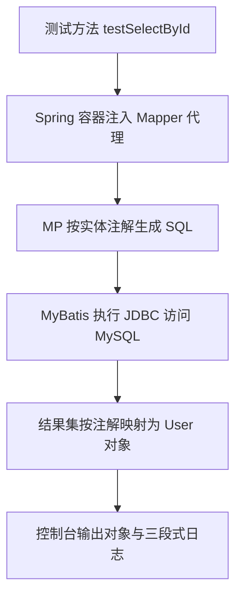

# MyBatis-Plus 入门案例测试：一个查询方法点亮整条链路

> 🔒 安全提示：文中示例的口令/密钥均为课程教学环境演示口径，生产环境的安全要求见《安全与合规须知》。

工程骨架搭完了，依赖、配置、实体、Mapper、启动类全部就位，但「就位」不等于「能用」。验证的方式是一个再简单不过的测试用例：按主键查一条用户记录。恰恰是这个最小用例最能说明问题，它把代理对象注入、SQL 自动生成、结果封装、日志观察这条完整链路全部点亮，任何一个环节断了都会当场报错。测试通过之后再去看控制台里滚过的日志，MP 的工作方式也就看得七七八八了。

## 先给结论

- 测试类用 `@SpringBootTest` 拉起完整容器，JUnit 4 口径下再加 `@RunWith(SpringRunner.class)`；注入 UserMapper 时拿到的不是接口本身，而是框架生成的代理对象。
- 接口里一个方法都没定义，增删改查方法照样全有，出处是继承来的 BaseMapper；SQL 由框架按实体注解生成，`selectById` 生成的就是按主键查询的标准语句。
- 控制台日志是观察 MP 的主窗口，三段式结构固定：Preparing 给出 SQL，Parameters 给出绑定参数，Total 或 Updates 给出影响行数。
- 启动日志里 MP 的 logo 一出现，说明 starter 的自动配置生效；`logging.level.root=debug` 打开后，SQL 日志才可见。
- 高频报错集中在三处：漏 `@MapperScan` 导致注入失败，实体注解与表结构对不上导致 SQL 错误，依赖或注解导错包导致测试跑不起来。

## 测试类怎么写：注入的是代理对象

测试类放在 test 目录下，与启动类同包最省事。四个注解撑起骨架：

```java
@RunWith(SpringRunner.class)
@SpringBootTest
public class UserMapperTest {

    @Autowired
    private UserMapper userMapper;

    @Test
    public void testSelectById() {
        // 根据主键查询，返回实体对象
        User user = userMapper.selectById(2L);
        System.out.println(user);
    }
}
```

`@SpringBootTest` 的作用是把整个 Spring Boot 容器跑起来再执行测试，数据源、MyBatis 环境、Mapper 代理一样不少，所以它比纯单元测试慢，但验证的是真实链路。`@RunWith(SpringRunner.class)` 是 JUnit 4 时代的写法，作用是把测试交给 Spring 的测试运行器接管，两个注解缺一不可：少了前者容器起不来，注入直接是 null；少了后者，某些环境下 `@Autowired` 同样失效。

值得较真的是注入这个动作本身。UserMapper 是接口，工程里没有任何类实现它，按常规理解注入应该直接失败。MyBatis 的机制在这里接手：启动类上的 `@MapperScan` 扫描到这个接口后，框架为它生成代理对象并注册进容器，`@Autowired` 拿到的是这个代理。代理对象里藏着完整的增删改查方法，IDEA 里点开 `userMapper.` 能看到一长串提示，这些方法没有一个来自接口自己的定义，全部继承自 BaseMapper。

两个导包细节在编译期就会拦人。其一是 User 实体，同名类在别的包里也有，手滑导入别的包后 `userMapper.selectById` 的返回类型对不上，报错看似莫名其妙，检查 import 即可。其二是测试框架本身，项目用的是 JUnit 4，`@Test` 要取 `org.junit.Test`，JUnit 5 的注解放在这套 `@RunWith` 组合里跑不起来。报错信息里出现 `InitializationError` 时，先核对这两处。

## 控制台里看什么：logo、SQL 与参数

直接运行测试方法，控制台先滚过一大段 Spring Boot 的启动日志，其中有一块 MP 的专属 logo，字符画拼出框架的名字。logo 出现即代表 `mybatis-plus-boot-starter` 的自动配置已经生效，SqlSessionFactory 等核心组件装配完成；如果连 logo 都没有，回头查依赖是不是拿错了 starter。

SQL 日志依赖日志级别。配置文件里 `logging.level.root=debug` 打开后，MyBatis 执行的每条语句都会以 DEBUG 级别输出。入门用例的输出固定是三段：

```text
==>  Preparing: SELECT id,user_name,password,name,age,email FROM tb_user WHERE id=?
==>  Parameters: 2(Long)
<==      Total: 1
```

三段各管一件事。Preparing 行是生成的 SQL，`?` 是占位符；Parameters 行是绑定进去的参数值与类型，`2(Long)` 对应调用时传入的主键 2；Total 行是查询结果行数，写操作同一位置则显示 Updates 与受影响行数。日志里这条 SQL 与手写的没有任何区别，区别在于它的出生方式：表名取自实体类的 `@TableName("tb_user")`，查询列取自各属性的映射注解，条件 `WHERE id=?` 则来自方法语义，`selectById` 天生按主键查。方法语义加注解信息，共同决定了这条 SQL 的长相，这也是 MP 不写 SQL 却能干活的直接证据。

最后一行打印结果对象：

```text
User(id=2, userName=lisi, password=123456, name=李四, age=20, email=test2@example.com)
```

一行查询结果被封装成了 User 对象，属性名与值一一对应。这个紧凑的输出格式是 Lombok `@Data` 生成的 `toString()` 的功劳，映射过程同样依赖注解声明的列与属性对应关系，`user_name` 列的值落进 `userName` 属性，靠的就是那层 ORM 契约。

换成查询全部记录的用例，观察点不变：

```java
@Test
public void testSelectList() {
    // 查询 tb_user 全部记录
    List<User> users = userMapper.selectList(null);
    for (User user : users) {
        System.out.println(user);
    }
}
```

`selectList` 的参数是查询条件包装器，传 null 表示不设条件，生成的 SQL 没有 WHERE 子句。日志里 Total 显示 5，与建表时插入的测试数据条数一致，数据对得上，链路就通了。

## 测试链路的全景

把一次测试执行的完整路径画出来，排障时按图逐段检查：



图上任何一环出问题都有典型的症状：容器起不来多半是配置或依赖问题；代理注入失败查 `@MapperScan`；SQL 报语法错或找不到表，回头核对实体注解与建表语句；映射结果为 null，检查列名与属性名的对应关系。顺藤摸瓜比盲目重试有效得多。

## 常见误区

- **以为注入的是接口的实现类。** 错例：在工程里找不到 UserMapperImpl 就以为缺了实现。正解：MyBatis 为 Mapper 接口生成代理对象并注册进容器，注入的是代理；接口继承 BaseMapper 后方法天然齐备。
- **测试类少了运行器注解。** 错例：只写 `@SpringBootTest`，某些环境下注入对象为 null，测试报空指针。正解：JUnit 4 口径下 `@RunWith(SpringRunner.class)` 与 `@SpringBootTest` 成对出现。
- **日志没输出 SQL 就断定 MP 没生效。** 正解：SQL 日志依赖 DEBUG 级别，配置里临时打开 `logging.level.root=debug`；另以启动日志里的 MP logo 作为自动配置生效的标志。
- **把 `selectList(null)` 当错误用法。** 正解：参数是条件包装器，null 表示无条件查询全表，这是合法语义；生产代码里避免无条件全表查询，测试与初始化场景无妨。

## 面试可能被问到的问题

1. 面试官追问：「Mapper 只是个接口，没有实现类，为什么能注入也能调用？」
   答：MyBatis 在启动阶段为 Mapper 接口生成动态代理对象并注册到容器，`@Autowired` 拿到的是代理。调用代理方法时，MyBatis 根据方法对应的 SQL 去执行数据库访问，MP 的通用方法同样挂在这套代理机制上，只是 SQL 来源换成了框架按注解与模板自动生成。
2. 面试官追问：「怎么确认一条 SQL 是 MP 生成的，而不是哪里手写的？」
   答：开 DEBUG 日志看输出，MP 生成的语句会带有 Mapper 接口全路径加方法名的日志头，例如按主键查询的语句对应 selectById；再对照实体注解核对表名与列名的来源。工程里只有 BaseMapper 继承关系而无映射文件语句时，这类 SQL 只能出自框架生成。
3. 面试官追问：「`@SpringBootTest` 和 `@RunWith(SpringRunner.class)` 各做什么？」
   答：`@SpringBootTest` 让测试在完整的 Spring Boot 容器中执行，数据源与 MyBatis 环境全部真实装配；`@RunWith(SpringRunner.class)` 是 JUnit 4 的运行器声明，让 Spring 的测试支持接管用例。两者配合才能在测试里完成依赖注入，缺一会在注入环节直接失败。
4. 面试官追问：「查询结果的日志里 Total: 1 和 Updates: 1 分别是什么？」
   答：Total 出现在查询类操作后，表示结果集行数；Updates 出现在插入、更新、删除后，表示受影响行数。两者都是日志对执行结果的汇报，配合 Preparing 与 Parameters 两行，一次数据库交互的 SQL、参数、结果三要素就齐了。

## 配套资料

- 讲义：`materials/docs/10/Mybatis-Plus讲义v1.0.md`，快速入门的测试用例、三段式 SQL 日志样例与常见配置说明均出自该讲义。
- 代码：`materials/code/10/mp-springboot/`，入门工程归档，测试类、`application.properties` 的日志配置与 Mapper 接口写法均可对照；内层目录保留原始命名，引用路径列到工程目录为止。
- 说明：正文测试代码与日志按视频画面线与讲义样例整理，包名按 `com.study.finance` 系改写，示例邮箱统一替换为 `example.com` 占位。
