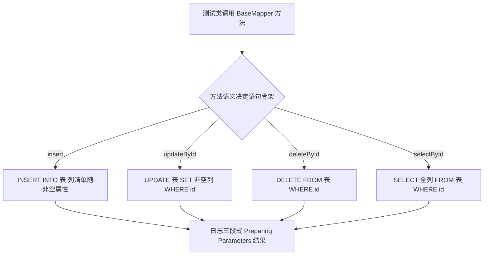

# MyBatis-Plus 增删改查实测：BaseMapper 的四个常用方法

入门案例只尝了一口甜头，selectById 查一条记录还不足以体会「不用写 SQL」的分量。BaseMapper 里躺着完整的增删改查方法集，挑最常用的四个逐个实测：insert、updateById、deleteById、selectById。每个方法都对着控制台日志看它生成的 SQL、参数与返回值，顺带把主键生成策略这个绕不开的话题讲透。实测的结论先行放在这里：调用方只关心对象与方法，SQL 细节全部交给框架。

## 先给结论

- 四个方法全部来自 BaseMapper，测试类里直接调用，不需要映射文件里写任何语句。
- `insert` 的返回值是受影响行数，不是主键；主键值在插入后自动回填到实体对象，`user.getId()` 直接可取。
- 主键策略由 `@TableId` 的 type 属性控制，默认生成的全局唯一 ID 是一长串数字，改成数据库自增用 `IdType.AUTO`。
- `updateById` 只把对象中不为 null 的属性更新进表，SQL 的 SET 子句随非空字段动态伸缩；调用前必须给主键赋值。
- `deleteById` 按主键删一行，主键不存在时返回 0 而不报错，返回值判断是必要习惯。

## 插入：insert 与主键回填

新写一个测试类，注入 UserMapper 之后逐个方法过。插入对应 insert 方法，参数是实体对象：

```java
@Test
public void testInsert() {
    User user = new User();
    user.setUserName("caocao");
    user.setPassword("111111");
    user.setName("曹操");
    user.setAge(30);
    user.setEmail("123@example.com");
    // 返回受影响行数
    int result = userMapper.insert(user);
    System.out.println("result = " + result);
}
```

运行后先看日志，再查表。日志里生成的 INSERT 语句随非空属性而变，给哪些属性赋了值，语句的列清单里就出现哪些列：

```text
==>  Preparing: INSERT INTO tb_user ( user_name, password, name, age, email ) VALUES ( ?, ?, ?, ?, ? )
==>  Parameters: caocao(String), 111111(String), 曹操(String), 30(Integer), 123@example.com(String)
<==    Updates: 1
```

三段日志各有所指：Preparing 是生成的语句，Parameters 是按列顺序绑定的参数，Updates: 1 表示一行受影响，这与 insert 的 int 返回值一致。刷新表数据，新行确实落库，但主键一眼假不了：建表时留了六条 id 为 1 到 6 的数据，新行的主键不是期望中的 7，而是一长串由框架生成的全局唯一数字。代码里并没有给 id 赋值，这个值从哪来？答案在主键生成策略：MP 默认的 IdType 会按内置算法生成分布式环境友好的全局唯一 ID，不需要数据库自增参与，也不需要调用方操心。

生成的主键没有丢，它自动回填到了刚才那个对象里。在测试里补一行 `System.out.println(user.getId())`，打印出来的就是新行的主键，与表里看到的完全一致。想用自增主键的话，改实体注解一个属性即可：

```java
@TableId(value = "id", type = IdType.AUTO)
private Long id;
```

IdType 是 MP 提供的枚举，取值各有分工：AUTO 表示数据库自增，NONE 表示不设置，INPUT 表示调用方手动提供主键，ID_WORKER 与 ID_WORKER_STR 是全局唯一 ID 的数值与字符串形态，UUID 则生成字符串唯一值。改回 AUTO 再跑一次插入，新行的主键变成了普通的递增数字，在表中现有最大主键的基础上加一；表数据有过删改时，递增的基准是当前最大行，不是行数。两种策略没有优劣，单机小项目用 AUTO 简单直观，分库分表场景里全局唯一 ID 才是主角。

## 更新：updateById 只动非空字段

更新按主键进行，方法名 updateById 已经把语义说完了：

```java
@Test
public void testUpdateById() {
    User user = new User();
    // 主键必须赋值，它决定更新哪一行
    user.setId(6L);
    // 只改年龄
    user.setAge(21);
    int result = userMapper.updateById(user);
    System.out.println("result = " + result);
}
```

生成的 SQL 短得出奇：

```text
==>  Preparing: UPDATE tb_user SET age=? WHERE id=?
==>  Parameters: 21(Integer), 6(Long)
<==    Updates: 1
```

对象里只有 id 与 age 被赋值，SET 子句里就只有 age 一列；用户名、密码这些没赋值的属性全部缺席，不会被改成 null。这个「非空才更新」的行为让局部修改变得顺手：new 一个对象、设主键、设要改的字段，三行代码完成一次定向更新。代价是它永远做不到「把某列清空」，null 不进 SET 子句，需要把字段更新为 null 时要借助条件构造器，那是按条件更新与删除章节的话题。表里刷新一眼，原年龄 28 的王五这行变成了 21， Updates: 1 与数据变化互相印证。

## 删除：deleteById 按主键干掉一行

删除是最简短的方法调用，给主键即可：

```java
@Test
public void testDeleteById() {
    // 按主键删除
    int result = userMapper.deleteById(6L);
    System.out.println("result = " + result);
}
```

日志与结果同样直白：

```text
==>  Preparing: DELETE FROM tb_user WHERE id=?
==>  Parameters: 6(Long)
<==    Updates: 1
```

DELETE 语句带着主键条件精准命中一行，Updates: 1，刷新表数据那一行已经不在。有个容易忽略的行为差异：删除一个不存在的主键，方法不报错，返回 0。这也是为什么每个写操作的返回值都值得接住并检查，按行数判断操作是否真的生效，比事后翻表可靠。批量删除、按条件删除的方法也在 BaseMapper 里，套路与这里一致，只是参数换成主键集合或条件构造器。

## 四个方法的共同套路

把实测过的四个方法放在一起看，套路完全一致：



调用方提供的是实体对象与主键，实体注解提供表与列的映射，方法名提供语句的骨架，三者拼装出最终 SQL。整个过程没有一行手写语句，没有一处 XML 配置，这就是 MP 为简化开发交出的答卷。条件更复杂的查询与更新靠条件构造器接力，单表大部分操作从此不再进入映射文件。

## 常见误区

- **把 insert 的返回值当主键。** 错例：`Long id = userMapper.insert(user)` 编译不过，或误以为返回的 1 是新行主键。正解：返回值是受影响行数，主键在插入后回填进实体对象，取 `user.getId()`。
- **updateById 前忘了给主键赋值。** 错例：new 对象后只设字段就执行更新，行为不符合预期。正解：主键决定 WHERE 条件，赋值是第一步；顺带记住非空字段才会进 SET 子句。
- **期望 updateById 能把字段清成 null。** 正解：按主键更新只处理非空属性，置空需求走条件构造器的 set 语法，或调整业务设计避免物理置空。
- **删除与更新不看返回值。** 错例：deleteById 返回 0 仍当删除成功。正解：主键不存在时写操作返回 0 而不抛异常，用受影响行数判断结果并向调用方反馈。
- **主键策略随口切换。** 错例：项目上线后从全局唯一 ID 换成自增，历史数据主键与新策略冲突。正解：策略在表设计阶段定好，全局唯一 ID 服务分布式扩展，AUTO 依赖单库自增，中途切换要评估存量数据。

## 面试可能被问到的问题

1. 面试官追问：「insert 之后怎么拿到数据库生成的主键？」
   答：主键会自动回填到传入的实体对象上，直接调用对象的 getId 即可。框架在执行插入时把生成的主键写回实体属性，无论主键策略是数据库自增还是内置的全局唯一 ID 生成器，回填行为一致，返回值本身只是受影响行数。
2. 面试官追问：「MP 的主键生成策略有哪些，分别适合什么场景？」
   答：IdType 枚举给出主要选项：AUTO 依赖数据库自增，适合单库单表；INPUT 由调用方手动赋值，适合主键有业务含义的场景；UUID 与 ID_WORKER 系列由框架生成全局唯一值，后者面向分布式场景生成趋势递增的数值型 ID，分库分表下不依赖数据库也能保证唯一。
3. 面试官追问：「updateById 为什么只更新部分字段，这是缺陷吗？」
   答：这是刻意设计。实体里非 null 的属性才进 SET 子句，未赋值的属性不会覆盖表中数据，天然支持局部更新。若要整体覆盖或把字段置空，可用条件构造器显式 set，两种语义分开，避免了误清数据的风险。
4. 面试官追问：「删除接口返回 0 意味着什么，代码里怎么处理？」
   答：意味着没有匹配到记录，通常是主键不存在或已被删除。返回值是受影响行数，业务代码应按行数判断成败，向调用方返回「记录不存在」这类明确语义，而不是笼统报成功或抛出误导性的异常。

## 配套资料

- 讲义：`materials/docs/10/Mybatis-Plus讲义v1.0.md`，插入、更新、删除、查询四节的测试用例、SQL 日志样例与 IdType 枚举定义均为正文出处。
- 代码：`materials/code/10/mp-springboot/`，入门工程归档，测试类里还有按条件更新、批量删除、条件构造器查询等进阶用例可对照；内层目录保留原始命名，引用路径列到工程目录为止。
- 说明：正文代码与日志按视频画面线与讲义样例整理，insert 的日志三段式为按讲义样式还原，实际列清单随非空属性而定；示例邮箱替换为 `example.com` 占位，包名按 `com.study.finance` 系改写。
