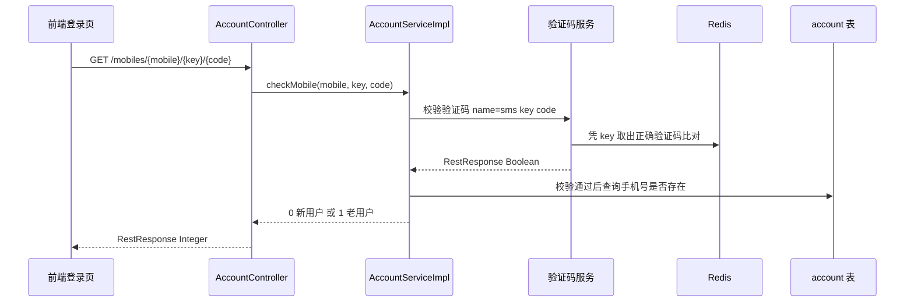

# 注册第二步的接口契约：校验手机号和验证码为什么是三个参数

登录页上用户填完手机号与验证码，点击登录，前端把数据送到服务端。服务端此刻要回答两个问题：验证码对不对，手机号是不是已经存在。获取短信验证码的功能此前已经打通，MyBatis-Plus 的环境与用法也铺好了底子，注册的第二步「校验手机号和验证码」具备了动工条件。动手写实现之前，先把接口契约立起来，而这个契约最值得掰开的地方在于：明明只校验两样东西，参数却有三个。

## 先给结论

- 接口沿用既有口径定义在 API 工程的 `AccountAPI` 接口里，方法名 `checkMobile`，返回值 `RestResponse<Integer>`，表现层 Controller 实现它并给出空实现。
- 三个参数各有来历：`mobile` 是用户填的手机号，`code` 是用户填的验证码，中间的 `key` 是当初获取验证码时返回的校验标识，三者缺一不可。
- `key` 不是验证码，而是验证码服务写入 Redis 的那把「钥匙」：生成验证码时以 key 为键、验证码为值存入 Redis，校验时凭 key 取出正确答案与用户输入比对。
- 返回值用 `Integer` 表达手机号判定：0 表示不存在（新用户，走注册），1 表示存在（老用户，走登录）；验证码错误不占用返回值，直接抛业务异常。
- 请求路径是 REST 风格的 `/mobiles/{mobile}/{key}/{code}`，三个参数全在路径上，Controller 侧每个参数都必须配 `@PathVariable`，漏一个直接 400。

## 需求边界：先验证码，后手机号

把注册的时序图翻出来对位：获取验证码对应前六步，本功能对应其中的校验段。用户收到短信后，在页面输入手机号与验证码提交，前端将手机号、验证码连同校验标识一起发给统一账户服务；统一账户服务先找验证码服务校验验证码，通过后再判断手机号是否已经存在，随即将结果返回前端。这个先后顺序在需求层面就定死了，对应的功能说明写得很清楚：校验验证码是否正确，如果校验正确，则校验手机号是否存在。



图上能看出两个要点：验证码的比对发生在验证码服务一侧，Redis 里的答案不外流；手机号的存在性查询由统一账户服务自己做，靠的是本地数据库。接口契约要同时照顾这两条支线，这正是三个参数的由来。

## 三个参数各自的来历

`mobile` 与 `code` 的含义一目了然，值得单独交代的是中间的 `key`。回顾获取验证码的那次交互：验证码服务生成验证码后存入 Redis，把验证码作为值、把一个校验标识作为键，返回给调用方的只有这个键。它以 `sms:` 为前缀，后接一串无规则字符，形如 `sms:xxxxxxxx`。前缀划出了业务命名空间，同一套 Redis 将来还要容纳图形、邮件等形态的验证信息，彼此互不干扰。

校验时前端把这个 key 原样传回来，服务端拿它去 Redis 里定位当初那条记录，取出正确验证码，与用户输入的 `code` 比对。验证码服务源码里这段比对逻辑是现成的：

```java
// 验证码服务侧的校验逻辑：凭 key 取答案，与输入比对
public boolean verify(String verificationKey, String verificationCode) {
    // key 或验证码任一为空，直接判负
    if (StringUtils.isBlank(verificationKey) || StringUtils.isBlank(verificationCode)) {
        return false;
    }
    // 从 Redis 取出当初存入的正确验证码
    String code = getVerificationStore().get(verificationKey);
    if (code == null) {
        return false;
    }
    return code.equals(verificationCode);
}
```

验证码服务对外暴露的校验接口签名也与之呼应，三个查询参数分别指定业务名称、校验标识与验证码：

```java
@PostMapping(value = "/verify")
public RestResponse<Boolean> verify(String name, String verificationKey, String verificationCode) {
    Boolean isSuccess = verificationService.verify(name, verificationKey, verificationCode);
    return RestResponse.success(isSuccess);
}
```

看到了服务端怎么用 key，就能理解前端为什么必须把它存下来再传回来：没有 key，Redis 里的答案无法定位，校验无从谈起。手机号、校验标识、验证码，三样东西凑齐，一次校验请求才是完整的。

## 接口定义与空实现

接口落在 API 工程的 `AccountAPI` 里，与获取验证码的 `getSMSCode` 并排。返回值 `RestResponse<Integer>` 的泛型参数是判定数字：

```java
public interface AccountAPI {
    // 获取手机验证码
    RestResponse getSMSCode(String mobile);
    // 校验手机号和验证码：0 手机号不存在，1 存在
    RestResponse<Integer> checkMobile(String mobile, String key, String code);
}
```

表现层照例实现接口、生成空方法，先把契约挂到工程上：

```java
@Override
@ApiOperation("校验手机号和验证码")
@ApiImplicitParams({
    @ApiImplicitParam(name = "mobile", value = "手机号", required = true, dataType = "String"),
    @ApiImplicitParam(name = "key", value = "校验标识", required = true, dataType = "String"),
    @ApiImplicitParam(name = "code", value = "验证码", required = true, dataType = "String")
})
@GetMapping(value = "/mobiles/{mobile}/{key}/{code}")
public RestResponse<Integer> checkMobile(@PathVariable String mobile,
                                         @PathVariable String key,
                                         @PathVariable String code) {
    return null;
}
```

路径写法把三个参数全部放进了请求路径，这是 REST 风格里「资源标识带参数」的典型形态。代价是 `@PathVariable` 一个都不能少：Spring 按注解把路径变量逐个绑定到形参，漏写的那一个会被当成普通形参处理，取不到值，请求直接报错。这类失误编译器不报错，Swagger 文档页上一测就现形。

## 错误分支的约定：异常管失败，返回值管判定

`RestResponse` 的 `code` 字段本可以承载错误信息，这里却约定验证码错误不走返回值，而是抛出自定义业务异常 `BusinessException`，错误码取账号侧的 `140152`，提示「验证码错误」。异常一路向上抛，由 Spring MVC 的全局异常捕获类统一接住，封装成带错误码与提示信息的 `RestResponse` 返回前端，前端据此弹窗。这套机制在项目的异常处理设计里已经定型，各层只管抛，捕获与封装集中在全局处理器一处。

这样分工之后，`checkMobile` 的返回值语义非常干净：请求能正常返回，`result` 里就只有 0 或 1，前端拿它决定下一步展示注册页还是登录页；验证码错了、过期了、key 失效了，全部表现为一个带 140152 的错误响应。判定与失败两条通道互不掺和，前端处理逻辑随之简化。

## 常见误区

- **把 key 当成验证码，或者把两者弄混。** 错例：前端把验证码输入框的值同时传给 key 与 code 两个参数。正解：key 是获取验证码时接口返回的 `sms:` 前缀校验标识，前端要在发送校验请求前暂存它，提交时与用户输入的验证码一起回传。
- **路径参数漏加 `@PathVariable`。** 错例：方法签名写了三个形参，注解只补了两个，测试时第三个参数永远是 null。正解：REST 路径里的每个变量都要用 `@PathVariable` 绑定，写完对照 `@GetMapping` 的路径逐个数一遍。
- **校验顺序颠倒，先查手机号再验验证码。** 错例：用任意字符串当验证码探测接口，手机号存在与否先被摸清。正解：验证码校验在前，手机号判定在后，保证未通过验证码校验的请求拿不到任何用户是否存在的信息。
- **把验证码错误塞进返回值。** 错例：约定 result 取 -1 表示验证码错误、0 表示不存在、1 表示存在，前端写一串分支判断。正解：失败走业务异常与全局异常处理器，返回值只承载业务判定，两条通道各司其职。

## 面试可能被问到的问题

1. 面试官追问：「校验验证码为什么要前端回传一个 key，服务端直接用手机号定位 Redis 记录不行吗？」
   答：生成时用的键是带前缀的校验标识而不是手机号，同一手机号可以重复发送验证码，后发的记录会覆盖先发的，用手机号当键需要额外处理多次发送与不同业务形态的隔离。用无规则的 key 作键，配合有效期，天然做到了一次一码、用后即弃，也避免把手机号这类敏感信息暴露在键名与 URL 中。
2. 面试官追问：「返回值为什么设计成 0 和 1，而不是直接返回下一步该做什么？」
   答：服务端只对「手机号是否存在」这一事实负责，注册页还是登录页属于前端交互决策。把事实与决策分开，接口可以被注册、登录之外的调用方复用，语义稳定；页面跳转规则变化时不必改接口。
3. 面试官追问：「先验证码后手机号的顺序，除了业务习惯还有什么考虑？」
   答：安全考虑。验证码校验是这道接口的准入门槛，顺序颠倒会让脚本绕过门槛批量探测手机号是否已注册，形成用户枚举漏洞。先验证码后存在性，未通过校验的请求一律在第一步被拦下，拿不到存在性信息。
4. 面试官追问：「接口为什么定义在独立的 API 工程里？」
   答：API 工程承载对外的接口契约，表现层 Controller 实现它，保证方法签名、参数、返回值在定义与实现两处永远一致；契约单独成模块后，前端或第三方拿到接口定义即可并行开发，后续其他服务依赖这份契约时也有统一出处。
5. 面试官追问：「三个参数全放在路径上有什么隐患？」
   答：key 是长字符串，拼在路径里会进访问日志、浏览器历史与代理日志，敏感凭据经 URL 传播有泄漏面；路径长度也有上限。课程里这样写是为了演示 REST 风格的路径参数，生产实现更常见的选择是 POST 加请求体承载参数，至少避免把校验标识暴露在 URL 上。

## 配套资料

- 讲义：`materials/docs/10/万信金融-第2章-讲义-开户v1.0.md`，开户业务流程与注册环节的背景依据，校验手机号和验证码是注册三步中的第二步。
- 讲义：`materials/docs/10/验证码服务使用指南.md`，校验接口的访问路径与参数表（name、verificationKey、verificationCode）为正文参数名的出处。
- 代码：`materials/code/10/sailing/`，验证码服务源码归档，`/verify` 接口定义、key 与验证码的 Redis 比对逻辑、`RestResponse` 与 `BusinessException` 的公共类均可对照；内层目录保留原始命名，路径只列到工程目录为止。
- 代码：`materials/code/10/wanxinp2p/`，P2P 工程归档，API 工程模块在其中；`AccountAPI` 的 `checkMobile` 方法与表现层代码随课程编码完成，归档未单独收录，正文按画面线补全，包名按 `com.study.finance` 系改写。
