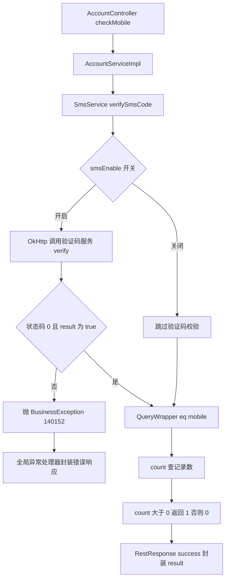

# 校验手机号和验证码的完整实现：远程验证码校验、MP 环境搭建与 count 判定的落地全过程

接口契约已经立好，`AccountController` 里躺着一个返回 null 的空方法。把它补成能跑的代码，实际是两条支线的汇合：验证码这条支线延续获取验证码时的做法，把活儿转交给验证码服务；手机号这条支线是统一账户服务第一次真正操作数据库，MyBatis-Plus 的环境要从零装起来，实体、数据访问层、业务层一层层铺过去。四段编码过程在时间上是连续的推进，合并成一条完整的实现脉络来看，前后依赖关系反而更清楚。

## 先给结论

- 验证码校验放在 `SmsService` 里新增的 `verifySmsCode` 方法，与获取验证码共用 `sms.url`、`sms.enable` 两个配置；方法设计成无返回值，校验不通过直接抛 `BusinessException`，错误码 `140152`，提示「验证码错误」。
- 校验请求打向验证码服务的 `/verify` 子路径，参数 `name=sms`、`verificationKey`、`verificationCode` 用 `StringBuilder` 逐段拼接，请求体给空串即可，因为参数全在查询串里。
- 手机号校验要动数据库，统一账户服务先补齐 MyBatis-Plus 环境：四个依赖进 pom，Apollo 上覆盖实体扫描包与映射文件路径两个配置项并发布，启动类加 `@MapperScan`。
- 实体 `Account` 用 `@TableName` 对准 `account` 表，数据访问层一个继承 `BaseMapper<Account>` 的空接口加一个 XML 占位文件就完事，增删改查全套随继承到位。
- 业务层改造为继承 MP 的 `IService` 与 `ServiceImpl` 体系，`checkMobile` 先调 `verifySmsCode` 卡住验证码，再用条件构造器按手机号 `count`，`count > 0` 返回 1 否则返回 0；Lambda 写法用 `Account::getMobile` 代替手写列名，编译期就锁死了字段。

## 验证码校验：SmsService 的第二个方法

代码放哪，答案在实现获取验证码时就定了：凡是验证码领域的代码，统一收进 `SmsService`。这个类当时是为了避免账户业务类越长越胖而抽出来的，获取与校验是一对动作，共享同一批配置与同一条远程链路，继续住在同一个类里最合适。校验这个动作与数据库无关，要打交道的是验证码服务，所以数据访问层不参与，工作量集中在业务层这一个方法上。

方法签名值得推敲。参数只需要 `key` 与 `code` 两个：校验验证码这件事用不到手机号，验证码服务只认校验标识与答案。返回值干脆不要，设计思路是「失败即抛异常」：验证码错了，方法内部直接抛出业务异常，调用方根本等不到一个返回值；验证码对了，方法正常走完，也不需要向调用方回传什么。异常与正常两种结局都在方法内部了断，调用方写起来最省心。

```java
@Service
public class SmsService {

    // 验证码服务基本访问路径，来自 Apollo
    @Value("${sms.url}")
    private String smsURL;
    // 短信验证码功能开关，来自 Apollo
    @Value("${sms.enable}")
    private Boolean smsEnable;

    // 校验短信验证码：失败直接抛业务异常，由全局异常处理器统一封装响应
    public void verifySmsCode(String key, String code) {
        // 功能关闭时未发送过验证码，校验环节整体跳过
        if (smsEnable) {
            // 参数全部拼在查询串里，请求体留空
            StringBuilder params = new StringBuilder("/verify?name=sms");
            params.append("&verificationKey=").append(key);
            params.append("&verificationCode=").append(code);
            RestResponse restResponse = OkHttpUtil.post(smsURL + params.toString(), "");
            // 状态码非 0，或服务端明确返回 false，都判定为校验失败
            if (restResponse.getCode() != CommonErrorCode.SUCCESS.getCode()
                    || Boolean.FALSE.equals(restResponse.getResult())) {
                throw new BusinessException(AccountErrorCode.E_140152);
            }
        }
    }
}
```

参数拼接这次换成了 `StringBuilder` 的 `append` 链。获取验证码那次是手工拼 JSON 字符串，引号转义写起来提心吊胆；校验接口的参数全在查询串里，逐段 `append` 比字符串相加清爽得多，`&verificationKey=`、`&verificationCode=` 各占一段，漏没漏参数一眼可辨。参数名与服务端保持全小写一致：验证码服务的 Controller 按同名参数接收，大小写对不上就绑定不到值，校验永远失败。`OkHttpUtil.post` 的第二个参数给空串，原因是 `/verify` 不读请求体，工具类的方法签名要求有这个位置，空串占位即可。

拼出来的完整请求地址是 `sms.url` 加 `/verify?name=sms&verificationKey=...&verificationCode=...`，配置中心里存的基本路径管到上下文，具体动作的子路径跟在后面，与获取验证码时拼 `/generate` 的套路完全对称。

## 失败即抛：异常怎么抛、谁来接

判定条件里出现两个判据，各管一件事。`restResponse.getCode()` 是响应包装类的状态码，0 表示验证码服务处理正常，非 0 表示那次远程调用本身出了问题；`restResponse.getResult()` 才是校验结论，`/verify` 返回的泛型是 Boolean，true 匹配、false 不匹配。两个判据用「或」连接：状态码不对，或者状态码正常但答案是 false，都属于校验失败。取状态码时没有写裸的数字 0，而是从公共错误码枚举取 `SUCCESS` 的值，魔法数字散落各处的隐患就此避免，枚举里「成功」的定义改了，所有比较点自动跟着变。

抛出的是项目自定义的 `BusinessException`，公共工程里提供，继承自 `RuntimeException`，内部持有一个 `ErrorCode` 类型的错误码对象：

```java
// 业务异常：携带错误码，交给全局异常处理器统一转换成响应
public class BusinessException extends RuntimeException {

    private ErrorCode errorCode;

    public BusinessException(ErrorCode errorCode) {
        super();
        this.errorCode = errorCode;
    }

    public ErrorCode getErrorCode() {
        return errorCode;
    }
}
```

继承 `RuntimeException` 是刻意的：非受检异常不强制调用方捕获或声明，异常可以从 `SmsService` 一路向上抛，穿越业务层与表现层，途中没有任何一层需要写 try-catch。接它的是 Spring MVC 的全局异常捕获类，`@ControllerAdvice` 加 `@ExceptionHandler(Exception.class)` 把所有漏网的异常收进来，识别出 `BusinessException` 后，取出错误码与提示信息，封装成 `RestResponse` 返回前端。账号侧错误码类里登记的 `140152` 对应「验证码错误」，前端拿到的响应里就是这个码与这句提示，弹窗素材直接可用。

这套「各层只抛、一处捕获、统一封装」的机制是项目设计阶段就定下的，本方法是它接到的第一个真实业务调用，验证码校验失败的场景让整条异常链路第一次跑通了全程。

## 手机号校验的前置工程：给统一账户服务装上 MP

验证码支线写完，手机号支线开工。判断手机号是否已经存在，本质是一次数据库查询，查 `account` 表里有没有这个手机号的记录。统一账户服务创建时只引入了注册中心客户端这些基础依赖，没有数据库访问能力，MyBatis-Plus 的环境要现装。装环境分三步：依赖、配置、扫描。

依赖进统一账户服务的 pom，四个各司其职：

```xml
<!-- MP 与 Spring Boot 的整合包，引入即获得 BaseMapper 等能力 -->
<dependency>
    <groupId>com.baomidou</groupId>
    <artifactId>mybatis-plus-boot-starter</artifactId>
</dependency>
<!-- JSR310 类型处理器，支持 LocalDateTime 等新日期类型与数据库字段的映射 -->
<dependency>
    <groupId>org.mybatis</groupId>
    <artifactId>mybatis-typehandlers-jsr310</artifactId>
</dependency>
<!-- 阿里巴巴 Druid 数据库连接池 -->
<dependency>
    <groupId>com.alibaba</groupId>
    <artifactId>druid-spring-boot-starter</artifactId>
</dependency>
<!-- MySQL 驱动 -->
<dependency>
    <groupId>mysql</groupId>
    <artifactId>mysql-connector-java</artifactId>
</dependency>
```

配置走 Apollo。项目公共名称空间里躺着一套为其他服务写好的 MyBatis-Plus 配置，其中两项与包路径挂钩：实体类别名扫描包 `typeAliasesPackage` 指向的是用户中心的实体包，映射文件路径 `mapper-locations` 指向的也是用户中心的目录。统一账户服务直接复用必然错位，按 Apollo 的覆盖机制，在 `account-service` 项目的本地名称空间里重写这两个值，同名配置以本项目为准，第一项换成统一账户的实体包，第二项对准自己的 `mapper/xml` 目录：

```properties
mybatis-plus.typeAliasesPackage = com.study.finance.account.entity
mybatis-plus.mapper-locations = classpath:com/study/finance/account/mapper/xml/*.xml
```

数据源配置在搭建服务时已指向 `p2p_account` 库，用户名与密码核对一遍即可，不用再动。这里有个观念要摆正：配置搬进 Apollo 管理之后，内容与语义没有任何变化，`typeAliasesPackage` 还是那个实体扫描包，`mapper-locations` 还是那个映射文件路径，变的只是存放位置。理解配置时该按本地 `application.yml` 的思路去读，操作时记住去 Apollo 上找，两套心智分开，配置项再多也不会乱。

改动完成后发布是硬性动作，Apollo 的配置不发布就不生效，客户端拿到的仍是旧值，这个坑在配置中心接入时强调过，这里最容易忘。检验配置是否到位有个朴素办法：把启动日志里打印的 MyBatis-Plus 配置与 Apollo 上已发布的值对一遍，路径对上了再继续往下写代码。

启动类补上 Mapper 接口扫描注解，告诉 MP 去哪个包下找数据访问接口：

```java
@SpringBootApplication
@MapperScan("com.study.finance.account.mapper")
public class AccountServiceApplication {
    public static void main(String[] args) {
        SpringApplication.run(AccountServiceApplication.class, args);
    }
}
```

扫描路径写错一个段，Mapper 接口就不在扫描范围里，注入时直接报找不到 Bean。包路径此时已经定型为 `com.study.finance.account` 系，实体放 `entity`，数据访问放 `mapper`，配置、注解、目录三者对齐，环境才算装完。

## 实体与数据访问层：空接口承载全套增删改查

数据库表是现成的，`p2p_account` 库里的 `account` 表登记着账号的核心字段：主键、用户名、手机号、密码、盐、账号状态、用户归属端。实体类与表一一对应，`@Data` 让 Lombok 生成全部 getter 与 setter，`@TableName` 指定表名，`@TableId` 标注主键，普通字段用 `@TableField` 逐个对准列名。列名在表里是大写，属性名是驼峰，显式标注最稳妥，省得依赖大小写转换的隐式规则：

```java
@Data
@TableName("account")
public class Account implements Serializable {

    private static final long serialVersionUID = 1L;

    // 主键
    @TableId("ID")
    private Long id;
    // 用户名
    @TableField("USERNAME")
    private String username;
    // 手机号，本功能的主角
    @TableField("MOBILE")
    private String mobile;
    // 密码密文
    @TableField("PASSWORD")
    private String password;
    // 盐，密码加密时掺入的随机串
    @TableField("SALT")
    private String salt;
    // 账号状态
    @TableField("STATUS")
    private String status;
    // 用户归属端，c 为 C 端用户
    @TableField("DOMAIN")
    private String domain;
}
```

数据访问层是 MyBatis-Plus 的招牌时刻。编码顺序上也值得留意：三层结构里这次先写数据访问层，因为它最简单，实体与 Mapper 就位后，业务层与表现层才有可依赖的地基，这个自下而上的小顺序与前面搭统一账户服务时的分层习惯一致。Mapper 接口继承 `BaseMapper` 并把实体填进泛型，一行方法体都不用写，按主键增删改查、按条件查询、查询记录数等方法全部随继承到位：

```java
public interface AccountMapper extends BaseMapper<Account> {
}
```

配套的映射文件照旧要有，虽然此刻里面没有一条手写语句。namespace 对准接口全限定名，文件放进 `mapper/xml` 目录，与 Apollo 里覆盖过的 `mapper-locations` 路径严丝合缝。将来出现复杂 SQL 时语句写进这个文件，扫描路径不和谐就会在运行时爆出绑定失败的错误：

```xml
<?xml version="1.0" encoding="UTF-8"?>
<!DOCTYPE mapper PUBLIC "-//mybatis.org//DTD Mapper 3.0//EN" "http://mybatis.org/dtd/mybatis-3-mapper.dtd">
<mapper namespace="com.study.finance.account.mapper.AccountMapper">
</mapper>
```

新建映射文件这类重复劳动可以交给 IDEA 的文件模板：在 File and Code Templates 里把 DTD 声明与 mapper 骨架存成一个自定义模板，右键新建时直接生成带命名空间的骨架文件，只填 namespace 一处。这套模板一次配置长期受益，项目里 Mapper 会越来越多。

## 业务层收口：count 判定与条件构造器的两种写法

业务层原本就有「接口加实现类」的骨架，现在要接入 MP 的业务层封装：接口继承 `IService`、实现类继承 `ServiceImpl`，泛型分别填 Mapper 与实体。这套封装的意义与 `BaseMapper` 一脉相承，通用业务方法在父接口与父实现类里已经备好，`count`、`save`、查询系列直接可用，实现类里只剩业务专属代码：

```java
// 业务接口：继承 MP 的 IService，泛型为实体
public interface AccountService extends IService<Account> {
    RestResponse getSMSCode(String mobile);
    Integer checkMobile(String mobile, String key, String code);
}

@Service
public class AccountServiceImpl extends ServiceImpl<AccountMapper, Account>
        implements AccountService {

    @Autowired
    private SmsService smsService;

    @Override
    public Integer checkMobile(String mobile, String key, String code) {
        // 第一道：验证码校验，不通过直接抛异常，走不到后面
        smsService.verifySmsCode(key, code);
        // 第二道：按手机号查记录数，判断是否已存在
        QueryWrapper<Account> wrapper = new QueryWrapper<>();
        wrapper.eq("mobile", mobile);
        int count = count(wrapper);
        // 手机号不允许重复，记录数要么 0 要么 1
        return count > 0 ? 1 : 0;
    }
}
```

方法体的两行就是整个功能的骨架。`smsService.verifySmsCode(key, code)` 负责第一道门，验证码不对，异常从那里抛出，方法在此终结；能走到第二行，说明验证码已经过了关，剩下的纯是存在性判定。判定选用 `count` 而不是把整行记录查回来：业务只关心「在不在」，不关心账号详情，记录数是最小的回答。手机号在表里不允许重复，查出来的记录数要么 0 要么 1，三元表达式把数字翻译成语义，1 是老用户，0 是新用户。

条件构造器的第一种写法用字符串指定列名，`eq("mobile", mobile)` 里第一个参数是表里的列名。这份直白里藏着风险：列名是手敲的，小手一抖写成 `mobil`，编译器毫无察觉，错误要到 SQL 真正执行时才爆出来。MP 提供的 Lambda 写法把列名的来源换掉了：

```java
// Lambda 写法：列名由实体的 getter 推导，不手写字符串
QueryWrapper<Account> wrapper = new QueryWrapper<>();
wrapper.lambda().eq(Account::getMobile, mobile);
int count = count(wrapper);
return count > 0 ? 1 : 0;
```

`Account::getMobile` 是方法引用，传入的是实体上取手机号的 getter。MP 内部把这个方法引用解析成属性名，再对照实体注解里 `@TableField("MOBILE")` 登记的列名，最终拼出与字符串写法完全相同的 SQL。区别只在列名的出处：一个靠人手写，一个从实体定义推导。后者代码略长，却把「写错列名」这类运行期事故提前消解在编译期，属性改名时编译器立刻报错，字符串写法则无声无息。两种写法各有拥趸，团队里统一一种即可，关键是要明白 Lambda 版防的是什么错。

表现层收尾只剩一次委托与一次封装：

```java
@Override
@ApiOperation("校验手机号和验证码")
@GetMapping(value = "/mobiles/{mobile}/{key}/{code}")
public RestResponse<Integer> checkMobile(@PathVariable String mobile,
                                         @PathVariable String key,
                                         @PathVariable String code) {
    return RestResponse.success(accountService.checkMobile(mobile, key, code));
}
```

`RestResponse.success` 的静态方法把判定数字装进 `result` 字段返回。整条链路至此闭环，从请求进来到答案出去的完整走向如下：



图的右半边是数据库支线，左半边是远程调用支线，两条支线在 `checkMobile` 里串成先后两道门。验证码这道门抛出的异常走全局处理器那条路，正常放行的请求才轮到 count 出场，两种结局最终都收敛成一次规范的 `RestResponse` 响应。

## 常见误区

- **Apollo 上改了配置不发布。** 错例：覆盖完 `mapper-locations` 直接重启服务，映射文件路径仍是公共配置里的旧值，调用时报语句绑定失败。正解：Apollo 的修改必须点发布才对客户端生效，改配置与发布当作一个动作完成。
- **手写列名拼错，运行期才暴露。** 错例：`wrapper.eq("mobil", mobile)`，编译通过，执行时 SQL 报未知列。正解：列名以实体注解与表结构为准反复核对，或改用 Lambda 写法，用 `Account::getMobile` 让列名从属性推导，错误提前到编译期。
- **把校验失败设计成返回 false，调用方又忘了判断。** 错例：`verifySmsCode` 返回 Boolean，业务层拿到 false 继续往下查手机号，校验形同虚设。正解：失败即抛 `BusinessException`，用异常中断流程，调用方想忽视都忽视不了。
- **把响应状态码 0 当成手机号不存在。** 错例：看到响应里出现 0 就断定手机号没注册，实际上那是 `RestResponse` 的 `code`，表示请求处理正常。正解：手机号判定看 `result` 字段的 0 与 1，`code` 只说明本次调用本身没有出错。

## 面试可能被问到的问题

1. 面试官追问：「验证码校验失败为什么用异常而不是返回值表达？」
   答：失败属于业务规则被打破，调用方必须处理，不能靠自觉检查返回值。抛出携带错误码的 `RuntimeException` 可以中断调用链，配合全局异常处理器统一转换成带错误码的响应，各层省去逐层判断与传递的样板代码，错误提示也天然统一。
2. 面试官追问：「业务实现类继承 ServiceImpl 之后到底得到了什么？」
   答：ServiceImpl 内部持有泛型指定的 Mapper 实例，并实现了 IService 声明的通用方法，保存、按主键操作、按条件查询、count 等常用能力开箱即用，实现类只需写业务专属逻辑。泛型把 Mapper 与实体绑定起来，方法内部能直接操作对应表的 CRUD，省掉了手工注入与转发的重复代码。
3. 面试官追问：「条件构造器的字符串列名写法与 Lambda 写法，底层差别在哪？」
   答：字符串写法直接把列名拼进 SQL 的条件段，风险是拼错只能运行期发现。Lambda 写法传入实体的方法引用，框架解析引用对应的属性，再依据实体注解或命名规则映射出列名，属性与列的对应关系由编译期类型检查背书，重构字段名时所有条件同步更新，错误窗口从运行期收缩到编译期。
4. 面试官追问：「判断手机号是否存在，用 count 与查出对象再判空各有什么取舍？」
   答：count 只返回记录数，网络传输与内存开销最小，语义就是存在性判定，适合不需要记录内容的场景。查出对象能顺带拿到账号详情，但本场景后续并不使用这些数据，属于多余的字段搬运；手机号有唯一约束时两者结论一致，count 更贴题。
5. 面试官追问：「统一账户服务复用公共配置时，实体包与映射文件路径为什么会冲突，怎么解决？」
   答：公共名称空间的 MyBatis-Plus 配置是按某个服务的包路径写的，其他服务沿用就会扫错包、找错映射目录。Apollo 的同名配置遵循本项目覆盖公共的规则，在各服务自己的名称空间里重写这两项即可，改完发布生效。这类配置覆盖是多服务共用基础设施配置时的常规操作。

## 配套资料

- 讲义：`materials/docs/10/Mybatis-Plus讲义v1.0.md`，BaseMapper 继承、实体注解、条件构造器与业务层封装的用法出处。
- 讲义：`materials/docs/10/万信金融-异常处理机制.md`，自定义异常、错误码设计与全局异常捕获的机制说明，正文的失败即抛约定出自该设计。
- 讲义：`materials/docs/10/验证码服务使用指南.md`，`/verify` 校验接口的路径与参数表（name、verificationKey、verificationCode）为正文拼参的依据。
- 代码：`materials/code/10/mp-springboot/`，MyBatis-Plus 示例工程归档，`BaseMapper` 继承、`@TableName`、`@TableId`、`@TableField`、`@MapperScan` 与 `mybatis-plus-boot-starter` 坐标均可对照；内层目录保留原始命名，路径列到工程目录为止。
- 代码：`materials/code/10/sailing/`，验证码服务源码归档，`RestResponse`、`BusinessException`、`CommonErrorCode`、`RedisVerificationStore` 与校验比对逻辑为正文异常设计与响应判定引用的真实实现。
- 代码：`materials/code/10/wanxinp2p/`，P2P 工程归档；统一账户服务的 `SmsService`、`Account` 实体、`AccountMapper` 与业务层代码随课程编码完成，归档未单独收录，正文按画面线与本课写法补全，包名按 `com.study.finance` 系改写。
