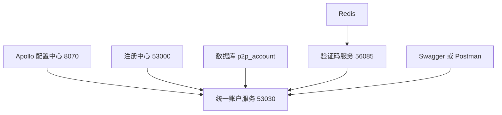

# 校验功能的测试现场：正反用例各来一遍，顺手检验全局异常链路

校验手机号和验证码的代码全部收口，注册第二步到了验收时刻。测试前的第一道题不是写用例，而是数清楚这次要启动哪些服务：功能越往后做，链路上的参与者越多，少起一个进程，报错形态各不相同，排障成本远高于开测前对一遍清单。这次测试还有一层额外意义，项目设计阶段定下的全局异常处理机制，终于等到了第一个真实业务场景来检验它是否名副其实。

## 先给结论

- 启动清单按依赖数出来共五个进程：Apollo 配置中心、Redis、验证码服务、注册中心、统一账户服务；Apollo 从接入配置中心那天起就是每次测试的固定开场。
- 测试顺序有依赖：先调获取验证码接口拿到 `result.key` 与控制台输出的验证码，再拿这三样东西去测校验接口，直接测校验必然失败。
- 正向用例的响应要分清两个字段：`code` 为 0 表示请求处理正常，`result` 里的 0 或 1 才是手机号存在性判定。
- 反向用例故意填错验证码，响应里出现 `140152` 与「验证码错误」，证明业务异常、全局异常捕获、统一响应封装整条链路都在正常工作。
- Swagger 适合首次点亮一个新接口，Postman 把请求归档进集合供回归，两个工具各测一遍再收工，此后以 Postman 为主。

## 启动清单：按依赖关系数出来

清单不用背，对着调用链数参与者：校验接口跑在统一账户服务里，它要连 Apollo 拿配置、连注册中心做服务治理、连数据库查手机号、还要远程调用验证码服务；验证码服务又依赖 Redis 存取验证码。把这些画成图，启动顺序与依赖关系一目了然：



五个进程按依赖顺序拉起，控制台没有报错再动手。经验法则是：Apollo 属于基础设施，凡是要起微服务它必在；其余服务谁被谁依赖，谁就先起。清单漏项的代价各不相同，少起验证码服务是远程调用超时，少起 Redis 是验证码服务读写失败，少起 Apollo 则微服务根本起不来，报错位置离病因越远，排查越绕，开测前对清单永远比事后溯源便宜。

## 正向用例：key 与验证码的接力

校验接口的输入依赖上一步的输出，用例要从获取验证码开始跑。在 Swagger 文档页展开「获取手机验证码」，输入一个表里已存在的手机号（示例用 `13xxxxxxxxx` 占位），执行后从响应里复制 `result.key`，形如 `sms:xxxxxx` 的校验标识；验证码服务工作在控制台输出模式，6 位数字验证码直接打印在它自己的日志里，复制下来即可（示例用 `xxxxxx` 占位）。

回到「校验手机号和验证码」这一项，三个路径参数各归各位：手机号保持一致，key 粘贴刚复制的校验标识，验证码填控制台里那个数字。执行后看响应：

```json
{
  "code": 0,
  "msg": "",
  "result": 1,
  "content": null
}
```

读这份响应要分两个通道。`code` 是 `RestResponse` 的状态码，0 表示这次调用本身处理正常，没有异常抛出；`result` 才是业务判定，1 表示手机号已存在，0 表示不存在。手机号换成表里没有的一个再测，`result` 变成 0，同样算测试通过，两种结果分别对应前端跳转登录与注册的分支。把判定数字误读成错误码是这一步最常见的误读。

Postman 把同一请求沉淀成资产。新建请求归入统一账户服务的集合，请求方式 GET，URL 直接从 Swagger 页面抄，路径里 `mobiles` 后面依次挂着手机号、key、验证码三段。点 Send，返回与 Swagger 一致。两个工具测同一个接口的价值分工：Swagger 所见即所测，文档与请求同源，适合第一次验证；Postman 请求可保存可重放，注册第二步的用例从这一刻起进入回归清单，后续每实现一个接口添一条。

## 反向用例：故意填错，看异常链路亮灯

正向通过只证明代码能跑，反向用例才证明分支可靠。操作上甚至不需要刻意构造：测试时复制错了验证码，粘了一个旧短信的数字进去，响应立刻变成 `code` 为 `140152`、`msg` 为「验证码错误」的错误响应。这个意外恰好是想要的东西，验证码错误分支被真实触发了。

顺着这个错误响应能完整走一遍异常链路。在 `SmsService` 的抛异常处与全局异常捕获类的方法入口各打一个断点，故意再执行一次错误请求：断点先停在抛出 `BusinessException` 的那一行，错误码对象里装着 `140152` 与提示信息；放行之后，调用栈跳进全局异常捕获类。这个类是公共工程里的固定成员，收拢所有漏网异常：

```java
@ControllerAdvice
public class GlobalExceptionHandler {

    @ExceptionHandler(value = Exception.class)
    @ResponseBody
    public RestResponse exceptionGet(HttpServletRequest req, HttpServletResponse response, Exception e) {
        // 业务异常：取错误码与描述封装成统一响应
        if (e instanceof BusinessException) {
            BusinessException be = (BusinessException) e;
            return new RestResponse(be.getErrorCode().getCode(), be.getErrorCode().getDesc());
        }
        // 其余分支处理 404、405、415 与未知异常
        LOGGER.error("【系统异常】{}", e);
        return new RestResponse(CommonErrorCode.UNKNOWN.getCode(), CommonErrorCode.UNKNOWN.getDesc());
    }
}
```

`@ControllerAdvice` 让这个类监听所有控制器，`@ExceptionHandler(Exception.class)` 表明兜底范围是全部异常，`instanceof` 识别出 `BusinessException` 后取出错误码与描述，装进 `RestResponse` 返回。前端拿到的就是那个带 `140152` 的 JSON，弹窗提示「验证码错误」。断点演示的价值在于把设计图上的三个框，业务层抛异常、全局处理器捕获、统一封装响应，变成了肉眼可见的执行路径，异常处理机制从纸面设计坐实为工作代码。

## 测试习惯：把一次测试沉淀成方法

这次测试留下三条可复用的习惯。其一，测试即验证设计：异常处理机制在设计阶段讲过原理，但一直没有具体业务案例，校验功能恰好补上了这块拼图，每完成一个功能，顺手确认它是否踩在了既定的机制轨道上，比攒到联调再对账划算。其二，正反都要测：正向证明主流程通，反向证明分支可靠，只测正向的通过是侥幸不是结论。其三，用例要归档：Postman 集合里的每一条请求都是资产，注册后续步骤的测试还会反复用到这条校验请求，改名、归组、按顺序排列，回归时逐条点过去。

## 常见误区

- **跳过获取验证码直接测校验接口。** 错例：拿一个随手编的 key 与验证码去请求，得到 140152 就断定功能有缺陷。正解：校验接口的输入依赖获取验证码接口的输出，key 与验证码必须是同一一次真实请求产生的，用例要从获取那一步开始跑。
- **把响应里的 `code` 与 `result` 混为一谈。** 错例：看到 `result` 为 0 以为出了错，或者看到 `code` 为 0 就断定手机号已注册。正解：`code` 是响应状态通道，0 为正常；`result` 是业务判定通道，0 与 1 都是正常结果。
- **用例里手机号随手乱填。** 错例：测存在性判定时用一个从未入库的手机号，结果恒为 0，测不出 1 的分支。正解：从数据库挑一个真实存在的手机号测出 1，再换一个不存在的测出 0，两个方向都要覆盖。
- **反向用例失败就回头改代码。** 错例：故意填错验证码收到 140152，误以为接口有 bug，着手排查。正解：错误码与提示信息符合约定时，反向用例的「失败」正是功能正确的证据，先核对约定再动手改代码。

## 面试可能被问到的问题

1. 面试官追问：「测一个依赖多个服务的接口，启动清单怎么定才不漏项？」
   答：从被测接口沿调用链向外数参与者：它所在的进程、它依赖的配置中心与注册中心、它远程调用的服务、被调服务自身的依赖（如 Redis），每个参与者一项，按依赖顺序启动。把清单固化成检查表，每次测试前过一遍，比记住报错特征再回头补进程成本低得多。
2. 面试官追问：「全局异常处理器是怎么捕获到业务层抛出的异常的？」
   答：`@ControllerAdvice` 标注的类配合 `@ExceptionHandler` 注解，Spring MVC 在控制器方法抛出异常后进入匹配的处理器方法。业务异常是 `RuntimeException` 子类，不需要逐层声明，一路向上传播到控制器之外时被统一拦截，处理器按 `instanceof` 识别类型，取出错误码封装成 `RestResponse` 返回。
3. 面试官追问：「为什么正向用例之外还要专门构造反向用例？」
   答：正向用例只覆盖代码的主路径，异常分支、边界条件在正向流程里根本执行不到。反向用例验证的是失败时的行为是否符合约定，错误码、提示信息、状态回滚、安全拦截都靠它确认。生产事故多发生在异常路径上，反向用例是对这些路径最直接的保障。
4. 面试官追问：「响应里同时有 code 和 result 两个通道，前端该如何消费？」
   答：先判 code，非 0 走统一错误处理，通常按 code 展示对应提示；code 为 0 再读 result，result 的语义由接口文档定义，本接口里 0 与 1 表示手机号不存在与存在，前端据此跳注册页或登录页。两条通道分离让错误处理逻辑可以收敛成一处公共代码。
5. 面试官追问：「Swagger 与 Postman 在接口测试中如何分工？」
   答：Swagger 由代码注解生成文档，请求即文档，参数含义与类型一目了然，适合新接口首次点亮与团队浏览契约；Postman 的价值是请求资产化，集合、变量、脚本支持保存与重放，适合把稳定接口沉淀下来做回归。常见节奏是 Swagger 点通、Postman 归档，两者互补而非二选一。

## 配套资料

- 讲义：`materials/docs/10/万信金融-异常处理机制.md`，自定义异常、错误码与全局异常捕获的设计说明，反向用例核对的 `140152` 错误响应即出自该机制。
- 讲义：`materials/docs/10/验证码服务使用指南.md`，验证码服务生成与校验接口的参数约定，为测试输入数据的组织方式提供依据。
- 代码：`materials/code/10/sailing/`，验证码服务源码归档，`GlobalExceptionHandler`、`BusinessException`、`CommonErrorCode`、`RestResponse` 的真实实现均可对照，公共异常处理类与验证码服务出自同一套公共工程；内层目录保留原始命名，路径列到工程目录为止。
- 代码：`materials/code/10/wanxinp2p/`，P2P 工程归档；统一账户服务的测试过程为课堂现场操作，归档未收录测试用例文件，正文按画面线整理，手机号与验证码均以 `13xxxxxxxxx`、`xxxxxx` 占位，包名按 `com.study.finance` 系改写。
