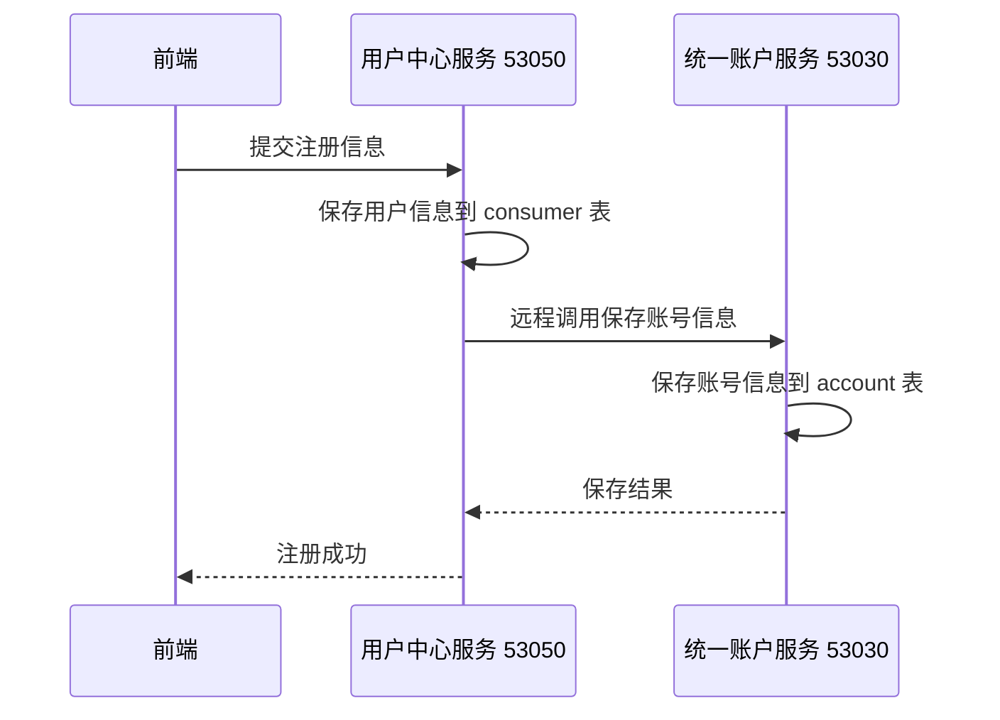

# 注册的最后一步：保存用户信息为什么要写两张表、动两个服务

注册被拆成三个小功能：发送并获取短信验证码、校验手机号和验证码、保存用户信息。前两步已经实现并测试通过，最后一步动手之前，需求层面有一个反直觉的设计必须先想明白：保存一份用户信息，居然要在两个微服务里各落一次库。这个设计不是绕弯，而是项目在用户模型上刻意做的分离，它的好处与代价都需要在编码前算清楚。

## 先给结论

- 保存用户信息是校验结果的直接延续：校验返回 0 表示新用户，走注册流程保存信息；返回 1 表示老用户，直接登录，注册到此为止。
- 数据要落两处：用户中心服务保存用户业务信息到 `p2p_consumer` 库的 `consumer` 表，统一账户服务保存账号认证信息到 `p2p_account` 库的 `account` 表。
- 两张表的存在源于用户与账号分离设计：姓名、身份证这类业务信息，与账号、密码、盐这类认证信息分开放，业务信息变化不波及认证授权。
- 分离的代价是数据同步：注册要两边都插入，删除要两边都删除，任何一处只改一半都会造成数据不一致。
- 流程约定为前端请求先到用户中心，用户中心保存自己的数据后远程调用统一账户服务，两边都保存成功才算注册成功。

## 需求定位：判定数字决定走哪条路

校验接口的返回值在这里接上了剧情。手机号查出来存在，返回 1，说明是老用户，前端直接进登录流程，注册的第三步与他无关；查出来不存在，返回 0，说明是新用户，新用户必须先把基本信息留下来，手机号是账户体系里最关键的标识，于是有了保存用户信息这一步。三步之间的衔接关系是：第一步把验证码发出去，第二步确认来者的身份状态，第三步把新用户的资料落库，注册流程就此闭环。

这一步在动手前只有需求分析，没有编码。分析要回答两个问题：数据落在哪，流程怎么走。

## 两处落库：consumer 表与 account 表各管一摊

数据落在两个微服务各自的库里。用户中心服务管理 `p2p_consumer` 库，用户信息进 `consumer` 表；统一账户服务管理 `p2p_account` 库，账号信息进 `account` 表。两张表的字段清单可以从课程资料的测试脚本里直接看到：

```sql
-- 用户中心侧：p2p_consumer 库的 consumer 表，存用户业务信息
-- 核心列：ID, USERNAME, MOBILE, IS_BIND_CARD
-- 讲义字段说明中还包含 FULLNAME, ID_NUMBER, USER_ID, USER_TYPE, ROLE 等列
USE `p2p_consumer`;
INSERT INTO `consumer`(`ID`, `USERNAME`, `MOBILE`, `IS_BIND_CARD`) VALUES
(1001, '13xxxxxxxxx', '13xxxxxxxxx', 0);

-- 统一账户侧：p2p_account 库的 account 表，存账号认证信息
-- 核心列：ID, USERNAME, MOBILE, PASSWORD, DOMAIN
-- DOMAIN 取 c 表示 C 端用户；密码存密文，配套 SALT 列存放盐值
USE `p2p_account`;
INSERT INTO `account`(`ID`, `USERNAME`, `MOBILE`, `PASSWORD`, `DOMAIN`) VALUES
(2001, '13xxxxxxxxx', '13xxxxxxxxx', '密文占位', 'c');
```

两张表里都有手机号与用户名，这不是冗余失误，而是分离设计的必然：用户中心认识的「用户」是带着姓名、身份证、会员属性的业务对象，统一账户认识的「账号」是能登录、能鉴权的凭证主体，手机号在两边各有一席，一边用来组织业务数据，一边用来组织认证数据。`consumer` 表的扩展列多为开户与借贷业务预备，`IS_BIND_CARD` 记录是否绑卡，`LOAN_AMOUNT` 这类字段在后续业务里才会启用，注册阶段只填核心列。

## 用户与账号分离的设计账

见过不少系统把用户名、密码、个人资料全塞进一张用户表，单表用起来确实省事，为什么这个项目要拆成两张？设计动机在于两类信息的变化频率与敏感程度不同。账号认证信息追求稳定，账号、密码、盐一旦确定轻易不变，认证授权逻辑只围绕它们运转；用户业务信息变化频繁，改昵称、更新资料是家常便饭。分表之后，业务信息的任何改动都碰不到认证数据，授权链路的输入保持稳定，这正是分离换来的核心好处。

代价同样真实：一张逻辑上的「用户」被物理拆成两处，增删改全部要双写同步。注册是第一笔双写，将来删除账号也是两边一起删，任何一边只动了一半，用户中心与统一账户对同一个人的认知就开始分叉，这种不一致排查起来相当痛苦。项目后续还会围绕这个一致性引入分布式事务的讨论，眼下先把「必须两处保存」作为铁的约定记牢。数据库层面 `p2p_account` 与 `p2p_consumer` 是两个独立的库，各自归各自的微服务所有，服务之间不允许跨库读写，同步只能靠服务间的调用协作完成。

## 流程约定：先用户中心，再统一账户

保存动作的发起方与顺序在流程图上已经画定：前端发注册请求，先到用户中心服务；用户中心保存用户信息到自己的表，然后远程调用统一账户服务；统一账户服务保存账号信息，两边都成功，注册才算成功。整条链路是一次由用户中心主导的两段式保存：



两个微服务在这次协作里做的事是同一种：往自己的表里插数据。区别在于分工与被依赖关系，用户中心是流程的入口与组织者，统一账户是被调用的账号管理方。为下次编码立下的目标由此明确：用户中心要提供注册接口，内部完成本地保存并组装远程调用；统一账户要暴露账号保存的接口供它调用；两边的数据访问层、实体、业务层都围绕各自表结构展开。需求到此交代完毕，编码按这份蓝图推进。

## 常见误区

- **以为保存用户信息只写一张表。** 错例：在统一账户服务里把资料插进 `account` 表就认为注册完成，用户中心那边查无此人。正解：注册要求两处落库，`consumer` 表与 `account` 表各存各的职责字段，缺一边就是脏数据。
- **把两张表当成主从关系或复制关系。** 正解：两张表是同一个用户在两个领域的投影，各自独立主键、各自独立维护，手机号与用户名是业务上对齐的锚点，不是主外键同步关系。
- **跳过需求分析直接开写代码。** 错例：上来就在统一账户服务里加保存接口，写完才发现用户中心才是请求入口，远程调用的方向搞反了。正解：流程图定的是谁先谁后、谁调用谁，需求分析阶段把方向钉死，编码时才不会返工。
- **用同一套字段清单填两张表。** 错例：把姓名、身份证等业务字段塞进 `account` 表，或者把密码、盐挪进 `consumer` 表。正解：认证字段归账号侧，业务字段归用户侧，字段搬家等于推翻分离设计。

## 面试可能被问到的问题

1. 面试官追问：「用户信息和账号信息拆成两张表、两个服务，图什么？」
   答：图的是变更隔离与职责清晰。认证信息稳定且敏感，围绕它建立的认证授权逻辑不希望被业务字段的高频变更波及；业务信息灵活多变，放在用户中心独立演进。分离之后各自的数据访问、缓存、安全策略都可以按自己的节奏优化，代价是写操作要跨服务双写同步。
2. 面试官追问：「两个服务各存一份手机号，怎么保证两边数据一致？」
   答：短期靠流程约束，注册流程里用户中心先落库再远程调用统一账户，两边都成功才响应成功，任一边失败按失败处理。长期看这类跨服务写一致性问题需要分布式事务或最终一致性方案配合，比如消息通知加补偿重试，课程在注册流程后续会专门讨论这个话题。
3. 面试官追问：「为什么注册请求的入口是用户中心而不是统一账户服务？」
   答：注册面向的是「用户」这个业务概念，用户中心是用户领域的主导服务，页面上提交的姓名、身份证等资料也归它管理。统一账户服务定位是账号凭证的管理方，只对账号的创建与鉴权负责。入口放在领域归属明确的一方，流程组织与后续扩展都更顺。
4. 面试官追问：「需求分析阶段就要区分两张表的字段，这个边界怎么划？」
   答：按信息服务的对象划。为登录认证、密码校验、权限判定服务的字段归账号侧，如账号、密码密文、盐、状态；为业务运营、资料展示、风控服务的字段归用户侧，如姓名、身份证号、会员属性。有歧义的字段看它的变更频率与敏感级别，宁可重复一个锚点字段（手机号、用户名），也不把认证字段混进业务表。

## 配套资料

- 代码：`materials/code/10/_散落资料/`，其中开户讲义的归档副本附有测试种子数据 SQL，向 `p2p_consumer` 库的 `consumer` 表与 `p2p_account` 库的 `account` 表插入数据，正文两张表的核心字段清单以此为出处；内层文件名保留原始命名，路径只列到该层级。
- 代码：`materials/code/10/wanxinp2p/`，P2P 工程归档，用户中心服务模块在其中，可对照其工程结构与依赖组成；内层目录保留原始命名，路径只列到该层级。
- 讲义：`materials/docs/10/万信金融-第2章-讲义-开户v1.0.md`，开户业务流程与注册环节在整体链路中的位置，注册三步的划分以此为背景。
- 说明：保存用户信息的实现代码尚未编码，该单元止步于需求分析，表结构细节除资料可查的核心列外，其余字段按画面线的字段说明整理，密码密文以占位表示，手机号以 `13xxxxxxxxx` 占位，包名按 `com.study.finance` 系口径描述。
