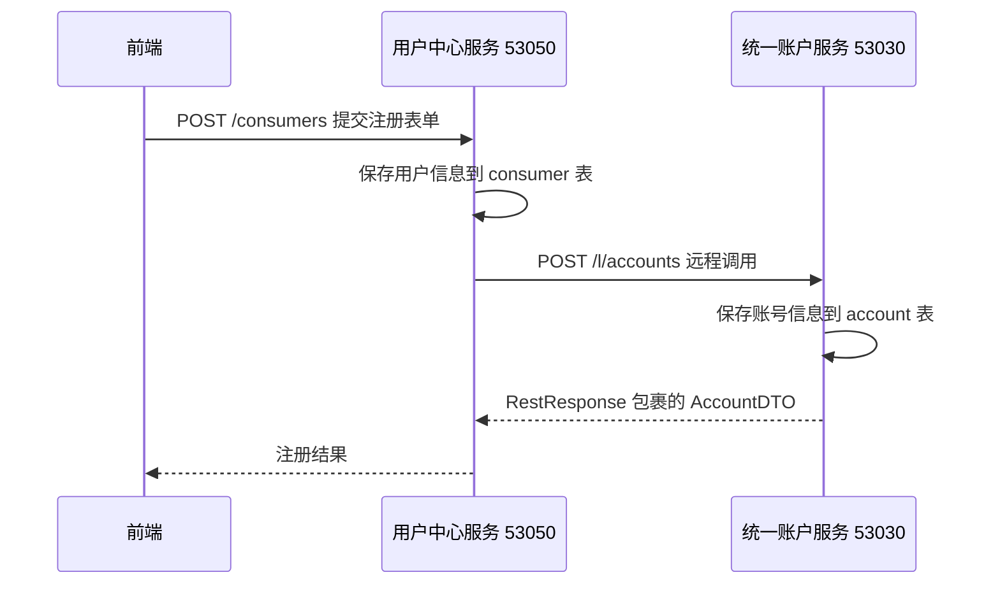

# 统一账户注册接口定义：API 工程分包与两个 DTO 的分工

注册的最后一步要动手编码了。需求分析时已经定调：保存用户信息要在用户中心与统一账户两处落库，流程由用户中心组织，先保存自己的数据再远程调用统一账户。真正写代码前冒出来的第一个问题不是怎么实现，而是从哪个服务开工、接口长什么样。统一账户在这个流程里是被远程调用的一方，它的接口不面向前端，路径怎么起、入参怎么收、返回值给谁看，都得在实现之前用一份接口契约钉死。

这节课把统一账户的注册接口定义出来。API 工程的分包结构要顺势调整一次，入参与出参各选一个 DTO 承担，请求路径按编码规范打上内部标记，Controller 挂上空实现并把 Swagger 注解一并补齐。契约立住之后，实现与调用两侧就都可以各自开工了。

## 先给结论

- 开发顺序可以自选，需求与流程想清楚了，从哪个服务开始都成立；本课按「先统一账户、后用户中心」推进，被调方的契约先立住，调用方才有明确的依赖目标。
- 接口全部定义在 `finance-api` 工程并按服务分包：`account` 包放统一账户的接口，`consumer` 包放用户中心的接口，DTO 进各自的 `model` 子包。
- 注册方法签名定为 `RestResponse<AccountDTO> register(AccountRegisterDTO)`：入参只收用户名、手机号、密码三项，出参回传带主键与默认值的完整账户信息。
- 这个接口不暴露给前端，按编码规范约定，请求路径以 `/l` 开头，最终定为 `POST /l/accounts`。
- 接口定稿后立刻在 Controller 里挂空实现，Swagger 注解同步补齐，文档页随之生成，契约在编译期就生效。

## 从哪个服务开工：顺序自由，契约先行

**第一，开发顺序没有标准答案。** 两个微服务都要写保存逻辑，谁先谁后都能做成，前提是自己对需求与流程已经想透。本课选择先做统一账户，理由很实际：用户中心的保存动作里包含一次对统一账户的远程调用，被调一方的接口先立起来，调用一侧编码时才有东西可指。整个协作关系画在时序图上是这样的：



图上值得盯住的只有一点：前端从头到尾只跟用户中心打交道，`/l/accounts` 这条请求永远只出现在用户中心与统一账户之间。统一账户的注册接口是纯内部接口，这个定位直接决定了它的路径写法与注解选择。

**第二，接口的定义位置不变。** 项目从第一个功能起就约定：所有表现层接口集中定义在 `finance-api`，服务工程只写实现。这样调用方与服务方共用同一份契约，接口改一处，两侧的编译器同时报错提醒，比口头约定可靠得多。

## API 工程分包：接口与 DTO 各归各家

`finance-api` 里原本已经有 `AccountAPI`，获取短信验证码、校验手机号和验证码两个方法都住在里面。随着服务越做越多，所有接口平铺在一个包里的做法开始显出维护成本：找接口靠肉眼翻文件，DTO 与接口混在一起，归属全靠命名猜。这节课顺势把包结构调整成按服务划分的两级结构：`api.account` 收统一账户的接口与模型，`api.consumer` 收用户中心的，各自的 DTO 再下沉一层进 `model` 子包。课程资料里的公共类原件可以佐证这套结构，`AccountRegisterDTO` 的包路径正是 `api.account.model` 这三级。

分包之后要做的就是在 `AccountAPI` 里新增注册方法。接口文件中三个方法并排，前两个已经实现并测试通过，新的一个是本课的产物：

```java
package com.study.finance.api.account;

import com.study.finance.api.account.model.AccountDTO;
import com.study.finance.api.account.model.AccountRegisterDTO;
import com.study.finance.common.domain.RestResponse;
import io.swagger.annotations.ApiImplicitParam;
import io.swagger.annotations.ApiOperation;
import org.springframework.web.bind.annotation.PostMapping;

public interface AccountAPI {

    // 获取短信验证码 getSMSCode 与 校验手机号和验证码 checkMobile 此处省略

    /**
     * 用户注册，保存账号信息
     * @param accountRegisterDTO 账户注册信息
     * @return 注册后的完整账户信息
     */
    @ApiOperation(value = "用户注册", notes = "账户注册信息", httpMethod = "POST")
    @ApiImplicitParam(name = "accountRegisterDTO", value = "账户注册信息",
            required = true, dataType = "AccountRegisterDTO", paramType = "body")
    @PostMapping(value = "/l/accounts")
    RestResponse<AccountDTO> register(AccountRegisterDTO accountRegisterDTO);
}
```

方法名 `register` 没有起名的纠结，注册这个动作在系统里的叫法高度统一，见名知义即可。

## 入参与出参：两个 DTO 各管一头

**入参用 `AccountRegisterDTO`。** 保存账号需要哪些信息，前端注册表单上就有哪些：用户名、手机号、密码，三项足够。字段一多就有越俎代庖的嫌疑，账号该由服务端补齐的东西不该让调用方传。这个公共类在课程资料里已经备好，拿来即用：

```java
package com.study.finance.api.account.model;

import io.swagger.annotations.ApiModel;
import io.swagger.annotations.ApiModelProperty;
import lombok.Data;

@Data
@ApiModel(value = "AccountRegisterDTO", description = "账户注册信息")
public class AccountRegisterDTO {

    @ApiModelProperty("用户名")
    private String username;

    @ApiModelProperty("手机号")
    private String mobile;

    @ApiModelProperty("密码")
    private String password;
}
```

类上的 `@Data` 交给 Lombok 生成 getter、setter 与 toString，字段上的 `@ApiModelProperty` 负责 Swagger 文档里每个字段的含义说明，一个注解对应一行文档，接口页的可读性全靠它们撑着。

**出参用 `AccountDTO`。** 注册成功后回传的不是回声，而是一份补齐了默认值的账户档案：主键 `id` 是数据库分配的，账号状态 `status` 新注册必然是正常态，域 `domain` 标记用户属于 C 端还是 B 端。这些值调用方没有传，服务端定，所以出参天然比入参多几个字段，两个 DTO 各管一头：

```java
package com.study.finance.api.account.model;

import io.swagger.annotations.ApiModel;
import io.swagger.annotations.ApiModelProperty;
import lombok.Data;

@Data
@ApiModel(value = "AccountDTO", description = "账户信息")
public class AccountDTO {

    @ApiModelProperty("标识")
    private Long id;

    @ApiModelProperty("用户名")
    private String username;

    @ApiModelProperty("手机号")
    private String mobile;

    @ApiModelProperty("账号状态")
    private Integer status;

    @ApiModelProperty("域(c：c端用户；b：b端用户)")
    private String domain;
}
```

顺带把分层口径再钉一次：接口层流动的永远是 DTO，与数据库表建立映射的实体类不出服务边界。这套约定写在编码规范的分层章节里，实现阶段转换实体时还会再遇到它。

## 内部路径约定与空实现

路径 `POST /l/accounts` 里的 `/l` 是本课最容易被轻视的细节。编码规范对接口路径有条成文规定：不暴露给前端的内部接口，请求地址以 `/l` 开头。它解决的是一个治理问题：接口文档与日志里扫一眼路径前缀，就知道这条接口的消费方是谁。前端能调的接口走正常路径，内部接口一律 `l` 打头，网关与安全策略也能按这个约定做统一处理。注册账号的保存动作只被用户中心远程调用，所以是 `l/accounts`，而不是光秃秃的 `/accounts`。

请求方式选 POST 的理由也顺理成章：注册要在数据库里产生新数据，属于典型的非幂等写操作，语义上就该用 POST，请求体承载 JSON 参数。契约立完，Controller 这边照惯例先把空实现挂上，让工程处于可编译状态：

```java
package com.study.finance.account.controller;

import com.study.finance.api.account.AccountAPI;
import com.study.finance.api.account.model.AccountDTO;
import com.study.finance.api.account.model.AccountRegisterDTO;
import com.study.finance.common.domain.RestResponse;
import io.swagger.annotations.Api;
import org.springframework.web.bind.annotation.PostMapping;
import org.springframework.web.bind.annotation.RequestBody;
import org.springframework.web.bind.annotation.RestController;

@RestController
@Api(value = "统一账户服务", tags = "Account")
public class AccountController implements AccountAPI {

    @Override
    @PostMapping(value = "/l/accounts")
    public RestResponse<AccountDTO> register(@RequestBody AccountRegisterDTO accountRegisterDTO) {
        // 业务层实现完成前先返回 null，契约先立、功能后补
        return null;
    }
}
```

`@RequestBody` 在这里先占住位置：入参从请求体的 JSON 反序列化而来，这个注解在实现阶段是忘写率最高的一处，先写上养成习惯。Controller 实现接口、补齐 Swagger 注解之后，打开文档页就能看到「用户注册」这一项带着参数说明躺在那里，与前面两个接口排成一列。至此统一账户侧的接口契约全部就位，下一课往业务层里填实现。

## 常见误区

- **把内部接口路径当成普通接口起名。** 错例：路径写成 `/accounts`，与将来可能出现的公开接口混在一起，文档上分不清谁给前端用、谁给服务间调用用。正解：不暴露给前端的接口以 `/l` 开头，`/l/accounts` 一眼可辨。
- **入参出参共用一个 DTO。** 错例：图省事直接用 `AccountDTO` 做入参，让前端把 `status`、`domain` 也传进来。正解：入参收用户真正填写的字段，出参回传服务端补齐后的完整档案，两个类各司其职，混用等于把默认值的决定权交给调用方。
- **接口随手定义在服务工程里。** 错例：把 `register` 写进 `finance-account-service`，用户中心要调用时依赖不上，只能另造一份签名。正解：接口进 `finance-api` 按服务分包，契约一份，两侧共用。
- **Controller 只实现接口，不补 Swagger 注解。** 错例：文档页上新接口光秃秃，参数含义全靠猜。正解：`@ApiOperation` 与 `@ApiImplicitParam` 随接口一起加，注解是文档的源头，写注解就是写文档。

## 面试可能被问到的问题

1. 面试官追问：「接口为什么定义在独立的 API 工程，而不是各自服务里？」
   答：API 工程让契约成为可被依赖的公共件。调用方与服务方引用同一份接口定义，编译期就能发现签名不一致；DTO 也集中在 API 工程里，序列化反序列化两侧对称。接口散在各自服务里，跨服务调用只能靠复制签名或手工对齐，改一处漏一处的风险很高。
2. 面试官追问：「`/l` 前缀这种约定有什么实际价值？」
   答：它用最轻量的方式区分了接口的可见范围。路径前缀本身就是元数据，文档审查、日志排查、网关路由都能按前缀识别内部接口；配套的安全策略可以按前缀统一拦截外部流量，避免每个接口单独声明可见性。约定先于配置，团队规模越大收益越明显。
3. 面试官追问：「注册接口的入参和出参为什么用两个不同的 DTO？」
   答：入参边界最小化，只收调用方有权利提供的字段，服务端补齐的默认值不允许外部传入，否则账号状态、用户域这些本该服务端控制的数据会被越权改写。出参边界最大化，回传完整档案减少二次查询。收发两侧的诉求不同，合成一个类必然顾此失彼。
4. 面试官追问：「`RestResponse<AccountDTO>` 里的泛型起什么作用？」
   答：统一的响应结构由 code、msg、result 三部分组成，泛型把 result 的类型约束到具体 DTO，调用方拿到响应后不需要强制转换，文档里也能显示出 result 的结构。没有泛型的话，所有接口的 result 都是弱类型，序列化工具与文档生成都拿不到准确信息。
5. 面试官追问：「为什么注册接口用 POST 而不用 GET？」
   答：注册是创建资源类的写操作，非幂等，重复提交会产生多条账号记录，语义上不属于 GET；同时密码这类敏感信息放请求体里，不进 URL，避免被浏览器历史、网关日志、代理服务器记录明文。GET 适合查询，POST 适合提交，这条边界在 REST 风格里是基本功。

## 配套资料

- 代码：`materials/code/10/资料/公共类/`，`AccountRegisterDTO.java` 与 `AccountDTO.java` 的真实原件在此，包路径为 `api.account.model`，正文分包结构的出处即这两个文件；`Account.java` 实体、`PasswordUtil` 加密工具也在本目录，后续实现篇会用到。
- 代码：`materials/code/10/wanxinp2p_apollo/`，公共工程 `wanxinp2p-common` 内含真实 `RestResponse` 响应包装类（对应正文的 `finance-common`），泛型设计、`success` 静态方法均可对照；内层目录保留原始命名，引用路径列到工程目录为止。
- 代码：`materials/code/10/wanxinp2p/`，P2P 工程归档，可对照其 api 工程与服务工程的模块划分；内层目录保留原始命名，路径只列到该层级。
- 讲义：`materials/docs/10/万信金融-第2章-讲义-开户v1.0.md`，开户整体链路与注册环节的位置，接口定义在流程中的节点以此为背景。
- 说明：`finance-account-service` 的接口与控制器代码随课程编码完成，资料归档未单独收录，正文按画面线与本课写法补全，包名按 `com.study.finance` 系改写，手机号等敏感示例以 `13xxxxxxxxx` 占位。
