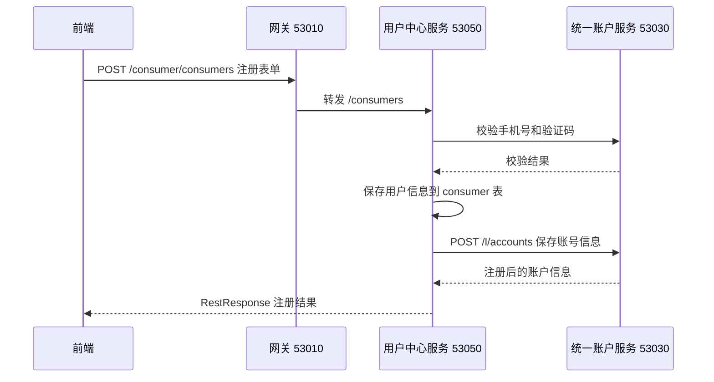

# 用户中心注册接口定义：ConsumerAPI 立约，一张表单收齐两边数据

统一账户一侧的保存功能已经落地，注册流程还差另一半：用户中心的保存。它跟统一账户那次立约套路相同，处境却不同，这是整个注册流程的入口，接口直接面对前端，实现时还要替前端去远程调用统一账户。用户中心此前只有两个测试方法，从未正式定义过业务接口，`consumer` 包还是空的，这次要从一个空文件开始立约。

接口本身几分钟就能写完，真正值得想清楚的是入参 DTO 的设计：一张表单收齐的字段里，有一半不是用户中心自己用的。

## 先给结论

- 用户中心的接口集中进 `finance-api` 的 `consumer` 包，新建 `ConsumerAPI`，`register` 是它的第一个业务方法，此后用户中心所有接口都归这个文件。
- 入参 `ConsumerRegisterDTO` 一次收齐五个字段：用户名、手机号、密码、角色（B 借款人、I 投资人）、验证码 key；密码等账号字段并非用户中心所用，是实现阶段转发给统一账户的。
- 返回值用不带泛型的 `RestResponse`，注册成败由 code 表达，页面不依赖返回的业务对象。
- 路径定为 `POST /consumers`：这是暴露给前端的公开接口，没有内部接口的 `/l` 前缀。
- Controller 实现 `ConsumerAPI`，原有 hello、hi 两个测试方法保留，`register` 先空实现，等远程调用环境就绪后再填实现。

## 换个服务，同一套契约思路

**接口仍然是表现层的接口。** 前后端并行的效率来自契约先行：接口签名一确定，前端按契约写页面，后端按契约写实现，两边互不等待。用户中心的 `ConsumerController` 之前只有 hello 与 hi 两个测试方法，用来验证工程能跑、Swagger 能出文档，没有实现过任何接口。这节课它要正式挂上第一份契约，同时项目里也多出一个新的接口文件：

```java
package com.study.finance.api.consumer;

import com.study.finance.api.consumer.model.ConsumerRegisterDTO;
import com.study.finance.common.domain.RestResponse;
import io.swagger.annotations.ApiImplicitParam;
import io.swagger.annotations.ApiOperation;
import org.springframework.web.bind.annotation.PostMapping;

/**
 * 用户中心接口 API
 */
public interface ConsumerAPI {

    /**
     * 用户注册，保存用户信息
     * @param consumerRegisterDTO 用户注册信息
     * @return 注册结果
     */
    @ApiOperation(value = "用户注册", notes = "用户注册信息", httpMethod = "POST")
    @ApiImplicitParam(name = "consumerRegisterDTO", value = "用户注册信息",
            required = true, dataType = "ConsumerRegisterDTO", paramType = "body")
    @PostMapping(value = "/consumers")
    RestResponse register(ConsumerRegisterDTO consumerRegisterDTO);
}
```

接口名照着 `AccountAPI` 的语式起作 `ConsumerAPI`，定义位置在 `finance-api` 的 `com.study.finance.api.consumer` 包，与统一账户侧的结构完全对称。方法名沿用 `register`，两个服务的注册方法同名不同义：一个管账号，一个管用户，名字统一反而降低了跨服务阅读时的理解成本。

返回值这里没有指定泛型。对比统一账户的 `RestResponse<AccountDTO>`，差异是刻意为之：注册接口面向页面，页面关心的是「成功还是失败」，成败由 code 与 msg 表达，不需要回传业务对象；统一账户的注册接口返回完整账户档案，是因为它的消费方是另一个服务，服务之间传递的是数据。消费方不同，返回值的丰俭就不同。

## 入参 DTO：一张表单两边用

入参 `ConsumerRegisterDTO` 在课程资料的公共类里备好原件，字段比 `AccountRegisterDTO` 多出两个：

```java
package com.study.finance.api.consumer.model;

import io.swagger.annotations.ApiModel;
import io.swagger.annotations.ApiModelProperty;
import lombok.Data;

@Data
@ApiModel(value = "ConsumerRegisterDTO", description = "用户注册信息")
public class ConsumerRegisterDTO {

    @ApiModelProperty("用户名")
    private String username;

    @ApiModelProperty("手机号")
    private String mobile;

    @ApiModelProperty("密码")
    private String password;

    @ApiModelProperty("用户角色.B借款人or I投资人")
    private String role;

    @ApiModelProperty("验证码key")
    private String key;
}
```

逐个字段看分工。**用户名、手机号、密码三个字段与账号侧对齐**，用户中心保存用户信息时并不使用它们，它们是为远程调用统一账户准备的：用户中心拿到整张表单后，本地保存业务数据，再把账号相关的字段转发给统一账户去建账号。DTO 作为前后端统一契约，把一次交互要收齐的数据一次装满，避免前端对两个服务各发一次请求。

**角色字段 role** 是注册页上的单选项，B 表示借款人、I 表示投资人，决定了这个账号后续能参与哪类业务，用户中心把它存进 `consumer` 表的角色列。**验证码 key** 是获取验证码时接口返回的那个 `sms:` 前缀校验标识，前端发送注册请求时把它一并回传。校验手机号和验证码的接口此前已经实现过，注册动作正式开始前要用它再对一次答案，防止有人跳过校验环节直接调保存接口，这道关设在实现阶段的业务层里。

整张表单与接口的协作关系按设计蓝图走一遍：



图上有两次对统一账户的调用：先校验、后保存，方向都是用户中心发起。这张图是实现阶段的施工图，接口定义阶段把它画出来，是为了让 `register` 的入参与返回值在设计时就经得起推敲。

## 参数校验的约定与 Controller 空实现

参数校验在这个接口上有明确的分工约定。必填项交给 Swagger 注解表达，`@ApiImplicitParam` 的 `required = true` 写进文档，前端与测试打开页面就能看到；格式与业务校验不在 Controller 里堆 if，手机号在注册前的校验环节已经对过验证码，注册接口的校验重心放在业务层保存前的完整性检查，已有的能力复用即可，重复造轮子只会让校验逻辑散落三处。

Controller 这边把契约接上，类声明实现 `ConsumerAPI`，原有两个测试方法原样保留：

```java
@RestController
@Api(value = "用户服务的Controller", tags = "Consumer", description = "用户服务API")
public class ConsumerController implements ConsumerAPI {

    @ApiOperation("测试hello")
    @GetMapping(path = "/hello")
    public String hello() {
        return "hello";
    }

    @ApiOperation("测试hi")
    @ApiImplicitParam(name = "name", value = "姓名", required = true, dataType = "String")
    @PostMapping(path = "/hi")
    public String hi(String name) {
        return "hi," + name;
    }

    @Override
    @PostMapping(value = "/consumers")
    public RestResponse register(@RequestBody ConsumerRegisterDTO consumerRegisterDTO) {
        // 业务实现待数据访问环境与远程调用就绪后补齐
        return null;
    }
}
```

`@RequestBody` 随空实现一起先写上，JSON 请求体反序列化成 `ConsumerRegisterDTO` 的入口就靠它。Swagger 注解与统一账户侧同款，照着前面接口的样子补齐即可，这类体力活没有任何技术含量，但文档的可读性全指望它们。到这里，用户中心侧的接口契约立完，工程处于可编译状态，接下来两课补齐数据访问环境，再把空实现填成带远程调用的完整业务。

## 常见误区

- **把 `ConsumerAPI` 建进 `finance-consumer-service`。** 错例：接口写在服务工程里，用户中心自己编译没问题，将来别处要引用这份契约时只能复制一份签名。正解：接口进 `finance-api` 按服务分包，一份契约两侧共用。
- **注册路径加上了 `/l` 前缀。** 错例：模仿统一账户写成 `/l/consumers`，前端照着调用直接 404。正解：`/l` 是内部接口标记，注册入口是公开接口，路径就是 `/consumers`，前缀用错方向等于把接口藏了起来。
- **返回值随手定成 String 或 Map。** 错例：`String register(...)` 返回「ok」，前端拿不到统一的 code 结构。正解：统一用 `RestResponse` 承载成败，与全项目响应口径一致，异常处理器、网关、前端拦截器都按这个结构工作。
- **认为 DTO 里的 password 字段是设计失误。** 错例：觉得用户中心不存密码就该把字段删掉，实现阶段才发现统一账户建账号要密码，被迫改接口再改前端。正解：DTO 是一次交互的完整契约，字段服务的是整条链路，不只是当前服务。

## 面试可能被问到的问题

1. 面试官追问：「注册入口为什么放在用户中心，前端直接调统一账户不行吗？」
   答：注册面向的是「用户」这个业务概念，用户资料归用户中心管，账号只是用户的一个附属凭证。入口放在领域归属明确的一方，流程才能由它统一组织：先校验、再本地保存、后远程建账号，任一步失败都能由它给出统一结论。让前端直连统一账户，用户数据的保存与账号创建就成了两个孤立请求，一致性没有责任人。
2. 面试官追问：「一个 DTO 收齐两个服务要用的字段，和每个服务各定义一个入参，你怎么权衡？」
   答：一张表单收齐的好处是前端一次提交、契约简单、字段只定义一遍，代价是 DTO 里有「本服务不用的字段」，读代码时要靠注释说明归属；每个服务各收各的参数则边界干净，但前端要发多次请求或网关要拆包，一致性交给了前端保证。注册这种强流程场景倾向前者，字段归属写清楚即可；服务间被动的内部接口倾向后者，边界更小。
3. 面试官追问：「注册接口返回值为什么不给泛型，统一账户的却给了？」
   答：返回值的丰俭跟着消费方走。页面消费的接口只需要成败结论，code 与 msg 足够，给泛型反而诱导前端依赖不该依赖的数据结构；服务消费的接口要回传完整业务对象供下游继续处理，泛型让 result 的类型在编译期可查、文档里可见。接口设计里「给谁用」决定「给多少」。
4. 面试官追问：「注册时为什么还要再校验一次验证码？前端不是刚校验过吗？」
   答：前端校验属于体验优化，绕过它的成本几乎为零：用 Postman 或脚本可以直接调保存接口。服务端必须在保存前的业务层里凭 key 再对一次答案，这道校验才是安全边界。原则是客户端的一切校验都当它不存在，服务端对每个写操作独立把关。
5. 面试官追问：「role 用 String 存 B 和 I 两个字母，你怎么看这种设计？」
   答：字符串入库对数据库友好，跨表跨服务传输不用做映射转换，代价是取值约束只能靠代码自觉。改进方向是在接口层用枚举约束入参、在文档里枚举取值，入库仍保持字符串；或者数据库加 CHECK 约束兜底。比用 magic number 强的是 B、I 自带语义，日志里一眼可读。

## 配套资料

- 代码：`materials/code/10/资料/公共类/`，`ConsumerRegisterDTO.java` 与 `ConsumerDTO.java` 的真实原件在此，包路径为 `api.consumer.model`，字段注释（含角色取值与验证码 key 的说明）与正文一致。
- 代码：`materials/code/10/wanxinp2p/`，用户中心服务模块的基线代码在此，`ConsumerController` 只有 hello 与 hi 两个测试方法、启动类与 pom 可对照改造起点；内层目录保留原始命名，路径只列到该层级。
- 代码：`materials/code/10/wanxinp2p_apollo/`，公共工程 `wanxinp2p-common` 内含真实 `RestResponse` 响应包装类（对应正文的 `finance-common`）；内层目录保留原始命名，引用路径列到工程目录为止。
- 讲义：`materials/docs/10/万信金融-第2章-讲义-开户v1.0.md`，开户链路里用户中心与统一账户的分工，注册入口的流程位置以此为背景。
- 说明：`finance-consumer-service` 的接口与控制器代码随课程编码完成，归档未单独收录，正文按画面线与本课写法补全，包名按 `com.study.finance` 系改写；网关路由前缀以网关配置为口径，正文时序图中的 `/consumer` 前缀为按网关写法的示例。
