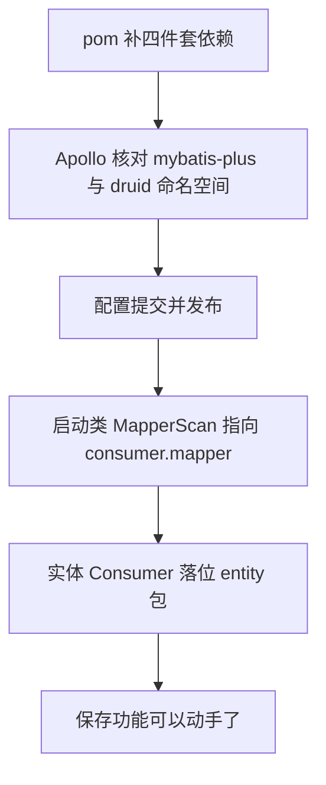

# 用户中心搭 MyBatis-Plus 环境：依赖、配置、扫描、实体四步补齐

> 🔒 安全提示：文中示例的口令/密钥均为课程教学环境演示口径，生产环境的安全要求见《安全与合规须知》。

用户中心的注册接口已经立约，Controller 里挂着空实现等实现。动手前一盘点才发现撞上了墙：这个服务从搭建那天起就没打算碰数据库，hello、hi 两个测试方法全是纯 Web 响应，翻遍依赖列表找不到 MyBatis-Plus 的影子，连数据源都没有。统一账户那边的编码经验再多，环境是空的就一行都写不了。

搭环境本身没有新知识，全是当初搭 MP 入门工程的老套路：依赖、配置、扫描，外加一个实体类。真正的风险在于每一步都眼熟，眼熟就容易漏，漏一步或抄错一处，问题全憋到运行期才炸。这节课把四步走完，每步都点出容易翻车的地方。

## 先给结论

- 用户中心此前没有任何数据操作，MP 环境从零补齐，四步：pom 依赖、Apollo 配置、启动类 `@MapperScan`、实体类落位。
- 依赖四件套：`mybatis-plus-boot-starter`、`mybatis-typehandlers-jsr310`、`druid-spring-boot-starter`、`mysql-connector-java`，版本全部由父工程 dependencyManagement 统一管理，模块里不写版本号。
- Apollo 侧核对两个命名空间：`micro_service.mybatis-plus` 里的 `mapper-locations` 与 `typeAliasesPackage`，`micro_service.spring-boot-druid` 里指向 `p2p_consumer` 库的数据源；模板默认值恰好以 consumer 为例，实际只微调了 mapper-locations。
- 配置改完必须点「发布」，Apollo 客户端拉取的是已发布版本，只提交不发布，服务重启多少次都读不到新值。
- 启动类加 `@MapperScan("com.study.finance.consumer.mapper")`；从统一账户粘注解时把包名里的 account 换成 consumer，粘代码后遗症在这一步高发。

## 盘点家底：用户中心缺什么

先看清楚现状再动手。`finance-consumer-service` 的 pom 里，注册发现的 Eureka 客户端、服务容错的 Hystrix、重试、Web、Redis、RocketMQ 都在，MySQL 驱动也在，唯独没有 MyBatis-Plus 与连接池。驱动在而 ORM 缺位，就好比音响齐备没有唱片，SQL 还是发不出去。统一账户当初是怎么补齐这套家当的，用户中心照方抓药即可，MP 讲义的入门篇把每一步都写过，方法上没有任何秘密。

四步的先后有讲究：依赖是地基，配置是管道，扫描是开关，实体是砖。顺序错了也不会立刻报错，但会浪费排查时间，按这个次序走，每步都能被上一步验证。

## 第一步：pom 补依赖

四个依赖一次补齐，坐标照抄统一账户的 pom，版本一个都不写：

```xml
<!-- MyBatis-Plus 的 Spring Boot 支持，版本由父工程统一管理 -->
<dependency>
    <groupId>com.baomidou</groupId>
    <artifactId>mybatis-plus-boot-starter</artifactId>
</dependency>
<!-- JSR310 日期时间类型支持，LocalDateTime 等类型入库要用 -->
<dependency>
    <groupId>org.mybatis</groupId>
    <artifactId>mybatis-typehandlers-jsr310</artifactId>
</dependency>
<!-- Druid 数据库连接池 -->
<dependency>
    <groupId>com.alibaba</groupId>
    <artifactId>druid-spring-boot-starter</artifactId>
</dependency>
<!-- MySQL 驱动，工程里已有，确认坐标即可 -->
<dependency>
    <groupId>mysql</groupId>
    <artifactId>mysql-connector-java</artifactId>
</dependency>
```

版本号去哪了？在父工程 `finance` 的 dependencyManagement 里锁着，课程资料里父工程 pom 的真实版本是：MP starter 3.1.0、typehandlers-jsr310 1.0.2、Druid starter 1.1.16、MySQL 驱动 8.0.11。模块里手写版本是依赖冲突的常见源头，父工程定一份、几十个模块跟随一份，将来统一升级只改一处。引入后刷新 Maven，依赖树里能看到 `mybatis-plus`、`druid` 与驱动一起就位，第一步才算完成。

## 第二步：Apollo 两个命名空间

用户中心的配置托管在 Apollo，工程的 `application.yml` 里列明了要加载的命名空间，本地文件只需要这几行：

```yaml
app:
  id: consumer-service
apollo:
  bootstrap:
    enabled: true
    namespaces: application,micro_service.spring-boot-druid,micro_service.spring-boot-http,micro_service.spring-eureka,micro_service.spring-hystrix,micro_service.spring-ribbon,micro_service.spring-boot-redis,micro_service.mybatis-plus,micro_service.spring-rocketmq

spring:
  application:
    name: consumer-service
```

数据库与 MP 相关的配置全在这串命名空间里，要核对的是两个。**`micro_service.mybatis-plus`** 里的 MP 专属配置项，`typeAliasesPackage` 指实体类别名扫描包，模板默认值恰好写的就是 consumer 的 entity 包，核对无误即可；`mapper-locations` 指 Mapper XML 的扫描路径，课程把它微调成与项目其他服务完全一致的路径层级，全项目一套写法，避免各服务各自为战：

```properties
# 命名空间 micro_service.mybatis-plus
mybatis-plus.mapper-locations = classpath:/mapper/*.xml
mybatis-plus.typeAliasesPackage = com.study.finance.consumer.entity
```

**`micro_service.spring-boot-druid`** 里是数据源四件套，模板默认就以 consumer 为例，核对指向正确即可：

```properties
# 命名空间 micro_service.spring-boot-druid，数据源指向用户中心自己的库
spring.datasource.url = jdbc:mysql://localhost:3306/p2p_consumer?useUnicode=true&characterEncoding=utf8&useSSL=false&serverTimezone=UTC
spring.datasource.driver-class-name = com.mysql.cj.jdbc.Driver
spring.datasource.username = root
spring.datasource.password = 123456
```

配置改完在 Apollo 控制台点发布。Apollo 的配置生命周期里，「提交」只是保存，「发布」才让配置成为客户端可拉取的版本，客户端靠长轮询感知已发布内容的变更。只提交不发布是配置中心使用中最常见的空转：改了、提交了、重启了、没生效，问题就出在少点的那一下。

## 第三步：启动类加 @MapperScan

MP 环境的最后一道开关在启动类上：扫描 Mapper 接口所在的包，扫描到的接口才会被注册成可注入的 Bean。用户中心的启动类此前的注解只有应用与注册相关的三个，现在补上第四个：

```java
@SpringBootApplication
@EnableDiscoveryClient
@EnableFeignClients(basePackages = {"com.study.finance.consumer.agent"})
@MapperScan("com.study.finance.consumer.mapper")
public class ConsumerService {

    public static void main(String[] args) {
        SpringApplication.run(ConsumerService.class, args);
    }
}
```

这行注解十有八九是从统一账户的启动类粘来的，粘完必须逐字符核对包名：扫描路径里写着 account 还是 consumer？粘代码后遗症就在这类细节上发作，`@MapperScan` 指向一个不存在的包，Spring 启动时往往不吭声，等业务层注入 Mapper 时才抛 `NoSuchBeanDefinitionException`，报错位置离病因隔着一个启动过程，排查极不划算。包名核对是粘代码后的一把硬纪律。此刻 `consumer.mapper` 包里还没有任何 Mapper 接口，扫描的是目录本身，实现篇把 `ConsumerMapper` 放进去，注册即生效。

## 第四步：实体类落位

数据操作围着表转，实体类是表在 Java 世界的投影。用户中心对应的是 `p2p_consumer` 库的 `consumer` 表，实体类在课程资料的公共类里备好原件，复制进 `com.study.finance.consumer.entity` 包：

```java
@Data
@TableName("consumer")
public class Consumer implements Serializable {

    private static final long serialVersionUID = 1L;

    /** 主键 */
    @TableId(value = "ID", type = IdType.AUTO)
    private Long id;

    /** 用户名 */
    @TableField("USERNAME")
    private String username;

    /** 真实姓名 */
    @TableField("FULLNAME")
    private String fullname;

    /** 身份证号 */
    @TableField("ID_NUMBER")
    private String idNumber;

    /** 用户编码，全局唯一，用户在存管系统标识 */
    @TableField("USER_NO")
    private String userNo;

    /** 平台预留手机号 */
    @TableField("MOBILE")
    private String mobile;

    /** 用户类型，个人or企业，预留 */
    @TableField("USER_TYPE")
    private String userType;

    /** 用户角色，借款人or投资人 */
    @TableField("ROLE")
    private String role;

    // 存管授权列表、绑卡标记、状态、可贷额度、请求流水号等字段同理，此处省略
}
```

注解各司其职，需要能脱口而出：`@Data` 是 Lombok 的，编译期生成 getter、setter、toString 这些样板方法；`@TableName("consumer")` 把类绑到同名表；`@TableId` 标记主键，`type = IdType.AUTO` 声明主键交给数据库自增列生成，保存时不用手工赋值，插入成功后 MP 会把自增回来的主键回填进实体；`@TableField` 把 Java 属性逐一对到全大写的数据库列上。实体列的完整清单可以在数据库工具里打开 `consumer` 表对照熟悉，注册功能暂时只用到其中几列，其余列是开户、借贷业务的地基，先备着。

四步走完，环境验收的标准很朴素：工程能启动、Apollo 配置已发布、实体与包结构就位。画一张检查图，环境出问题时按图逐格排查：



图的每一个节点都对应一类典型故障：依赖没进依赖树，启动直接 NoClassDefFoundError；配置没发布，数据源连的还是旧值或干脆连不上；扫描包名写错，注入 Mapper 时炸；实体注解缺失，运行期 SQL 报 Unknown column。按图排查，比在代码里翻来翻去找答案快得多。

## 常见误区

- **Apollo 只提交不发布。** 错例：改完数据源点保存，重启服务后依旧报连接失败。正解：Apollo 客户端只认已发布版本，提交后的那条配置必须点发布，控制台上看到发布记录才算落地。
- **`@MapperScan` 的包名从别的服务原样照抄。** 错例：扫描路径里还是 account，`ConsumerMapper` 注册不上，业务层注入时报找不到 Bean。正解：粘完注解逐字符核对包名，扫描目标必须是本服务的 mapper 包。
- **在模块 pom 里手写依赖版本。** 错例：给 MP starter 写死一个版本，与父工程锁定的 3.1.0 冲突，依赖仲裁结果不可预期。正解：模块只写 groupId 与 artifactId，版本交给父工程 dependencyManagement。
- **实体漏写 `@TableField` 或列名映射错。** 错例：字段 `userNo` 不加注解，MP 按默认驼峰转下划线规则映射成 `user_no`，而表里列是 `USER_NO`，运行期报 Unknown column。正解：课程表列名风格是全大写，实体上一律显式 `@TableField` 指明列名，不赌默认映射规则。

## 面试可能被问到的问题

1. 面试官追问：「`@MapperScan` 与接口上的 `@Mapper` 注解有什么区别？」
   答：`@Mapper` 逐个标注，每个 Mapper 接口都要写一遍；`@MapperScan` 按包批量扫描，一个注解覆盖整个目录。项目里 Mapper 数量多，约定用 `@MapperScan` 统一扫描，接口保持干净；两者混用时注意扫描范围不要重叠，重复注册会有告警。
2. 面试官追问：「引入 mybatis-plus-boot-starter 后，Spring Boot 帮你自动配置了什么？」
   答：starter 触发自动装配，替你组装了 SqlSessionFactory、SqlSessionTemplate，把 MP 的 MybatisPlusAutoConfiguration 注册进来，注入了通用 CRUD 能力与分页等插件入口；数据源、连接池则由 druid starter 按配置装配。手写 MyBatis 工程里这些全是样板配置，starter 把它们收敛成引一个依赖加一段配置。
3. 面试官追问：「`typeAliasesPackage` 和 `mapper-locations` 分别管什么？」
   答：前者让指定包下的实体类注册别名，Mapper XML 里 resultType 可以写短名不用写全限定类名；后者告诉 MP 去哪加载 Mapper XML 文件。一个管「类名怎么简写」，一个管「XML 在哪」，配错的表现完全不同：前者报别名解析失败，后者报 Invalid bound statement 找不到语句。
4. 面试官追问：「Apollo 客户端是怎么感知配置变更的？」
   答：客户端与服务端保持长轮询，已发布配置有变化时服务端立刻返回，客户端拉取最新版本并触发回调刷新 Spring 环境里的属性值。发布前的修改对客户端完全不可见，这就是「提交不发布不生效」的机制层原因。长轮询的代价低、实时性好，这也是 Apollo 相对定时拉取方案的优势。
5. 面试官追问：「`IdType.AUTO` 之外，MP 还有哪些主键策略？」
   答：常用的有 AUTO 数据库自增、ASSIGN_ID 雪花算法在应用侧生成分布式友好的长整型、INPUT 由使用者手工赋值、NONE 不做处理跟随全局配置。分库分表或数据库自增能力受限时多用 ASSIGN_ID，本项目的 consumer 表主键是数据库自增列，所以实体上声明 AUTO。

## 配套资料

- 代码：`materials/code/10/wanxinp2p/`，父工程 pom 的 dependencyManagement 里锁定的 MP starter 3.1.0、typehandlers-jsr310 1.0.2、Druid starter 1.1.16、MySQL 驱动 8.0.11 为真实版本出处；用户中心服务模块的基线（启动类、pom、application.yml）可对照改造起点；内层目录保留原始命名，路径只列到该层级。
- 代码：`materials/code/10/资料/公共类/`，`Consumer.java` 实体原件，`@TableName`、`@TableId(IdType.AUTO)`、`@TableField` 注解齐全，正文实体的注解讲解以它为准。
- 代码：`materials/code/10/mp-springboot/`，MyBatis-Plus 入门工程，启动类上 `@MapperScan` 的最小用法可对照。
- 讲义：`materials/docs/10/Mybatis-Plus讲义v1.0.md`，入门篇的环境搭建步骤（依赖、数据源、扫描）为本次补环境的方法出处。
- 说明：Apollo 命名空间内的具体键值以画面线与配置中心实际配置为准，数据源账号口令为本地开发配置（root/123456），生产环境应使用独立账号并由配置中心加密管理。
