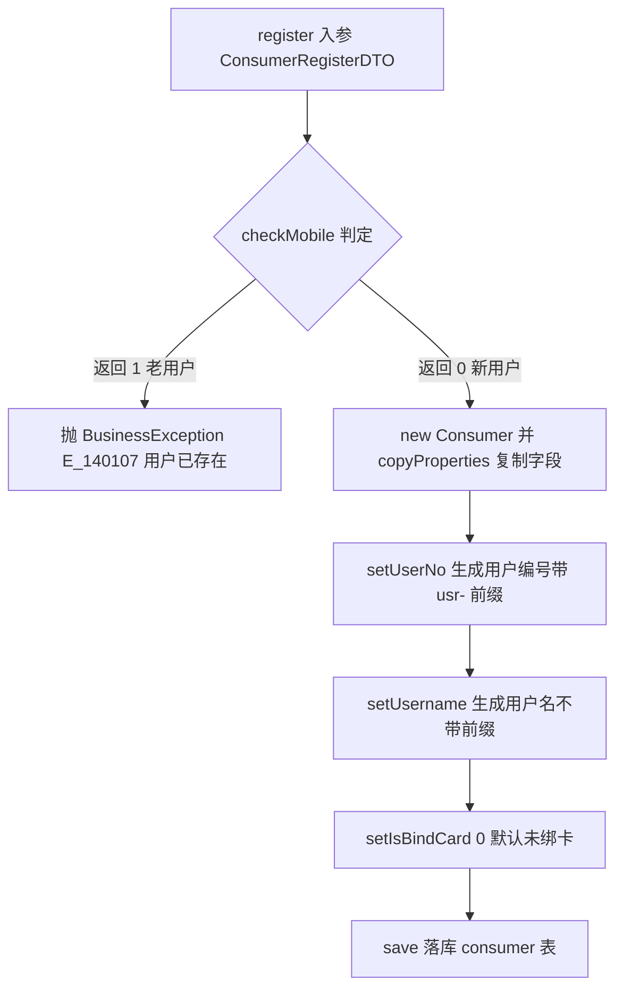

# 用户中心的业务层：手机号查重与保存用户信息的方法该怎么写

数据访问层两个文件收工之后，保存用户信息的主战场转移到业务层。这一层要回答三个问题：接口里该声明哪几个方法、每个方法的判定逻辑怎么落、表现层怎么收口。统一账户服务那边虽然写过几乎同名的功能，但那是两个独立微服务各自的领地，用户中心的查重只能查自己的 `consumer` 表，保存也只能存自己的库，代码要在这一侧从头立起来。两段编码前后相接：先把手机号查重的 `checkMobile` 立住，再实现注册本体的 `register`，最后把 Controller 的空实现补上，用户中心单侧的保存逻辑就此齐整。

## 先给结论

- 业务接口 `ConsumerService` 声明两个方法：`Integer checkMobile(String mobile)` 返回 1 或 0 表示手机号是否存在，`void register(ConsumerRegisterDTO dto)` 保存用户信息，接口同时继承 MP 的 `IService<Consumer>`。
- 实现类 `ConsumerServiceImpl` 继承 `ServiceImpl<ConsumerMapper, Consumer>`，泛型第一个是 Mapper、第二个是实体，类上必须加 @Service，否则容器里没有 Bean。
- 查重拆成私有方法 `getByMobile`，用 `QueryWrapper` 的 Lambda 写法按手机号 `getOne`，查到转成 `ConsumerDTO` 返回、查到 null 原样返回，`checkMobile` 只做三元判定。
- `register` 开头先调 `checkMobile`，手机号已存在直接抛 `BusinessException(ConsumerErrorCode.E_140107)`「用户已存在」；新用户走 `BeanUtils.copyProperties` 把 DTO 复制进实体，业务层补齐用户编号、用户名与绑卡默认值后 `save`。
- Controller 注入 `ConsumerService` 调 `register`，成功直接返回 `RestResponse.success()`，失败靠异常向外抛，响应格式交给全局异常处理器。

## 业务接口先行：两个方法定下职责

业务层的老规矩是先立接口再写实现。`ConsumerService` 的方法清单在设计时就定死了两条：查一查手机号是否存在，保存用户信息完成注册。

```java
package com.study.finance.consumer.service;

import com.baomidou.mybatisplus.extension.service.IService;
import com.study.finance.api.consumer.model.ConsumerRegisterDTO;
import com.study.finance.consumer.entity.Consumer;

public interface ConsumerService extends IService<Consumer> {

    // 校验手机号是否存在：存在返回 1，不存在返回 0
    Integer checkMobile(String mobile);

    // 保存用户信息：新用户才允许走到这里
    void register(ConsumerRegisterDTO consumerRegisterDTO);
}
```

接口继承 `IService<Consumer>` 是 MP 的业务层封装约定，通用方法随继承到位，接口里只声明带业务语义的两个方法。有疑问的地方在于查重这个方法：校验手机号是否存在，统一账户服务在前面实现校验功能时已经写过一份，为什么这里又要写一遍？原因藏在服务的边界里。那次实现发生在统一账户服务，查的是 `p2p_account` 库的 `account` 表，服务的是账号领域的登录校验；现在的代码在用户中心服务，要查的是 `p2p_consumer` 库的 `consumer` 表。两个微服务各有各的库，彼此不跨库读写，统一账户认识的「账号存在」与用户中心认识的「用户存在」是两个领域的两份事实，谁也不能替谁作答。所以用户中心这边的方法照样要写，查重的对象换成了自己的表。

返回值为什么是 1 和 0 这两个数字？这与前一步校验功能的约定一脉相承：1 表示存在、0 表示不存在，前端拿到判定数字直接决定走登录还是继续注册。`register` 设计成无返回值，成败的表达全部交给异常机制，方法体里不需要组装响应。

## checkMobile：一次条件查询加一层实体到 DTO 的转换

实现类把继承与实现一起挂上：

```java
package com.study.finance.consumer.service;

import com.baomidou.mybatisplus.core.conditions.query.QueryWrapper;
import com.baomidou.mybatisplus.extension.service.impl.ServiceImpl;
import com.study.finance.api.consumer.model.ConsumerDTO;
import com.study.finance.consumer.entity.Consumer;
import com.study.finance.consumer.mapper.ConsumerMapper;
import org.springframework.beans.BeanUtils;
import org.springframework.stereotype.Service;

@Service
public class ConsumerServiceImpl extends ServiceImpl<ConsumerMapper, Consumer>
        implements ConsumerService {

    @Override
    public Integer checkMobile(String mobile) {
        return getByMobile(mobile) != null ? 1 : 0;
    }
}
```

两个泛型的顺序是老考点：第一个 `ConsumerMapper` 是该实体对应的数据访问接口，第二个 `Consumer` 是实体本身，与 `ServiceImpl` 的类声明 `<M extends BaseMapper<T>, T>` 严格对齐。IDE 从接口生成实现类时会自动把两个抽象方法带出来，方法体先空着再逐个填。

查重的核心是私有方法 `getByMobile`。为什么不把查询直接写进 `checkMobile`？这段按手机号查询的代码将来别处也要用，比如开户、绑卡都要先定位用户，所以单独立一个方法，让 `checkMobile` 退化成一个判定壳子：

```java
// 根据手机号做一次查询：查到返回 DTO，查不到返回 null
private ConsumerDTO getByMobile(String mobile) {
    Consumer consumer = getOne(
            new QueryWrapper<Consumer>().lambda().eq(Consumer::getMobile, mobile));
    return convertConsumerEntityToDTO(consumer);
}

// 实体转 DTO：为空直接返回 null，避免空指针
private ConsumerDTO convertConsumerEntityToDTO(Consumer entity) {
    if (entity == null) {
        return null;
    }
    ConsumerDTO dto = new ConsumerDTO();
    BeanUtils.copyProperties(entity, dto);
    return dto;
}
```

查询用的 `getOne` 在 MP 里有两种形态。单参数版本只接收条件构造器，查不到返回 null，不抛异常；两参数版本多一个布尔值，用来显式声明查不到时要不要抛出异常。这里用单参数版本，查无此人是合法业务状态，算不得异常。条件构造器走 Lambda 写法：`Consumer::getMobile` 是实体属性的方法引用，MP 从中解析出列名 `MOBILE`，字段名写错直接编译不过，比手写字符串列名安全得多。

返回值选 `ConsumerDTO` 而不是数字，也值得说一句。这个方法未来会被多处复用，调用方要的不只是「存在与否」，还有这个用户是谁；返回 0 和 1 是 `checkMobile` 的业务口径，属于它的职责，不该下沉到查询方法里。`ConsumerDTO` 定义在 API 工程的 model 包下，是给跨服务调用方用的传输对象，属性与实体大体对应但收窄了敏感字段，实体到 DTO 的转换用 `BeanUtils.copyProperties` 按同名属性复制，入参为 null 时直接短路返回。最终 `checkMobile` 一行三元表达式：`getByMobile(mobile) != null ? 1 : 0`，查询与转换在私有方法里闭环，判定数字在这里产生。

## register：新用户判定、DTO 复制与默认值补齐

注册方法的骨架是一个前置判定加一段组装保存：

```java
@Override
public void register(ConsumerRegisterDTO consumerRegisterDTO) {
    // 注册只针对新用户：手机号已存在直接抛业务异常
    if (checkMobile(consumerRegisterDTO.getMobile()) == 1) {
        throw new BusinessException(ConsumerErrorCode.E_140107);
    }
    Consumer consumer = new Consumer();
    // 前端提交的字段批量复制进实体：mobile、password、role 等
    BeanUtils.copyProperties(consumerRegisterDTO, consumer);
    // 用户编号：工具类生成，统一带 usr- 前缀，全局唯一
    consumer.setUserNo(CodeUtil.getNo(CodePrefixCode.CODE_REQUEST_PREFIX));
    // 用户名：前端不传，注册时代为生成，用户名不适合带业务前缀
    consumer.setUsername(CodeUtil.getNo(CodePrefixCode.CODE_NO_PREFIX));
    // 是否绑定银行卡：新用户默认未绑卡
    consumer.setIsBindCard(0);
    save(consumer);
}
```

先看前置判定。注册在业务定义上只属于新用户，手机号查出来是 1，说明来者是老用户，直接抛异常结束流程，方法体后面的代码一行都不会执行。抛的是项目统一的 `BusinessException`，错误码从用户中心自己的错误码枚举取：

```java
// c 端用户服务异常编码以 14 开头：前两位服务标识，中间两位模块标识，后两位异常标识
public enum ConsumerErrorCode implements ErrorCode {
    E_140101(140101, "不存在的用户信息"),
    E_140105(140105, "用户已开户"),
    E_140106(140106, "注册失败"),
    E_140107(140107, "用户已存在"),
    // 后续开户、绑卡等场景的编码按同规则扩充
    ;
    // code 与 desc 字段及构造器略，实现 ErrorCode 接口的 getCode 与 getDesc
}
```

错误码写成六位数是项目级的编码规范，前两位标服务、中间两位标模块、末两位标异常，用户中心登记在 14 开头区段，`140107` 就是「用户已存在」。枚举实现 `ErrorCode` 接口，全局异常处理器收到 `BusinessException` 后取 `getCode` 与 `getDesc` 组装响应，前端拿到的就是 140107 加「用户已存在」的提示。

再看组装与补默认值。`BeanUtils.copyProperties(consumerRegisterDTO, consumer)` 把 DTO 里同名同类型的属性批量复制进实体，第一个参数是源、第二个是目标，方向写反了复制结果就全错。复制完的字段覆盖了前端提交的部分，但 `ConsumerRegisterDTO` 只有用户名、手机号、密码、角色、验证码 key 这几样，实体里还有一堆前端根本不提供的字段，这些默认值必须由业务层补齐：



这张图把 `register` 的分支与补值顺序串了下来。用户编号是实体里「生成唯一、用户在存管系统标识」的字段，项目统一用工具类生成：`CodeUtil.getNo` 底层基于雪花算法产出全局不重复的序列，再按传入的前缀枚举拼前缀，用户编号这一项全平台统一带 `usr-` 前缀，所以取枚举里的带前缀选项；用户名同样由前端缺席、需要代为生成，但用户名是登录与展示用的高频字段，挂个 `usr-` 前缀既难看也没必要，生成时取不带前缀的选项。前缀选项集中在公共工程的 `CodePrefixCode` 枚举里，按「使用前缀、不使用前缀」分档，编号规则全局只此一份。是否绑定银行卡给 0，新用户离绑卡还远；状态、可贷额度这类字段后续业务才会启用，注册阶段不碰。

补值与复制的先后也有讲究。复制在前、补值在后，`copyProperties` 只复制源对象里非空的同名属性之外不做的事先不展开，但顺序保证了补上的默认值不会被 DTO 里的空值冲掉。所有字段就位后 `save(consumer)` 落库，`save` 是 `ServiceImpl` 继承来的通用方法，内部转给 `ConsumerMapper` 的 `insert`，主键按 `IdType.AUTO` 由数据库自增回填。

## 表现层收口：Controller 调用 register 返回统一响应

业务层完工，Controller 里那个返回 null 的空实现可以补上了。改动只有三处：注入服务、调用方法、返回统一响应：

```java
@RestController
@Api(value = "用户服务的Controller", tags = "Consumer", description = "用户服务API")
public class ConsumerController {

    @Autowired
    private ConsumerService consumerService;

    @ApiOperation("用户注册")
    @ApiImplicitParam(name = "ConsumerRegisterDTO", value = "注册信息", required = true,
            dataType = "ConsumerRegisterDTO", paramType = "body")
    @PostMapping(value = "/consumers")
    public RestResponse register(@RequestBody ConsumerRegisterDTO consumerRegisterDTO) {
        consumerService.register(consumerRegisterDTO);
        return RestResponse.success();
    }
}
```

方法上的注解是两类混用：`@PostMapping`、`@RequestBody` 是 Spring MVC 的路由与参数绑定，`@ApiOperation`、`@ApiImplicitParam` 是 Swagger 的文档注解，两类都齐全，接口文档里才有完整的请求说明。方法体直接调 `register`，成功后返回 `RestResponse.success()`；失败的情况不在方法体里处理，`register` 内部抛出的 `BusinessException` 会一路向上，由全局异常处理器统一捕获、按错误码组装响应。表现层不掺业务判定，这是项目分层铁律在这一步的体现。

到这里，用户中心单侧的保存用户信息功能已经完整：接口两个方法、实现类一套流程、Controller 一个入口。对照整体流程还差最后一段，用户中心保存完自己的数据之后发起远程调用，把账号信息送到统一账户服务落库，那是下一单元的主题。

## DTO 与实体的分工：谁出海、谁守家

两个 DTO 的住处值得专门交代。`ConsumerRegisterDTO` 与 `ConsumerDTO` 都定义在 API 工程的 model 包下，`Consumer` 实体则守在用户中心服务内部的 entity 包里，位置差异是刻意安排的。实体贴着表走，`@TableName`、`@TableField` 这些映射注解都是服务的私产，绝不出现在跨服务传输的对象上；DTO 贴着契约走，前端提交什么、接口返回什么，看 DTO 的字段清单就够。本次注册里三类对象的流转各有分工：请求进来先被 `ConsumerRegisterDTO` 收拢，业务组装落库用 `Consumer` 实体，将来对外提供查询时再由 `ConsumerDTO` 出海，相互之间用 `BeanUtils.copyProperties` 搭桥。

字段清单也随角色收放。`ConsumerDTO` 相对实体收窄了内部字段，暴露的是用户名、真实姓名、手机号这类业务可读信息；`ConsumerRegisterDTO` 只保留用户名、手机号、密码、角色、验证码 key 几样，前端提交什么它就收什么。同一部手机号在三个对象里各有一席，靠属性名的对齐在转换时自动落位。守住这条边界，服务内部的表结构怎么调整都不惊动调用方，DTO 的契约怎么演进也不污染库表，两端各自独立演进的余地就是这么留出来的。

## 原理与细节：getOne 的边界与属性复制的方向

两个高频工具的细节决定这段代码的成色。`getOne` 单参数版本查到多条时会抛 `TooManyResultsException`，手机号在业务上是唯一标识，理论上一号一人，但表结构并没有强制唯一索引时，防御式写法可以给条件构造器追加 `.last("LIMIT 1")`，或者用两参数版本显式控制抛异常行为。注册入口按手机号查重的场景里，并发重复注册本身就是下一单元要面对的一致性问题，查询层面先保证语义清晰即可。

`BeanUtils.copyProperties` 的三个特性直接影响正确性：复制按属性名与类型双重匹配，名字对不上或类型不同的属性静默跳过；源对象里为 null 的属性同样会覆盖到目标；它是浅复制，引用类型属性拷的是引用。`ConsumerRegisterDTO` 里的 password 会被复制进实体吗？不会，`Consumer` 实体根本没有密码字段，密码属于账号领域，后面由统一账户服务处理，属性名匹配机制天然把领域外的字段挡在了外面。这套 DTO 与实体的来回转换在 P2P 项目里随处可见，方向、时机、字段边界三件事想清楚，转换代码就只剩体力。

异常链路在这套代码里也走完了全程。`register` 抛出的 `BusinessException` 携带错误码对象向上冒泡，Controller 不写任何 try-catch，由全局异常处理器统一接住、按错误码组装响应。失败的表达集中在一处出口，错误码与提示文字在枚举里同源维护，前端拿到的描述永远与错误码对得上。

## 常见误区

- **getOne 查到多条直接炸。** 错例：表里手工插了两条同手机号的数据，注册接口一调就抛 `TooManyResultsException`。正解：明确单条语义，用 `.last("LIMIT 1")` 兜底或用两参数 `getOne(wrapper, false)`，同时把手机号唯一性约束补到表上。
- **copyProperties 的参数方向写反。** 错例：写成 `copyProperties(consumer, consumerRegisterDTO)`，实体里的空字段反过来覆盖了 DTO，查重判断全部失灵。正解：第一个参数永远是源，第二个是目标，写完对照一眼赋值方向。
- **老用户注册不抛异常继续 save。** 错例：判定写成 `!= 0` 之外忘记 return，或者直接删掉判定，同一手机号反复插入，两库数据越积越乱。正解：新用户判定是注册的第一道闸，存在即抛 `E_140107`，流程立刻终止。
- **实现类漏加 @Service。** 错例：继承关系都对，Controller 注入时报 `NoSuchBeanDefinitionException`。正解：继承解决方法从哪来，注解解决 Bean 从哪来，两者缺一不可。
- **把密码塞进用户中心保存。** 错例：顺手把 password 一并存进 `consumer` 表，认证信息混进业务表。正解：密码由统一账户服务的 `account` 表管理，用户中心只收不存，领域边界不能破。

## 面试可能被问到的问题

1. 面试官追问：「统一账户服务已经有校验手机号的功能，用户中心为什么再写一遍？」
   答：两个服务是独立微服务，各自持有各自的库，不允许跨库访问。统一账户的查重查的是 `account` 表，服务的是账号认证；用户中心的查重查的是 `consumer` 表，服务的是用户业务。同名功能背后是两个领域的两份事实，代码必须各写各的，调用也只调自己库。
2. 面试官追问：「checkMobile 返回 Integer 的 1 和 0，为什么不用 boolean？」
   答：这是对外接口的既定契约，校验接口的返回值在前端已经按 1 和 0 消费，保持口径统一可以少一层转换。数字状态码也为将来扩展留了余地，比如再加 2 表示封禁状态，boolean 表达不了第三种语义。
3. 面试官追问：「QueryWrapper 的 Lambda 写法比字符串列名好在哪？」
   答：Lambda 用实体方法引用 `Consumer::getMobile`，列名由框架在运行期从属性解析，字段改名时编译期直接报错，而字符串列名要等到运行期 SQL 拼错才暴露。类型安全、重构友好，代价是表达式稍长，团队内统一选一种风格即可。
4. 面试官追问：「ServiceImpl 的两个泛型顺序记不住怎么办，写反会怎样？」
   答：记住类声明 `<M extends BaseMapper<T>, T>`，Mapper 在前且必须继承 BaseMapper，实体在后。写反后泛型约束不满足，编译期就报错，不会带病运行；两个类型一个是接口一个是类，编译器会给出明确提示。
5. 面试官追问：「为什么 register 设计成 void，成功失败怎么让调用方知道？」
   答：成败表达全部走异常机制，失败抛携带错误码的 BusinessException，由全局异常处理器统一转成响应；成功走到底，Controller 返回 success。方法签名干净，调用方不需要处理返回值分支，错误信息集中在错误码枚举里维护。
6. 面试官追问：「用户编号和用户名都由后端生成，为什么一个带前缀一个不带？」
   答：用户编号是系统内部标识，要跨多个子系统传递且不允许重复，统一前缀便于识别来源与排障；用户名是面向登录与展示的字段，可读性优先，前缀反而添乱。两类字段的消费场景不同，编号策略跟着场景走，规则集中在公共枚举里统一维护。

## 配套资料

- 代码：`materials/code/10/资料/公共类/Consumer.java`，用户中心实体归档，字段与正文 `Consumer` 一致；`ConsumerDTO.java`、`ConsumerRegisterDTO.java` 同目录，DTO 属性清单以归档为准。
- 代码：`materials/code/10/资料/公共类/ConsumerErrorCode.java`，用户中心错误码枚举的真实归档，`140106 注册失败`、`140107 用户已存在` 与正文引用一致；`GlobalExceptionHandler.java` 也在该目录，异常到响应的转换实现可对照。
- 代码：`materials/code/10/资料/Mybatis-Plus/代码/`，MP 入门工程归档，`service/UserService.java` 与 `service/UserServiceImpl.java` 是业务层继承体系的原型写法；内层目录保留原始命名，路径列到工程目录为止。
- 讲义：`materials/docs/10/万信金融-第2章-讲义-开户v1.0.md`，注册功能的业务流程与消费者注册步骤划分的出处。
- 说明：业务层与 Controller 的实现代码按视频画面线整理，仓库中无该模块实现层源码，`CodeUtil`、`CodePrefixCode` 的方法签名按画面与主流写法补全，包名一律按 `com.study.finance` 系改写。
