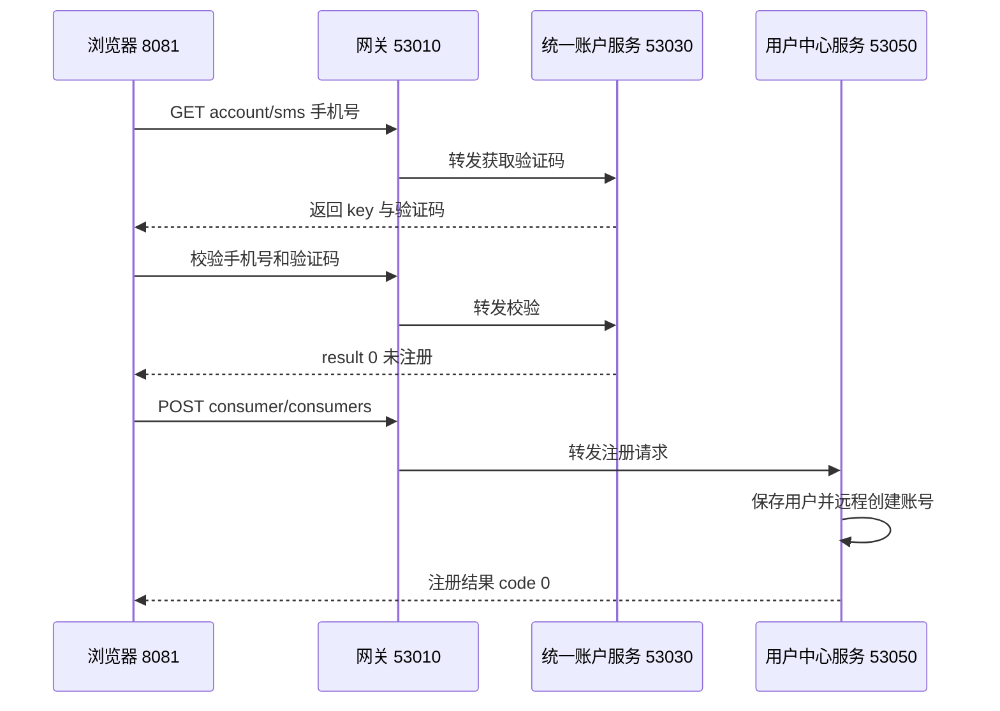

# 注册功能前后端集成测试：一个登录按钮背后的整条链路

Postman 里的三连测全绿，不代表真实用户能用。用户手里的入口是浏览器里的页面，点一下「登录」，请求先落在前端框架，再经网关转发进微服务，中途还要取验证码、判新老用户、跨两个库写数据，任何一环配置缺失，页面上只剩一个含糊的报错。这一课把注册功能放进真实链路里跑一遍，也是项目的第一次前后端集成测试，方法跑通之后，它就是后续每个功能的固定验收动作。

## 先给结论

- 集成测试从配置开始：Apollo 里给网关应用补上 account 与 consumer 两条 Zuul 路由，前端发往两个微服务的请求才转发得到位。
- 启动清单比 Postman 测试多了三样：短信验证码服务、它依赖的 Redis、以及前端工程；HBuilderX 把前端运行到 Chrome，占用 8081 端口。
- 前端登录页把注册与登录合并在一个按钮里：先调校验接口判新老用户，未注册就自动先注册再登录，用户全程无感知。
- 第一次点击登录返回 404，根因是运行中的网关没有读到 Apollo 新加的路由配置，重启网关后链路立通；「请求没到达」与「代码写错」要先分清。
- 验收以数据为准：`p2p_consumer.consumer` 与 `p2p_account.account` 各进一行，沿用此前两库核对的口径。

## 集成测试从网关配置开始

前端发出的所有请求都要经过网关服务转发，这是项目立项时就定下的规矩。此前 Postman 直连 53050 端口测用户中心，网关一直在旁观；换成真实页面，网关就成了必经之路。网关本身是一个基础工程直接提供的现成服务，目前只承担路由转发这一个职责，认证、拦截都还没做，所以本次要做的只有一件事：在 Apollo 中给网关应用补上 account 与 consumer 两条微服务的路由配置。

```properties
# Apollo 网关应用新增：两条手动路由，路径与微服务上下文路径一致
zuul.routes.account-service.path = /account/**
zuul.routes.account-service.stripPrefix = false
zuul.routes.consumer-service.path = /consumer/**
zuul.routes.consumer-service.stripPrefix = false
# 失败重试与请求头转发
zuul.retryable = true
zuul.add-host-header = true
# 关闭按服务名自动映射，路由全部手动声明，更安全
zuul.ignoredServices = *
```

这几行配置各有讲究。`stripPrefix = false` 表示转发时保留路径前缀，因为统一账户服务与用户中心服务的上下文路径本来就是 `/account` 与 `/consumer`，前缀剥掉反而 404；`add-host-header = true` 让网关把请求头原样带过去；`retryable = true` 配合负载均衡组件对偶发失败做重试；`ignoredServices` 置为 `*` 是把「按注册中心服务名自动生成路由」的默认行为关掉，路由表从此完全可控。工程归档里的网关 `application.properties` 底稿上还挂着 ribbon 的超时与重试参数，这几条 Apollo 配置补上去之后，前端的两类请求才各有去处。

启动清单对着依赖数：Apollo 与注册中心是基础设施，网关、统一账户服务、用户中心服务是链路主角，这次与 Postman 测试不同的是，发送验证码环节要用真服务，短信验证码服务与它依赖的 Redis 也必须到场，前端工程最后启动。

## 前端工程与开发者工具

前端是 uni-app 工程，用 HBuilderX 打开后点运行到 Chrome，编译片刻浏览器自动打开登录页，地址为 `localhost:8081/#/pages/user/login`，8081 是前端工程自己的端口。页面在 PC 上显得过大变形，因为它按手机端设计，F12 打开开发者工具，点击设备模拟按钮切换到手机视口，显示效果立刻归位，这个开关在后续使用前端工程时一直要开着。

Network 面板是集成测试的主战场。页面上每一次点击产生的请求、最终请求路径、响应数据、响应头，面板里逐条列出，点开任意一条能看 Headers 与 Response。直连服务测接口时用 Postman 看，跨了网关之后请求的真实走向只有它能证明，后面排 404 全靠它。

## 全流程实测：验证码、校验、注册一气呵成

登录页只有手机号、验证码两个输入框和一个登录按钮，按钮的点击逻辑里藏着注册全流程，前端关键代码如下：

```javascript
// 点击发送：向统一账户服务要验证码，响应里带回后续校验要用的 key
getCode() {
    this.request({ url: `account/sms/${this.mobile}`, method: 'GET' }).then(res => {
        if (res.data.code == 0 && res.data.result) {
            this.codeKey = res.data.result.key
        }
    })
},
login() {
    // 登录按钮先校验手机号与验证码，按 result 决定走注册还是登录
    this.request({
        url: `account/mobiles/${this.mobile}/key/${this.codeKey}/code/${this.password}`
    }).then(res => {
        if (res.data.result == 1) {
            this.log(data)   // 已注册，走登录
        } else {
            this.reg(data)   // 未注册，先注册再登录
        }
    })
},
reg(data) {
    // 注册：经网关转发到用户中心的公开注册接口
    this.request({ url: 'consumer/consumers', params: { ...data, role: '' }, method: 'POST' })
}
```

测试号要选两库里都不存在的新手机号，示例统一以 `13xxxxxxxxx` 占位，测前先查两边的表。输入手机号点击发送，Network 面板里出现对 `account/sms/{mobile}` 的请求，经网关转发进统一账户服务；控制台版的验证码服务把 6 位验证码直接打印在自己的日志里，响应中带回的 `key` 是下一步校验的凭证，顺手打开 Redis 管理工具还能看到那个键确实写进去了，验证码链路的每一环都可以眼见为实。

把验证码填进第二个输入框，点击登录。页面先调校验接口，返回 `result` 为 0 表示手机号未注册，前端自动转入注册分支，对 `consumer/consumers` 发起 POST。这次的请求走的是 `http://localhost:53010/` 开头的网关地址，而不是直连 53050。一次点击的完整旅程可以画成下面这张时序图。



这张时序图就是登录按钮一次点击的完整旅程：三次进网关，两个微服务各接一棒。实际测试在这里第一次卡住了：Network 面板里对 `consumer/consumers` 的请求返回 404。路径拼法反复核对没有错，问题出在网关，Apollo 上的路由配置是测试前刚加的，运行中的网关进程没有立即读取到，请求到了网关却找不到转发目标。重启网关，从头再走一遍：新号、发送、填码、登录，注册请求正常返回 `code` 为 0，刷新两张表，`consumer` 表与 `account` 表各进一行，用户名、手机号、密文密码逐项对得上，链路全线贯通。

页面随后还会发一个到 `uaa/oauth/token` 的请求，那是为登录功能预留的出口，服务尚未就位，不在本次测试范围，Network 面板里看到它报错可以径直略过。重复注册的验证同样点到为止：用同一手机号再点一次登录，校验接口返回 `result` 为 1，前端直接切进登录分支，页面不会弹「用户已存在」，因为前端把注册与登录合并处理，老用户静默走登录。这条路径的完整验证留给登录功能实现之后。

## 收官复盘：注册功能带走了什么

注册功能从需求分析走到全链路贯通，值得清点一下带走的东西。功能上是三个小接口加一段远程调用：发送并获取短信验证码、校验手机号和验证码、保存用户信息，用户中心落库之后经 Feign 代理把账号信息送到统一账户服务。过程上修过两个有代表性的问题：DTO 复制早于赋值导致账号侧用户名为空，全局异常处理器缺席导致重复注册返回 500。方法上则收获了这一课的集成测试套路：网关配置先行、启动清单按依赖数、Network 面板看请求走向、两库数据逐项核对。流程沉淀下来了，下一个功能联调时不再需要摸索，出问题时也能按「配置、服务、代码」的顺序快速排位。

## 常见误区

- **直连服务测通了就认为集成没问题。** 错例：Postman 直发 53050 全部通过，前端一跑就 404。正解：集成测试的变量恰恰是直连时不存在的那几样，网关路由、前端请求封装、跨域处理，任何一环都可能引入新问题，必须走真实链路。
- **网关加了路由配置就默认立即生效。** 错例：Apollo 保存配置后直接测，收到 404 却去排查 Controller 路径。正解：运行中的服务未必即时读到新配置，先重启对应服务排除配置未加载的因素，Network 面板确认请求是否到达了目标服务。
- **前端端口与后端端口混为一谈。** 错例：以为页面跑在 53050 或 53010 上。正解：前端工程独立占用 8081，它发出的请求统一指向网关 53010，再由网关按路由转发，端口号各归各位。
- **测完只看页面提示不看数据库。** 错例：页面无报错就收工。正解：跨服务的写操作以两库落数为准，`consumer` 表与 `account` 表各查一行逐字段核对，页面表现只是链路的最后一格。

## 面试可能被问到的问题

1. 面试官追问：「前后端集成测试和接口功能测试的区别是什么，重点多在哪？」
   答：功能测试验证单个接口的输入输出，直连服务即可；集成测试验证整条链路，多了网关转发、前端请求封装、多服务协作这些变量。重点在配置的完整性与请求的真实走向，比如网关路由是否覆盖每个微服务、转发时前缀是否保留，以及最终落库数据是否正确。
2. 面试官追问：「Zuul 路由里 stripPrefix=false 起什么作用，什么情况下要这么配？」
   答：它控制转发时是否剥掉匹配的前缀。本项目两个微服务的上下文路径本身就是 /account 与 /consumer，网关必须保留前缀原样转发，服务才能按 context-path 匹配到请求。如果下游服务没有这个前缀，就要用默认的剥前缀行为，两种模式按服务的 context-path 设计来定。
3. 面试官追问：「前端一个登录按钮为什么能同时完成注册和登录？」
   答：按钮先调用统一账户的校验接口，同时验证手机号与短信验证码，返回结果里带有手机号是否已存在的判定。未注册就先调注册接口落库，注册成功后自动继续登录流程。把入口合并成按钮是产品层的简化，链路上仍然是一个校验加两次写操作。
4. 面试官追问：「集成测试遇到 404，你的排查顺序是什么？」
   答：先看请求是否真的发出，用浏览器 Network 面板确认请求路径与响应来源；再判断 404 出在哪一层，网关找不到路由与目标服务内部匹配不到处理器是两种 404；然后检查网关路由配置与配置是否已加载，必要时重启网关；最后才核对 Controller 的路径映射与请求方式是否一致。
5. 面试官追问：「为什么注册成功的验收标准是查两张表而不是看接口响应？」
   答：注册是一次链路式写操作，用户中心与统一账户各存一份职责不同的数据，接口响应只代表调用链没有异常，不能证明每一份数据都落对了。跨服务写操作必须对每个落库点逐一核对，字段值要与业务逻辑的预期一致，这是发现隐性 bug 的最后一道关卡。

## 配套资料

- 代码：`materials/code/10/wanxinp2p/`，P2P 工程归档（目录保留原始命名，路径列到该层级），内层网关模块 resources 下的 `application.properties` 为网关配置底稿，Zuul 路由、重试、请求头转发的真实写法以它为准；Apollo 上为 account 服务补的路由按视频画面线整理。
- 代码：`materials/code/10/wanxinp2p_front/`，前端 uni-app 工程归档（内层为同名目录），登录页源码 `pages/user/login.vue` 是发送验证码、校验、注册三分支点击逻辑的出处，正文为节选。
- 代码：`materials/code/10/wanxinp2p_front/` 内层 `utils/request.js`，前端请求封装，可见全部请求统一指向网关 `53010`，以及免登录拦截的请求白名单。
- 讲义：`materials/docs/10/万信金融-第2章-讲义-开户v1.0.md`，开户章节对应讲义，前后端集成测试的启动安排为本次测试的背景。
- 说明：集成测试过程、Network 面板观察与两库核对 SQL 按视频画面线整理，仓库未归档测试脚本与 Apollo 导出配置；归档目录内原始包名与模块名按 `com.study.finance` 系口径改写，手机号以 `13xxxxxxxxx` 占位。
