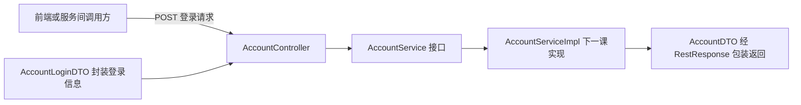

# 传统登录的接口定义：一个 login 方法背后的参数与返回值套路

注册功能全线贯通之后，接下来自然是登录，注册的目的本来就是为了将来能登录。登录这个业务大家都熟，代码也熟，但它在本项目里有个专门的叫法：传统实现方式，与后续要引入的认证服务体系相对。动笔之前先把接口立起来，参数是什么、返回什么、路径怎么定，这些契约一旦定下，前后端与跨服务调用就都有了共同的凭据。

## 先给结论

- 登录的业务本质是增删改查里的「查」：拿账号和密码去 `account` 表查一查，存在且正确即成功，否则失败。
- 接口落位在统一账户侧：`AccountAPI` 新增 `login` 方法，入参用专门的 `AccountLoginDTO` 封装登录信息，出参沿用 `RestResponse<AccountDTO>`。
- 返回完整 DTO 而不是布尔值，是因为登录成功后前端要直接消费用户信息渲染页面，一次请求把数据带足。
- 路径定为 `/l/accounts/session`，`/l` 前缀沿用内部接口的编码规范，这条接口不直接暴露给前端。
- Controller 里的空实现要把 Swagger 注解、`@PostMapping`、`@RequestBody` 一次配齐，缺一个都可能在联调时爆雷。

## 登录的业务底色：增删改查里的查询

把注册与登录放在增删改查的坐标系里看得很清楚：注册的核心动作是「增」，往账户表里插一行；登录的核心动作是「查」，查一查表里有没有提交过来的这组账号密码。拿 `account` 表说，表里有用户名、手机号、密码等列，如果用手机号登录，就是判断这个手机号和密码在表里是否存在，存在即登录成功，任何一个对不上即登录失败。业务简单到一句话说得完，代码层面也就是一次条件查询加一次比对。

这种实现方式被称为传统的实现方式，不是贬义，它最熟、最简单，先把功能立起来，才能看清它在分布式场景下的短板，后续章节引入认证服务时再回头对照。传统方式下登录是纯粹的服务端查询，没有令牌、没有单点登录这些概念，这也是它名字的由来。

## 接口定义：AccountAPI 里的 login

功能放在统一账户中心，接口定义自然落在 API 工程的 `AccountAPI` 接口里，与注册方法并排。方法名不用犹豫，登录在系统里的叫法高度统一，`login` 见名知义：

```java
public interface AccountAPI {

    // 获取短信验证码、校验手机号和验证码、用户注册三个方法此处省略

    /**
     * 用户登录
     * @param accountLoginDTO 封装用户登录信息
     * @return 登录成功的账户信息
     */
    @ApiOperation(value = "用户登录", notes = "登录信息", httpMethod = "POST")
    @ApiImplicitParam(name = "accountLoginDTO", value = "登录信息",
            required = true, dataType = "AccountLoginDTO", paramType = "body")
    @PostMapping(value = "/l/accounts/session")
    RestResponse<AccountDTO> login(AccountLoginDTO accountLoginDTO);
}
```

签名里有三个决定要想清楚：参数、返回值、路径。前两个是本课的主线，路径在 Controller 实现时一并交代。

## 参数与返回值：DTO 进，AccountDTO 出

**入参必须是一个专门的 DTO。** 登录至少要带账号和密码，字符串散着传既不好看也难扩展，工程里备好了封装类 `AccountLoginDTO`，与注册用的 `AccountRegisterDTO` 放在同一个公共类目录：

```java
package com.study.finance.api.account.model;

import io.swagger.annotations.ApiModel;
import io.swagger.annotations.ApiModelProperty;
import lombok.Data;

@Data
@ApiModel(value = "AccountLoginDTO", description = "封装账户登录的信息")
public class AccountLoginDTO {

    @ApiModelProperty("用户名")
    private String username;

    @ApiModelProperty("手机号")
    private String mobile;

    @ApiModelProperty("密码")
    private String password;

    @ApiModelProperty("域（c：C 端用户；b：B 端用户）")
    private String domain;
}
```

用户名、手机号、密码一眼能看懂用途，`domain` 单独说一句：账户分 C 端用户与 B 端用户两类，C 端用户的用户名就是手机号，B 端用户的用户名才是账号。这个差异影响查询方式，所以登录请求里必须告诉服务端来的是哪类用户，`domain` 字段就是干这个的，下一课实现时会用到。

**出参沿用 `RestResponse<AccountDTO>`。** 有没有可能只返回一个成功失败的布尔值？传统做小项目时很多人这么干，但这里不行。登录成功后，前端页面要展示用户信息，导航栏的昵称、个人中心的档案都来自这次响应，`AccountDTO` 里的标识、用户名、手机号、账号状态、域刚好是前端要的那一份。返回完整档案，前端不用再发第二次请求，这就是出参比「是否成功」多承载一层信息的原因。接口定义涉及的角色与数据流向可以画成一张图。



这张图把接口定义的四个角色连成一线：DTO 进、Controller 收、Service 待实现、DTO 出。接口层的套路与注册如出一辙，前端往后端传数据用专门设计的 DTO 封装，增删改查做完再返回一个 DTO 封装结果，两头的封装类各管一头，接口契约因此稳定。

## Controller 空实现：注解与路径一次配齐

接口定好，顺手把 Controller 里的方法补出来，先给空实现占住位置，实现留给下一课：

```java
@ApiOperation("用户登录")
@ApiImplicitParam(name = "accountLoginDTO", value = "登录信息", required = true,
        dataType = "AccountLoginDTO", paramType = "body")
@Override
@PostMapping(value = "/l/accounts/session")
public RestResponse<AccountDTO> login(@RequestBody AccountLoginDTO accountLoginDTO) {
    return null;
}
```

三个细节值得逐个确认。其一，路径 `/l/accounts/session` 沿用了内部接口的 `/l` 前缀，`l` 表明这条请求不直接暴露给前端访问，`session` 表示登录会话的建立，将来谁调用它、怎么调用，到认证方案落地时再展开。其二，`@RequestBody` 要求前端发过来的数据是 JSON 格式，这个注解最容易忘，漏了之后 JSON 请求体解析不了，DTO 字段全是 null。其三，Swagger 注解照搬注册方法的写法，`@ApiOperation` 描述接口，`@ApiImplicitParam` 描述参数，文档随代码同步生成，接口页上登录与注册两项并排可测。

从 PDF 讲义或旧文件复制代码时还有个不起眼的坑：中文标点。复制过来的注解参数之间可能夹着中文逗号，编译器直接报错，粘贴后的代码要扫一眼标点，这类错误位置明显但初见容易愣住。

## 常见误区

- **登录接口只设计成返回成功或失败。** 错例：返回 `Boolean`，前端拿到 true 之后还得再调一个查询接口取用户信息。正解：返回 `RestResponse<AccountDTO>`，登录响应直接携带账户档案，减少一次往返，也让错误信息有地方放。
- **入参图省事直接用两个 String。** 错例：`login(String username, String password)`，后面加验证码、加用户类型时方法签名被迫变更，所有调用方跟着改。正解：入参封装成 DTO，字段扩展不动签名，`domain` 这类新增字段无感加入。
- **路径忘了 `/l` 前缀或者误加到公开接口上。** 错例：写成 `/accounts/session`，与将来可能暴露的公开接口混作一团；或者反向把前端要调的接口也加 `/l`，前端直接 404。正解：不暴露给前端的内部接口一律 `/l` 开头，公开接口不加，方向别用反。
- **接口定义与 Controller 实现脱节。** 错例：API 接口改了签名，Controller 忘了同步，实现类报编译错误或者 `@Override` 失效。正解：Controller 实现统一账户接口，改动接口后用 IDE 的实现提示逐个补齐，编译器是最好的对账工具。

## 面试可能被问到的问题

1. 面试官追问：「为什么登录接口的返回值选 RestResponse 加 AccountDTO，而不是只返回一个状态码？」
   答：RestResponse 是统一的响应结构，状态码与提示信息有固定位置，前端错误处理可以收敛成一处；AccountDTO 承载登录成功的用户档案，页面渲染一次拿全。只回状态码省了字段，却逼着前端补一次查询，往返成本与接口数量都上去了。
2. 面试官追问：「登录参数里为什么要带 domain 字段？」
   答：账户体系里 C 端与 B 端用户的用户名语义不同，C 端用手机号做用户名，B 端用账号。查询条件因此不同，服务端需要请求方明确用户类型。把类型放在请求参数里，接口保持一套实现两条查询路径，避免拆成两个接口。
3. 面试官追问：「内部接口用 /l 前缀的价值是什么，光靠文档约定行不行？」
   答：前缀是可执行的约定，网关路由、接口扫描、日志排查都能按前缀机械判断消费方，不依赖人的记忆。纯文档约定在人员流动和接口数量上来之后必然失守。前缀还能配合网关做访问控制，内部前缀直接拒绝外部流量。
4. 面试官追问：「@RequestBody 漏加会是什么现象？」
   答：Spring MVC 会退回按表单或查询参数绑定，JSON 请求体不会被解析，DTO 所有字段为 null，方法照样执行，数据库里可能插进空数据。这类问题编译器查不出来，联调时发现「请求成功但字段全空」，第一反应就是检查这个注解。
5. 面试官追问：「接口先定义空实现再补功能，有什么工程上的好处？」
   答：契约先行让依赖方可以并行开发，前端与调用服务拿到接口签名即可对接联调；空实现配合 Swagger 注解能让接口文档先挂出来；编译错误把接口与实现的对账交给工具。它也是团队协作里接口评审的载体，签名定下来再填实现，返工成本最低。

## 配套资料

- 代码：`materials/code/10/资料/公共类/AccountDTO.java`，登录出参 DTO 的归档单文件，字段与 Swagger 注解以它为准。
- 代码：`materials/code/10/资料/公共类/Account.java`，账户实体归档，登录要查询的 `account` 表字段结构可对照。
- 代码：`materials/code/10/wanxinp2p/`，P2P 工程归档（目录保留原始命名，路径列到该层级），内层 api 模块的 `pom.xml` 可查 `AccountAPI` 所在模块的依赖声明；接口类本体未归档，正文按讲义与画面线整理。
- 讲义：`materials/docs/10/万信金融-第2章-讲义-开户v1.0.md`，用户登录章节的接口定义与功能实现步骤说明。
- 说明：`AccountLoginDTO` 在归档公共类目录中未收录，字段按视频画面线与登录实现所需补全；包名与路径按 `com.study.finance` 系口径改写，`AccountLoginDTO.java` 为示例补全文件。
