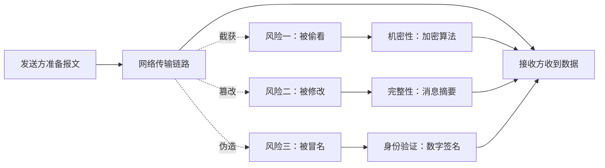

# 数据安全的三个问题：机密性、完整性与身份验证的全景图

> 🔒 安全提示：文中示例的口令/密钥均为课程教学环境演示口径，生产环境的安全要求见《安全与合规须知》。

认证和授权还没动手实现，课程先插进来一节「数据安全」，这个安排值得琢磨：认证要回答「你是谁」，授权要回答「你能干什么」，两者从头到尾都在跟数据打交道。登录请求里躺着账号密码，用户资料在服务之间来回传递，任何一环被人截获、篡改或者冒名顶替，架构设计得再漂亮也是空中楼阁。所以实现认证授权之前，先把数据安全的底层问题立起来，后面每一道防线在防什么，心里才有数。

## 先给结论

- 保证数据安全归结起来要解决三个问题：机密性、完整性、身份验证（也叫抗抵赖性），三个全部解决，数据安全才成立，缺任何一个都有对应的攻击手法。
- 机密性落到技术上是加密算法：内容以非明文传输，即使被截获，截获者也看不懂。
- 完整性落到技术上是消息摘要：内容在传输中被篡改，接收方必须能够发现。
- 身份验证落到技术上是数字签名：接收方能够验证数据的实际发送方，确保数据不是第三方伪造的。
- 这三个问题不挑场景，认证过程、授权过程、与第三方系统交互，判断标准始终一样。

## 一封军事情报引出的三个问题

讲义里的例子很形象：甲乙两家军队要联手攻打实力强大的丙方，两家军队不在一处，必须通信约定合围战术与进攻时间。甲方军师把战术写成信送出去，这封信在送达乙方之前，随时可能落到丙方手里。围绕这封信的担忧恰好就是三类：

- 丙方截获了信，把内容读了，战术全暴露，这是机密性问题。
- 丙方截获了信，把进攻时间改掉再送出去，乙方按假时间行动，这是完整性问题。
- 丙方自己伪造一封「甲方的信」寄给乙方，乙方信以为真，这是身份验证问题。

把军队换成系统，把信换成报文：请求数据在网络上经过的每一跳，都可能被嗅探、被篡改、被伪造，处境和这封信一模一样。所以「解决这三个问题」不是理论摆设，而是对传输链路威胁模型的完整归纳。

## 机密性：看不懂，才算安全

机密性的要求一句话就能说清：传输的内容非明文，即使数据被外界截获，也不能被解释或破解。古代的做法是密码本，发电报时按密码本把文字编成外人看不懂的码，只有拿着同一本密码本的人才能还原内容；影视剧中地下工作者发电报必带密码本，防的就是电文被截获后直接读出情报。

放到系统里，密码本就是密钥，编码过程就是加密算法。同一条业务报文在加密前后的样子差别巨大：

```json
{"loanApply": {"mobile": "13xxxxxxxxx", "amount": "100.00"}}
```

明文一眼可读，谁截到谁受益。经过加密算法处理后再上线，报文变成这样：

```json
{"loanApply": {"mobile": "example-cipher-x9Fk2Qd1Lp8w", "amount": "example-cipher-8Qd1LpT4vB6n"}}
```

拿到密文的人看到的是一串无法解读的字符，只有持有对应密钥的接收方能把内容还原出来。机密性把「能不能看懂数据」从人的自觉问题变成了数学问题，这是它真正可靠的原因。

## 完整性：被改过，必须看得出来

完整性的要求：内容在传输过程中不能被篡改，若信息被篡改或不完整，接收方能够得知。古人的做法是火漆封缄，在信封口滴上火漆、盖上印记，封口被拆过一眼就能看出来。现代生活里的对照是收快递：取手机时发现包裹是打开的状态，第一反应就是里面的手机可能已经被换成一块砖头。

火漆防的是「拆开动过」，防不了内容被整封重写，技术上要用消息摘要给内容提取一份「数据指纹」。摘要按固定算法对原文计算出一个定长结果，原文变一个字节，指纹就面目全非；接收方对收到的内容重算指纹，与发送方带来的指纹一比，一致则内容未动，不一致则必然被动过。完整性由此从「看起来没拆封」升级为「可以逐字节验证」。

## 身份验证：确认这封信真是你写的

身份验证（抗抵赖性）的要求：接收方能够验证数据的实际发送方，确保数据不是被人冒名顶替伪造的。古代的凭据是印章、玉佩、令牌：玉玺盖在文书上代表最高权力，锦衣卫出门要带腰牌，都是「见物如见人」的身份证明。考试里的替考事件也是同一个问题，答卷写得再好，提交者不是本人，一切作废。

值得把三道防线放在一起掂量：一封密文信、封漆完好无损，如果落款用的是伪造的印章，它依然是一封假信。机密性和完整性各自守住一条线，身份验证补上「这东西到底是谁给的」这条线，三个问题同时解决，传输安全才算闭环。

## 从类比到技术：三个问题各自落在哪

课程在收尾处把类比接到了技术方案上，也是后面两课的路线图。机密性对应加密算法，分对称与非对称两类，靠密钥和成对的公钥私钥实现；完整性对应消息摘要算法，SHA-256、MD5 这类算法就是干这个的；身份验证对应数字签名，做法是把两个前面的手段组合起来：发送方对原文用摘要算法生成摘要，再用私钥对摘要加密，生成数字签名随内容一起传输。摘要本身必须再被加密保护，否则第三方知道摘要算法后，篡改内容的同时可以连摘要一起重算，接收方照样比对通过。这正是身份验证被称为「机密性加完整性综合运用」的原因。

一份数据从发出到落地，面临的风险与对应的技术手段可以用一张图收拢：



这张图把三类威胁与三套技术一一对应：加密算法保证看不懂，消息摘要保证改动必然被察觉，数字签名保证冒充者拿不出合法签名。三条线全部通过，报文才算安全抵达。三种手段在代码层面的形态先预览一眼：

```java
// 三个问题在代码层面的对照（示例为按本课写法补全，方法体在后续课程展开）
String cipher = AesUtil.encrypt(content, secretKey);    // 机密性：明文变密文，可解密还原
String digest = Sha256Util.sha256Hex(content);           // 完整性：生成数据指纹，不可逆
String sign   = RsaUtil.sign(digest, privateKey);        // 身份验证：私钥加密摘要，生成数字签名
```

## 常见误区

- **把机密性当成数据安全的全部。** 错例：报文加了密就觉得高枕无忧。正解：密文能防偷看，防不了内容被替换后整体重发，完整性要靠摘要另行保证。
- **认为完整性和身份验证是一回事。** 错例：比对摘要一致就认定消息可信。正解：完整性只回答「内容变没变」，回答不了「谁发的」，摘要未受保护时伪造者可以连内容带摘要一起重造。
- **觉得内网系统不需要这三道防线。** 错例：服务只在内网互通就明文裸奔。正解：内网只是抬高了截获门槛，域名劫持、链路中间件、内部人员都可能成为那个第三方，威胁模型并不因此改变。
- **混淆身份验证与登录认证。** 错例：把「用户登录」和数据安全的「身份验证」划等号。正解：登录认证确认「操作者是谁」，数据安全里的身份验证确认「消息发自谁」，后者靠数字签名实现，对象是消息而不是人。

## 面试可能被问到的问题

1. 面试官追问：「保证数据安全要解决哪几个问题，分别靠什么技术？」
   答：三个问题。机密性靠加密算法保证内容不被看懂，完整性靠消息摘要保证篡改可被发现，身份验证（抗抵赖性）靠数字签名确认发送方并防止事后抵赖。三者独立又配合，缺一不可。
2. 面试官追问：「机密性和完整性的区别是什么？」
   答：机密性防「被看」，要求非授权方即使拿到数据也无法解释；完整性防「被改」，要求任何篡改都能被接收方检出。加密不保证完整性，摘要不保证机密性，两套机制各管一段。
3. 面试官追问：「为什么身份验证又叫抗抵赖性？」
   答：合法签名只能由发送方的私钥生成，私钥由发送方独持，验签通过后发送方无法否认发过这条消息。事后出现业务争议时，这层「不能赖账」的保证正是它区别于前两个问题的地方。
4. 面试官追问：「数字签名为什么会同时涉及机密性和完整性？」
   答：签名是「摘要加私钥加密」的组合产物：摘要算法保证内容被篡改后签名对不上，私钥加密保证只有持有对应公钥的一方能够验证，同时确认签名出自私钥持有者。一句话，完整性和身份确认在同一套机制里完成。
5. 面试官追问：「项目里哪里会用到这三个问题？」
   答：以课程项目为例，注册登录链路上用户的敏感字段要加密传输，对应机密性；跨系统调用的报文要带摘要比对，对应完整性；与银行存管系统对接时双向签名验签，对应身份验证。密码落库则用加盐摘要存储，是完整性与机密性的另一个应用面。

## 配套资料

- 讲义：`materials/docs/10/day16-项目总结&就业指导v1.0.md`，其中 3.7 节「数据安全」复盘了非对称加密的定义与对接第三方系统时的签名验签要求，可与本课的框架对照阅读。
- 代码：`materials/code/10/wanxinp2p/`，原始命名的工程目录归档；公共工程 common 模块下的 `RSAUtil.java` 是后续签名验签工具类的原型，包名按 `com.study.finance` 系口径改写后使用。
- 说明：本课为概念总览，课程未提供配套源码；文中报文与代码示例为按本课写法补全，手机号以 `13xxxxxxxxx` 占位，密钥与密文以 `example-*` 占位。
