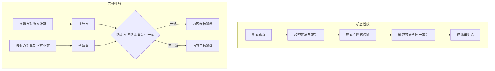

# 数据安全实战：机密性靠加密算法，完整性靠消息摘要

> 🔒 安全提示：文中示例的口令/密钥均为课程教学环境演示口径，生产环境的安全要求见《安全与合规须知》。

上一课把数据安全拆成三个问题：机密性、完整性、身份验证。这一课动手解决前两个。很多工程师一听加密就联想到复杂的数学，其实工程视角下要做的事很朴素：把四组概念（明文、密文、加密、解密）理清，把两类算法（对称与非对称）的分工划清，再用 Java 标准库跑通一次加密解密和摘要计算。算法本身早已被 JDK 封装好，需要的是知道什么时候用哪把钥匙、哪把指纹。

## 先给结论

- 机密性靠加密算法实现：明文经算法变成密文，密文经解密还原，一切围绕密钥展开。
- 加密算法分两类：对称加密的加密与解密用同一把密钥（常见 DES、AES），速度快；非对称加密用一对密钥，公钥加密只有成对的私钥能解（常见 RSA、DSA、ECC），安全性更高。
- 完整性靠消息摘要实现：对原文按算法提取定长的「数据指纹」，原文变一个字节指纹就面目全非，接收方对比前后指纹即可发现篡改。
- 常见摘要算法有 SHA-1、SHA-256、MD5、CRC32，摘要号称不可逆，只能用来验证完整性，不能当加密用。
- 课程项目的两个真实落点：与银行存管系统对接的数据安全用 RSA，密码落库用 MD5 加盐。

## 机密性的四组名词

机密性的目标在上一课已经定了：内容以非明文传输，被截获也看不懂。实现它的过程中会反复出现四个名词，先把它们钉死：

- 明文：原始数据，比如要发送的 `hello`。
- 密文：明文被处理后的样子，一串看不懂的字符，比如 `ldksuf6d9agdfit6s9dfyhoasdhfas86df9y`。
- 加密：把明文变成密文的过程，靠加密算法完成。
- 解密：把密文还原成明文的过程，与加密相反。

A 发消息给 B 的完整链路是：A 用加密算法和密钥把明文加工成密文，密文经网络传输，B 用对应的密钥和算法把密文还原回明文。中间就算有人截获，拿到的也只是密文。加密算法的价值就在这里：把「能不能看懂数据」从人的自觉问题，变成一个有数学难度兜底的技术问题。

课堂上给的情境是两个地下工作者用电台联络：双方要传的不过是一句打招呼的 `hello`，也不想让第三方看懂，于是按约定的密码本把内容编成密文再发报，对方收到后用同一本密码本还原。哪怕电文被敌方侦听抄走，抄到的也只是一串没有意义的码。这个情境把加密的四个名词全部演了一遍，也点出了机密性的边界：保护的是「看懂看不懂」，至于内容有没有被改动，它管不着，那是完整性的活。

## 对称加密：同一把钥匙锁门开门

对称加密的定义：加密和解密使用同一个密钥。课程里的类比是那本密码本：A 按密码本把 `hello` 编成密文发出去，B 解密时参考的还是同一本密码本。一把钥匙既能锁门也能开门，这就是「对称」二字的含义。

用 Java 标准库写一个对称加密的最小示例（课程未归档对称加密源码，此处为按主流写法补全的示例）：

```java
// AES 对称加密示例：加密与解密使用同一把密钥 secretKey
Cipher encryptCipher = Cipher.getInstance("AES");
encryptCipher.init(Cipher.ENCRYPT_MODE, secretKey);
String cipherText = Base64.getEncoder()
        .encodeToString(encryptCipher.doFinal("hello".getBytes("UTF-8")));

Cipher decryptCipher = Cipher.getInstance("AES");
decryptCipher.init(Cipher.DECRYPT_MODE, secretKey);
String plainText = new String(decryptCipher.doFinal(Base64.getDecoder().decode(cipherText)), "UTF-8");
// plainText 还原为 hello
```

对称加密的优点是运算快，适合加密大块数据；缺点在密钥分发上：B 要解密，就必须拿到同一把密钥，而把密钥安全地送到 B 手里，本身就是一个机密性问题，密码本成了需要密码本保护的东西。通信双方数量一多、网络又不可信时，这个死结就显形了。影视剧情节里为送一本密码本要专人冒死穿越封锁线，系统世界里为发一把密钥也得动用额外手段，说的都是同一件事：对称加密的命门不在算法，在钥匙怎么送。

## 非对称加密：公钥与私钥成对出现

非对称加密破解的正是密钥分发难题。它有两把密钥，成对生成：一把叫公开密钥（public key，简称公钥），可以对外公开；一把叫私有密钥（private key，简称私钥），永远留在自己手里。配对规则是对称性的反面：用公钥加密的数据，只有成对的私钥才能解密；反过来，用私钥加密的数据，只有成对的公钥才能解密。正因为加密和解密用的是两把不同的钥匙，它才叫「非对称」。

流程随之改变：A 生成一对密钥，把公钥公开发出去；B 拿公钥把机密信息加密后传给 A；A 用自己私藏的私钥解密。公钥在网络上随便传也不影响安全，私钥不出门，密钥分发问题就此消失。理论上讲，非对称加密的安全性要高于对称加密。常见的非对称加密算法有 RSA、DSA、ECC 等。

代价是运算速度：非对称算法的数学复杂度远高于对称算法，加解密慢得多。工程上的成熟做法是两者混用，先让非对称加密把一把对称密钥安全地送到对方手里，再用对称密钥加密大量业务数据，HTTPS 握手用的就是这套思路。课程项目里与银行存管系统对接时，双方各自生成密钥对并交换公钥，走的也是非对称这套。

项目公共工程里的 `RSAUtil` 把这种「两方各持一对钥匙」的形态直接写成了代码常量：平台侧一对、存管侧一对，四个密钥字符串常量并排放在类的开头，各自标注归属。发送给存管的数据用平台私钥签名、存管用平台公钥验签，反向亦然。真实系统里这些密钥由配置或密钥管理系统下发，绝不会硬编码进仓库，教学工程为了演示方便才写成常量，这一点在动手时要分清。

## 动手验证 RSA 加解密链路

画面线的课堂演示基于 JDK 标准库封装了一个 `RSAEncrypt` 工具类，核心是三个方法：生成密钥对、公钥加密、私钥解密。包名按课程口径改写后整理如下：

```java
// 生成密钥对：非对称加密的起点，公钥公开、私钥自留
public static Map<Integer, String> genKeyPair() throws Exception {
    KeyPairGenerator keyGen = KeyPairGenerator.getInstance("RSA");
    keyGen.initialize(1024); // 位数越大越安全，加解密也越慢
    KeyPair keyPair = keyGen.generateKeyPair();
    String publicKey = encoder.encodeToString(keyPair.getPublic().getEncoded());
    String privateKey = encoder.encodeToString(keyPair.getPrivate().getEncoded());
    Map<Integer, String> keyMap = new HashMap<>();
    keyMap.put(0, publicKey);  // 约定 0 号位放公钥
    keyMap.put(1, privateKey); // 约定 1 号位放私钥
    return keyMap;
}
```

```java
// 公钥加密：任何人拿到公钥都能加密，密文只有私钥持有者能解开
public static String encrypt(String str, String publicKey) throws Exception {
    byte[] decoded = decoder.decode(publicKey); // Base64 编码的公钥先解码
    RSAPublicKey pubKey = (RSAPublicKey) KeyFactory.getInstance("RSA")
            .generatePublic(new X509EncodedKeySpec(decoded));
    Cipher cipher = Cipher.getInstance("RSA");
    cipher.init(Cipher.ENCRYPT_MODE, pubKey);
    return encoder.encodeToString(cipher.doFinal(str.getBytes("UTF-8")));
}

// 私钥解密：先 Base64 还原密文字节，再用私钥解出明文
public static String decrypt(String str, String privateKey) throws Exception {
    byte[] inputByte = decoder.decode(str);
    byte[] decoded = decoder.decode(privateKey);
    RSAPrivateKey priKey = (RSAPrivateKey) KeyFactory.getInstance("RSA")
            .generatePrivate(new PKCS8EncodedKeySpec(decoded));
    Cipher cipher = Cipher.getInstance("RSA");
    cipher.init(Cipher.DECRYPT_MODE, priKey);
    return new String(cipher.doFinal(inputByte), "UTF-8");
}
```

测试方法把整条链路串起来：生成密钥对，用 0 号位的公钥加密，再用 1 号位的私钥解密，最后比对还原结果：

```java
@Test
public void test1() throws Exception {
    Map<Integer, String> keyMap = RSAEncrypt.genKeyPair();
    String content = "还款金额 100.00 元";
    System.out.println("随机生成的公钥为：" + keyMap.get(0));
    System.out.println("随机生成的私钥为：" + keyMap.get(1));
    String messageEn = RSAEncrypt.encrypt(content, keyMap.get(0));
    System.out.println("加密后的字符串为：" + messageEn);
    String messageDe = RSAEncrypt.decrypt(messageEn, keyMap.get(1));
    System.out.println("解密后的字符串为：" + messageDe);
}
```

运行输出的形态大致是（密钥与密文按课程口径占位）：

```text
随机生成的公钥为：example-rsa-public-key-MFwwDQYJKoZIhvc
随机生成的私钥为：example-rsa-private-key-MIIBUwIBADANBg
加密后的字符串为：example-rsa-cipher-P8f2kQ9dLx7vN0mR3tY6
解密后的字符串为：还款金额 100.00 元
```

公钥和私钥单独看都是一串无意义的 Base64 字符，密文同样无法辨认，解密后的输出却与原始明文一字不差，机密性的闭环就验证完了。项目公共工程里的 `RSAUtil` 与这套演示同源，其中密钥对生成方法初始化为 512 位，注释里写明这可以理解为密文长度，位数越大加解密越慢；它的解密方法还按 128 字节分段处理超长密文，工程细节比演示更完整。

## 完整性：消息摘要与数据指纹

搞定机密性，接着解决完整性：防止数据被篡改。发出的数据是 `123`，对方收到的必须是 `123`，不能是 `12` 也不能是 `1234`；万一路上被人恶意改了，接收方得能知道这件事。让接收方「知道被改过」的手段，就是消息摘要。

消息摘要的做法：按某种算法对发送的数据进行内容提取，得到一个定长结果，这个结果也常被称为数据指纹。它有三个关键性质：

- **定长。** 无论原文是一个字还是一部小说，摘要长度固定，SHA-256 恒定输出 256 位。
- **单向。** 从原文算摘要容易，从摘要反推原文号称不可逆，这是它与加密的本质区别。
- **敏感。** 原文哪怕只改动一个字节，得到的摘要也完全不同，俗称雪崩效应。

常见的摘要算法有 SHA-1、SHA-256、MD5、CRC32。验证完整性的方式就是把摘要当成指纹比对：发送方对原文计算指纹随内容一起送出，接收方对收到的内容用同一算法重算指纹，前后一致说明传输途中没有任何变化，不一致就说明内容被篡改了。摘要不是把数据藏起来，而是给数据生成一张「验明正身」的卡片。

有人会问：想验证内容没变，把原文原样再发一遍让接收方对比不就行了？问题在于原文可能很大，重发一遍既浪费带宽又给截获者多一次机会；而且两份原文同时经过同一条不可信链路，篡改者把两份一起改了，对比照样通过。摘要解决了前一个问题，一段 256 位的指纹与一部电影的原文对比成本可以忽略；至于后一个问题，要等指纹本身被加密保护之后才彻底解决，这条线索留给下一课的身份验证。

## 动手验证 SHA-256 摘要

画面线的演示类 `SHA256` 用 JDK 标准库计算摘要，两个方法整理如下（演示工程未随资料包归档，按画面线与主流写法补全为可运行结构）：

```java
public class SHA256 {

    // 计算字符串的 SHA-256 摘要，返回十六进制串
    public static String getSHA256(String str) {
        MessageDigest messageDigest;
        String encodestr = "";
        try {
            messageDigest = MessageDigest.getInstance("SHA-256");
            messageDigest.update(str.getBytes("UTF-8"));
            encodestr = byte2Hex(messageDigest.digest());
        } catch (NoSuchAlgorithmException e) {
            e.printStackTrace();
        } catch (UnsupportedEncodingException e) {
            e.printStackTrace();
        }
        return encodestr;
    }

    // 字节数组转十六进制字符串，单个字节不足两位时补 0
    private static String byte2Hex(byte[] bytes) {
        StringBuffer stringBuffer = new StringBuffer();
        String temp = null;
        for (int i = 0; i < bytes.length; i++) {
            temp = Integer.toHexString(bytes[i] & 0xFF);
            if (temp.length() == 1) {
                stringBuffer.append("0");
            }
            stringBuffer.append(temp);
        }
        return stringBuffer.toString();
    }
}
```

课堂演示用同一个明文连续计算两次摘要，比对两次结果：

```java
@Test
public void test2() throws Exception {
    String content = "还款金额 100.00 元";
    System.out.println(content + "：第一次摘要后的字符串为：" + SHA256.getSHA256(content));
    System.out.println(content + "：第二次摘要后的字符串为：" + SHA256.getSHA256(content));
}
```

两次结果一模一样，说明内容在「传输」前后没有发生任何变化。接着把明文改动一下再算，比如金额从 `100.00` 被改成 `10.00`，删掉一个零，两次摘要立刻完全不同。演示里改的是几个字，放到真实业务里，金额被改一个字符就是资金的出入，摘要的雪崩效应保证了任何细微篡改都藏不住。

把这个演示放回通信场景，接收方要做的事就清楚了：拿到报文后，用与发送方约定好的同一种摘要算法（比如 SHA-256）对内容重算，与报文里附带的指纹比对，一致则放行，不一致则拒收并告警。算法名必须是双方事先约定的，指纹没法在接收方不知道算法的情况下被复算。这里还剩一个洞：附带来的指纹如果被人连同内容一起替换，比对依然通过，这正好构成下一课数字签名要解决的问题，先记在心里。

## 项目里的摘要落点：密码存储

消息摘要在本课程项目里最贴近日常的用途是密码存储。公共工程里有一个 `MD5Util`，核心就是把字符串算成 32 位十六进制的 MD5 摘要：

```java
// 公共工程中的 MD5 摘要工具（节选自项目真实代码，包名按课程口径改写）
public static String getMd5(String plainText) {
    try {
        MessageDigest md = MessageDigest.getInstance("MD5");
        md.update(plainText.getBytes());
        byte[] b = md.digest();
        StringBuffer buf = new StringBuffer("");
        for (int offset = 0; offset < b.length; offset++) {
            int i = b[offset];
            if (i < 0) i += 256;
            if (i < 16) buf.append("0");
            buf.append(Integer.toHexString(i));
        }
        return buf.toString(); // 32 位摘要结果
    } catch (NoSuchAlgorithmException e) {
        e.printStackTrace();
        return null;
    }
}
```

单纯的 MD5 存密码有一个明显弱点：同样的密码永远算出同样的摘要，攻击者预先算好海量「常见密码到摘要」的对照表，也就是彩虹表，拿到库直接反查。项目里的 `PasswordUtil` 给出了加盐的应对：生成密码时先拼上一段随机盐再算 MD5，最后把盐与摘要交织存储在一个 48 位的结果里：

```java
// MD5 加盐：随机盐掺入摘要，存库时盐与摘要交织在一起（节选自项目真实代码）
public static String generate(String password) {
    Random r = new Random();
    StringBuilder sb = new StringBuilder(16);
    sb.append(r.nextInt(99999999)).append(r.nextInt(99999999));
    int len = sb.length();
    if (len < 16) {
        for (int i = 0; i < 16 - len; i++) {
            sb.append("0");
        }
    }
    String salt = sb.toString();
    password = md5Hex(password + salt);
    char[] cs = new char[48];
    for (int i = 0; i < 48; i += 3) {
        cs[i] = password.charAt(i / 3 * 2);
        char c = salt.charAt(i / 3);
        cs[i + 1] = c;
        cs[i + 2] = password.charAt(i / 3 * 2 + 1);
    }
    return new String(cs);
}
```

校验密码时把 48 位结果拆开，取出盐，对用户输入的密码拼盐重算，与存库摘要比对即可。同一密码每个用户存出来的结果都不同，彩虹表整表失效，这就是摘要算法在完整性之外的典型应用。

拆解的规则值得看一眼：存库串的第 0、3、6 号位往后每隔三位取一个字符，拼出来是 16 位盐；剩下位置上的字符拼出来是 32 位摘要。盐以明文形式和摘要躺在一起并不降低安全性，因为盐的作用不是保密，而是让每个用户的摘要独一无二，让对照表造不出来。工程上更推荐直接使用 BCrypt 这类自带盐和慢计算的算法，理解了加盐的原理再去用它们，心里就有底了。

## 机密性与完整性的分工

两条技术线各管一件事，合起来才覆盖前两个安全问题：



左边一条线解决「别人看不懂」，密钥是命门，密钥泄露全线失守；右边一条线解决「篡改看得见」，算法是公开的，安全性来自摘要本身的单向性与敏感性。加密可以解回来，摘要解不回来也不需要解回来，记住这个差别，两类算法就不会用混。换成截获者的视角再看一遍：拿到密文，看不懂，这是机密性在起作用；想改内容再送出去，指纹对不上，这是完整性在起作用。两条线守住之后剩下的最后一个问题，就是冒名顶替的人怎么被识破，下一课的身份验证来收口。

## 常见误区

- **把 MD5 叫「MD5 加密」。** 错例：说「用 MD5 加密密码，需要时解密回来」。正解：摘要是单向指纹，不可逆，只能比对不能还原；网上声称能「解出 MD5」的服务只是拿彩虹表撞库查表。
- **认为对称加密不安全就该淘汰。** 错例：学了非对称就把对称加密贬得一钱不值。正解：对称算法本身并不弱，AES 至今是主流，弱处在密钥分发；大块数据加密仍然靠对称算法，配合非对称算法交换密钥才是标准姿势。
- **用公钥加密后想用公钥解密。** 错例：以为「公开的那把钥匙随便谁都能解」。正解：公钥加密只有成对的私钥能解，公钥解不开自己加密的内容，这正是非对称安全性的来源。
- **摘要一致就断定消息绝对可信。** 错例：认为比对通过即万事大吉。正解：理论上存在碰撞可能，且裸摘要不防「内容与摘要一起重算」的伪造，重要场景要让摘要接受签名保护，身份验证课会展开。

## 面试可能被问到的问题

1. 面试官追问：「对称加密和非对称加密的区别是什么，各自用在什么场景？」
   答：对称加密加密解密同一把密钥，速度快，适合大块数据，难点是密钥分发；非对称加密用成对的公钥私钥，公钥加密私钥解密，安全性更高但运算慢，适合交换密钥和签名。工程上通常混用，非对称保送密钥，对称加密数据。
2. 面试官追问：「非对称加密为什么安全性更高？」
   答：私钥永远不出本机，公钥即使被截获也解不开密文，安全性建立在数学困难问题上，不依赖秘密通道传输密钥。对称加密的密钥必须经某种方式送达对方，传输过程本身就是风险面。
3. 面试官追问：「消息摘要和加密有什么本质区别？」
   答：摘要是单向的、定长的指纹，用来验证内容是否被改过，不可逆；加密是双向的变换，用密钥可以还原明文。摘要防篡改不防偷看，加密防偷看不保证发现篡改，两者不能互相替代。
4. 面试官追问：「MD5 存密码为什么还要加盐？」
   答：相同密码的 MD5 摘要相同，攻击者可用预先算好的彩虹表反查。加盐后每个用户的摘要都混入了各自的随机盐，同一密码存出的结果各不相同，对照表失效。盐可以明文随摘要一起存，校验时取出重算即可。
5. 面试官追问：「你的项目里哪里用到加密和摘要？」
   答：以课程项目为例，密码落库用 MD5 加盐的摘要方案，注册返回里只存密文；与银行存管系统对接时基于 RSA 做数据安全与签名验签，双方交换公钥，签名标准算法为 SHA1withRSA。这两块在后续功能开发中都会实际落地。
6. 面试官追问：「RSA 密钥长度怎么选？」
   答：位数越长越安全但加解密越慢，工程上常见 1024、2048 位；课程项目工具类里用 512 位并注明了速度考量，属于教学演示。生产系统推荐 2048 位起步，同时注意 RSA 对单次加密的明文长度有限制，超长内容要用对称算法配合。

## 配套资料

- 代码：`materials/code/10/wanxinp2p/`，原始命名的工程目录归档；公共工程 common 模块下的 `RSAUtil.java`（密钥对生成、分段解密与签名验签）、`MD5Util.java`（MD5 摘要）、`PasswordUtil.java`（加盐密码的生成与校验）与正文示例同源，包名按 `com.study.finance` 系口径改写。
- 讲义：`materials/docs/10/day16-项目总结&就业指导v1.0.md`，3.7.1 节「什么是非对称加密算法」给出了公钥私钥配对规则与常见算法清单的复盘表述。
- 说明：`RSAEncrypt` 与 `SHA256` 演示类为课堂演示工程代码，未随资料包归档，正文按画面线与主流写法整理并补全为可运行结构；演示中密钥与密文一律以 `example-*` 占位。
