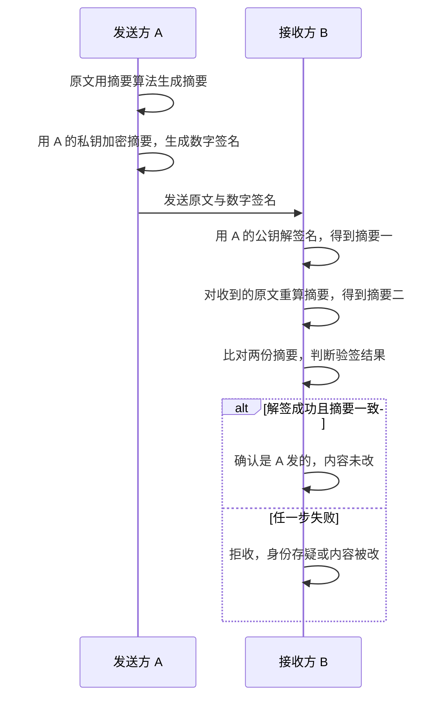

# 数据安全之身份验证：数字签名用私钥锁住摘要，一次验明身份与完整

机密性和完整性都有了对策，数据安全还剩最后一个洞。演示摘要时有个前提被一笔带过：报文里附带的那份指纹本身没有受到保护。第三方既然知道双方约定的摘要算法，就可以改完内容自己重算一份新指纹附上，接收方比对照样通过。指纹要被保护，发送方要被证明，两个需求拼在一起，就是数据安全的第三件武器，数字签名。

## 先给结论

- 数字签名的生成：发送方对原文用摘要算法生成摘要，再用私钥对摘要加密，得到数字签名，随内容一起传输。
- 验签的过程：接收方用发送方的公钥解开签名拿回摘要，再对收到的原文重算摘要，两者一致且解签成功，身份与完整性同时得到确认。
- 依据在密钥成对：用 A 的公钥加密的数据只有 A 的私钥能解，B 的私钥试不开，所以解签成功本身就是身份证明。
- `SHA1WithRSA` 这类签名算法名可以直接拆开读：SHA1 负责摘要（完整性），RSA 负责加密（机密性），一个名字综合两件事。
- 项目落点：课程项目与银行存管系统对接采用双向签名验签，标准算法就是 SHA1withRSA，交互前双方先交换公钥。

## 摘要也会被伪造

身份验证课开篇先复盘了两个遗留问题。第一个是摘要的安全性：演示里「内容变一个字，摘要完全不同」的结论，成立的前提是附带来的摘要没有被动过。攻击者改了内容之后，只要按同样的摘要算法重算一份新摘要替换进去，接收方重算比对，两份「新摘要」天然一致，篡改就完全隐形了。摘要算法是公开的，这一点是好事，但公开的东西谁都能用，包括攻击者。

第二个是消息的发送来源：收到一条消息，怎么确定它真是声称的那个发送方发出来的，而不是 B 冒充 A 发的？前者要求摘要本身被加密保护，机密性的手段；后者要求只有真正的发送方才造得出来这份保护物，非对称加密的手段。把两个手段按正确的方式组装，答案就出来了。

## 数字签名的生成与验证

组装的方式课件里只有一句话：发送方将消息原文使用摘要算法生成摘要，再用私钥对摘要进行加密，生成数字签名，然后将内容附上数字签名一起传输。拆开来看每一步各司其职：

- 原文经摘要算法生成摘要，摘要承担完整性职责，内容有任何改动它都会对不上。
- 摘要经私钥加密生成签名，加密承担机密性职责，没有私钥的人造不出这份签名。
- 私钥只有发送方持有，所以签名成了身份凭据，谁也不能冒充。

接收方走的是逆过程：用发送方的公钥对数字签名解密，解出摘要；再对收到的原文用同样的摘要算法重算；两份摘要一致，且解签动作本身成功，双重确认后才放行。整个流程画出来是这样：



这张图的关键路径在私钥与公钥的分工：签名永远出自私钥，验签永远用对方的公钥。方向不能颠倒，颠倒之后验的是自己而不是对方。

## 密钥成对：身份验证的数学根基

为什么「解签成功」就能证明身份？答案藏在非对称加密的成对规则里。假设通信各方都持有自己的密钥对：A 有 A 公钥、A 私钥，B 有 B 公钥、B 私钥。用 A 公钥加密的数据只能用 A 私钥解开，用 B 公钥加密的数据只能用 B 私钥解开，交叉试解是无效的，这就是「成对」的严格含义。

落到验签上：B 用 A 的公钥解开了签名，意味着这份签名是用与之配对的 A 的私钥生成的，而 A 的私钥只有 A 持有，所以签名的制造者就是 A 本人。如果解不开，要么对方冒名顶替，要么内容被替换，无论哪种情况都不能放行。顺带还得到了抗抵赖性：事后 A 无法否认发过这条消息，因为能造出这份签名的私钥在他自己手里。演示工程里 A 生成密钥对，用自己的私钥生成签名，B 侧用 A 的公钥验签，输出「验证签名成功」，整条链路就闭环了。

## 项目里的签名验签：与银行存管系统对接

这套机制在课程项目里有明确的用武之地。项目复盘讲义专门设了「说一下项目在跟第三方系统对接时如何保证数据安全」一节：平台要和银行存管系统交互，为了验证消息发送者的身份、确保其他人无法伪造，所有请求和返回报文都包含签名，接收方务必检查签名的正确性，签名使用标准算法 `SHA1withRSA`。交互流程是双方先交换各自的公钥，然后 A 端对传输内容签名、B 端验签，B 端同样对返回内容签名、A 端验签，一来一回双向互验。

公共工程里的 `RSAUtil` 就是这套规则的实现，签名与验签两个方法节选如下，包名按课程口径改写：

```java
public class RSAUtil {

    public static final String SIGN_ALGORITHMS = "SHA1WithRSA";
    final static Base64.Decoder decoder = Base64.getDecoder();
    final static Base64.Encoder encoder = Base64.getEncoder();

    // RSA 签名：用私钥对 content 生成签名，Base64 编码后返回
    public static String sign(String content, String privateKey, String input_charset) {
        try {
            PKCS8EncodedKeySpec priPKCS8 = new PKCS8EncodedKeySpec(decoder.decode(privateKey));
            KeyFactory keyf = KeyFactory.getInstance("RSA");
            PrivateKey priKey = keyf.generatePrivate(priPKCS8);

            Signature signature = Signature.getInstance(SIGN_ALGORITHMS);
            signature.initSign(priKey);
            signature.update(content.getBytes(input_charset));
            byte[] signed = signature.sign();
            return encoder.encodeToString(signed);
        } catch (Exception e) {
            e.printStackTrace();
        }
        return null;
    }

    // RSA 验签：用对方的公钥验证签名是否合法
    public static boolean verify(String content, String sign, String public_key, String input_charset) {
        try {
            KeyFactory keyFactory = KeyFactory.getInstance("RSA");
            byte[] encodedKey = decoder.decode(public_key);
            PublicKey pubKey = keyFactory.generatePublic(new X509EncodedKeySpec(encodedKey));

            Signature signature = Signature.getInstance(SIGN_ALGORITHMS);
            signature.initVerify(pubKey);
            signature.update(content.getBytes(input_charset));
            return signature.verify(decoder.decode(sign));
        } catch (Exception e) {
            e.printStackTrace();
        }
        return false;
    }
}
```

对照着读，`SIGN_ALGORITHMS` 常量就是那句「综合运用」的落点：`SHA1WithRSA` 前半段是摘要算法 SHA-1，后半段是加密算法 RSA，JDK 的 `Signature` 类把摘要与私钥加密封装成一次 `sign`，把解签与摘要比对封装成一次 `verify`。调用方只需要按约定传入内容、密钥与字符集，两把钥匙的方向由 `initSign` 与 `initVerify` 区分，用错方向会在运行期直接暴露。

课堂演示的调用侧更直观：A 方生成密钥对，用 `get(1)` 取私钥对原文「还款金额 100.00 元」签名并打印签名值；B 方收到后用 `get(0)` 取 A 的公钥验签，打印「验证签名成功」。课程说明里反复强调，这些工具类在项目开发中会被封装好直接调用，要掌握的不是默写算法，而是遇到「签名」「摘要」「公钥私钥」这些词时，立刻知道它们在哪一步、防的是什么事。

## 签名与加密：同一对钥匙的两个方向

容易混淆的地方值得单独说清。加密方向是「公钥加密、私钥解密」，目标是机密性，保证只有私钥持有者能看；签名方向是「私钥加密、公钥解密」，目标是身份与完整性，保证任何人都能验证、只有私钥持有者能发出。同一对钥匙，两个方向，两种用途。对接银行存管系统时两者都可能出现：报文要签名互验，敏感字段要加密传输，工程里按字段属性选择手段。

## 常见误区

- **以为数字签名是把整篇原文加密。** 错例：认为签名后的报文里装的是全文密文。正解：签名加密的是摘要，原文通常明文传输或另行加密，签名只负责让接收方能验出「谁发的、改没改」。
- **验签用发送方的私钥。** 错例：手里有谁的私钥就用谁的去验。正解：私钥永远只在生成方手里，验证必须用对方的公钥；能用自己私钥「验」通过的，那是自己签名自己解，毫无证明力。
- **觉得有了签名就不用加密。** 错例：报文带签名字段就认为整条消息安全了。正解：签名解决完整性与身份验证，不提供机密性，敏感内容仍需按机密性方案加密，两个问题两套手段。
- **验签失败只会怀疑代码。** 错例：`verify` 返回 false 就反复重写算法。正解：按链路排查，内容字节与字符集是否一致、双方密钥是否配对、签名值 Base64 解码是否正确、算法名是否与对方约定一致，绝大多数失败出在这些交接环节。
- **把 SHA1withRSA 当成自己的安全选型。** 错例：新系统设计接口时无脑沿用 SHA1。正解：课程项目沿用它是为了兼容存管方协议；SHA-1 作为摘要算法已显老旧，自主设计时应选 SHA256WithRSA 一类更强的组合。

## 面试可能被问到的问题

1. 面试官追问：「讲一下数字签名的生成与验证过程。」
   答：生成端对原文做摘要，用私钥加密摘要得到签名，原文与签名一起传输；验证端用发送方公钥解开签名得到摘要，对收到的原文重算摘要，解签成功且两份摘要一致即通过。完整性由摘要保证，身份由私钥唯一性保证。
2. 面试官追问：「为什么私钥签名、公钥验签能证明身份？」
   答：非对称密钥严格成对，公钥加密的内容只有对应私钥能解开。验签用的是 A 的公钥，能解通就意味着签名出自与之配对的 A 私钥，而 A 私钥只有 A 持有，所以签名者只能是 A。这也顺带提供了抗抵赖性。
3. 面试官追问：「签名和加密用同一对密钥，两者方向上的区别是什么？」
   答：加密是公钥加密、私钥解密，保证只有持有者能看；签名是私钥加密、公钥解密，保证任何人可验证且只有持有者能发。同一对钥匙两个方向，一个保机密，一个保身份与完整。
4. 面试官追问：「项目里与第三方系统对接时怎么保证数据安全？」
   答：以课程项目对接银行存管系统为例，交互前双方交换公钥，所有请求与返回报文都带签名，接收方必须验签，签名算法约定为 SHA1withRSA；平台与存管双向签名互验，加上必要字段的加密传输，覆盖机密性、完整性与身份验证三个问题。
5. 面试官追问：「裸摘要和数字签名差在哪一步？」
   答：差在摘要有没有被私钥保护。裸摘要可以被篡改者连内容一起重算替换，只能防误传不能防伪造；签名把摘要锁进私钥加密里，重算的摘要没有私钥签不出合法签名，伪造链路被彻底切断。

## 配套资料

- 代码：`materials/code/10/wanxinp2p/`，原始命名的工程目录归档；公共工程 common 模块下的 `RSAUtil.java` 含签名与验签的完整实现，正文节选自它，包名按 `com.study.finance` 系口径改写，密钥常量以 `example-*` 占位。
- 讲义：`materials/docs/10/day16-项目总结&就业指导v1.0.md`，3.7.2 节复盘了与银行存管系统对接时签名验签的两个基本要求与双向交互流程。
- 说明：`DataSecurityTest` 演示类为课堂演示工程代码，未随资料包归档，正文按画面线整理为可运行片段；演示原文与签名值均以业务语义表述，密钥以 `example-*` 占位。
