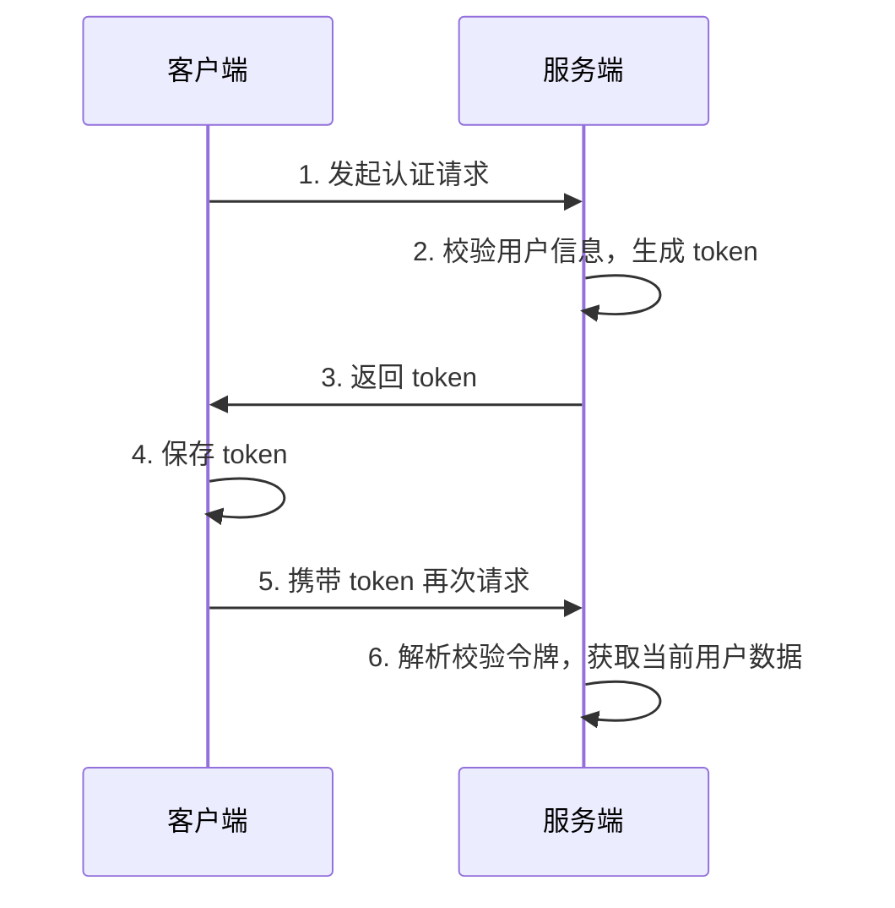

# 基于 Token 的认证机制：身份装进令牌，服务端不再记人

Session 方案在分布式、微服务、前后端分离架构下的困局已经摆过了：会话各建一份、负载均衡打散连接、修补方案各有代价，项目最终选择放弃它。放弃之后用什么呢？课程给出的答案是基于 Token 的认证。很多人第一次接触 token 时真正的困惑是：session 把用户数据放在服务端都能出这么多问题，token 干脆连服务端都不存了，那服务端凭什么认得我？把「数据放在哪」这个问题想透，token 的全部机制就通了。

## 先给结论

- Token 翻译过来就是令牌：认证通过后服务端生成一枚令牌返回给客户端，用户相关数据直接放在令牌里，服务端不再保存会话。
- 交互分六步：发起认证、校验用户信息并生成令牌、返回令牌、客户端保存令牌、携带令牌再次请求、服务端解析校验令牌并取回用户数据。
- 与 Session 的根本区别是数据位置：Session 是数据在服务端、凭条在客户端；Token 是数据本身在客户端、服务端只验不存。
- 无状态带来三个直接收益：分布式下不需要会话同步，没有集中存储的单点依赖，移动端这类不依赖 Cookie 的客户端也能用同一套机制。
- 令牌如何防伪造、令牌内容用什么格式组织，是 Token 方案必须回答的两个问题，答案就是下一课的 JWT。

## 令牌是什么：从锦衣卫的腰牌说起

Token 的直译是令牌。提到令牌，最容易想到的画面是影视作品里的锦衣卫：腰间挂一块牌子，上刻「锦衣卫」三个字，所到之处亮牌即通行。这块牌子的关键在于，身份信息就刻在牌子本身上，验的人看牌子就能确认身份，不需要回京城查档案。

基于 Token 的认证就是这个思路。用户认证成功后，服务端生成一枚令牌，把用户的相关信息放进去，连同令牌一起返回给客户端；此后客户端每次请求都携带这枚令牌，服务端校验解析令牌，取出里面的用户数据，就知道请求者是谁、是什么角色。

项目总结讲义对它的定义是：基于 Token 的用户认证是一种服务端无状态的认证方式，所谓服务端无状态，指 token 本身包含用户所有的相关数据，客户端在认证后的每次请求都会携带 token，因此服务端无需存放 token 数据。对照上一课 Session 的形态，差别一目了然：Session 是登录数据留在服务端，客户端只拿一个 sessionId 编号；Token 是把「锦衣卫」三个字直接刻在令牌上，数据随令牌走，服务端发出去之后就不保存了。

## 六步交互流程

一枚令牌从签发到被使用，完整的生命周期是六步，课件上的流程图把它画得很清楚：



这张图的信息流值得盯住第 3 步：令牌一返回，用户数据就随令牌落到了客户端手里，服务端此后不保存任何副本。第 5、6 步与 Session 的对应步骤看似相似，内在完全不同：Session 方案里服务端拿 sessionId 去找回存好的会话，Token 方案里服务端拿到的是数据本身，要做的只是校验与解析。

## 代码视角：只验不存的过滤器

把流程落成代码，数据流向会更直观（课程未提供本节源码，以下为按主流写法补全的示例，包名按专题约定使用 `com.study.finance`）：

```java
// 登录成功后签发令牌：用户信息直接放进令牌体
public class TokenLoginService {

    public String login(String username, String password) {
        if (!checkUser(username, password)) {
            throw new RuntimeException("账号或密码错误");
        }
        // 先看数据组织方式：用户身份、角色、过期时间都在令牌里
        // 真实令牌必须加签名防伪，签名机制在 JWT 一课展开
        String payload = "{\"username\":\"" + username
                + "\",\"role\":\"consumer\",\"exp\":" + (System.currentTimeMillis() + 7200_000) + "}";
        return Base64Util.encode(payload);
    }

    private boolean checkUser(String username, String password) {
        // 省略：查询 p2p_account 库校验账号密码
        return true;
    }
}
```

```java
// 后续请求校验令牌：服务端只验不存，不查找任何会话
@WebFilter("/*")
public class TokenAuthFilter implements Filter {

    @Override
    public void doFilter(ServletRequest request, ServletResponse response, FilterChain chain)
            throws IOException, ServletException {
        HttpServletRequest req = (HttpServletRequest) request;
        String token = req.getHeader("Authorization"); // 客户端每次请求携带令牌
        if (token == null || !verifyAndParse(token)) {
            ((HttpServletResponse) response).sendError(401, "令牌缺失或无效");
            return;
        }
        chain.doFilter(request, response); // 校验通过即确认身份
    }

    private boolean verifyAndParse(String token) {
        // 示例从简：解析 payload 并检查 exp，真实实现需先验签名
        return true;
    }
}
```

对比上一课 Session 方案的两个类：登录侧从 `session.setAttribute` 存数据变成把数据组织进令牌；校验侧从 `getSession(false)` 找回会话变成解析令牌本身。过滤器里没有任何一处代码依赖「上一次请求发生过什么」，这正是无状态的含义：每个请求都自带全部身份信息，服务端拿到什么验什么。

## 无状态到底解决了什么

上一课给 Session 列的难题，可以逐条对号入座地看 Token 是怎么化解的。

**第一，分布式会话不一致。** 各服务不再各建会话，也就无所谓同步。任何一台服务器、任何一个微服务，只要持有令牌校验能力（本质是持有一份验签密钥），就能独立确认请求者身份，不需要回某个中心查会话。Session 集中存储方案虽然也统一了数据，但引入了一个必须高可用的 Redis 中心；Token 方案连这个中心都不需要。

**第二，负载均衡与扩缩容。** 服务端不存会话，请求落到哪个节点都一样，session 粘滞那套「把用户绑死在一个节点」的别扭设计彻底不需要，服务可以随意水平扩容、随意重启。

**第三，多端统一。** Session 基于 Cookie，移动端 APP 对 Cookie 支持薄弱。Token 的存放位置很自由：可以放 Cookie，也可以放 `localStorage` 等存储中，每次请求放进请求头带上即可。课件在总结 JWT 优点时特别点了一句：token 存在 `localStorage` 可避免 CSRF，并且可以实现 web 和 app 统一认证机制。服务端只认令牌不认端，PC 网页与移动 APP 走的是同一套认证逻辑。

课程项目的最终形态也印证了这条路：项目总结讲义描述的认证流程里，接入方（前端）请求认证服务获取令牌，之后携带令牌访问微服务，API 网关负责解析令牌并验证接入方权限，再把解析出的明文用户信息转发给微服务。网关侧的配套约定也早就定好了：`/服务名称/my/资源名称/*` 这类受保护的 C 端接口，必须携带 C 端用户认证所获取的 Access Token 才可访问。令牌在整条链路里就是通行凭证本身。

## 两个留白：令牌的真伪与格式

六步流程里藏着两个本课没有展开的问题，它们正是下一课的主角。

**其一，令牌的真伪怎么保证。** 锦衣卫的腰牌可以仿造，令牌同样可以：客户端发来的东西服务端并不能天然分辨真假，第 6 步的「解析校验」里，校验二字才是关键。手段是对令牌加签名，服务端验签通过才信任里面的数据，具体怎么做由 JWT 的签名机制回答。

**其二，令牌的内容用什么格式。** 令牌里放用户名、角色、过期时间，总得有个统一的结构约定，否则签发方和校验方对不上话。市面上的 Token 方案大多采用 JWT（Json Web Token），它的三段式结构、每一段放什么，下一课逐段拆开。

另外要预支一笔账：令牌发出去就收不回来，服务端不存状态意味着「主动作废一枚令牌」变得困难，只能靠有效期控制，这是 Token 方案为无状态付出的代价，后面的误区一节还会回到它。

## 常见误区

- **把令牌当成加密数据。** 错例：认为令牌内容别人看不见，把手机号、身份证号明文塞进去。正解：编码不等于加密，很多令牌的载荷部分解码即可读；防篡改靠签名，防偷看靠 HTTPS 传输，敏感信息不应明文进令牌。
- **认为无状态就是服务端什么都不存。** 错例：说「服务端完全不保存任何东西」。正解：无状态指的是不存会话数据，校验令牌所需的密钥、签发策略仍然在服务端手里，丢了这个，令牌就成了谁都能伪造的白条。
- **把令牌放进 Cookie 就等于退回了 Session。** 错例：见令牌存在 Cookie 里，就断定和 Session 一回事。正解：Cookie 只是众多存储位置之一，关键区别在数据本身：令牌自带用户数据，服务端不靠它去定位某个会话；而 Cookie 里的 sessionId 只是一张凭条。
- **以为分布式下各微服务要共享一个用户库来校验令牌。** 错例：每个微服务都去查用户表确认身份。正解：自包含令牌的校验靠验签完成，验签只需要密钥，不需要查库；查库验证用户是登录那一刻在认证服务里做的事。

## 面试可能被问到的问题

1. 面试官追问：「描述一下基于 Token 的认证流程。」
   答：客户端发起认证，服务端校验账号密码后根据用户数据生成令牌并返回；客户端将令牌保存在 Cookie 或 localStorage 等存储中，此后每次请求携带令牌；服务端解析并校验令牌，取回其中的用户数据确认身份。整个过程服务端不保存令牌，是无状态认证。
2. 面试官追问：「Token 和 Session 认证的本质区别是什么？」
   答：本质区别是数据位置。Session 把用户数据存在服务端会话里，客户端只持有 sessionId 这张凭条，服务端要拿凭条找回数据；Token 把用户数据直接放进令牌交由客户端保存，服务端只验不存。由此衍生出 Token 天然适合分布式与多端，Session 在这些场景下需要各种修补。
3. 面试官追问：「为什么说 Token 方案天然支持分布式和微服务？」
   答：因为服务端无状态，任何节点只要持有验签密钥就能独立校验令牌，不需要会话同步，也不依赖集中式会话存储；负载均衡把请求打到哪个实例都一样，扩容缩容不受会话牵制。Session 的复制、粘滞、集中存储三种修补方案要解决的问题，在 Token 这里直接不存在。
4. 面试官追问：「客户端把 Token 存在哪里比较好？」
   答：常见是 localStorage 或 Cookie。存 localStorage 配合请求头携带，不依赖 Cookie 自动发送，可以避免 CSRF，也能让 web 和 app 走统一认证机制；存 Cookie 则要注意 XSS 风险与作用域设置。课程项目里令牌由前端统一保存并在请求头中携带。
5. 面试官追问：「服务端不存令牌，那用户主动退出登录怎么办？」
   答：这是 Token 方案的经典代价。通行做法是缩短令牌有效期，配合刷新令牌机制在用户活跃时换发新令牌；需要立即作废时，只能引入服务端黑名单或改用不透明令牌回查状态，但这会牺牲一部分无状态特性，要在安全性与架构简洁之间权衡。

## 配套资料

- 讲义：`materials/docs/10/day16-项目总结&就业指导v1.0.md`，3.2.1 节给出令牌与服务端无状态的定义，3.2.2 节描述了项目完整的七步认证流程（令牌由 UAA 签发、网关解析后转发用户信息）。
- 讲义：`materials/docs/10/万信金融-第2章-讲义-开户v1.0.md`，1.4.2 节定义了三类接口的访问约定，受保护的 `/my/**`、`/m/**` 接口必须携带 Access Token 才可访问。
- 代码：`materials/code/10/wanxinp2p/`，万信金融工程的原始命名归档目录，工程结构可在该层级浏览；本课为概念讲解，归档代码中暂无 Token 机制相关源码，正文 Servlet 示例为按本课写法补全，包名按专题约定改写。
