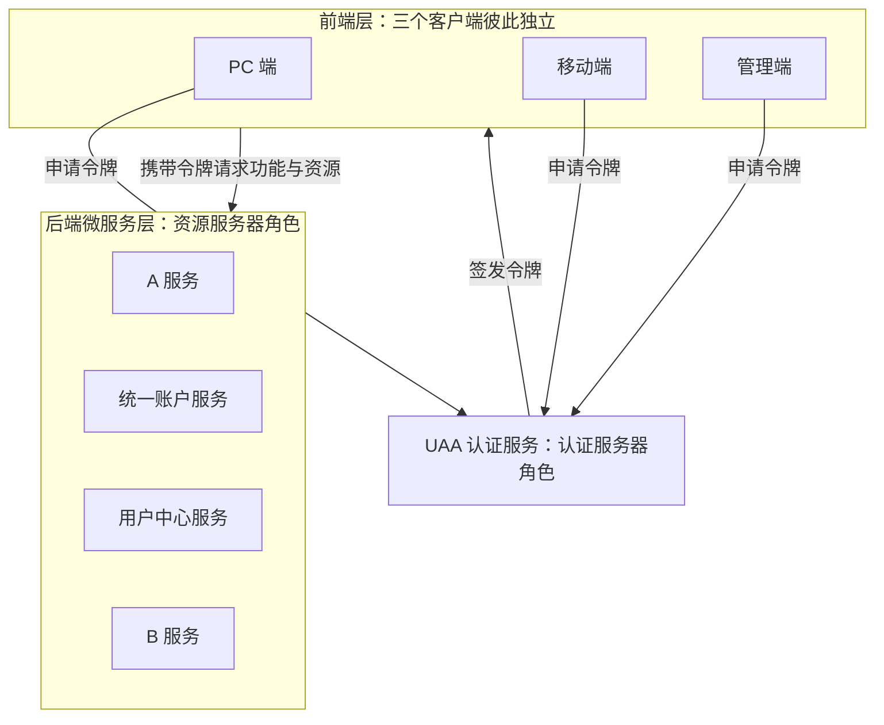
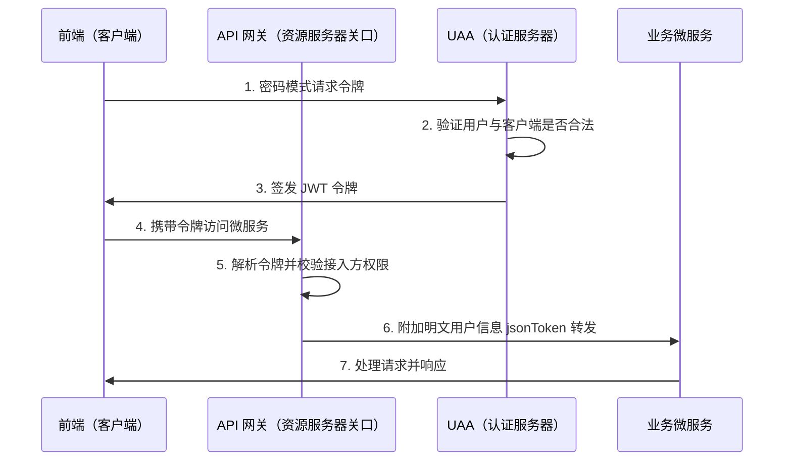

# OAuth2 落地万信金融：谁当客户端，为什么选密码模式

> 🔒 安全提示：文中示例的口令/密钥均为课程教学环境演示口径，生产环境的安全要求见《安全与合规须知》。

机制讲了两课，回到自己的项目：万信金融这个 P2P 平台需不需要 OAuth2？答案是需要，但得说清原因，说清角色怎么映射、四种授权模式为什么只用密码模式就能转起来。这些问题逐一对号入座。

## 先给结论

- 引入 OAuth2 的两个原因：一是现有短信验证码登录之外，要预留第三方授权登录的扩展能力；二是前后端分离、分布式、微服务架构下，多个前端与一堆微服务彼此独立、互不认识，彼此都视为第三方，需要一套统一的认证管理机制。
- 角色映射：前端是客户端，用户是资源拥有者，后端业务微服务是资源服务器，独立部署的 UAA 服务是认证服务器。
- 落地流程：前端先向 UAA 申请令牌，拿到令牌后携带令牌去访问微服务要资源、要功能；API 网关负责解析令牌并做权限拦截。
- OAuth2 提供四种授权模式，项目目前只用密码模式：`grant_type=password`，请求携带 `client_id`、`client_secret`、`username`、`password` 等参数，认证服务器先校验客户端合法性，再校验用户账号密码，都通过才签发令牌。
- 密码模式会把客户端密钥与用户凭证直接交出去，只适合自家开发的客户端；第三方接入必须改用授权码等其他模式。

## 为什么引入：两个站得住的理由

第一个理由好理解：当前登录方式是手机号加短信验证码，体验不错，但产品演进不能只看当下。预留第三方授权登录，将来在登录页摆上 QQ、微信的授权入口，用户扫码授权即可进入平台，再补充个人信息或继续开户，第一步就让用户感受到快捷。支撑这类扩展靠的正是 OAuth2。

第二个理由藏在架构里，也更本质。项目采用前后端分离、分布式、微服务架构：前端至少有三个，PC 端、移动端、管理端；后端是一群微服务。关键在于它们相互独立、互不认识：每个前端、每个微服务都单独启动、单独部署、各占各的端口，同属一个项目，但 PC 端看移动端是第三方，移动端看管理端也是第三方，前端看任何微服务还是第三方。彼此都是第三方的世界里，认证必须有统一的机制来管，而 OAuth2 恰好特别擅长这种局面。



这张图把两层的角色标注了出来：前端层是客户端阵营，后端微服务层整体扮演资源服务器，UAA 独立承担认证服务器。三条申请令牌的箭头强调三个前端走的是同一套接入机制，谁也不特殊。

## 角色对号入座

把上一课的四个角色搬进项目，映射关系如下：

| OAuth2 角色 | 项目中的扮演者 | 说明 |
|---|---|---|
| Client 客户端 | 前端（PC 端、移动端、管理端） | 自己发起请求的应用，本身不存资源 |
| Resource Owner 资源拥有者 | 用户本人 | 授权与否由用户决定 |
| Resource Server 资源服务器 | 后端业务微服务 | 数据都在数据库里，但操作数据库的是后端微服务，所以资源服务器是它们 |
| Authorization Server 认证服务器 | 独立的 UAA 服务 | User Account and Authentication，专门做认证授权的微服务 |

资源服务器这一项容易犹豫：资源不都在数据库里吗？数据库是被动的，真正操作它的是后端微服务，前端碰不到库，所以对外提供资源的是微服务本身。认证服务器则原本在架构图里缺席，它就是即将集成进项目的 UAA 服务，一个专门做认证授权的独立微服务。

## 请求链路：令牌怎么领，资源怎么拿

角色就位之后，整条链路的走法与上一课的通用流程完全同构。项目总结讲义把项目认证流程描述得很具体，串成时序如下：



几个环节值得展开。第 2 步是双重校验，UAA 调用统一账户服务验证用户身份并获取权限，同时获取接入方权限信息、验证接入方是否合法，都合法才签发 JWT 令牌，令牌里同时包含用户权限和接入方权限。第 5、6 步是网关的价值所在：解析令牌、验证接入方权限能否访问本次请求的微服务，通过后把明文用户信息 `jsonToken` 附在请求上转发，微服务凭它识别本次请求的用户。开户讲义把网关在认证体系里的职责概括为两件事：令牌解析并转发当前登录用户信息给微服务，作为 OAuth2.0 的资源服务器角色实现接入方权限拦截。

配套的接口约定也已经定好，微服务内部接口按保护级别分三类：`/服务名称/my/资源名称/*` 是受保护的 C 端用户接口，需携带 C 端用户认证获取的 Access Token；`/服务名称/m/资源名称/*` 是受保护的 B 端管理员接口，需携带 B 端用户的令牌；其余不带前缀的是公开资源，无限制。访问 `/my/**` 这类资源，要求接入客户端 `scope` 中包含 `read`、`authorities` 中包含 `ROLE_CONSUMER`，这些数据与 `oauth_client_details` 表一一对应。

## 密码模式：五个参数换一枚令牌

OAuth2 一共提供四种获取令牌的方式，项目目前只用到了密码模式，把这一种吃透就能跟上后续的代码实现。密码模式的请求很直白，向认证服务的令牌端点发一个请求，带上约定参数：

```bash
# 向认证服务申请令牌：五个参数缺一不可（客户端密钥用占位符示意）
curl "http://uaa/oauth/token?client_id=finance-pc&client_secret=example-client-secret&grant_type=password&username=zhangsan&password=123456"
```

五个参数各有名分：

| 参数 | 含义 |
|---|---|
| `client_id` | 客户端准入标识，认证服务器不允许随便一个客户端接入 |
| `client_secret` | 客户端秘钥 |
| `grant_type` | 授权类型，固定填 `password` 表示密码模式 |
| `username` | 资源拥有者用户名 |
| `password` | 资源拥有者密码 |

`grant_type` 是四种授权模式的开关，取什么值就告诉认证服务器走哪种模式，`password` 即密码模式。剩下四个参数分成两对：一对是客户端的标识与秘钥，一对是用户的账号与密码。客户端这一对容易被忽视，它背后是 OAuth2 对接入方加的又一层认证：认证服务器不能来一个请求就接一个，万一是个来历不明的客户端发来的请求，白白消耗资源还有安全风险。所以项目会给每个前端客户端分配各自的 `client_id` 与 `client_secret`，PC 端、移动端、管理端各有一份，请求时必须带上让服务器验明正身。校验顺序是先客户端后用户：客户端不合法直接拒绝，客户端合法再验用户账号密码，账号密码不对同样不发令牌，两关都过，认证服务器才生成令牌返回。响应里除了访问令牌，还带着过期时间与权限范围（示例为按主流写法补全）：

```json
{
  "access_token": "eyJhbGciOiJIUzI1NiIsInR5cCI6IkpXVCJ9.example-token",
  "token_type": "bearer",
  "refresh_token": "example-refresh-token",
  "expires_in": 7200,
  "scope": "read",
  "authorities": ["ROLE_CONSUMER"]
}
```

这套流程在 Spring Security OAuth2 里对应两处关键配置。客户端信息不写死在代码里，而是存放在数据库的 `oauth_client_details` 表，由 `JdbcClientDetailsService` 读取，给哪个前端发什么 `client_id`、配什么权限，都是表里的一条记录；密码模式要生效，还依赖一个必须显式暴露的 `AuthenticationManager` Bean，课程同栈 UAA 工程的配置里专门有一行注释提醒这件事：

```java
// 课程同栈 UAA 工程的真实写法，包名按专题约定改写
@Configuration
public class SecurityConfig extends WebSecurityConfigurerAdapter {

    // 不定义这个 Bean，密码模式 grant_type 就无法使用
    @Override
    @Bean
    public AuthenticationManager authenticationManagerBean() throws Exception {
        return super.authenticationManagerBean();
    }
}
```

```java
// 客户端准入信息存库管理：oauth_client_details 表（真实写法，包名按专题约定改写）
@Bean
public ClientDetailsService clientDetailsService(DataSource dataSource) {
    JdbcClientDetailsService detailsService = new JdbcClientDetailsService(dataSource);
    detailsService.setPasswordEncoder(passwordEncoder());
    return detailsService;
}
```

另有一个工程细节：课件示例用 GET 请求把参数拼在 URL 里展示，只为看得清楚，工程实现中这类请求通常用 POST 提交，避免账号密码出现在 URL 与访问日志里。

## 密码模式的边界：只给自家人用

密码模式的短处课件说得毫不客气：客户端的秘钥、用户的账号密码，全在请求里直接扔了出去。凭证经过自家前端尚属可控，一旦客户端是第三方，等于把账号密码亲手递给别人，绝对不行。

所以硬边界是：密码模式只能用于自己开发的客户端。项目里 PC 端、移动端、管理端全是自家团队写的，密钥握在自己人手里，风险可控。将来若有第三方应用要接入平台，必须换用其他授权模式，让用户在认证服务器的授权页面上亲自授权，第三方拿到的只是令牌而非凭证。四种模式的存在意义就在这里：按客户端的可信程度选模式，这正是后续代码集成时要用到的知识。

## 常见误区

- **把密码模式当成默认选项到处用。** 错例：给第三方应用的接入文档里直接写 `grant_type=password`。正解：密码模式要求客户端是自家开发，第三方接入必须走授权码等模式，把授权动作收回到认证服务器的授权页上完成。
- **把 `client_id` 当成机密、把用户密码当成唯一校验。** 错例：只传 `client_id` 不传 `client_secret`，或者以为验完账号密码就算完。正解：`client_id` 是准入标识，`client_secret` 才是秘钥，两者成对上传；认证服务器先验客户端再验用户，两关都过才发令牌。
- **认为 UAA 服务是资源服务器。** 错例：把认证服务器与资源服务器混为一谈。正解：UAA 扮演认证服务器，负责签发令牌；后端业务微服务才是资源服务器，资源归资源、认证归认证，两者分开部署。
- **让前端绕过网关直连微服务。** 错例：前端为了省一跳，直接请求微服务端口。正解：令牌校验收口在网关，网关解析令牌、校验接入方权限后附加明文用户信息 `jsonToken` 转发，微服务信任的是网关传来的数据；绕过网关的请求没有统一校验，也拿不到用户信息。

## 面试可能被问到的问题

1. 面试官追问：「你的项目为什么要引入 OAuth2？」
   答：两个原因。一是登录方式要扩展，现有短信验证码之外预留第三方授权登录能力；二是架构使然，项目是前后端分离加分布式微服务，多个前端与多个微服务单独部署、互不认识，彼此在架构上都视为第三方，需要 OAuth2 这类机制做统一的认证管理。
2. 面试官追问：「OAuth2 的四个角色在你项目里分别由谁扮演？」
   答：前端（PC 端、移动端、管理端）是客户端；用户是资源拥有者；后端业务微服务是资源服务器，因为数据虽在数据库，操作数据库的是微服务；独立部署的 UAA 服务是认证服务器，全称 User Account and Authentication，用 Spring Security 加 OAuth2 加 JWT 技术栈实现。
3. 面试官追问：「密码模式获取令牌的请求长什么样，服务端怎么校验？」
   答：向认证服务的 `/oauth/token` 端点发请求，参数包括 grant_type 固定为 password、客户端的 client_id 与 client_secret、用户的 username 与 password。服务端先校验客户端是否合法准入，再校验用户账号密码，两关都通过才签发 JWT 令牌，令牌里带用户权限和接入方权限。
4. 面试官追问：「密码模式安全吗，什么场景下不能用？」
   答：它会把客户端秘钥和用户账号密码直接暴露在请求里，只适合客户端完全由自己开发的场景，自家前端用没有问题。第三方应用绝不能用密码模式，否则等于把用户凭证交给别人，第三方接入应使用授权码模式，由用户在认证服务器页面亲自授权。
5. 面试官追问：「令牌签发之后，一次请求在系统里是怎么被处理的？」
   答：前端携带令牌访问 API 网关，网关解析令牌并校验接入方权限能否访问目标微服务，通过后将解析出的明文用户信息 jsonToken 附加到请求上转发给微服务，微服务凭它识别用户。网关在认证体系里就干两件事：令牌解析并转发用户信息，以及作为资源服务器角色做接入方权限拦截。
6. 面试官追问：「每个客户端的 client_id 和秘钥存在哪里，怎么管理？」
   答：存在数据库的 oauth_client_details 表，通过 JdbcClientDetailsService 读取，每个前端客户端一条记录，包含标识、秘钥、scope 和 authorities 等字段。接口保护规则与这张表对应，比如访问 /my/** 资源要求客户端 scope 含 read、authorities 含 ROLE_CONSUMER，接入方的权限管理因此是配置化的。

## 配套资料

- 讲义：`materials/docs/10/day16-项目总结&就业指导v1.0.md`，3.2.2 节给出项目认证流程的七步描述：接入方以密码模式请求 UAA，UAA 验证用户与接入方后签发 JWT，网关解析令牌并附加 `jsonToken` 转发微服务。
- 讲义：`materials/docs/10/万信金融-第2章-讲义-开户v1.0.md`，1.2 节说明引入 UAA 服务的原因，1.4 节定义网关的认证职责与三类接口的访问规则（`/my/**`、`/m/**`、公开资源，对应 `oauth_client_details` 表的 `scope` 与 `authorities`）。
- 代码：`materials/code/10/代码/shanjupay-uaa/shanjupay-uaa-service/src/main/java/com/shanjupay/uaa/config/SecurityConfig.java` 与同目录 `AuthorizationServer.java`，同阶段课程 UAA 实现工程（与万信金融同一套 Spring Security OAuth2 + JWT 技术栈）的真实配置，含 `AuthenticationManager` 暴露与 `JdbcClientDetailsService` 写法，正文摘录按专题约定改写了包名。
- 代码：`materials/code/10/wanxinp2p/`，万信金融工程原始命名归档目录；当前阶段网关仅做路由转发，UAA 集成后的代码在后文实现篇展开。
