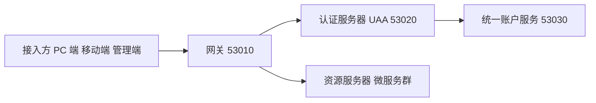
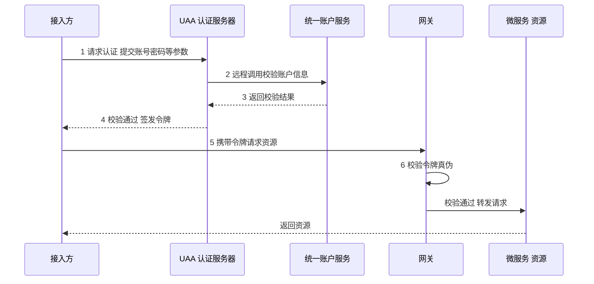

# P2P 平台的认证架构图：认清六方角色，走通六步认证流程

OAuth2.0 的协议模型刚讲完，概念层面知道了接入方、认证服务器、令牌各是什么。可协议图是抽象的，放进万信金融这个具体的前后端分离加微服务系统，各方怎么摆、请求怎么流、令牌由谁验，这些问题协议图回答不了。课程此时给出一张更正式的 P2P 项目认证架构图，这张图是后续集成认证服务、改造网关、实现登录功能的施工图，后续每一行代码都能在图上找到自己的位置，读懂它，后面的开发就顺了。

## 先给结论

- 后端拆成两大块：一群微服务扮演 OAuth2.0 里的资源服务器，负责提供功能与数据；独立抽出的认证服务器 UAA 专职签发令牌，两者同属服务器端。
- 认证流程六步：接入方提交账号密码请求认证，认证服务器远程调用统一账户服务校验账户信息与接入客户端信息，通过后签发令牌返回。
- 客户端拿到令牌后，此后每次访问资源都必须携带令牌，不带或带假的一律被拒。
- 令牌校验压在网关做：所有请求必经网关，在这一层验一次真伪，校验通过再转发微服务，微服务不重复校验。
- 令牌里要装下用户名、手机号、权限这类用户信息，网关校验通过后把用户信息随请求转发给下游微服务使用。

## 图上有哪些角色

整张图从外到内可以分成三层。最外层是接入方，也就是 OAuth2.0 里说的客户端：PC 端、移动端、管理端，将来还可能有第三方系统接入。平台必须考虑可扩展性，认证方案不能只为某一种前端定制，今天能接 H5，明天来了小程序或第三方应用也能接，这是架构设计的前提。

中间穿插着网关。它的位置特殊，图里有时不画它，但它一直存在：前端发出的所有请求都要经过网关，再由网关转发到后端。这个「必经之地」的属性，马上会在令牌校验的方案选择里发挥决定性作用。

最里层是服务器端，分成两大块。一大块是那一堆微服务，统一账户服务、用户中心，以及后续要开发的业务服务，它们对外提供功能与数据，在 OAuth2.0 的术语里叫资源服务器；另一大块是单独抽出来的认证服务器 UAA，全平台统一认证中心，专职认证与签发令牌。两块并列，都属于后端。认证服务器自己不存账号密码，校验账户信息要委托统一账户服务完成，这条依赖关系在图上也是一条实线。



这张图把角色关系压成四条线：网关是唯一入口，认证服务器与资源服务器在网关之后并列而立，认证服务器签发令牌前要找统一账户服务核对账户信息。看懂布局，流程只是把这些线按时间顺序点亮。

## 六步流程把角色串起来

架构图的价值在流程里兑现。一次完整的认证与资源访问，按时间顺序走六步：



第一步从接入方开始：用户在登录页填好账号密码发起认证请求，按 OAuth2.0 密码模式的要求，请求里要带上客户端标识、客户端密钥、用户名、密码等一组参数。第二步，认证服务器收到请求后要做两件核对：一是账户信息对不对，这要靠远程调用统一账户服务来完成；二是接入客户端合不合法，客户端标识与密钥要能对上认证服务数据库里登记的接入方信息。第三步返回校验结果，第四步校验通过，认证服务器生成令牌返回给客户端，到这一步登录完成。

第五步是分水岭：客户端要访问任何微服务的功能，每次发请求都得带上这个令牌，因为它是能证明身份的凭证，不带令牌的请求会被直接拒绝。第六步是整套架构里最关键的一环，令牌进入网关，网关校验它的真伪，网络传输中令牌可能被伪造或篡改，这道校验必不可少；校验通过，请求才被转发给目标微服务，微服务提供资源并响应客户端。

## 令牌校验该交给谁

第六步在动手前要过方案论证关：校验令牌这件事，交给谁做合适。可选的路有两条。

**方案一，网关不管校验，只负责转发。** 请求转发到哪个微服务，就由哪个微服务自己校验令牌。这条路的毛病一推演就露出来：用户中心的请求要校验，后续的投标、放款、还款，每个微服务都得各自实现一遍校验逻辑，前端发一次请求就要在每个服务里重复建设，代码重复不说，校验规则一旦调整，所有服务都得跟着改。

**方案二，校验压在网关。** 网关的位置恰好是为这件事准备的：前端发出的所有请求都必须经过它，在入口处验一次令牌，通过后放行到任意微服务，全平台一份校验逻辑，一处维护。

本项目选方案二。网关从此在认证授权体系里承担两项职责：其一，令牌解析，校验通过后把当前登录用户的信息取出来放进请求，转发给下游微服务使用；其二，作为 OAuth2.0 的资源服务器角色，对接入方做权限拦截。要拦谁、放谁，靠的是接口的 URL 规则：受保护的 C 端接口以 `/my` 为前缀、受保护的 B 端接口以 `/m` 为前缀、公开资源无前缀，网关的配置类按前缀匹配并检查令牌里的权限标识。归档的同框架网关工程里，这类规则的真实写法如下：

```java
// 网关按微服务逐个定义拦截规则，此处按用户中心的路径改写，写法与归档工程一致
http.authorizeRequests()
    .antMatchers("/consumer/druid/**").denyAll()
    // 受保护的 C 端接口：要求权限范围含 read 且接入客户端持有 ROLE_CONSUMER
    .antMatchers("/consumer/my/**")
        .access("#oauth2.hasScope('read') and #oauth2.clientHasRole('ROLE_CONSUMER')")
    // 其余路径公开放行
    .antMatchers("/consumer/**").permitAll();
```

前缀即规则，拦截器扫一眼路径就知道该不该拦、要什么权限，业务代码里不需要散落任何判断。而网关目前离这个目标还有距离，归档工程里它的启动类只有路由转发与跨域配置：

```java
@SpringBootApplication
@EnableZuulProxy
@EnableDiscoveryClient
public class GatewayServer {

    public static void main(String[] args) {
        SpringApplication.run(GatewayServer.class, args);
    }
}
```

`@EnableZuulProxy` 管路由转发，令牌解析与资源服务器两块拼图还没装上，这正是接下来集成 UAA 服务、给网关补认证能力的动工点。

## 令牌里要装什么信息

令牌能证明身份，前提是它装得下身份信息。这套体系采用 JWT 令牌，三段结构里第二段是自定义载荷，登录成功时封装的用户名、手机号、权限信息都会写进这一段，网关与微服务解开令牌就能拿到，不需要再查库。权限信息尤其重要：网关做接入方权限拦截时，判断依据正是令牌里的权限标识与 URL 规则的匹配结果。令牌自身还带着有效期与唯一编号，到期自动失效，防重放有依据。令牌的具体生成过程由认证服务框架自动完成，业务代码只负责把用户信息交出去，这是下一课集成 UAA 服务后要动手实现的部分。

## 常见误区

- **把令牌校验下沉到每个微服务。** 错例：网关只转发，用户中心、消费服务各写一遍校验代码。正解：所有请求必经网关，校验压在网关做一次，微服务只消费校验后转发的用户信息。
- **把网关当纯路由器。** 错例：认为网关的职责就是转发加跨域，认证绕过它直连微服务。正解：网关在认证体系里是令牌解析者加资源服务器双重角色，绕过网关等于绕过整个授权体系。
- **认为令牌通过就什么都能访问。** 错例：拿到合法令牌后调管理类接口也畅通无阻。正解：令牌证明身份，能访问什么由 URL 规则与令牌里的权限标识共同决定，受保护接口按前缀与权限表达式机械拦截。
- **公开资源也被拦下要求令牌。** 错例：登录认证、获取验证码这类认证之前的接口也要求带令牌，前端死循环。正解：URL 三分类是设计出来的，认证前的接口按公开资源规则放行，前端请求封装里的免登录白名单正对应这一类。

## 面试可能被问到的问题

1. 面试官追问：「描述一下你们项目里一次完整的认证流程。」
   答：接入方在登录页提交账号密码，按 OAuth2.0 密码模式携带客户端标识、密钥等参数请求认证服务器；认证服务器远程调用统一账户服务核对账户信息，同时核对客户端的接入合法性；通过后签发令牌返回客户端。此后客户端每次访问资源都携带令牌，网关统一校验真伪，通过后把用户信息随请求转发给微服务。
2. 面试官追问：「令牌校验为什么放在网关，而不是让每个微服务自己校验？」
   答：微服务各自校验意味着每个服务重复实现一遍校验逻辑，规则调整时要全量修改。网关是所有请求的必经之地，在入口校验一次即可放行到任意微服务，一份逻辑一处维护，位置上天然合适。
3. 面试官追问：「网关在你们认证体系里具体负责什么？」
   答：两项职责。一是令牌解析，校验通过后取出当前登录用户信息放进请求转发给微服务；二是作为 OAuth2.0 资源服务器角色对接入方做权限拦截，按 URL 三分类规则匹配前缀，检查令牌的权限范围与角色标识。
4. 面试官追问：「令牌里应该包含哪些信息，为什么？」
   答：用户名、手机号这类身份字段，下游业务处理时直接取用，不必再查账户库；权限标识，网关做权限拦截的判断依据；有效期与唯一编号，前者控制令牌生命周期，后者用于防重放。这些信息放进 JWT 的自定义载荷，解开令牌即可读取。
5. 面试官追问：「认证服务器为什么还要调用统一账户服务，它自己查库不行吗？」
   答：职责划分决定的。认证服务器只管认证流程与令牌签发，账户数据、密码加密这些资产统一收在账户服务里，一处存储一处维护。认证服务器通过远程调用获取校验结果，账户模型变化时认证服务无感，这是微服务单一职责的体现。

## 配套资料

- 代码：`materials/code/10/wanxinp2p/`，P2P 工程归档（目录保留原始命名，路径列到该层级），网关模块的启动类 `GatewayServer` 与跨域配置为真实实现，正文「要补的拼图」针对的就是它的现状。
- 代码：`materials/code/10/代码/shanjupay-gateway/`，同框架网关工程归档（目录保留原始命名，路径列到该层级），`ResouceServerConfig` 按微服务逐个定义资源服务器拦截规则，正文规则写法出自其中。
- 讲义：`materials/docs/10/万信金融-第2章-讲义-开户v1.0.md`，「认证拦截功能实现」一节明确网关在认证授权体系里的两项职责与资源服务器配置思路。
- 说明：认证架构图出自课程 PPT，仓库未归档，角色盘点与六步流程按视频讲解整理；端口 53010、53020、53030 沿用课程部署文档的服务端口表口径，包名按 `com.study.finance` 系改写。
