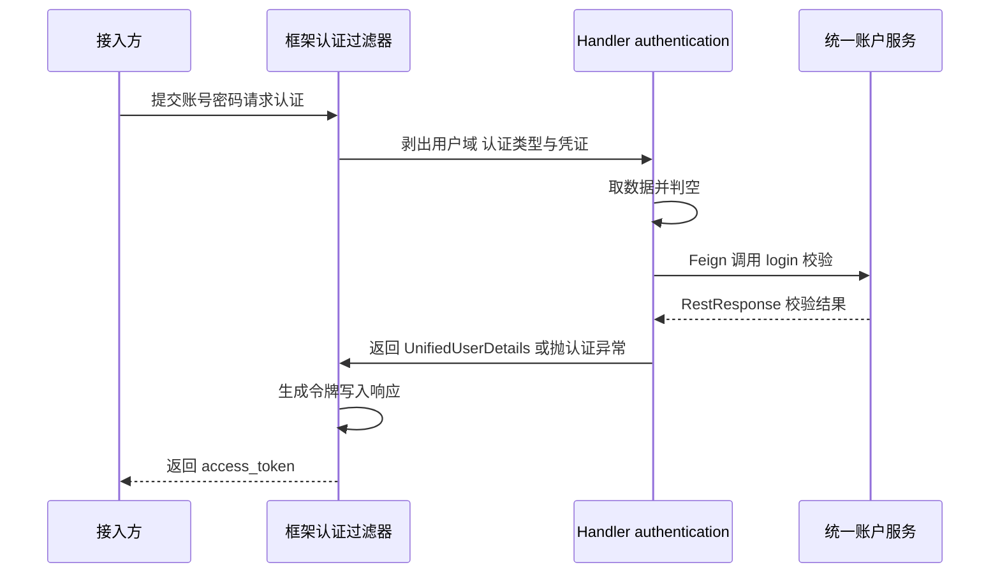

# 认证（登录）功能实现与测试：authentication 四步与第一张令牌

> 🔒 安全提示：文中示例的口令/密钥均为课程教学环境演示口径，生产环境的安全要求见《安全与合规须知》。

Feign 代理把 UAA 到统一账户的通道接通，登录功能可以动笔了。这一次的写法与以往任何功能都不同：代码不能想写到哪写到哪。UAA 采用了 Spring Security 整合 OAuth2.0 的框架，用了人家的框架就得按人家的设计来，登录代码必须落在框架指定的位置。写完之后还有一场完整的功能测试：先向 UAA 换取令牌，再把令牌解析开核对原始数据，证明手里拿到的不是一串看不懂的乱码，而是装着用户信息的合法凭证。

## 先给结论

- 认证代码必须写进 UAA 工程 domain 包的 `IntegrationUserDetailsAuthenticationHandler` 类的 `authentication` 方法，这是框架约定的唯一入口。
- 方法三个参数各司其职：`domain` 区分 C 端与 B 端用户，`authenticationType` 区分密码与短信认证，`token` 封装客户端提交的账号密码；参数名带 token 但它不是令牌，令牌在登录成功后才生成。
- 实现固定四步：取数据并判空、远程调用统一账户校验、结果非 0 抛 `BadCredentialsException`、成功则封装 `UnifiedUserDetails` 返回。
- 令牌由框架自动生成：返回的 `UnifiedUserDetails` 里用户名、手机号、权限会被写进 JWT 载荷，业务代码不碰生成逻辑。
- 测试两条：`POST /uaa/oauth/token` 用表单参数换取 `access_token`，`POST /uaa/oauth/check_token` 把令牌解析回原始字段核对。

## 框架画好的格子：认识 authentication 方法

传统登录的实现自由度很高，业务层建方法、控制器调服务，路径随自己起。这套框架下不行，讲义与 PPT 明确了位置：UAA 工程 domain 包里有个类，名字很长，`IntegrationUserDetailsAuthenticationHandler`，直译过来是集成用户详情认证处理器，类里有个方法叫 `authentication`，这个单词本身就是认证的意思。实现登录的全部代码就写在这个方法里，别处写了框架也读不到；UAA 工程其余的代码都是提供好的，不用动。

方法由框架提供，带着参数与返回值，动手前必须把它们认清，否则写不下去：

```java
/**
 * 认证处理
 * @param domain 用户域，c 为 C 端用户，b 为 B 端用户
 * @param authenticationType 认证类型，如密码认证、短信认证
 * @param token 封装客户端提交的账号与密码
 * @return 认证成功返回用户信息，失败抛出异常
 */
public UnifiedUserDetails authentication(String domain,
        String authenticationType, UsernamePasswordAuthenticationToken token) {
    return null;
}
```

**第一个参数 `domain`，用户域。** 表示本次登录的是 B 端用户还是 C 端用户，值由接入方也就是前端传过来，传 c 就是 C 端登录，传 b 就是 B 端登录。它与统一账户里账户实体的 `domain` 字段一脉相承：C 端用户拿手机号当用户名，B 端用户拿账号当用户名。

**第二个参数 `authenticationType`，认证方式。** 表示用账号密码登录还是短信验证码登录，同样是前端传值，想用密码认证传一个约定值，想用短信认证传另一个值。注册功能时讲过验证码登录与密码登录由配置开关切换，这个参数正是把选择权带到框架里的载体。

**第三个参数 `token`，名字最容易误导。** 它的类型是 `UsernamePasswordAuthenticationToken`，看全名就明白了：这是 Spring Security 的认证请求对象，封装的是前端传过来的账号和密码。它不是令牌，令牌要等登录成功之后才生成，此时令牌根本不存在。把这三者分清，后面读代码就不会晕。

**返回值 `UnifiedUserDetails`** 是个框架提供的用户详情对象，实现了 Spring Security 的 `UserDetails` 接口。登录成功时，当前用户的基本信息都往这个对象里装；框架拿到它，会自动按里面的内容生成令牌，而且这些内容会成为 JWT 令牌第二段载荷的一部分。生成令牌这一步是框架自动做的，业务代码里不会出现任何生成令牌的语句，这是整套约定里最省心也最反直觉的一点。

## 四步实现：从取数到返回

方法的骨架有了，往里填的逻辑按顺序分四步。

**第一步，从客户端取数据。** 前两个参数暂时用不上，账号密码都在第三个参数里。账号取自 `token.getPrincipal()`，密码取自 `token.getCredentials()`。取出来要做基本判空，字符串非空校验用工具类的 `isBlank`，它判断空引用与去除空白后长度为零两种情况，语义正好。密码这边有个必须处理的细节：凭证字段是 `Object` 类型，值为 null 时直接调 `toString` 就是空指针异常，所以先判空、再转换，这一步顺序不能反。

**第二步，远程调用统一账户校验。** 把账号密码组装进 `AccountLoginDTO`：`domain` 放入方法参数带来的用户域，用户名放入 `username`，手机号字段也放同一个值，因为 C 端用户名就是手机号，账户侧用哪个由它自己判断；密码用取出的明文。随后通过上一课准备好的 `AccountApiAgent` 代理调用 `login`，拿到 `RestResponse`。

这里有个注入方式的坑。以往写业务类，字段上加 `@Autowired` 就能注入代理对象，可这个认证处理器类上没有加 `@Service` 或 `@Component`，它不是容器管理的 Bean，`@Autowired` 在这里用不了。解法是课程提供的 `ApplicationContextHolder` 工具类，调它的 `getBean` 方法并传入接口类型，从容器里把代理对象取出来，返回值需要强转。写法原始一点，但机制没变：拿到的依然是 Feign 生成的代理。

**第三步，判断结果。** 校验要么通过要么失败，失败的表现是响应码非 0，此时抛 `BadCredentialsException`，提示登录失败。注意抛的是 Spring Security 的认证异常，不再是项目里惯用的 `BusinessException`：现在运行在框架体系里，认证失败的翻译工作框架会接管，按人家的规矩来。C 端与 B 端用户登录后的差异化处理这里先不做，当前只做认证，差异判断留到授权阶段再补。

**第四步，封装返回。** 认证通过即登录成功，把用户信息装进 `UnifiedUserDetails`：账号从远程结果里取，密码用第一步的明文，权限先传固定值占位，授权功能实现后再换成真实权限；手机号通过 `setMobile` 补上。返回这个对象，方法的事就做完了，生成令牌是框架的事。

四步合起来，完整实现如下：

```java
public class IntegrationUserDetailsAuthenticationHandler {

    /**
     * 认证处理
     * @param domain 用户域，c 为 C 端用户，b 为 B 端用户
     * @param authenticationType 认证类型，如密码认证、短信认证
     * @param token 封装客户端提交的账号与密码
     * @return 认证成功返回用户信息，失败抛出异常
     */
    public UnifiedUserDetails authentication(String domain,
            String authenticationType, UsernamePasswordAuthenticationToken token) {
        // 1. 从客户端提交的数据中取出账号与密码
        String username = (String) token.getPrincipal();
        if (StringUtils.isBlank(username)) {
            throw new BadCredentialsException("用户名为空");
        }
        // 凭证是 Object 类型，先判空再转字符串，直接调 toString 有空指针风险
        Object credentials = token.getCredentials();
        if (credentials == null) {
            throw new BadCredentialsException("密码为空");
        }
        String presentedPassword = credentials.toString();

        // 2. 远程调用统一账户服务，进行账号密码校验
        AccountLoginDTO accountLoginDTO = new AccountLoginDTO();
        accountLoginDTO.setDomain(domain);
        accountLoginDTO.setUsername(username);
        // C 端用户名即手机号，一并携带，账户侧按 domain 决定用哪个
        accountLoginDTO.setMobile(username);
        accountLoginDTO.setPassword(presentedPassword);
        // 本类不是容器管理的 Bean，只能经工具类从容器取代理对象
        AccountApiAgent accountAgent = (AccountApiAgent)
                ApplicationContextHolder.getBean(AccountApiAgent.class);
        RestResponse<AccountDTO> restResponse = accountAgent.login(accountLoginDTO);

        // 3. 校验未通过，统一抛认证异常
        if (restResponse.getCode() != 0) {
            throw new BadCredentialsException("登录失败");
        }

        // 4. 登录成功，把用户信息封装进 UnifiedUserDetails 返回
        UnifiedUserDetails unifiedUserDetails = new UnifiedUserDetails(
                restResponse.getResult().getUsername(),
                presentedPassword,
                // 授权功能实现前，权限先用固定值占位
                AuthorityUtils.createAuthorityList("ROLE_ADMIN"));
        unifiedUserDetails.setMobile(restResponse.getResult().getMobile());
        return unifiedUserDetails;
    }
}
```

整条链路画出来是这样的：业务代码只在 Handler 一处，其余环节全部由框架接管。



关键路径一目了然：Handler 只做取数、远程校验、判断、封装四件事，令牌在框架侧生成后随响应送出。

## 框架接手的部分：令牌怎么冒出来的

业务代码返回 `UnifiedUserDetails` 之后发生的事，藏在两份配置类里。Spring Security 配置类里有个必须存在的 Bean，注释写得很直白：

```java
// 不定义这个 Bean，密码模式 grant_type 不可用
@Override
@Bean
public AuthenticationManager authenticationManagerBean() throws Exception {
    return super.authenticationManagerBean();
}
```

认证管理器把密码模式请求接进来，交到认证提供者，提供者再委托给 `authentication` 方法，这条委托链正是代码必须写在指定方法里的原因。令牌的生成由授权服务器配置类里的令牌服务负责，归档的同框架工程里它的真实实现如下：

```java
@Bean
public AuthorizationServerTokenServices tokenService() {
    DefaultTokenServices service = new DefaultTokenServices();
    service.setClientDetailsService(clientDetailsService);
    service.setSupportRefreshToken(true);            // 支持刷新令牌
    service.setTokenStore(tokenStore);               // JWT 令牌存储
    TokenEnhancerChain tokenEnhancerChain = new TokenEnhancerChain();
    tokenEnhancerChain.setTokenEnhancers(Arrays.asList(accessTokenConverter));
    service.setTokenEnhancer(tokenEnhancerChain);
    service.setAccessTokenValiditySeconds(7200);     // 访问令牌有效期 2 小时
    service.setRefreshTokenValiditySeconds(259200);  // 刷新令牌有效期 3 天
    return service;
}
```

`DefaultTokenServices` 是签发中枢，令牌存取交给 `JwtTokenStore`，内容增强交给 `JwtAccessTokenConverter`，后者用配置注入的签名密钥对令牌签名。JWT 三段结构里，用户名是标准字段，手机号与权限随自定义载荷进入第二段，第三段是签名，解开令牌的人用同一把密钥即可验明真伪。有效期也是在这一层配置的：访问令牌两小时，刷新令牌三天，单位秒。

## 功能测试：先把服务清单列对

代码写完，照例用 Postman 做功能测试，这次要测两个功能：登录拿到令牌，以及解析令牌。测试之前先把该启动的服务想清楚，这是每次集成测试的老问题，但每次的答案不一定相同。

必起的有四个：Apollo 配置中心不用说；注册中心 53000；统一账户服务 53030，UAA 校验账号密码要调它；UAA 本身 53020。网关 53010 也顺手起上，前后端联调时所有请求一定过网关，Postman 里过网关的用例可以一并准备。容易多想的是用户中心 consumer 要不要起：把登录链路默走一遍就知道用不上，UAA 只调统一账户校验账号密码，用户中心不在这条路上，不起。

数据侧再核对两处：`p2p_uaa` 库的 `oauth_client_details` 里有登记好的接入客户端，`p2p_account` 库的账户表里有测试账号，密码列是加密后的密文，测试用的明文以课程提供的测试数据为准。

## 请求一：获取令牌

第一个请求是登录。地址是 `POST http://localhost:53020/uaa/oauth/token`，直连 UAA 不走网关，53020 加上下文路径 `/uaa`。

这个路径第一眼会让人去找对应的 Controller：按以往经验，它应该是某个 Controller 方法上配的映射。可翻遍 UAA 工程，`UAAController` 里只有登录页跳转、授权确认、授权错误三个页面路径，加上一个解析令牌的方法，根本没有定义 `/oauth/token` 的地方。原因是这条路径由 OAuth2.0 框架内部固定死，是令牌端点，要获取令牌就固定往这里发请求，不是自定义出来的。

请求参数通过表单提交，Body 选 `x-www-form-urlencoded`，一共七项：

```bash
grant_type=password          # 授权类型 固定 password 即密码模式
client_id=finance-web-h5     # 接入客户端标识 对照 oauth_client_details
client_secret=example-secret # 接入客户端密钥
username=admin               # 登录账号 取自账户测试数据
password=123456              # 登录密码 测试数据明文
domain=b                     # 用户域 对照测试数据 该账号为 B 端
authenticationType=password  # 认证类型 告诉框架走密码认证
```

七个参数分三组：`grant_type` 决定授权模式，这里取 `password` 走密码模式；`client_id` 与 `client_secret` 验接入方，服务端拿它们与 `oauth_client_details` 对账，证明这个客户端是平台认可的合法接入方；剩下四项验用户，其中 `domain` 与 `authenticationType` 是平台在标准协议上扩展的参数，值不能随手写，要与测试数据对上，测试账号在账户表里登记为 B 端，`domain` 就写 b。账号密码这些字段最终会被框架封装进 `authentication` 方法的第三个参数里。

发送后返回一段 JSON，字段逐个看：

```json
{
  "access_token": "eyJhbGciOiJIUzI1NiJ9.example-payload.example-signature",
  "token_type": "bearer",
  "refresh_token": "example-refresh-token-value",
  "expires_in": 7199,
  "code": 0,
  "message": null,
  "jti": "example-token-unique-id"
}
```

`access_token` 就是平时说的令牌，将来前端每次过网关请求受保护资源都要带上它。`token_type` 是令牌类型，取值 `bearer`，固定输出，知道含义即可。`refresh_token` 是刷新令牌：访问令牌有有效期，过期后带着旧令牌发请求会被拒，重新登录能换新令牌但体验糟糕，用户正用着网站突然被踢回登录页很难接受；有了刷新令牌，程序在后台拿它去换新的访问令牌，用户全程无感。`expires_in` 是访问令牌的有效期，单位秒，可配置。`code` 与 `message` 是平台统一的响应状态，0 表示正常。`jti` 是本次签发令牌的唯一编号，一次性的，可用于防重放：登录按钮被连续点击这类重复请求，凭它就能识别拦截。

## 请求二：解析令牌

拿到令牌只是第一步，它对不对还要验证。令牌是三段编码串，肉眼看不出内容，解开后能看到原始数据才证明它正确。第二个请求因此而生：`POST http://localhost:53020/uaa/oauth/check_token`，参数只有一个 `token`，值就是刚拿到的令牌字符串。这个端点在 `UAAController` 里有真实实现：

```java
@RequestMapping(value = "/oauth/check_token", method = RequestMethod.POST)
@ResponseBody
public Map<String, ?> checkToken(@RequestParam("token") String value) {
    DefaultTokenServices tokenServices = (DefaultTokenServices) tokenService;
    OAuth2AccessToken token = tokenServices.readAccessToken(value);
    if (token == null) {
        throw new InvalidTokenException("Token was not recognised");
    }
    if (token.isExpired()) {
        throw new InvalidTokenException("Token has expired");
    }
    OAuth2Authentication authentication = tokenServices.loadAuthentication(token.getValue());
    return accessTokenConverter.convertAccessToken(token, authentication);
}
```

方法内部三步：读令牌、查过期、还原认证信息，最后把令牌内容转成 Map 返回。响应里除状态字段外，能看到 `user_name`、`mobile`、`active` 等，用户名与手机号和登录账号一致、`active` 为 true，就说明令牌验签通过、载荷完整，签发与解析闭环成立。这个解析能力也正是网关校验令牌时要用的同一套机制，先在 UAA 上验通，网关侧的校验就有了根基。

到这一步，登录功能从代码到测试全部走通：认证在 UAA 完成，令牌发到了客户端手里，校验与解析都有标准端点可用。剩下的授权拦截、网关改造，都在这套底座上继续加盖。

## 常见误区

- **把方法参数 token 当令牌用。** 错例：在 `authentication` 里把参数 `token` 返回或当作凭证下发。正解：它是封装账号密码的认证请求对象，令牌由框架在认证成功后自动生成，两者一先一后，本质不同。
- **请求体用 JSON 而不是表单提交。** 错例：Postman 里选 raw JSON 发到 `/oauth/token`，参数全部读不到，响应报认证失败。正解：令牌端点按表单读取参数，Body 必须选 `x-www-form-urlencoded`。
- **`domain` 与账号不匹配。** 错例：拿 C 端手机号当账号却传 `domain=b`，统一账户按 B 端账号的口径去查，查无此人登录失败。正解：`domain` 的值要与账户表里该账号的登记一致，测试前先查表。
- **密码凭证直接调 `toString`。** 错例：`token.getCredentials().toString()` 一行到底，凭证为空时空指针异常，登录接口返回 500。正解：先判空再转换，空值直接抛「密码为空」的认证异常。
- **在业务代码里自己生成令牌。** 错例：登录方法里手写 JWT 拼装逻辑。正解：把用户信息装进 `UnifiedUserDetails` 返回即可，签名、有效期、载荷写入全部由框架统一处理，自造令牌会绕开签名密钥管理。

## 面试可能被问到的问题

1. 面试官追问：「为什么登录代码必须写在框架指定的 Handler 方法里？」
   答：Spring Security 的认证流程由过滤器与认证提供者驱动，提供者在固定位置委托业务 Handler 完成真正的校验。代码写在这里，框架才能把参数递进来、把返回值接走、把异常翻译成标准认证失败响应，写别处框架感知不到，整条链路就断了。
2. 面试官追问：「authentication 方法的三个参数分别是什么，token 参数是令牌吗？」
   答：domain 是用户域，区分 C 端与 B 端；authenticationType 是认证方式，区分密码与短信验证码；token 是封装账号密码的认证请求对象，不是令牌。令牌在认证成功后由框架按返回的用户信息生成，参数名容易误导，认类型不认名字。
3. 面试官追问：「认证处理器里为什么用工具类取 Bean 而不是直接注入？」
   答：这个处理器由配置类手动创建，不是容器管理的组件，字段注入无处生效。通过容器上下文工具类按类型取代理对象，拿到的是同一个 Feign 代理 Bean，功能等价，只是取用方式更原始。这也是框架托管类里使用容器资源的一种通用手法。
4. 面试官追问：「令牌里的用户信息是在哪一步写进去的？」
   答：认证方法的第四步。把账号、密码、权限装进 UnifiedUserDetails，再补上手机号后返回，框架的令牌服务以它为素材生成 JWT，这些内容随自定义载荷进入令牌第二段。业务代码全程没有出现生成令牌的语句，写入动作由框架的令牌增强器完成。
5. 面试官追问：「访问令牌过期了怎么办，刷新令牌起什么作用？」
   答：过期令牌会被网关拒绝，重新登录固然能拿新令牌，但把正在使用的用户踢回登录页体验很差。刷新令牌的有效期更长，程序拿它在后台向认证服务换一个新的访问令牌，用户无感知。两个令牌有效期分开配置，访问令牌短保安全，刷新令牌长保体验。
6. 面试官追问：「check_token 接口做什么，为什么需要它？」
   答：它把一段令牌解回原始字段：读令牌、判断是否识别与是否过期、还原认证信息并返回用户名、手机号、生效状态等。测试时用它验证签发的令牌内容正确；运行期网关校验令牌、提取用户信息也是同一套令牌解析机制，这个接口是验证令牌体系是否闭环最直接的手段。

## 配套资料

- 代码：`materials/code/10/代码/shanjupay-uaa/`，同框架认证服务工程归档（目录保留原始命名，路径列到该层级），`SecurityConfig` 的 `authenticationManagerBean`、`AuthorizationServer` 的令牌服务与有效期配置、`UUAController` 的 `/oauth/check_token`、`UnifiedUserDetails` 与认证提供者均为真实实现，正文代码片段出自其中。
- 代码：`materials/code/10/wanxinp2p/`，P2P 工程归档（目录保留原始命名，路径列到该层级），统一账户接口定义与工程结构可对照。
- 讲义：`materials/docs/10/万信金融-第2章-讲义-开户v1.0.md`，认证相关功能的环境准备与实现章节。
- 说明：`IntegrationUserDetailsAuthenticationHandler` 的实现代码与 UAA 接口测试文档未在仓库归档，按视频画面线整理；包名按 `com.study.finance` 系改写，签名密钥、客户端密钥与令牌样例均为占位，测试账号取自课程提供的测试数据。
