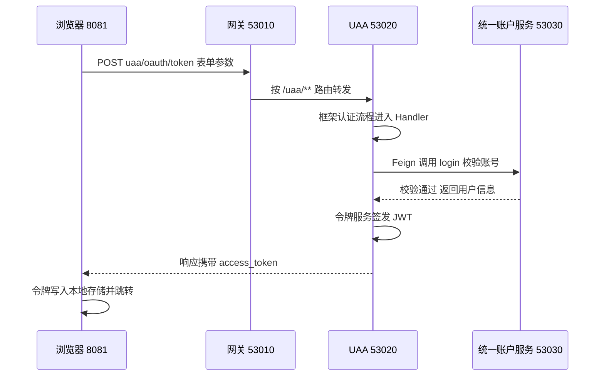

# 登录功能前后端集成测试：从页面点击到令牌落袋

> 🔒 安全提示：文中示例的口令/密钥均为课程教学环境演示口径，生产环境的安全要求见《安全与合规须知》。

Postman 直连与过网关两条路都验通了，但这些都还只是后端视角的测试。用户的真实路径是浏览器里的登录页：输入手机号、收验证码、点登录，请求由前端框架发出，经网关转发进 UAA。这一课把登录功能放进这条真实链路里跑一遍，方法沿用注册功能集成测试沉淀下来的套路，目标只有一个：前端拿到令牌并随身携带，认证功能才算真正收官。

## 先给结论

- 启动清单在注册功能集成测试的基础上加一个 UAA：Apollo、注册中心、网关、统一账户服务、UAA、短信验证码服务及其 Redis、前端工程，全部到场。
- 只测登录时必须用已存在的手机号（以 `13xxxxxxxxx` 占位），页面逻辑对新号会先注册再登录，混进来就变成测注册。
- 页面一次点击藏三步：发验证码、校验手机号与验证码并判定新老用户、携带参数向 `uaa/oauth/token` 换令牌。
- 验收看 Network 面板：令牌请求的表单参数与 Postman 用例一致，响应里有 `access_token`，页面跳转成功。
- 令牌由前端请求封装统一管理：登录后写入本地存储，此后每个请求自动带上 `Authorization: Bearer` 头。

## 启动清单与测试数据

对照依赖关系数服务：Apollo 与注册中心是基础设施；网关 53010 承接前端全部请求，路由在上一课已补齐 uaa-service 这一条；统一账户服务 53030 与 UAA 53020 是登录链路的两位主角；发送验证码要用真服务，短信验证码服务与它依赖的 Redis 必须在场；前端工程最后启动。用户中心不在登录链路上，可以不起，登录成功跳转的主页面会去调一些还没开发到的接口而报错，视而不见即可。

测试数据上的取舍值得想清楚：本次目标只是登录，所以手机号必须填一个账户表里已存在的。前端的登录按钮把注册与登录合并在一个入口里，手机号不存在时它会先走注册再登录，用新号测试等于把两个功能混在一起测，结果不纯粹。页面另一处细节也提前交代：第二个输入框填的是短信验证码，前端会把它放进 password 字段一并发给认证接口，账户侧按短信登录的配置开关免验密码，验证码的真伪在前面那个校验接口已经验过了。

## 页面三连击：验证码、校验、登录

登录页只有手机号、验证码两个输入框和一个登录按钮，点击逻辑由前端工程提供，关键代码节选如下：

```javascript
// data() 里预先写好的接入参数：五个字段与 Postman 用例一一对应
loginData: {
    grant_type: 'password',
    client_id: 'finance-web-h5',
    client_secret: 'example-secret',   // 接入客户端密钥按占位口径
    domain: 'c',
    authenticationType: 'password'
},
// 点击发送：向统一账户服务要验证码，响应里带回后续校验要用的 key
getCode() {
    this.request({ url: `account/sms/${this.mobile}`, method: 'GET' }).then(res => {
        if (res.data.code == 0 && res.data.result) {
            this.codeKey = res.data.result.key
        }
    })
},
// 登录按钮：先校验手机号与验证码，按 result 判定走登录还是注册
login() {
    const data = {
        username: this.mobile,
        password: this.password,   // 此处填入的是短信验证码
        mobile: this.mobile,
        ...this.loginData
    }
    this.request({
        url: `account/mobiles/${this.mobile}/key/${this.codeKey}/code/${this.password}`
    }).then(res => {
        if (res.data.result == 1) {
            this.log(data)   // 已注册，走登录
        } else {
            this.reg(data)   // 未注册，先注册再登录
        }
    })
},
// 登录成功：把登录参数与令牌写入本地存储，跳转主页面
log(data) {
    this.request({ url: 'uaa/oauth/token', params: data, method: 'POST' }).then(res => {
        uni.setStorage({ key: 'loginData', data: data })
        uni.setStorage({ key: 'access_token', data: res.data.access_token })
        uni.switchTab({ url: '/pages/main/main' })
    })
}
```

这段代码把页面上的一次点击拆成了三次请求。点「点击发送」，`account/sms` 去统一账户服务要验证码，响应带回一把 key；验证码服务在控制台日志里打印出本次的 6 位验证码，取最新一条填进输入框。点「登录」，先调 `account/mobiles` 的校验接口，同时核对手机号与验证码，返回的 `result` 决定走哪个分支，已注册就进入登录分支。三个参数值得对照 Postman 用例看：`grant_type`、`client_id`、`domain` 这组字段与手工测试完全一致，只是它们由前端代码预先写好，用户填的手机号与验证码填进 `username` 与 `password` 两个槽位。

## Network 面板看令牌往返

F12 打开开发者工具，Network 面板是集成测试的主战场。前端工程运行在自己的 8081 端口，所有请求都指向网关 53010，登录换令牌这一次也不例外。页面跳转后，面板里能找到发往 `uaa/oauth/token` 的请求，选中它逐项核对：



这张时序图把前端一次登录的完整旅程串了起来：请求头里能看到 `Content-Type` 是 `application/x-www-form-urlencoded`，与 Postman 的表单提交一致；请求体里七项参数一个不少；响应体里 `access_token` 字段赫然在列。页面同时跳转到主页面，登录完成。到这一步可以下结论：前端封装的请求参数与手工测试的用例完全对得上，令牌签发链路在真实用户路径上同样成立。

## 令牌落袋：前端存哪了、怎么带

拿到令牌只是开始，后续每个请求都要带上它。这件事由前端的请求封装统一处理，每个请求发出前先从本地存储读令牌：

```javascript
// utils/request.js 节选：统一读令牌、拼请求头
let token = ''
uni.getStorage({
    key: 'access_token',
    success: function (res) {
        token = res.data
    }
})
// 发送前：有令牌就带上 Bearer 头
if (token) {
    header = { ...header, 'Authorization': `Bearer ${token}` }
}
// 响应处理：令牌过期就清空存储退回登录页
if (res.data.code != 0 && res.data.msg.indexOf('Access token expired') > -1) {
    uni.clearStorage()
    uni.navigateTo({ url: '/pages/user/login' })
}
```

请求封装还维护着一张免登录白名单，`uaa/oauth/token`、获取验证码、校验手机号这三类请求不要求本地已有令牌，其余请求发现没有令牌就弹出「登录失效」并跳回登录页。这套封装正是认证体系在前端的落点：用户无感知地存令牌、带令牌、丢令牌时回到登录页，页面代码不需要逐个处理这些细节。封装里 `Access token expired` 的判断也预告了令牌过期后的处理路径，刷新令牌换新令牌的机制留给后续课程。

## 认证功能收官复盘

登录功能从需求分析走到前后端集成测试，全部环节到此走完，值得清点一下。功能上，UAA 工程的绝大部分代码由课程直接提供，真正动手实现的只有认证处理器里的四步：取数据并判空、远程调用统一账户校验、失败抛认证异常、成功封装用户详情返回，令牌的签发由框架自动完成。测试上，三层验证层层递进：Postman 直连验证 UAA 功能本身，过网关验证路由与转发，前后端集成验证真实用户路径。三层全绿，认证功能正式收官。

留给授权阶段的事情也要记录在案：认证处理器里权限先以固定值占位，C 端与 B 端用户登录后的差异化处理未做，令牌只证明了「你是谁」，「你能做什么」由接下来的认证拦截功能开始回答。

## 常见误区

- **用不存在的手机号测登录。** 错例：随手填一个新号点登录，页面照样登录成功，以为在测登录，实际先走了注册分支。正解：只测登录时查账户表选一个已存在的手机号，测试目标与数据状态要对齐。
- **以为前端直连了 UAA。** 错例：看到请求路径带 `uaa` 就断定前端连了 53020。正解：前端请求统一指向网关 53010，`uaa` 是路由前缀，Network 面板的请求地址以 53010 为准。
- **页面跳转成功就收工。** 错例：主页正常显示，不看响应体就下结论。正解：验收以 Network 面板里令牌请求的响应为准，`access_token` 在列才算拿到令牌，页面表现只是最后一格。
- **UAA 忘了启动。** 错例：沿用注册功能测试的启动清单，少了 UAA，登录请求超时。正解：本次比注册功能多一个 UAA，启动前按登录链路的依赖关系重新数一遍服务。

## 面试可能被问到的问题

1. 面试官追问：「前后端集成测试的验收标准是什么？」
   答：以真实用户路径上的关键数据为准。登录功能看三处：Network 面板里请求的参数与协议约定一致，响应里有 access_token，令牌随后被前端存储并在后续请求里携带。页面跳转只是表象，令牌的往返才是功能成立的证据。
2. 面试官追问：「前端拿到的令牌应该存在哪里？」
   答：常见做法是存本地存储，随每个请求放进 Authorization 头。放 Cookie 会引入 CSRF 问题，本地存储有 XSS 风险，靠访问令牌短有效期、刷新令牌长保、敏感操作二次校验来收敛风险，配合服务端把令牌过期做成明确的错误码让前端能识别并退回登录页。
3. 面试官追问：「前端为什么把验证码放进 password 字段提交？」
   答：OAuth2.0 密码模式的请求结构固定，接入方把账号与凭证两个槽位填满即可。验证码登录场景下凭证就是验证码，前端按同一结构提交，账户服务侧的短信登录开关开启时不再校验密码，验证码的真伪在专门的校验接口已经验证，两边各管一段。
4. 面试官追问：「页面登录与 Postman 测登录，测出来的东西差别在哪？」
   答：Postman 验证的是服务端契约，页面登录多了前端封装这一层，参数是否拼对、表单类型是否正确、令牌是否正确存储并携带，都只有真实页面能暴露。集成测试的价值就是把前端封装、网关转发、服务端处理这三层串起来验证。
5. 面试官追问：「用户反馈登录后频繁被踢回登录页，你怎么排查？」
   答：先看响应里的错误信息是否为令牌过期，再核对访问令牌的有效期配置与前端对过期错误的处理逻辑；排查前端请求封装是否稳定携带 Authorization 头，网关日志确认是校验拒绝还是路由失败；最后检查是否多个环境混用了不同的签名密钥，密钥不一致会让合法令牌被判非法。

## 配套资料

- 代码：`materials/code/10/wanxinp2p_front/`，前端 uni-app 工程归档（内层为同名目录），登录页 `pages/user/login.vue` 与请求封装 `utils/request.js` 为真实实现，正文为节选；接入客户端标识与密钥字面量按占位口径改写。
- 代码：`materials/code/10/wanxinp2p/`，P2P 工程归档（目录保留原始命名，路径列到该层级），网关模块的路由底稿与跨域配置为集成测试链路的真实依据。
- 讲义：`materials/docs/10/万信金融-第2章-讲义-开户v1.0.md`，开户章节对应讲义，登录接口参数与前后端集成测试的启动安排以讲义及视频画面为准。
- 说明：前后端集成测试的操作过程、Network 面板观察与页面跳转行为按视频画面线整理，仓库未归档测试脚本；手机号以 `13xxxxxxxxx` 占位，验证码以控制台实际打印为准，令牌样例与密钥为占位值。
