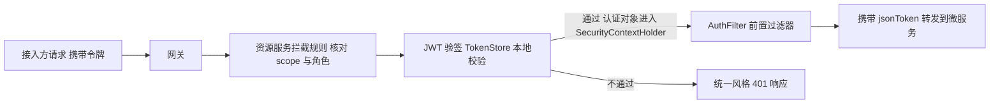

# 认证拦截功能实现：框架包办校验，过滤器负责递送用户信息

> 🔒 安全提示：文中示例的口令/密钥均为课程教学环境演示口径，生产环境的安全要求见《安全与合规须知》。

环境准备一完成，回头看会发现一件惊喜的事：需求分析里网关的第一项职责，对接入方的权限校验，其实已经由拷入的配置类搞定了。校验令牌真伪这一项同样由框架接管，业务代码一行都不用写。真正留给我们的活是需求分析里的另一半：把令牌里存的用户信息解析出来，随着转发请求递送给微服务，供它们按需取用。这一课就补上这块拼图。

## 先给结论

- 接入方权限拦截与令牌校验由 Spring Security OAuth2 框架完成，配置类已经就位，业务代码无需处理。
- 需要实现的是一个 Zuul 前置过滤器 `AuthFilter`：从安全上下文取认证信息，整理出用户与客户端信息，随转发请求传给微服务。
- 过滤器四要素：`shouldFilter` 返回 true 启用，`filterType` 返回 pre 表示转发前执行，`filterOrder` 返回 0 排在最先，核心逻辑在 `run` 方法。
- 用户信息先转 JSON 再 Base64 编码，以 `jsonToken` 为键放进转发请求的查询参数，微服务侧拿同名参数即可取到。
- `request.getParameterMap()` 必须先调用一次，`RequestContext` 里的查询参数集才会初始化，这是整套代码里最隐蔽的一处依赖。

## 框架包办的部分：两道校验如何发生

拷入网关的 `ResourceServerConfig` 让网关具备了资源服务器身份，请求进来后，Spring Security 按拦截规则核对接入客户端的 scope 与角色；令牌校验则由 JWT 相关配置驱动，网关构建的令牌存储与转换器长这样：

```java
package com.study.finance.gateway.config;

@Configuration
public class JWTConfig {

    // 签名密钥走配置中心注入 开发环境为占位值 example-signing-key 与 UAA 持同一把
    @Value("${signing-key}")
    private String SIGNING_KEY;

    @Bean
    public TokenStore tokenStore() {
        return new JwtTokenStore(accessTokenConverter());
    }

    @Bean
    public JwtAccessTokenConverter accessTokenConverter() {
        JwtAccessTokenConverter converter = new JwtAccessTokenConverter();
        converter.setSigningKey(SIGNING_KEY); // 对称密钥 验签与解析都靠它
        converter.setAccessTokenConverter(new ClientDefaultAccessTokenConverter());
        return converter;
    }
}
```

JWT 令牌自带签名，网关持同一把对称密钥即可本地验签、解开载荷，不需要为每个请求远程调用 UAA。校验通过后，框架把解析出来的认证对象放进 `SecurityContextHolder`，它正是过滤器取数据的入口。两道校验发生的位置画出来是这样：



关键路径在中间那条线：校验通过后认证对象已经躺在上下文里，过滤器只做搬运，不再碰任何校验逻辑。

## 我们要写的部分：前置过滤器 AuthFilter

网关的路由转发靠配置，但转发前还要做点逻辑处理，这类活归过滤器管。网关用的是 Zuul 体系，自定义过滤器继承 `ZuulFilter`，类上加 `@Component` 交给容器管理。完整实现如下，包名按平台口径改写：

```java
package com.study.finance.gateway.filter;

@Component
public class AuthFilter extends ZuulFilter {

    @Override
    public boolean shouldFilter() {
        return true; // 启用该过滤器 写 false 则整个过滤器不生效
    }

    @Override
    public String filterType() {
        return "pre"; // 前置过滤器 在路由转发之前执行
    }

    @Override
    public int filterOrder() {
        return 0; // 多个过滤器时的排序 数字越小越先执行
    }

    @Override
    public Object run() {
        // 1. 获取 Spring Security OAuth2 认证信息对象 框架校验通过后已放入上下文
        Authentication authentication = SecurityContextHolder.getContext().getAuthentication();
        if (authentication == null || !(authentication instanceof OAuth2Authentication)) {
            return null; // 无令牌访问网关内资源的场景 直接返回 交给拦截规则处理
        }
        OAuth2Authentication oauthAuthentication = (OAuth2Authentication) authentication;
        Authentication userAuthentication = oauthAuthentication.getUserAuthentication();

        // 2. 当前登录用户与接入客户端的信息整理进 Map
        Map<String, String> jsonToken = new HashMap<>(
                oauthAuthentication.getOAuth2Request().getRequestParameters());
        if (userAuthentication != null) {
            jsonToken.put("user_name", userAuthentication.getName());
        }

        // 3. 关键步骤 必须先 get 一下查询参数 下面的 getRequestQueryParams 才能拿到值
        RequestContext ctx = RequestContext.getCurrentContext();
        HttpServletRequest request = ctx.getRequest();
        request.getParameterMap();
        Map<String, List<String>> requestQueryParams = ctx.getRequestQueryParams();
        if (requestQueryParams == null) {
            requestQueryParams = new HashMap<>();
        }

        // 4. 转 JSON 后 Base64 编码 以 jsonToken 为键放入查询参数 随转发送达微服务
        List<String> arrayList = new ArrayList<>();
        arrayList.add(EncryptUtil.encodeUTF8StringBase64(JSON.toJSONString(jsonToken)));
        requestQueryParams.put("jsonToken", arrayList);
        ctx.setRequestQueryParams(requestQueryParams);
        return null;
    }
}
```

按 `run` 方法的执行顺序拆开看：

**第一步，取认证信息。** 令牌校验既然由框架完成，过滤器的起点就是从 `SecurityContextHolder` 拿认证对象。判断不能省：对象为空，或者不是 `OAuth2Authentication` 类型，说明这次请求没有携带合法令牌，直接返回 null 结束，此时的请求会在拦截规则那里被拦下，过滤器不必越俎代庖。

**第二步，整理数据。** 认证对象里有两部分值得转发：`getOAuth2Request().getRequestParameters()` 里是签发令牌时的请求参数，客户端标识、用户域这些都在；`getUserAuthentication()` 是用户认证信息，取它的 `getName()` 放进 `user_name`。两部分合装进一个 Map，键值都是字符串，拿去序列化正合适。

**第三步，处理转发请求。** `RequestContext` 是 Zuul 的请求上下文，里面的 `getRequestQueryParams()` 拿到的是即将发往微服务的查询参数集。这里埋着整套代码最关键的细节：必须先调一次 `request.getParameterMap()`。原因在于 `HttpServletRequest` 没有提供往请求里塞参数的 setter，参数集在上下文里又是懒加载的，先 get 一次触发初始化，随后 `getRequestQueryParams()` 才能拿到已存在的参数集，追加键值才不会丢。少这一行，后面写入的数据会出现取不到的诡异现象。

**第四步，编码写入。** Map 转成 JSON 字符串，再做一次 Base64 编码，放进参数集，键名固定为 `jsonToken`，最后把参数集设回上下文。Zuul 转发请求时，这个参数就跟着 URL 一起到了微服务。

## 数据为什么这样设计

**为什么转 JSON 再 Base64，而不是直接拼参数。** 用户信息是一组键值对，种类多、后续还可能扩展，打成一个 JSON 包一次传走最省事；JSON 里的大括号、冒号、中文直接拼进 URL 属于高危操作，Base64 编码后只剩安全的字符集，网关到微服务虽然走内网，编码一层数据也保证了传输过程中的完整与规整。

**为什么放进查询参数。** 微服务侧取这个数据的姿势越简单越好，查询参数用 `request.getParameter("jsonToken")` 一行就能取到，与语言、框架、接口写法都不耦合。把数据递出去是网关的本分，用不用是微服务的事，网关不关心下游怎么消费。

**为什么键名固定。** 网关写入与微服务读取是两端约定，键名不一致整条链路就断了。`jsonToken` 这个名字从网关一路用到微服务的取数代码，两端写死同一个值，这也是跨服务传数据的基本纪律。

## 常见误区

- **把过滤器当校验点用。** 错例：在 `AuthFilter` 里再写一遍令牌解析与权限判断。正解：校验已由框架的资源服务组件完成，过滤器只负责取数与转发，重复校验既浪费又容易产生两套标准。
- **省略 `request.getParameterMap()` 这一行。** 错例：直接调 `getRequestQueryParams()` 就开始写数据，部分请求上参数集尚未初始化，写入结果不可预期。正解：先 get 一次触发加载，再取再写，顺序不能动。
- **无令牌请求在过滤器里强行处理。** 错例：认证对象为空时继续往下取数据，空指针异常。正解：判空或类型不符直接返回 null，拦截交给资源服务规则，职责要分清。
- **键名随手改。** 错例：网关写入用 `userToken`，微服务读取用 `jsonToken`，参数永远取不到。正解：两端使用同一个固定键名，约定写进文档或常量类。

## 面试可能被问到的问题

1. 面试官追问：「网关的认证拦截为什么要用 Zuul 前置过滤器？」
   答：路由转发是配置驱动的，但转发前的数据处理需要编程入口，Zuul 过滤器就是那个入口。pre 类型保证逻辑在请求发往微服务之前执行，把用户信息装进转发请求后，下游才能取到，时序上没有别的选择。
2. 面试官追问：「用户信息从哪里取出来的？」
   答：框架完成令牌校验后，把 OAuth2Authentication 放进了 SecurityContextHolder。过滤器从上下文拿到它，一部分来自令牌请求参数映射，一部分来自用户认证对象的名称，合装成 Map 后序列化编码。
3. 面试官追问：「为什么先调 getParameterMap 再取查询参数集？」
   答：HttpServletRequest 没有提供设置参数的方法，Zuul 上下文里的查询参数集又是懒加载的，先 get 一次才能触发解析、把请求里已有的参数装进上下文。这行代码看似无输出，实际是后面写入动作的前提，属于典型的隐式初始化依赖。
4. 面试官追问：「传给微服务的用户信息为什么要 Base64 编码？」
   答：信息被组织成 JSON 字符串，其中可能有括号、中文等不适合出现在 URL 查询参数里的字符，Base64 编码后字符集安全，传输过程不会破坏结构。它不是加密，解码无需密钥，作用是保形传输。
5. 面试官追问：「没有携带令牌的请求经过这个过滤器会发生什么？」
   答：上下文里的认证对象为空或类型不符，过滤器直接返回 null，不写入任何用户信息；该请求接下来会撞上资源服务的拦截规则，受保护路径被统一响应成 401，公开路径照常放行。过滤器与拦截规则各司其职，互不越界。

## 配套资料

- 讲义：`materials/docs/10/万信金融-第2章-讲义-开户v1.0.md`，「认证拦截功能实现」的功能实现小节：认证拦截由框架实现、过滤器中取用户信息并转发的需求描述与代码。
- 代码：`materials/code/10/代码/shanjupay-gateway/`，同框架网关工程归档（目录保留原始命名，路径列到该层级），`filter/AuthFilter.java` 的真实实现与正文同构，`JWTConfig.java`、`ClientDefaultAccessTokenConverter.java` 为令牌校验配置的真实代码；该归档版本将 `jsonToken` 经 `addZuulRequestHeader` 以请求头方式递送，与课程版本的查询参数方式互为工程变体。
- 代码：`materials/code/10/wanxinp2p/`，P2P 工程归档（目录保留原始命名，路径列到该层级），`wanxinp2p-common` 的 `EncryptUtil` 提供 `encodeUTF8StringBase64` 与 `decodeUTF8StringBase64` 真实实现。
- 说明：课程版 `AuthFilter` 的源码文件未在仓库归档，正文按视频画面线整理并修正了转写笔误；包名按 `com.study.finance` 系改写，签名密钥为占位值 `example-signing-key`。
