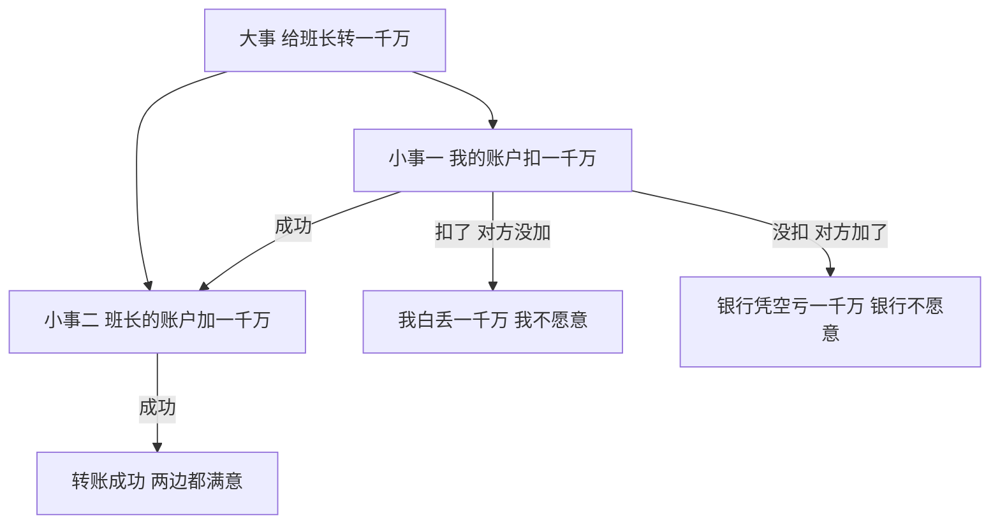

# 什么是事务：要么全部成功，要么全部失败

注册功能的脏数据已经见过现场了，修它之前得先补理论，而理论的地基是「事务」本身。这个名词几乎每个写过 `@Transactional` 的人都用过，可真要说出它保证的是什么、凭什么保证，多数人卡在半路。这一课用两个生活场景把事务的定义立起来，再看它在数据库里落到哪几个关键字上。

## 先给结论

- 事务可以看作一次大的活动，它由不同的小活动组成，这些小活动要么全部成功，要么全部失败，不允许一部分成功一部分失败。
- 转账是事务最经典的例子：我的账户扣钱与对方账户加钱是两个小活动，必须捆绑成一个整体。
- 交易的例子一样成立：一手交钱一手交货，交钱与交货两个动作同生共死，交易才算完成。
- 在软件系统里，事务的成败由数据库的 `begin`、`commit`、`rollback` 三类动作控制。
- 「要么都成、要么都败」这八个字，是后面理解 ACID 特性与分布式事务的共同起点。

## 用转账理解事务：拆出来的小事要同生共死

专业术语记不住的时候，回到生活里找原型最省力。转账是学习事务绕不开的入门案例：我要给班长转一千万，这是一件大事。大事不能一气呵成，拆开看它由两件小事组成：我的账户扣掉一千万，班长的账户加上一千万。两件小事都做完，转账这件大事才算办成。



图里两条失败路径，一条比一条荒唐。我这边扣了一千万，班长那边没加上，等于钱凭空蒸发，我跟班长谁都不答应；反过来我这边没扣成，班长那边多了一千万，我无所谓，银行可不答应，转账要都这么转，用不了几次银行就破产了。唯一说得过去的是两条正路：要么两件事都办成，我少一千万、班长多一千万；要么两件事都没办成，我没扣、他也没加，大家当无事发生。

把这个词抠死：这两个小活动必须同生共死，捆绑的依据不是人情，而是它背后真实存在的资金约束。任何一方单独成功，都会造成数据与事实的偏离。

## 用交易再看一遍：一手交钱一手交货

换个场景验证这个定义是不是巧合。买东西是一笔交易，行话叫一手交钱一手交货。交易是大事，拆成两个小活动：消费者交钱，商店交货。钱交了货没给，消费者吃亏；货给了钱没到，商家吃亏。交易成立的条件同样是两个动作全部成功；任何一个动作失败，交易就必须撤销，当它没发生过。

两个场景，同一个结论。事务的定义由此可以正式给出：事务可以看作一次大的活动，它由不同的小活动组成，要保证的就是这些小活动要么全部成功，要么全部失败。判断一组操作是不是一个事务，看的不是代码写在哪一行，而是业务上是否存在「缺一半就崩溃」的整体性。

## 从定义到落地：数据库怎么控制事务

生活例子给了直觉，工程上事务要落在具体机制上。常规做法是由关系型数据库控制事务，利用数据库本身的事务特性：一组操作用事务边界圈起来，中间任何一步出错就把整组动作撤销。以 MySQL 为例，转账的两个 `update` 圈在同一个事务里（示例为按本课写法补全）：

```sql
-- 转账事务 两个 update 要么都生效 要么都不生效
begin transaction;
update account set balance = balance - 10000000 where username = 'me';
update account set balance = balance + 10000000 where username = 'monitor';
commit transaction; -- 两句都成功 提交 落库
```

执行到 `commit` 之前出了任何差错，就用 `rollback` 把前面已执行的语句全部撤销，数据库回到事务开始前的状态。Java 应用里这层边界通常交给 Spring 声明，方法一标 `@Transactional`，进来开事务、正常返回提交、抛异常回滚，SQL 层面的 begin 与 commit 由框架代管：

```java
// 示例 按本课写法补全 单库转账的本地事务声明
@Transactional
public void transfer(String from, String to, BigDecimal amount) {
    accountMapper.decrease(from, amount); // 扣钱
    accountMapper.increase(to, amount);   // 加钱 任一步抛异常 两句一起回滚
}
```

`decrease` 与 `increase` 打的是同一个数据库连接，这正是它能被一个事务圈住的前提。上一课注册功能的两个落库动作分属两个进程两个库，`save` 与远程调用不在同一个连接上，这就是事务管不住它们的直接原因，也是后续要用分布式事务补位的地方。

## 回到注册现场：缺的正是这层整体性

拿定义对照注册功能：保存用户信息与保存账号信息是两个小活动，合起来才是「注册成功」这件大事。目前的代码里两个活动各自为战，一个成功一个失败时没有任何机制拉平，正好踩中事务定义里被禁止的那条中间态。事务控制的价值由此变得具体：它不是面试题里的名词，而是让「有用户没账号」这类数据从根上不可能出现的机制。事务怎么保证这八个字，靠的是它的四个特性 ACID，下一课逐条拆开。

## 常见误区

- **把事务当成一条 SQL。** 错例：认为事务就是单条 `update` 的原子性。正解：事务是若干操作组成的整体，可以包含多条增删改查，边界由 `begin` 与 `commit` 或 `@Transactional` 声明，与语句条数无关。
- **认为不写事务语句就没有事务。** 错例：MySQL 默认自动提交模式下从不写 `begin`，就以为自己没用过事务。正解：自动提交模式下每条语句各自构成一个隐式事务，执行成功即提交，只是粒度细到单条而已。
- **把「要么都失败」理解成「至少执行过一半」。** 错例：认为回滚意味着前半部分操作已经生效。正解：回滚的结果是数据库回到事务开始前的状态，任何一条语句的效果都不保留，对外看就像整组操作从未发生。
- **吞掉异常就能绕过失败。** 错例：在事务方法里 `catch` 住异常不抛出，以为业务照样继续。正解：声明式事务靠异常感知失败，异常被吞掉，框架认为方法正常完成，照常提交，半截数据照样产生。

## 面试可能被问到的问题

1. 面试官追问：「用一句话定义事务。」
   答：事务是一次大的活动，由不同的小活动组成，要保证这些小活动要么全部成功，要么全部失败，不允许出现部分成功部分失败的中间状态。
2. 面试官追问：「为什么转账例子能说明事务的本质？」
   答：转账天然拆成扣钱与加钱两个小活动，任何一方单独成功都直接违背资金事实，要么钱蒸发要么银行亏空。它把「缺一半就崩溃」的业务整体性摆到了明面上，这正是事务要捆住的东西。
3. 面试官追问：「数据库靠什么实现事务的成败控制？」
   答：靠事务边界与回滚机制。`begin` 圈定范围，组内语句先执行后落定，`commit` 让全部修改生效，任一步失败则 `rollback` 撤销全部修改，由数据库本身保证边界内操作的统一成败，应用层再用 Spring 的 `@Transactional` 把这套机制声明到业务方法上。
4. 面试官追问：「`@Transactional` 方法里发 HTTP 请求，事务能管住对端的数据吗？」
   答：管不住。事务的边界是当前服务的数据库连接，HTTP 请求是网络行为，不在任何数据库事务之内。请求发出后对端的提交与回滚由对端的连接决定，本地回滚时既无法撤回已发出的请求，也无法命令对端回滚，这正是注册功能事务问题的根源，需要分布式事务解决。
5. 面试官追问：「注册功能的两个落库操作算一个事务吗？」
   答：从业务看算，注册成功要求用户与账号两份数据同时落库；从实现看目前不算，两个操作分属用户中心与统一账户服务两个进程、`p2p_consumer` 与 `p2p_account` 两个库，各自在本地事务里提交，没有任何机制保证统一成败，这个缺口就是要引入分布式事务的原因。

## 配套资料

- 讲义：`materials/docs/10/万信金融-第2章-讲义-开户v1.0.md`，「注册功能中的分布式事务」节：注册请求由用户中心服务与统一账号服务协调完成，一方失败导致数据不一致，本课所属章节即为解决该事务问题而设。
- 说明：本课为概念讲解课，转账与交易两个案例出自课程视频画面线（PPT 与课堂演示），未对应独立源码包；`begin/commit` 与 `@Transactional` 示例为按本课写法补全，包名与库表口径与平台其余篇章一致。
