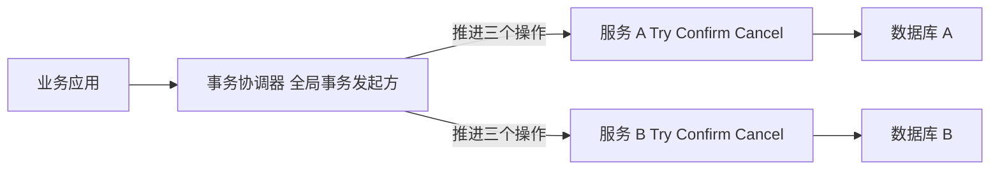
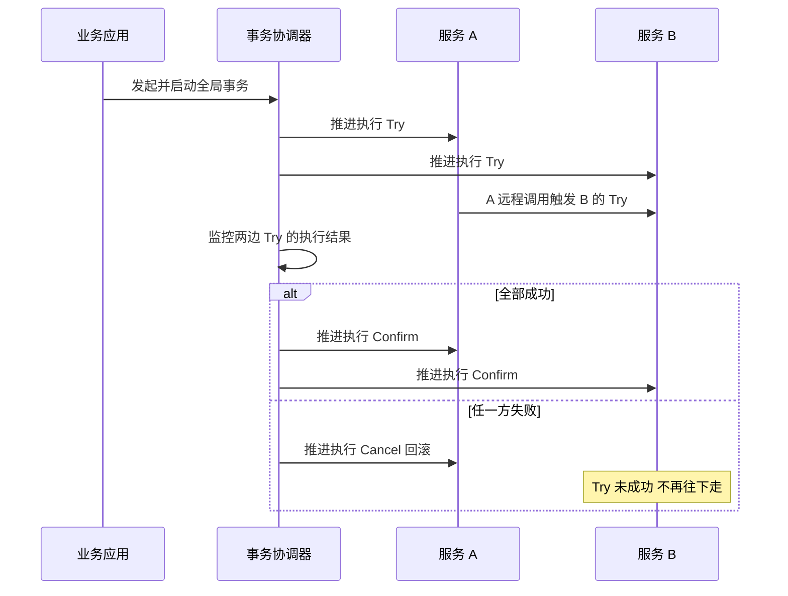

# TCC 解决方案概述：三个操作，两个阶段

CAP 与 BASE 讲的是理论，理论规定的是边界，不能直接落地；学习路线是理论产生解决方案，解决方案再产生框架，开发时真正拿在手里的永远是框架。基于这两套理论派生出的分布式事务解决方案在行业里有很多种，课程先介绍其中一种：TCC，也叫补偿事务。把它排在第一个讲，是因为本项目注册功能里就躺着一个现成的分布式事务问题，课程准备用 TCC 方案去解决它。先把模型吃透，方案为什么这么选就自然清楚了。

## 先给结论

- TCC 是 Try（尝试）、Confirm（确认）、Cancel（取消）三个单词首字母的缩写，是由 CAP、BASE 理论派生出的分布式事务解决方案之一。
- 编程模式的核心思想：针对每个分支事务操作，都要向全局事务发起方注册 Try、Confirm、Cancel 三个操作，具体干什么由业务自己实现。
- 执行分两个阶段：第一阶段各分支事务执行 Try；第二阶段看 Try 的结果，全部成功走 Confirm 确认提交，有失败走 Cancel 回滚释放。
- 全局事务发起方通常称作事务协调器，负责推进并监控三个操作的执行。
- Confirm 与 Cancel 不可能同时执行，三个操作对应两个阶段；Confirm、Cancel 出错要靠重试机制或人工处理兜底。

## 从理论到方案再到框架

CAP、BASE 给出的是约束与取舍原则，距离写代码还差两级台阶：由理论产生解决方案，解决方案离落地更近一步；再由解决方案产生框架，日常开发都是在框架上解决问题。TCC 就是理论通向框架之间的第一座桥，理解了它，后面接入任何 TCC 型框架都是照方抓药。

注册链路的问题回顾一下就清楚：用户中心保存用户的业务信息，然后远程调用统一账号服务保存对应的账号信息，两个服务、两个数据库，任何一边写失败，用户与账号的数据就对不上，这是典型的分布式事务问题。这个业务对一致性要求比较严格，而且执行时间短，TCC 方案的软状态时间很短、一致性较强，正好对得上号，所以课程选定 TCC 型方案来解决注册链路的事务问题。

## 名词先行：分支事务与全局事务发起方

TCC 模型里有两个名词要先接住。

**分支事务。** 一个大事务可以拆分成若干个小操作、小动作，每个单独的小操作就叫分支事务。注册链路里，用户中心保存用户信息是一个分支事务，统一账号服务保存账号信息是另一个分支事务。

**全局事务发起方。** 负责发起整个大事务、并协调各分支事务推进的角色。工程里更常见的叫法是事务协调器，两个称呼指的是同一个东西，后文统一叫事务协调器。

三个操作的名字就直白得多：Try 是尝试，Confirm 是确认，Cancel 是取消，单词字面意思就是职责。

## 模型全貌：每个微服务都要实现三个接口

TCC 对参与方的第一个要求就写在编程模式里：每个微服务都要按固定套路实现三块代码，分别放进 Try、Confirm、Cancel 三个操作里，各自根据自己的业务来实现。模型的全貌如下图：



服务 A 与服务 B 各自对着自己的数据库，各自实现 Try、Confirm、Cancel 三块代码，推进的权力全部收在事务协调器手里。接口层面的样子大致如下：

```java
// 示例 按本课写法补全 每个分支事务都要向全局事务发起方注册三个操作
public interface BranchTccAction {

    /** Try 阶段 业务检查与资源预留 仅是初步操作 与 Confirm 共同构成完整业务逻辑 */
    boolean tryExecute(TccContext context);

    /** Confirm 阶段 确认提交 Try 全部成功后由事务协调器推进 */
    boolean confirmExecute(TccContext context);

    /** Cancel 阶段 取消回滚 释放 Try 阶段预留的资源 */
    boolean cancelExecute(TccContext context);
}
```

三个方法就是三个钩子，业务方往里面填内容，协调器决定什么时候调谁。课程注册链路最终接入的是 Hmily 框架，项目技术方案清单里把 Hmily 列为分布式事务解决方案之一，注册功能明确使用 Hmily 框架解决分布式事务问题。Hmily 风格的接口形态如下：

```java
// 示例 按本课写法补全 Hmily 风格的 TCC 接口形态
public interface AccountTccService {

    @Tcc(confirmMethod = "confirmSave", cancelMethod = "cancelSave")
    boolean trySaveAccount(AccountDTO accountDTO);  // Try 账号信息先行预留

    boolean confirmSave(AccountDTO accountDTO);     // Confirm 确认账号生效

    boolean cancelSave(AccountDTO accountDTO);      // Cancel 释放预留资源
}
```

Try 方法上用注解把 Confirm、Cancel 两个方法挂上去注册，框架据此知道这套分支事务的三块代码在哪里，具体的业务内容仍由业务方写全。

## 执行流程：两个阶段怎么推进

编码完成之后看执行。整个流程由业务应用从发起全局事务开始，事务协调器接管之后按结果分情况推进：



**第一阶段，先走两边的 Try。** 事务协调器推进服务 A 与服务 B 先执行各自 Try 接口里的代码。常见形态是 A 远程调用 B，A 服务里的 Try 代码会触发 B 服务里 Try 代码的运行，总之两边首先运行的都是 Try。执行过程中事务协调器持续监控，看两边有没有出现问题。

**第二阶段，按 Try 的结果分两条路。** 最常见的一种情况是 A、B 两边的 Try 都执行成功，事务协调器接下来推进两边执行 Confirm 接口里的代码，业务确认提交。另一种情况也很常见：A 的 Try 成功了，B 的 Try 失败了，这时 A 这边要走 Cancel，执行回滚，把 Try 阶段预留的资源释放掉；B 这边不再往下走，Try 都没成功，没有留下需要回滚的东西，后续操作对它而言已经不存在了。这样无论哪条路，数据的前后一致性都有交代。

理解了流程，就能回答那个初见必然疑惑的问题：明明是三个操作，为什么说两个阶段？因为 Confirm 与 Cancel 不可能都执行，要么 Confirm 要么 Cancel，互斥的两条出口；再加上作为第一阶段的 Try，总共就是两个阶段。

## Confirm 或 Cancel 出错了怎么办

Try 出问题走 Cancel，不出问题走 Confirm，这个逻辑是闭环的。但 Confirm 和 Cancel 自己在执行中也可能出问题，谁也不敢保证百分之百成功。对此的处置是引入重试机制：一次不行再试一次，再不行再试，比如允许重试 30 次，认为 30 次里总有一次能成功。重试仍然不行，就交给人工处理。

这类极端情况理论上出现得比较少，权衡下来不能因为这点不确定性就放弃 TCC 方案，重试加人工兜底足够覆盖。

## 常见误区

- **以为三个操作是框架替你写的。** 错例：引入 TCC 框架后等着框架自动回滚业务数据。正解：Try、Confirm、Cancel 的具体内容由业务方自己实现，框架只负责注册、推进与监控，业务不写，回滚就是空的。
- **把三个操作当成三个阶段。** 错例：设计排期时给 Try、Confirm、Cancel 各预留一个执行阶段。正解：Confirm 与 Cancel 互斥，不可能都执行，执行阶段只有两个。
- **以为 Try 失败的一方也要执行 Cancel。** 错例：B 服务 Try 失败后仍然去调用 B 的 Cancel。正解：Try 失败说明该分支没有产生需要回滚的动作，走 Cancel 回滚的是 Try 成功过的一方。
- **以为 Confirm 阶段绝对安全。** 错例：Confirm 方法里不做任何异常防护与记录。正解：框架按「Try 成功 Confirm 大概率成功」设计，真出错仍需重试机制或人工处理兜底，Confirm 的代码同样要可重入、留痕迹。

## 面试可能被问到的问题

1. 面试官追问：「TCC 是什么？三个操作分别承担什么职责？」
   答：TCC 是 Try、Confirm、Cancel 三个单词首字母的缩写，也叫补偿事务。Try 做业务检查与资源预留，是初步操作，与 Confirm 共同构成完整业务逻辑；Confirm 在 Try 全部成功后确认提交；Cancel 在执行出错需要回滚时取消业务、释放预留资源。
2. 面试官追问：「为什么三个操作只有两个执行阶段？」
   答：第一阶段是所有分支事务执行 Try；第二阶段根据 Try 的结果二选一，全部成功执行 Confirm，有失败对成功过的一方执行 Cancel。Confirm 与 Cancel 不可能同时执行，所以三个操作只构成两个阶段。
3. 面试官追问：「事务协调器在整个流程里负责什么？」
   答：它就是全局事务发起方，接收业务应用发起的全局事务，推进各分支事务按顺序先执行 Try，监控执行结果，再根据结果推进 Confirm 或 Cancel。三块代码写在哪是业务的事，什么时候调哪一块由它说了算。
4. 面试官追问：「Try 阶段部分成功怎么处理？」
   答：按整体结果对待，任一分支 Try 失败就不进入 Confirm。Try 成功过的一方执行 Cancel 回滚、释放预留资源，Try 失败的一方没有预留动作、不再往下走，最终效果等价于整个事务没发生过，保证数据一致。
5. 面试官追问：「Confirm 或 Cancel 执行出错怎么办？」
   答：引入重试机制，失败后反复重试，比如允许重试若干十次；重试仍不成功转人工处理。这类情况理论上概率较小，方案设计上用重试加人工兜底即可，不必因此放弃 TCC。
6. 面试官追问：「为什么注册功能选 TCC 而不是别的方案？」
   答：注册业务对一致性要求比较严格，用户信息与账号信息必须同时生效，而且执行时间短。TCC 方案的软状态时间很短、一致性较强，与业务特征对得上；BASE 式的最终一致方案软状态窗口更长，对这个场景偏松，所以选 TCC 型方案。

## 配套资料

- 讲义：`materials/docs/10/day16-项目总结&就业指导v1.0.md`，「3.4.2 什么是 TCC（补偿事务）」小节：Try、Confirm、Cancel 三个操作与两个阶段的定义，Confirm、Cancel 出错需重试机制或人工处理的说明，以及注册业务因「软状态时间很短，一致性较强」选用 TCC 的理由。
- 讲义：`materials/docs/10/万信金融-第1章-讲义-项目介绍v1.0.md`，技术解决方案清单：项目分布式事务解决方案列为 RocketMQ、Hmily、requestNo 同步机制。
- 讲义：`materials/docs/10/万信金融-第2章-讲义-开户v1.0.md`，「注册功能中的分布式事务」小节：注册链路的分布式事务问题描述，明确使用 Hmily 框架解决。
- 代码：`materials/code/10/wanxinp2p/`，P2P 工程归档（目录保留原始命名，路径列到该层级），含注册链路相关服务的早期实现；TCC 接入代码未在仓库归档，正文接口示例为按本课写法补全，包名按 `com.study.finance` 系改写。
