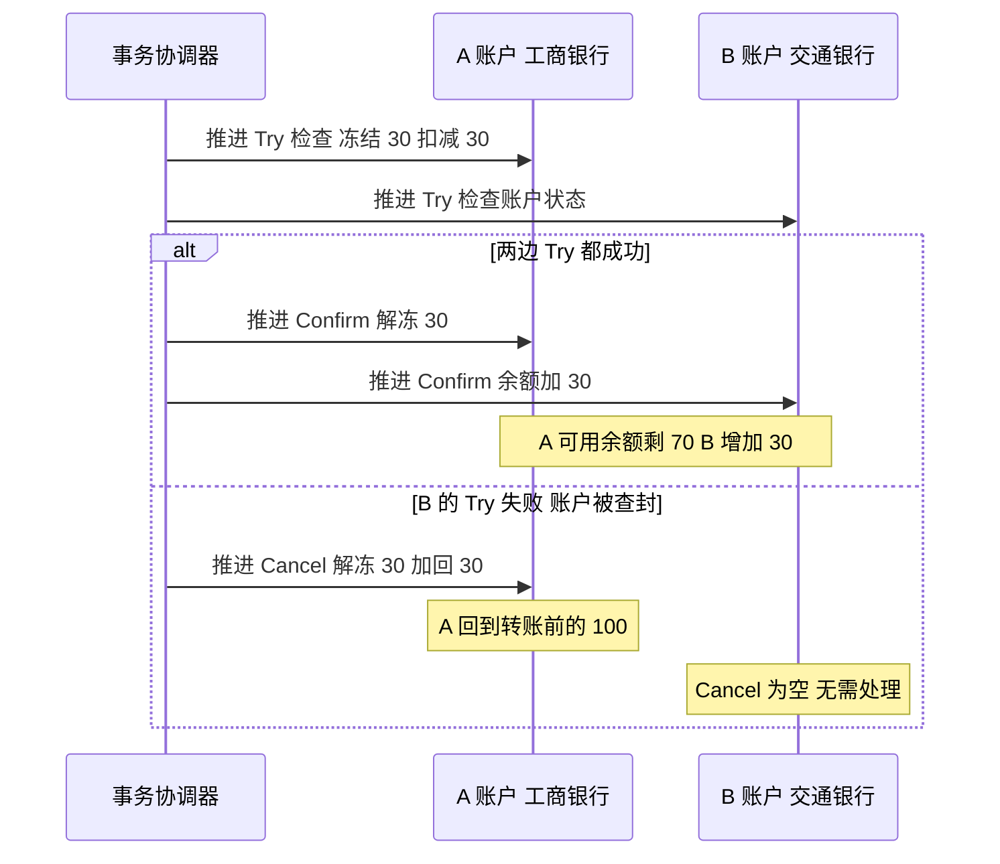

# TCC 案例：一笔 30 元转账走完 Try、Confirm、Cancel

TCC 的模型已经立在前面：三个操作、两个阶段、一个事务协调器。概念听懂是一回事，三个操作里各塞什么业务、失败分支怎么回滚，还是要用具体例子走一遍才踏实。课程选的例子依然是转账，这是 TCC 最经典的考场：A 转账给 B 30 元，A 的账户开在工商银行，B 的账户开在交通银行。两家银行使用的软件、系统相互独立，A 这边扣钱与 B 那边入账谁也包办不了谁，这就是一个典型的分布式事务应用场景，问题就该由 TCC 来收场。

## 先给结论

- A 账户的三个操作：Try 检查可用余额够不够 30 元、冻结金额 30 元、扣减可用余额 30 元；Confirm 解冻 30 元；Cancel 解冻 30 元并把扣掉的 30 元加回可用余额。
- B 账户的三个操作：Try 检查账户状态正常可用；Confirm 余额增加 30 元；Cancel 为空，无事可做。
- 冻结金额是为了防并发：被冻结的 30 元只能用于本次转账，别的用途动不了，避免检查完余额却被并发的消费把余额刷爆。
- 双方 Try 都成功才走 Confirm；任一方 Try 失败，成功过的一方走 Cancel 回滚，Try 失败的一方没有预留、无需处理。
- Confirm、Cancel 出错靠重试机制加人工处理兜底，重试必须配合幂等设计；TCC 的代价是对代码侵入性强、编码实现难度大。

## 先把两边要做的事数清楚

事务管理器怎么协调先放一边，案例图上那部分协调管理的蓝色框属于 TCC 的执行层。先用最朴素的方式过一遍：要完成这笔转账，A、B 两个账户各自要做哪些业务。

**A 账户要做三件事。** 第一件，检查可用余额够不够 30 元，余额都不够就没必要往下走了。第二件，冻结金额 30 元。以前聊转账没提过冻结，都是直接扣，现实业务里这一步不能省：账户余额除了自己在用，可能还有别的消费在并发进行，比如这边正在转账，另一边一张卡刷掉了余额，转账检查时余额明明够，扣款时却没钱了。冻结的意思是这 30 元被标记为专用，别人或别的用途都动不了，将来只能用于本次转账，这就保证了从检查到扣款之间余额不会被旁路消耗。第三件，扣减可用余额 30 元，把这笔钱从可用余额里划出，进入在途状态。

**B 账户只做两件事。** 检查账户状态是否正常可用，确认这个账户没有被查封之类的异常；然后就等着收钱，在 Confirm 阶段把余额加上 30 元。

余额的账目在这里值得走一遍，拿 A 账户原有 100 元算：

| 节点 | 动作 | 可用余额变化 | 说明 |
|---|---|---|---|
| Try | 冻结 30 元 | 100 → 70 | 30 元被标记为专用预留 |
| Try | 扣减可用余额 30 元 | 70 → 40 | 30 元划出可用余额，进入在途 |
| Confirm | 解冻 30 元 | 40 → 70 | 预留释放，这 30 元已划给 B，最终剩 70 |
| Cancel | 解冻 30 元并加回 30 元 | 40 → 70 → 100 | 相当于回滚，账户回到转账前的 100 |

转账成功只转走 30 元，100 减 30 最终剩 70，解冻就是把原来冻结的 30 元释放回可用余额；转账失败则该解冻还得解冻，余额还要把扣掉的 30 元加回来，账户回到 100，这正是事务要追求的结果。

## 往 Try、Confirm、Cancel 里套

两边要做的事数清楚了，编码就是把它们往三个操作里套：这个功能放 Try 里，那个功能放 Confirm 里，这两个功能放 Cancel 里。A 账户与 B 账户各自的分配如下：

| 操作 | A 账户（转账方） | B 账户（收款方） |
|---|---|---|
| Try | 检查余额够 30、冻结 30、扣减可用余额 30 | 检查账户状态正常可用 |
| Confirm | 解冻 30 | 余额增加 30 |
| Cancel | 解冻 30、增加可用余额 30 | 空 |

写成代码就是三块方法的骨架：

```java
// 示例 按本课写法补全 A 账户（转账方）的三个操作
public class TransferTccService {

    /** Try 检查余额 冻结 30 并扣减可用余额 30 */
    public boolean tryTransfer(String fromAccount, BigDecimal amount) {
        // 1. 检查可用余额是否够 30 元 不够直接失败
        // 2. 冻结金额 30 元 这笔钱只能用于本次转账
        // 3. 扣减可用余额 30 元 划出进入在途
        return accountDao.freezeAndDeduct(fromAccount, amount);
    }

    /** Confirm 解冻 30 元 预留释放 转账正式成立 */
    public boolean confirmTransfer(String fromAccount, BigDecimal amount) {
        return accountDao.unfreeze(fromAccount, amount);
    }

    /** Cancel 解冻 30 元 并把扣掉的 30 加回可用余额 等价回滚 */
    public boolean cancelTransfer(String fromAccount, BigDecimal amount) {
        return accountDao.unfreezeAndRefund(fromAccount, amount);
    }
}
```

```java
// 示例 按本课写法补全 B 账户（收款方）的三个操作
public class ReceiveTccService {

    /** Try 只做业务检查 账户状态正常可用 */
    public boolean tryReceive(String toAccount) {
        return accountDao.isStatusNormal(toAccount);
    }

    /** Confirm 余额增加 30 元 */
    public boolean confirmReceive(String toAccount, BigDecimal amount) {
        return accountDao.increaseBalance(toAccount, amount);
    }

    /** Cancel 空 Try 失败即返回 没有预留可释放 */
    public boolean cancelReceive(String toAccount, BigDecimal amount) {
        return true;
    }
}
```

B 账户的 Cancel 是空的，这不是偷懒：Try 都没执行成功，它什么预留动作都没做过，也没有余额可加，回滚对它无从谈起。

## 两个分支各走一遍

执行由事务管理器推动，事务管理器、事务协调器、全局事务发起方这三个叫法指的是同一个角色，图上标的就是「协调管理」。A 是转账发起方，所以协调器先推进 A 的 Try，再推进 B 的 Try，Try 执行期间协调器持续监控两边有没有出问题。成功与失败两个分支画在一张图里：



**成功分支。** A 的 Try 执行没有任何问题，B 的 Try 也没有问题，两边都检查、预留完毕。协调器随后推进双方 Confirm：A 解冻 30 元，可用余额停在 70；B 的余额增加 30 元。A 少 30，B 多 30，转账成立。

**失败分支。** A 的 Try 没问题，B 的 Try 出了问题，比如一检查发现账户被查封，状态异常。此时 A 这边走 Cancel，相当于回滚：原来冻结的 30 元解冻，原来扣掉的 30 元加回可用余额，账户回到转账前的 100 元。B 这边 Try 都失败了，不会往下走，Cancel 本身也是空，余额从未增加过。TCC 一协调，钱没有平白消失，也没有凭空多出，两边数据始终对得上，这正是它要达到的目的。

## Confirm 与 Cancel 出错的兜底

前面讲 TCC 模型时留过一个尾巴：Confirm 或 Cancel 执行中出问题怎么办。处置还是两条：重试加人工。比如解冻金额这一步失败了，就再试一次，一次不行再来一次，重试个 30 次；重试还不行就转人工处理，实际出现的概率比较小。

重试不能裸奔，必须保证幂等。幂等的意思是同一个功能、同一个操作，不管执行多少次，业务结果与数据都是一致的。解冻、加余额这类动作被反复重试时，如果没有幂等保护，解冻可能被解第二次，钱可能被加两次，兜底动作本身就制造了新的不一致，所以重试逻辑要带着幂等设计一起写。

回滚策略的复杂度也在这里。Try 里面可能不止三步：前两步成功了第三步失败，怎么回滚？第二步就失败，又怎么回滚？不同的失败位置对应不同的回滚路径，这些分支都得想清楚、写出来。能实现，但确实是麻烦，这就是 TCC 编码实现难度大的具体来源。

## TCC 的不足与价值

这套方案的两个不足要记牢。**一是对代码侵入性强。** 用 TCC 就得按它的套路来，业务代码必须拆成三块，分别套进 Try、Confirm、Cancel 三个接口里，不能想怎么写就怎么写；将来业务方案变化要改造，成本也会高一些。**二是编码实现难度大。** 重试要实现幂等，回滚要考虑不同失败位置的策略，转账这个例子看着简单纯粹是因为例子本身简单，换成复杂业务，工作量成倍增长。

好处同样直白：它真能解决分布式事务问题。本项目的注册链路最终就按这个方案落地，用户中心与统一账号服务两边的预留、确认、回滚由框架协调推进，两个库里的数据始终一致。

## 常见误区

- **把冻结金额当成多余动作。** 错例：检查完余额直接扣减，省掉冻结一步。正解：检查与扣款之间存在并发消耗余额的风险，冻结把这笔钱标记为专用，保证 Try 与后续步骤之间余额不被旁路动用。
- **以为 B 失败后 B 也要执行 Cancel。** 错例：统一给所有参与方安排回滚调用。正解：Try 失败的一方没有做过任何预留动作，B 的 Cancel 是空实现，需要回滚的只是 Try 成功过的一方。
- **把解冻理解成把钱加回余额。** 错例：在 Confirm 里既解冻又给 A 加回 30 元。正解：解冻只是释放预留标记；加回余额是 Cancel 里独立的动作，Confirm 时那 30 元已经划给收款方，账户就该剩 70。
- **重试时不做幂等。** 错例：Confirm 失败后直接循环重试 30 次，不做任何防重处理。正解：重试的前提是幂等，同一操作执行多少次结果都一致，否则重试会把解冻、加钱变成重复执行。

## 面试可能被问到的问题

1. 面试官追问：「转账前为什么要冻结金额？」
   答：检查余额与实际扣款之间存在时间差，期间账户可能被并发的消费扣款，出现检查时够、扣款时不够的情况。冻结把这笔金额标记为只能用于本次转账的专用预留，别的用途动不了，堵住了这个并发窗口。
2. 面试官追问：「转账案例里 A 账户的三个操作分别做什么？」
   答：Try 做检查可用余额够不够 30 元、冻结 30 元、扣减可用余额 30 元，完成检查与资源预留；Confirm 解冻 30 元，预留释放，转账正式成立；Cancel 解冻 30 元并把扣掉的 30 元加回可用余额，等价于回滚，账户回到转账前状态。
3. 面试官追问：「B 账户的 Cancel 为什么是空的？」
   答：B 的 Try 只做账户状态检查，不做任何预留或扣减动作。Try 失败时它没有产生需要撤销的东西，余额也从未增加，回滚对它无从谈起，所以 Cancel 是空实现。这正是 TCC 的特点：每个操作装什么完全由分支业务决定。
4. 面试官追问：「Confirm 或 Cancel 出错怎么办？重试要注意什么？」
   答：引入重试机制，失败就再试，比如允许重试 30 次，仍不成功转人工处理。重试必须实现幂等，同一个操作执行多少次业务结果与数据都一致，否则解冻可能被重复解、钱可能被重复加，兜底动作反而制造新的不一致。
5. 面试官追问：「Try 内部有多步操作时，回滚怎么设计？」
   答：要按失败位置设计不同的回滚策略：第二步就失败，只需撤销第一步的预留；前两步成功第三步失败，就要把前两步逐个撤销。回滚不是一句 revert，而是与 Try 的步骤一一对应的逆操作序列，这也是 TCC 实现难度大的原因之一。
6. 面试官追问：「TCC 方案有哪些不足？」
   答：一是对应用侵入性强，业务代码必须按框架套路拆成 Try、Confirm、Cancel 三块实现，业务变化时改造成本高；二是编码实现难度大，重试要保证幂等，回滚要覆盖不同失败位置的策略。换来的是分布式事务问题的可靠解决，在一致性要求严格、执行时间短的业务上值得投入。

## 配套资料

- 讲义：`materials/docs/10/day16-项目总结&就业指导v1.0.md`，「3.4.2 什么是 TCC（补偿事务）」小节：Try、Confirm、Cancel 三操作两阶段的定义与出错兜底方式，为转账案例的模型依据。
- 讲义：`materials/docs/10/万信金融-第2章-讲义-开户v1.0.md`，「注册功能中的分布式事务」小节：注册链路使用 Hmily 框架解决分布式事务问题的说明，TCC 案例的业务最终在该链路落地。
- 代码：`materials/code/10/wanxinp2p/`，P2P 工程归档（目录保留原始命名，路径列到该层级）；转账案例与 TCC 接入代码未在仓库归档，正文 A、B 账户的三方法骨架为按本课写法补全的示例，包名按 `com.study.finance` 系改写。
