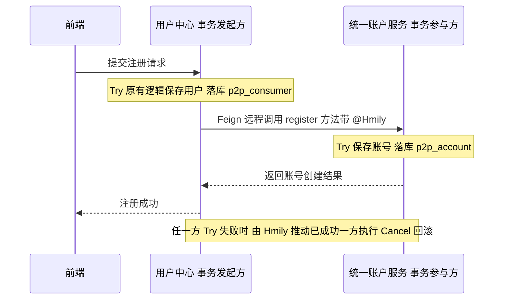

# 用户中心侧的 Hmily 改造：把注册方法挂上 Try、Confirm、Cancel

> 🔒 安全提示：文中示例的口令/密钥均为课程教学环境演示口径，生产环境的安全要求见《安全与合规须知》。

注册链路的分布式事务问题已经定位清楚，Hmily 框架的依赖与环境也就绪，接下来该动手改代码了。真正开写时容易卡在两个地方：三个方法往哪儿放，配置要不要每个服务复制一份。本课先把事务发起方，也就是用户中心服务这一侧改完，统一账户服务那一侧留给下一课。改造套路与此前转账例子完全一致，变的只是业务：那次是转账，这次是注册。

## 先给结论

- 角色由调用方向决定：注册请求先到用户中心、由它发起远程调用，用户中心是事务发起方，统一账户服务是事务参与方，两侧代码分开改造。
- Hmily 配置放进 Apollo 通用配置模板项目的公共名称空间 `micro_service.spring-cloud-hmily`，用户中心应用关联引用，`org.dromara.hmily.started=true` 表明发起方身份。
- 配置五件事：kryo 序列化、失败重试上限 30 次、事务日志持久化方式 db、发起方开关、事务日志库 `p2p_undo_log` 的连接信息。
- 代码改四处：新增 `HmilyConfig` 配置类产出引导对象、启动类扫描路径加 `org.dromara.hmily`、Feign 代理方法加 `@Hmily`、注册方法标 `@Hmily(confirmMethod, cancelMethod)` 并补齐 Confirm 与 Cancel 两个方法。
- 注册的 Try 就是原有的保存用户逻辑，Confirm 无业务只留日志，Cancel 按手机号删除 Try 保存的用户，回滚动作必须与 Try 相反。

## 先分清谁是发起方谁是参与方

**角色由调用方向决定，不由业务重要程度决定。** 注册链路里，前端请求先打到用户中心；用户中心先在本地保存用户信息，再远程调用统一账户服务创建账号。先收到请求、主动发起远程调用的这一方，就是事务发起方；被调用的那一方，是事务参与方。落到工程上，用户中心服务 consumer-service 是发起方，统一账户服务 account-service 是参与方。改造从发起方开始，两侧代码分开写、分开看，混在一起容易漏。

发起方改造完成后的完整链路长这样：



关键路径读法：Try 阶段先落用户库、再经远程调用落账号库；两边 Try 都顺利，注册成立，Confirm 只做收尾确认；任何一边 Try 出岔子，框架依据事务日志推动已执行过 Try 的一方走 Cancel。这张图里用户中心承担了两个动作，本地 Try 与发起远程 Try，它的代码改造因此比参与方多一项。

## 配置先行：公共名称空间与发起方开关

**配置集中放公共名称空间，而不是散在各个微服务里。** 项目里其他业务将来也可能用到 Hmily，配置一处维护才不会改漏。做法是在 Apollo 的通用配置模板项目下新建一个公共名称空间，名字与讲义保持一致，取 `micro_service.spring-cloud-hmily`，新建时选择公共类型，备注写 Hmily 相关配置即可。公共名称空间可以被其他项目关联引用，这正是「一处配置、多处复用」的载体。往里添加的配置项如下，添加后记得发布：

```properties
# 公共名称空间 micro_service.spring-cloud-hmily
org.dromara.hmily.serializer = kryo
org.dromara.hmily.retryMax = 30
org.dromara.hmily.repositorySupport = db
org.dromara.hmily.started = true
org.dromara.hmily.hmilyDbConfig.driverClassName = com.mysql.cj.jdbc.Driver
org.dromara.hmily.hmilyDbConfig.url = jdbc:mysql://localhost:3306/p2p_undo_log?useUnicode=true
org.dromara.hmily.hmilyDbConfig.username = root
org.dromara.hmily.hmilyDbConfig.password = 123456
```

逐项过一遍。`serializer` 指定序列化方式为 kryo，它比 JSON 更小更快，依赖管理里要相应登记 kryo 的坐标。`retryMax` 是 Confirm 或 Cancel 失败后的重试上限，30 次之后仍不成功就需要人工介入。`repositorySupport` 选 db，事务日志持久化到数据库，金融业务不能用内存方案，进程一崩日志就没了。`started` 是发起方开关，true 表示当前服务以事务发起方身份运行，false 表示参与方，公共配置里默认 true。`hmilyDbConfig` 四项是事务日志库的连接信息，指向环境搭建时单独创建的 `p2p_undo_log` 库，表不需要手建，框架启动时会自己往里建两张日志表。

**公共配置要关联到用户中心应用才生效。** 到 Apollo 里找到 consumer-service 项目，添加名称空间时选择公共的 `micro_service.spring-cloud-hmily`，提交后发布。关联完别急着走，检查一遍有没有需要覆盖的项：用户中心是发起方，`started` 应为 true，公共配置里本来就是 true，其余项也不涉及角色差异，无需覆盖，直接沿用。

## 配置类与启动类：让框架在容器里立起来

**配置类负责把 Apollo 里的键值变成框架的引导对象。** 新增 `HmilyConfig` 配置类，放到用户中心的 `config` 包：

```java
package com.study.finance.consumer.config;

@Configuration
@EnableAspectJAutoProxy(proxyTargetClass = true)
public class HmilyConfig {

    @Bean
    public HmilyTransactionBootstrap hmilyTransactionBootstrap(Environment env) {
        HmilyTransactionBootstrap bootstrap = new HmilyTransactionBootstrap();
        // 序列化方式与重试上限 对应公共名称空间里的两个键
        bootstrap.setSerializer(env.getProperty("org.dromara.hmily.serializer"));
        bootstrap.setRetryMax(Integer.parseInt(env.getProperty("org.dromara.hmily.retryMax")));
        // 事务日志持久化方式与发起方开关
        bootstrap.setRepositorySupport(env.getProperty("org.dromara.hmily.repositorySupport"));
        bootstrap.setStarted(Boolean.parseBoolean(env.getProperty("org.dromara.hmily.started")));
        // 事务日志库连接信息 单独的 p2p_undo_log 库
        HmilyDbConfig hmilyDbConfig = new HmilyDbConfig();
        hmilyDbConfig.setDriverClassName(env.getProperty("org.dromara.hmily.hmilyDbConfig.driverClassName"));
        hmilyDbConfig.setUrl(env.getProperty("org.dromara.hmily.hmilyDbConfig.url"));
        hmilyDbConfig.setUsername(env.getProperty("org.dromara.hmily.hmilyDbConfig.username"));
        hmilyDbConfig.setPassword(env.getProperty("org.dromara.hmily.hmilyDbConfig.password"));
        bootstrap.setHmilyDbConfig(hmilyDbConfig);
        return bootstrap;
    }
}
```

这个类逐键读取 `org.dromara.hmily` 前缀的配置，组装出一个 `HmilyTransactionBootstrap`，它是 Hmily 事务机制的引导对象，框架的初始化由它拉起。类上的 `@EnableAspectJAutoProxy(proxyTargetClass = true)` 不是摆设，Hmily 靠 AOP 切面拦截带注解的方法，代理方式必须按它要求的方式打开，否则切面织不进去。`Integer.parseInt` 那一行要留意：配置项读不到时 `env.getProperty` 返回 null，这里会直接抛 `NumberFormatException`，这个坑在功能测试课里真踩了一回。

**启动类要把框架的包扫进来。** Hmily 自己的组件都住在 `org.dromara.hmily` 包里，默认扫描扫不到它们，切面与协调器都不会工作：

```java
@SpringBootApplication(scanBasePackages = {"org.dromara.hmily", "com.study.finance.consumer"})
@EnableDiscoveryClient
@EnableFeignClients(basePackages = {"com.study.finance.consumer.agent"})
public class ConsumerService {

    public static void main(String[] args) {
        SpringApplication.run(ConsumerService.class, args);
    }
}
```

`scanBasePackages` 里现在有两个包：框架包与业务包，缺一不可。照着讲义模板粘贴时务必核对包路径，讲义里的路径与工程实际不一定逐字一致，以工程为准改对。

## 业务代码改造：远程调用出口与三段式

**远程调用的出口先标注。** 用户中心调统一账户走的是 Feign 代理 `AccountApiAgent`，在它的 `register` 方法上加 `@Hmily`：

```java
@FeignClient(value = "account-service")
public interface AccountApiAgent {

    /** 注册账户 远程调用统一账户服务 加 @Hmily 后纳入 TCC 事务管理 */
    @Hmily
    @PostMapping("/account/register")
    RestResponse<AccountDTO> register(AccountRegisterDTO accountRegisterDTO);
}
```

这一步的语义是告诉框架：这次跨服务的远程调用是全局事务里的一条分支，调用时要把事务上下文随请求带过去。少了这个注解，参与方根本不知道自己处在某个全局事务里，TCC 就断了链条。此处只加注解不指定 Confirm 与 Cancel，远程分支的三段由参与方自己的业务类负责。

**注册方法本身挂上注解，原有逻辑原样保留为 Try。** 打开用户中心业务实现类，类上补 `@Slf4j`，改造如下：

```java
@Override
@Hmily(confirmMethod = "confirmRegister", cancelMethod = "cancelRegister")
public void register(ConsumerRegisterDTO consumerRegisterDTO) {
    // Try 阶段 原有的保存用户逻辑 原样保留
    Consumer consumer = new Consumer();
    BeanUtils.copyProperties(consumerRegisterDTO, consumer);
    consumer.setIsBindCard(0);            // 初始状态 未绑定银行卡
    save(consumer);                       // 落库 p2p_consumer

    // 远程调用统一账户服务创建账号 失败抛异常 触发整个全局事务回滚
    consumerRegisterDTO.setUsername(consumer.getUsername()); // 回填用户名 保证远程侧拿到完整数据
    AccountRegisterDTO accountRegisterDTO = new AccountRegisterDTO();
    BeanUtils.copyProperties(consumerRegisterDTO, accountRegisterDTO);
    RestResponse<AccountDTO> restResponse = accountApiAgent.register(accountRegisterDTO);
    if (restResponse.getCode() != CommonErrorCode.SUCCESS.getCode()) {
        throw new BusinessException(ConsumerErrorCode.E_140106);
    }
}
```

方法体一行没改，变的只是方法上多出的注解：`confirmMethod` 指向确认方法名，`cancelMethod` 指向回滚方法名，两个名字对应的必须是本类里真实存在的方法。紧接着把这两个方法补齐：

```java
/** Confirm 阶段 Try 成功后执行 注册没有预留转正式的动作 留日志即可 */
public void confirmRegister(ConsumerRegisterDTO consumerRegisterDTO) {
    log.info("execute confirmRegister");
}

/** Cancel 阶段 与 Try 相反的逆操作 删除 Try 阶段保存的用户 */
public void cancelRegister(ConsumerRegisterDTO consumerRegisterDTO) {
    log.info("execute cancelRegister");
    QueryWrapper<Consumer> wrapper = new QueryWrapper<>();
    wrapper.eq("mobile", consumerRegisterDTO.getMobile());
    remove(wrapper);
}
```

Confirm 为什么可以只留一行日志：转账那种场景里 Try 做了冻结扣减，Confirm 要解冻把预留转正式；注册的 Try 一次就把用户数据写完整了，没有中间态需要转正，确认动作本身无事可做。Cancel 则必须动真格：Try 里 `save` 了一条用户，Cancel 就要把它删掉，`remove` 与 `save` 互为相反操作，删除条件用手机号，与 Try 的写入能够一一对上。两个方法的参数类型与 Try 保持一致，框架是按方法名加参数类型反射调用的，对不上号回滚就会落空。

## 常见误区

- **公共名称空间建了、忘了关联或忘了发布。** 错例：Apollo 上配置项齐全，服务启动却读不到，`Integer.parseInt` 直接抛 NumberFormatException。正解：配置生效要三步齐活，公共名称空间里添加并发布、应用侧关联、客户端 `namespaces` 清单里包含该名称空间。
- **Confirm 与 Cancel 的参数和 Try 对不上。** 错例：三个方法参数类型不一致，框架按名字反射调用时找不到匹配方法。正解：三方法同类、同名规则、同参数，Confirm 与 Cancel 通常不带返回值，参数与 Try 完全一致。
- **Feign 代理方法漏加 `@Hmily`。** 错例：只改了业务实现类，远程调用照常发生但事务上下文传不过去，参与方 Try 不被纳入全局事务。正解：发起方的每一处跨服务调用出口都要标注，一个都不能漏。
- **Cancel 里写了与 Try 无关的动作。** 错例：回滚方法里顺手清理缓存、发通知，失败时这些动作照常执行制造混乱。正解：Cancel 只做 Try 的逆操作，`save` 对 `remove`，其他动作不属于回滚职责。

## 面试可能被问到的问题

1. 面试官追问：「怎么判定一个服务在分布式事务里是发起方还是参与方？」
   答：看调用方向。请求先到达、并主动发起跨服务远程调用的一方是发起方，被调用的另一方是参与方。注册链路里用户中心先接请求又发起远程调用，是发起方；统一账户服务被调用，是参与方。角色决定了配置差异与改造清单差异。
2. 面试官追问：「`@Hmily` 注解在发起方出现了两次，Feign 接口上一次、业务方法上一次，各起什么作用？」
   答：业务方法上的 `@Hmily` 声明该方法是一个 TCC 入口，指定 confirmMethod 与 cancelMethod，把它变成全局事务的起点；Feign 接口方法上的 `@Hmily` 声明这次远程调用是全局事务的一条远程分支，框架据此把事务上下文随 HTTP 请求传递给参与方。两处缺一不可。
3. 面试官追问：「注册场景的 Confirm 为什么可以是空操作？」
   答：Confirm 的职责是把 Try 中的预留资源转成正式状态。转账场景 Try 冻结扣减了资金，Confirm 必须解冻；注册场景 Try 一次完成用户数据写入，不存在预留与转正的中间态，所以 Confirm 只留日志确认执行。Confirm 不是必须空，而是由 Try 留没留中间态决定。
4. 面试官追问：「Cancel 方法的编写原则是什么？」
   答：只做 Try 的逆操作，Try 里写了什么就撤什么，删除条件要能唯一定位 Try 写入的那条数据，例如按手机号删除本次注册保存的用户。不掺入业务外动作，同时要考虑幂等，因为 Cancel 失败后框架会按 retryMax 配置反复重试。
5. 面试官追问：「为什么把 Hmily 配置放在 Apollo 公共名称空间而不是各服务本地？」
   答：Hmily 的配置项是框架级的，多个服务共用同一套序列化、重试与日志库配置，放公共名称空间一处维护、多处关联引用，调整时改一处发布即可。角色差异项如 started 由各服务应用级覆盖，公共管共性、应用管差异，职责清晰。

## 配套资料

- 代码：`materials/code/10/wanxinp2p/`，P2P 工程归档（目录保留原始命名，路径列到该层级），其父工程 `pom.xml` 的依赖管理登记了 `org.dromara:hmily-springcloud:2.0.4-RELEASE` 与 `com.esotericsoftware:kryo:4.0.2`，正文依赖口径出自其中。
- 代码：`materials/code/10/资料/公共类/AccountRegisterDTO.java`、`ConsumerRegisterDTO.java`，注册链路两个 DTO 的真实字段定义，`BeanUtils.copyProperties` 复制的两端即此二者。
- 代码：`materials/code/10/资料/公共类/ConsumerErrorCode.java`，`E_140106 注册失败` 的登记出处。
- 讲义：`materials/docs/10/万信金融-第2章-讲义-开户v1.0.md`，「注册功能中的分布式事务」节：注册横跨用户中心与统一账户两服务，使用 Hmily 框架解决事务问题。
- 说明：`HmilyConfig`、启动类与 `ConsumerServiceImpl` 的完整源码以及 Apollo 配置未在仓库归档，正文按视频画面线与讲义整理；包名按 `com.study.finance` 系改写；数据库连接按本机 MySQL 口径 root/123456。
