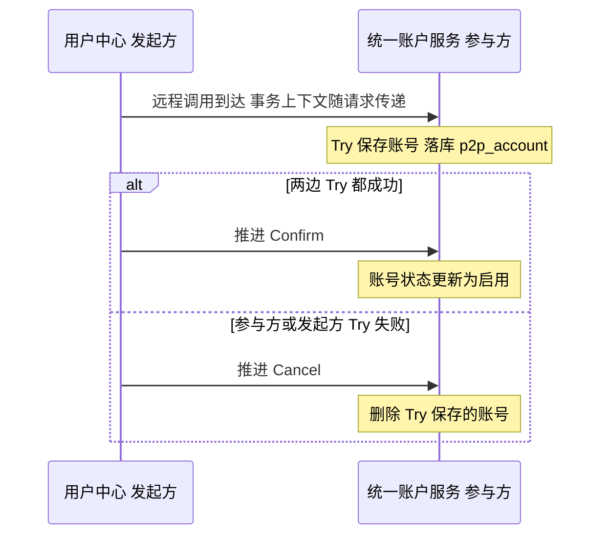

# 统一账户侧的 Hmily 改造：创建账号接口的 TCC 三段式

事务发起方用户中心那一侧改完之后，全局事务还缺另一半：被远程调用的统一账户服务还没接到 TCC 的三段式上。参与方的改造清单比发起方短，少的那一项恰恰体现角色差异，多的那一项则要小心 Apollo 的配置覆盖。本课把统一账户服务 account-service 这一侧补齐，注册链路的 Hmily 改造就全部到位。

## 先给结论

- 参与方没有远程调用出口，Feign 代理相关的改造一步都不需要；要做的是配置、配置类、启动类扫描、业务方法三段式这四件事。
- account-service 在 Apollo 关联公共名称空间 `micro_service.spring-cloud-hmily`，并覆盖 `org.dromara.hmily.started=false` 声明参与方身份，覆盖后必须发布才生效。
- 事务日志库两边允许共用同一个 `p2p_undo_log`，参与方不必另建。
- `AccountServiceImpl` 的 `register` 挂 `@Hmily(confirmMethod, cancelMethod)`，Confirm 把账号状态更新为启用 `STATUS_IN`，Cancel 按用户名删除账号，与 Try 的 `save` 相反。
- Confirm 与 Cancel 与 Try 同类同参数，编写原则不变：Confirm 轻量，Cancel 只做逆操作。

## 参与方的位置与更短的清单

参与方在全局事务里的位置是被推进的一方：发起方的 Try 执行到远程调用处，框架把事务上下文带过来，参与方的 Try 才被触发；后续 Confirm 或 Cancel 由框架按事务日志推进到参与方头上。它自己不再发起远程调用，也就没有 Feign 出口要标注：



清单对齐发起方逐项核对：配置要做，但多一个覆盖动作；配置类与启动类扫描照搬发起方的做法；业务方法同样拆三段；唯独 Feign 代理一栏，参与方划掉。分清哪些步骤因角色而异，参与方的改造才不会照猫画虎做多余功。

## 配置：关联公共名称空间再加一个覆盖

**公共配置关联进来，参与方身份用覆盖表达。** 到 Apollo 找到 account-service 项目，添加名称空间时选择公共的 `micro_service.spring-cloud-hmily`，提交后应用级就能看到整组 Hmily 配置。接着检查覆盖项：统一账户服务是事务参与方，`org.dromara.hmily.started` 应为 false，而公共配置里默认是 true，这里需要在应用级新增同名键覆盖掉：

```properties
# account-service 应用级配置 覆盖公共名称空间的同名键
org.dromara.hmily.started = false
```

其余配置项都不用动。序列化方式、重试上限、持久化方式与发起方完全一致，事务日志库也可以共用 `p2p_undo_log`，全局事务与分支事务的日志本来就要放在一个能被协调方读到的地方，两边分库反而添乱。覆盖之后提交并发布，Apollo 的配置以应用级优先于关联的公共级，不发布客户端拿到的还是旧值，这个开关写对了却没生效是典型冤案。

**配置类与启动类照搬发起方套路。** 从资料里把 `HmilyConfig` 粘到统一账户服务的 `config` 包，类内容与发起方一致，读取同一组 `org.dromara.hmily` 前缀的键，产出 `HmilyTransactionBootstrap` 引导对象。启动类补扫描路径：

```java
@SpringBootApplication(scanBasePackages = {"org.dromara.hmily", "com.study.finance.account"})
@EnableDiscoveryClient
public class AccountService {

    public static void main(String[] args) {
        SpringApplication.run(AccountService.class, args);
    }
}
```

框架包 `org.dromara.hmily` 与业务包 `com.study.finance.account` 并列在扫描清单里。粘贴模板后逐个核对包路径是硬要求，讲义模板里的业务包名与工程实际不一定一致，扫错了框架照样不工作。

## 三段式落地：保存账号是 Try，删账号是 Cancel

打开统一账户服务的业务实现类，注册账号的方法此前已经实现过，这次挂注解、补方法。类上同样加 `@Slf4j`：

```java
@Override
@Hmily(confirmMethod = "confirmRegister", cancelMethod = "cancelRegister")
public AccountDTO register(AccountRegisterDTO accountRegisterDTO) {
    // Try 阶段 原有保存账号逻辑
    Account account = new Account();
    account.setUsername(accountRegisterDTO.getUsername());
    account.setMobile(accountRegisterDTO.getMobile());
    account.setPassword(PasswordUtil.generate(accountRegisterDTO.getPassword()));
    if (smsEnable) {
        // 开启短信服务时 以手机号为原文生成密码密文
        account.setPassword(PasswordUtil.generate(accountRegisterDTO.getMobile()));
    }
    account.setDomain("c");    // C 端用户
    save(account);             // 落库 p2p_account
    return convertAccountEntityToDTO(account);
}

/** Confirm 阶段 把账号状态更新为启用 预留转正式 */
public void confirmRegister(AccountRegisterDTO accountRegisterDTO) {
    log.info("execute confirmRegister");
    update(Wrappers.<Account>lambdaUpdate()
            .eq(Account::getUsername, accountRegisterDTO.getUsername())
            .set(Account::getStatus, StatusCode.STATUS_IN.getCode()));
}

/** Cancel 阶段 与 Try 的 save 相反 按用户名删除 */
public void cancelRegister(AccountRegisterDTO accountRegisterDTO) {
    log.info("execute cancelRegister");
    remove(Wrappers.<Account>lambdaQuery().eq(Account::getUsername, accountRegisterDTO.getUsername()));
}
```

与发起方那侧相比，这三段有两个值得细看的地方。**Confirm 这里有真实动作。** `Account` 实体里有 `status` 账号状态字段，Try 阶段保存账号时不设置状态，账号先以默认状态存在；Confirm 把状态更新为启用 `STATUS_IN`，账号才算正式生效，这正是「预留转正式」在注册场景的具体形态。发起方那侧 Confirm 只留日志，是因为它的 Try 没有留中间态；两侧 Confirm 的胖瘦不同，恰好说明三段里装什么完全由 Try 决定。

**Cancel 的删除条件与发起方不同。** 发起方按手机号删除用户，参与方按用户名删除账号，条件的选择标准是唯一的：能精确对上 Try 阶段写入的那一条数据。`lambdaQuery` 拼出按用户名匹配的删除条件，与 `save` 互为相反操作。顺带体会一下 Mybatis-Plus 的便利，`update` 与 `remove` 都是业务层基类自带的方法，条件构造器把匹配与更新字段写得一目了然。

到这一步，发起方与参与方的代码都齐了。两端注解指名的方法全部真实存在，参数类型一致，事务日志库就绪，剩下的就是测，让框架真的把一次失败拉回来。

## 常见误区

- **参与方照抄发起方去改 Feign 代理。** 错例：在统一账户服务里找远程调用出口加 `@Hmily`，找了半天发现它根本不发远程调用。正解：参与方没有调用出口，三段式加在本服务被调用的业务方法上即可，清单里没有 Feign 这一项。
- **覆盖 `started` 后忘记发布。** 错例：应用级写了 false 就重启服务，Apollo 未发布不生效，客户端仍按公共配置的 true 运行，参与方被当成发起方，行为错乱。正解：覆盖提交后点发布，再重启服务。
- **Cancel 的删除条件与 Try 写入对不上。** 错例：Try 按用户名保存，Cancel 却按不存在的字段拼条件，回滚时删了个寂寞，两库数据裂开。正解：Cancel 的匹配条件必须唯一定位 Try 写入的那条数据，两侧的定位字段可以不同，但各自要自洽。
- **Confirm 里塞重量级业务。** 错例：在 Confirm 里再调第三方接口做审核。正解：Confirm 失败会被反复重试，必须轻量且幂等；重业务应放在 Try 的检查与预留里，Confirm 只做状态落定。

## 面试可能被问到的问题

1. 面试官追问：「参与方的改造为什么比发起方少一步？」
   答：发起方要主动发起跨服务调用，Feign 接口方法必须加 `@Hmily` 声明远程分支并传递事务上下文；参与方只被调用，没有远程出口，三段式直接落在自己的业务方法上。角色差异决定了清单差异。
2. 面试官追问：「参与方的 Confirm 做了状态更新，发起方的 Confirm 却是空操作，TCC 的 Confirm 到底该装什么？」
   答：Confirm 装的是「把 Try 预留的资源转成正式状态」这个动作。统一账户的 Try 保存了默认状态的账号，Confirm 将状态置为启用；用户中心的 Try 一次写完整数据，无中间态可转，Confirm 留日志即可。装什么完全取决于 Try 留了什么。
3. 面试官追问：「为什么参与方事务日志库可以和发起方共用同一个库？」
   答：Hmily 的协调依据是事务日志，全局事务与分支事务的日志需要在同一套存储里关联查询。共库能让框架推进 Confirm 与 Cancel 时读到完整的日志链，也避免分库后日志库自身的运维成本翻倍，开发环境与中小规模场景共用是常见做法。
4. 面试官追问：「Cancel 按用户名删除，发起方按手机号删除，条件不一致会不会出问题？」
   答：不会，两侧条件各自对应各自 Try 的写入即可。发起方 Try 写用户表按手机号可唯一定位，参与方 Try 写账号表按用户名可唯一定位，回滚是每个分支各自撤销自己的写入，不要求跨服务条件统一，只要求本侧自洽且能防重复删除。
5. 面试官追问：「如果参与方的 Try 保存成功了，但发起方随后抛异常，参与方的这条账号记录怎么处理？」
   答：框架从事务日志里得知该分支 Try 已成功，会向参与方推进 Cancel，统一账户执行按用户名删除的回滚逻辑，账号记录被清掉。Try 成功过就必须接受 Confirm 或 Cancel 的推进，这正是 TCC 保证最终一致的核心机制。

## 配套资料

- 代码：`materials/code/10/资料/公共类/Account.java`，统一账户实体真实定义，`status` 账号状态字段与 `domain` 域字段出自其中，Confirm 更新状态与 Try 设置 `c` 端域的依据。
- 代码：`materials/code/10/资料/公共类/AccountRegisterDTO.java`、`AccountErrorCode.java`，远程注册的入参字段与统一账户侧错误码登记。
- 代码：`materials/code/10/wanxinp2p/`，P2P 工程归档（目录保留原始命名，路径列到该层级），父工程 `pom.xml` 依赖管理含 `org.dromara:hmily-springcloud:2.0.4-RELEASE`。
- 讲义：`materials/docs/10/万信金融-第2章-讲义-开户v1.0.md`，「注册功能中的分布式事务」节，注册链路两侧服务协调完成的背景。
- 说明：`AccountServiceImpl` 三段式改造与 `HmilyConfig` 的完整源码未在仓库归档，正文按视频画面线整理；`StatusCode.STATUS_IN` 为画面线口径；包名按 `com.study.finance` 系改写。
