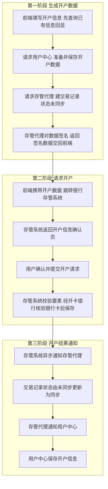

# 开户需求分析：注册收官之后，平台与银行两侧怎么把户开起来

注册功能连同其中的分布式事务问题全部落地，登录链路也已交付，用户终于能走进平台了。但这条链路的终点不是终点：注册与登录只是攒齐了基本信息，真正的资金业务一样都做不了，因为还差开户。动工之前把需求掰开揉碎，是这套课程每个业务块的标准动作，开户横跨平台与银行两个世界，需求阶段想不清楚，写出来的接口一定拧巴。

## 先给结论

- 注册与开户是两码事：注册记录用户名、手机号这类个人信息，开户记录身份证号、银行卡号等资金要素；注册登录完成只能进门浏览，能交易要等开户。
- 银行存管模式决定了开户要开两套账户：平台一套，银行存管系统一套，两侧账户数据必须同步。
- 链路涉及三方系统：银行侧的存管系统（含合并进来的开卡银行，无需开发直接部署）、平台侧的存管代理服务（所有与银行交互的统一出口）、用户中心。
- 开户流程分三阶段：生成开户数据在平台侧完成，请求开户跳转银行侧完成，开户结果靠异步通知回传，状态线「未同步 → 同步」贯穿始终。
- 结果通知走异步是刻意设计：银行侧的处理时机不可控，同步等待不可靠，通知经消息中间件到达后平台侧才更新状态、保存信息。

## 注册与开户的分界

注册做的事很轻：一个手机号、一个验证码，配上系统代为生成的用户编号与用户名，用户中心与统一账户两个库里各落一条记录，用户就有了进门资格。开户做的事重得多：身份证号、本人银行卡号、银行预留手机号这些与资金直接挂钩的要素都要登记，还要经银行侧实名核验。两者的分界可以用一句话划开：注册解决「你是谁」，开户解决「你的钱走哪条通道」。

为什么 P2P 平台非要这道工序？因为平台采用的是银行存管模式，这是当前 P2P 平台最安全的模式：投资人的钱不放平台，统一存放在银行，平台只撮合交易。资金既然在银行那边，银行就必须为每个用户开立个人存管账户，钱从谁的卡进、往谁的卡出，都要银行侧有账可查。于是一个用户天然要开两个账户，平台账户承载业务身份，银行存管账户承载资金，两套数据必须同步，对不上就是事故。

## 系统清单：谁开发、谁对接、谁合并

把开户链路上要打交道的系统数清楚，是需求分析的本分。三方角色各就各位：

- **存管系统**：银行侧系统，部署在银行，不属于平台，专门负责对接平台的账户与交易，平台的交易主要与它交互。它由银行提供，项目里无需开发，课程资料直接提供部署指南与接口说明，开发前先本地部署并熟悉接口。
- **开卡银行**：银行用于管理储蓄卡信息的系统，同样属于银行侧。为了使用方便，本项目把它合并进了存管系统，流程图里不再单独出现，但银行卡核验的职责仍在。
- **存管代理服务**：平台侧的一个微服务，专门与存管系统对接。设立它的目的是解耦：平台各业务服务都不直接碰银行接口，凡是要与银行往来的，一律经存管代理转发，银行侧的报文格式与签名规则被封装在一个点上。

用户中心在平台侧继续承担开户数据的入口职责。整个开户链路的系统关系如下：

```mermaid
flowchart LR
    FE["前端"] -->|"开户请求"| UC["用户中心"]
    UC -->|"准备数据并请求加签"| DA["存管代理服务"]
    DA -->|"签名报文对接"| DS["存管系统"]
    FE -->|"第二阶段整页跳转"| DS
    DS -->|"银行卡核验"| CB["开卡银行 已合并进存管系统"]
    DS -.|"异步通知 开户结果"| DA
```

关键路径在存管代理这一个节点上：平台侧出去的请求只有一条路通向银行，回来异步通知也先落在它这里。银行侧规则再怎么变，改动被压缩在存管代理内部，用户中心等业务服务毫无感知，这正是设立代理服务换来的松耦合。

## 三阶段流程走查

讲义把整个开户业务流程切成三个阶段，每个阶段有明确的参与方与产出，逐段过一遍：



第一阶段全在平台侧。用户中心收到开户请求后准备数据并落库，再让存管代理建一条交易记录，状态标记「未同步」，签名后的开户数据原路交回前端。签名的意义在于银行要确认请求确实来自合作平台且途中未被篡改，这是与银行对接的信任前提。第二阶段的舞台在银行侧：前端带着签名数据整页跳转到存管系统，银行给确认页、收提交、做要素校验，校验过程中还会请求开卡银行核对银行卡信息，无误后保存开户信息。到这一步，银行侧的账户其实已经开立，开户业务本身完成了。

第三阶段是平台侧的收尾闭环。用户看到成功页只是体验层面的结束，平台侧的状态同步依赖银行的异步通知：存管系统通知存管代理，交易记录从未同步翻成同步；存管代理再通知用户中心，用户中心保存开户信息。哪怕用户拿到成功页立刻关掉浏览器，这条通知链也会自己走完，平台侧的开户状态终究是准的。

## 异步通知为什么是标配

银行侧处理开户的时机不受平台控制，网络抖动、业务量波动都会让结果回来的时间飘忽，平台若同步堵着等结果，体验和稳定性双输，异步通知是这类跨机构交互的标准答案。通知到达后的更新动作也刻意排在通知之后：交易记录的状态更新、用户中心的开户信息保存，全部由收到通知触发，没收到通知就不动。为什么这里必须这样设计、通知走什么格式、消息中间件 RocketMQ 在其中承担什么角色，留到具体实现那几课再展开，需求层面记住结论即可：第二阶段结束不等于开户完成，状态翻成同步才算数。

## 下一程的接口清单

需求理清后按惯例拆接口。平台侧两个入口在讲义的接口定义里已经点名：用户中心的 `ConsumerAPI` 新增 `createConsumer`，负责接收前端开户信息、准备基础数据并落库；存管代理的 `DepositoryAgentApi` 新增 `createConsumer`，负责建交易记录与签名。银行侧的「个人绑卡开户」接口由其接口说明文档约定，参数与返回值以文档为准。两个平台侧接口的形状如下：

```java
/** 平台侧开户入口 按讲义接口定义口径整理 包名按 com.study.finance 系改写 */
public interface ConsumerAPI {

    /** 用户中心生成开户数据 准备要素并落库 再调存管代理建记录与签名 */
    RestResponse<ConsumerDTO> createConsumer(ConsumerRequest consumerRequest);
}

public interface DepositoryAgentApi {

    /** 存管代理生成开户请求数据 建交易记录 状态未同步 并对数据签名 */
    RestResponse<DepositoryConsumerResponse> createConsumer(DepositoryConsumerRequest depositoryConsumerRequest);
}
```

交易记录的状态承载，用一个字段就够：

```java
/** 交易记录关键字段示例 按本课口径补全 字段语义与三阶段状态线一致 */
public class DepositoryRecord {
    private String requestNo;    // 开户请求号 一次开户一条记录
    private String userNo;       // 用户编号 关联平台侧用户
    private Integer syncStatus;  // 同步状态 0 未同步 1 同步 银行异步通知到达后才置 1
}
```

下一课起按第一阶段的顺序动工：先用户中心的生成开户数据接口，再存管代理的交易记录与签名，随后打通跳转银行的第二阶段，最后实现异步通知的接收与状态更新。需求里的每一步，到时候都对应一段真实的代码。

## 常见误区

- **把开户当成注册的附属步骤。** 错例：以为注册完就自动开了户，用户登录后直接调投资接口被拒。正解：注册与开户是两个独立业务，开户要用户主动发起、银行侧核验，两条链路分开实现分开测试。
- **只开平台侧账户就算开户。** 错例：用户中心落了一条开户信息就宣布完成。正解：银行存管模式下必须在银行侧开立个人存管账户，两侧数据同步、状态翻成同步后开户才算闭环。
- **在第二阶段等银行同步返回结果。** 错例：平台阻塞等待银行处理完再响应用户。正解：第二阶段以跳转加银行侧处理为界，结果靠第三阶段的异步通知回传，平台侧做的是接收通知与状态落定。
- **忽略「未同步」这个中间状态。** 错例：把交易记录建出来就当作已同步，通知逻辑不做。正解：未同步是事实状态的如实表达，通知到达翻成同步；通知链缺失时这个状态恰好暴露问题，是排查的抓手而不是累赘。

## 面试可能被问到的问题

1. 面试官追问：「注册和开户在数据层面的区别是什么？」
   答：注册只写用户基本信息，用户中心与统一账户两库各一条记录，要素是手机号加系统生成的编号；开户要写身份证号、银行卡号、预留手机号等资金要素，并且银行存管侧要开立个人存管账户。前者管身份，后者管资金通道。
2. 面试官追问：「存管代理服务为什么值得单独拆一个微服务？」
   答：银行侧的报文格式、签名规则、接口变动都收敛到它一个点上，平台各业务服务面向代理的通用接口编程。没有这个代理，每个微服务都得自己实现一套银行对接逻辑，银行一改全部跟着改。单点封装换来的是业务服务与银行侧的松耦合。
3. 面试官追问：「开户为什么让用户跳转到银行页面完成，平台代填不行吗？」
   答：存管账户的开立主体是银行，实名核验与银行卡校验必须发生在银行侧，这既是合规要求也是防篡改手段。平台准备签名后的数据并引导跳转，银行确认页收集确认动作，处理完经异步通知回传结果，平台代填绕不开核验环节。
4. 面试官追问：「签名字段在开户链路里防的是什么？」
   答：防伪造与防篡改。银行验签通过才受理请求，签名能证明数据来自签约平台且传输途中未被修改；验签失败的请求进不了银行业务逻辑。平台侧签名由存管代理统一完成，与它对接银行的职责一致。
5. 面试官追问：「异步通知一直不到，平台侧怎么兜底？」
   答：交易记录停留在未同步状态，用户在平台侧视为未开户，不影响资金安全。工程上靠两条兜底：银行侧对未确认的通知定期重发；平台侧也可按请求号主动向存管代理或银行查询结果，把状态补齐。查询兜底与通知互补，最终一致。
6. 面试官追问：「开卡银行在架构图里为什么不见了？」
   答：它本义是银行管理储蓄卡信息的独立系统，本项目为使用方便把它合并进了存管系统，流程图不再单独画它，但银行卡核验的职责还在，第二阶段校验银行卡信息时背后问的就是它。合并是工程简化，职责没有消失。

## 配套资料

- 讲义：`materials/docs/10/万信金融-第2章-讲义-开户v1.0.md`，3.1 需求分析：开户定义、两个账户与数据同步、存管系统与存管代理服务与开卡银行的系统介绍、三阶段业务流程；3.2 部署银行存管系统：银行侧系统直接提供、按部署指南与接口说明熟悉；3.3.2 接口定义：`ConsumerAPI` 与 `DepositoryAgentApi` 新增 `createConsumer` 的出处。
- 代码：`materials/code/10/wanxinp2p/`，P2P 工程归档（目录保留原始命名，路径列到该层级），用户中心服务骨架可供对照开户接口将落地的位置。
- 说明：`DepositoryRecord` 为按本课口径补全的示例，`DepositoryConsumerRequest` 与 `DepositoryConsumerResponse` 的完整字段以银行存管系统接口说明为准；银行存管系统部署指南与接口说明随课程资料提供，未在 `materials/docs/10/` 单独归档。
