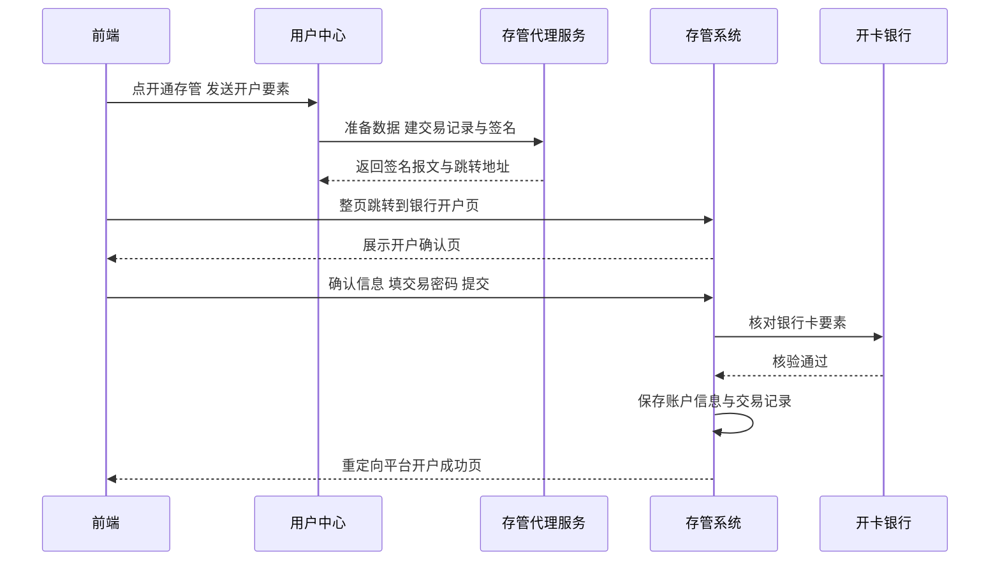

# 开户第二阶段实测：不写一行平台代码，跟用户走完银行侧开户

第一阶段把签名报文交到前端手里之后，按理说该写第二阶段的代码了，摊开任务清单却发现无码可写：第二阶段从跳转到银行确认页，到银行校验要素、保存账户，再到重定向平台的成功页，全程发生在银行存管系统与前端两侧，平台没有一段新增代码。这一课的价值因此换了个方向：把现成的东西组装起来跑通，借全程实测把第一阶段的产出也一并验收，顺带看清「开户成功」四个字到底意味着什么、还差什么。

## 先给结论

- 第二阶段的流程步骤 2.1 到 2.8 全部落在银行存管系统与前端，平台侧唯一的参与方式是第一阶段已经产出的签名数据与跳转地址，无需开发。
- 登录方式可以切换：Apollo 上统一账户服务的短信验证码开关改为 false，登录从验证码模式换成密码模式，密码即手机号，联调节省大量来回。
- 测试数据必须成套：姓名、身份证号、手机号、银行卡号要从存管系统库里的银行用户表与银行卡表按外键关系挑出来，乱填必核验失败。
- 用户点「开通存管」按钮后，第一阶段的 1.1 到 1.8 与第二阶段的跳转在一瞬间连续完成，浏览器地址栏的域名变化是判断「此刻在谁家页面」的最直接依据。
- 成功页只是体验层面的结束，交易记录此刻仍是未同步状态，平台侧的状态同步要等第三阶段的异步通知。

## 为什么这一阶段没有代码要写

把时序图摊开数一数归属。步骤 2.1 是前端带着签名数据跳转到存管系统的开户接口，2.2 是银行返回开户信息确认页，2.3 是用户在银行页面上填写确认并提交，2.4 到 2.7 是银行侧的校验与保存：校验四要素、经开卡银行核对银行卡信息、保存账户信息、保存交易记录，2.8 是处理完成后的重定向，落回 P2P 平台的开户成功页。除 2.8 的落点是平台页面之外，其余动作全部发生在银行侧与前端。

存管系统是银行提供的成品，部署后直接可用；前端工程从项目启动之初就是现成的。平台要做的只有两件事，而这两件都已经在第一阶段完成：把签名数据递给前端，把跳转地址算出来放在报文的 `url` 字段里。所以第二阶段的「实现」就是组装与测试，把启动清单过一遍，代码零新增。

这其实是一个架构信号的具象化：平台与银行是两个只在业务上关联的系统，银行侧的处理过程平台既不参与也看不见，能做的只是送数据上门和等结果回传。第二阶段的零代码恰好演示了这条边界在哪里。

## 测试前的准备：服务、登录模式与测试数据

**启动清单照旧拉满。** Apollo、注册中心、网关、UAA、统一账户服务、用户中心、存管代理服务、银行存管系统、前端工程，全部启动。少第一阶段就没有第二阶段，平台侧这一串服务是跳转能发生的前提。

**登录模式切到密码模式。** 之前每次登录都要先获取短信验证码，测试一个功能就得先把验证码服务拉起来，来回成本太高。Apollo 上统一账户服务有一个短信验证码开关配置，值一直是 true，表示登录必须先获取验证码；改成 false 之后验证码环节直接取消，登录退化为密码模式，密码默认就是用户的手机号。配置改完记得发布才生效。这个开关是为联调效率服务的，上线环境该是 true 还是 true。

**挑用户只挑 C 端。** 统一账户库里既有 C 端用户也有 B 端用户，当前全部业务都发生在 C 端，B 端的服务侧代码根本没接进去，拿 B 端账号测试会得到莫名其妙的失败，代码却没有任何问题。测试数据本身的正确性是联调的前提条件。

**资金要素要从银行侧库里成套挑。** 部署存管系统时执行过一次初始化测试，批量生成了一批银行用户与银行卡数据，落在存管系统库的两张表里。银行用户表存姓名、身份证号、手机号，银行卡表存卡号、所属银行、初始密码，银行卡表以用户 id 作为外键关联到用户表。填进开户页面的身份证、手机号、银行卡号必须从这两张表里按关联关系成套挑，因为银行侧校验的第一步就是拿四要素去查这两张表，查不到或者对不上就是核验失败。查数据的思路长这样（列名按本课口径整理，账号数据为占位）：

```sql
-- 存管系统库 银行用户与银行卡按 user_id 关联 成套挑取测试数据
SELECT u.ID, u.USER_NAME, u.ID_CARD, u.MOBILE,
       c.CARD_NUMBER, c.BANK_NAME, c.CARD_PASSWORD
FROM depository_bank.bank_user u
JOIN depository_bank.bank_card c ON c.USER_ID = u.ID
LIMIT 5;
```

挑中某个用户后，按它的 id 去银行卡表找它名下的卡，卡上带初始密码六个 8，确认页要填的交易密码就是它。

## 走一遍完整链路

准备就绪，从登录开始走全程。浏览器打开前端，用挑好的 C 端手机号加密码登录，进入个人中心，点「开通存管」按钮。从这一刻起，第一阶段的所有步骤连成一气：前端发开户请求到用户中心，用户中心补齐数据落库，远程调用存管代理建未同步的交易记录并拿到签名报文，前端拿到报文里的 `url` 立即发起整页跳转。这些动作在毫秒级完成，用户感受到的只是一次页面切换。



确认页出现时有一个值得留意的细节：地址栏已经不是平台前端的域名，页面样式与内容都出自存管系统，这是「此刻人在银行侧」的最直接证据，也印证了跳转确实把用户交到了银行手上。确认页里的要素就是第一阶段 1.1 时填写的那份信息，银行只是回显出来让用户再确认一遍，另需填一个交易密码，勾选协议后点确认。

提交之后，银行侧做三件事：核验要素、保存账户、保存交易记录，这些全是银行内部的业务，平台看不见也不用管。处理完成，银行重定向回平台的开户成功页，地址栏切回平台前端域名，页面上写着开户成功。从点按钮到看到成功页，一条龙走完，前后端的集成测试连同第一阶段一起验收完毕。

## 数据核对与第三阶段的悬念

**两处落库点与第一阶段测试时相同。** 用户中心库 `p2p_consumer` 的 `consumer` 表里，测试用户的真实姓名、身份证、银行卡信息被补齐，`user_no` 写入；存管代理库 `p2p_depository_agent` 的 `depository_record` 表里躺着一条本次开户的交易记录，`object_id` 关联用户 id，`request_status` 仍是 0，未同步。两条查询摆出证据：

```sql
-- 用户中心侧 用户要素与开户标志的当前状态
SELECT ID, USERNAME, MOBILE, USER_NO, IS_BIND_CARD
FROM p2p_consumer.consumer
WHERE MOBILE = '13800000001';

-- 存管代理侧 本次开户的交易记录仍停在未同步
SELECT REQUEST_NO, OBJECT_TYPE, OBJECT_ID, REQUEST_STATUS
FROM p2p_depository_agent.depository_record
ORDER BY CREATE_DATE DESC
LIMIT 1;
```

**成功页没有终结业务。** 银行那边账户确实开出来了，但平台侧对这件事还一无所知：交易记录未同步，用户中心的开户状态没动。浏览器关掉，用户看到成功页的记忆不会给平台留下任何痕迹，两侧的数据此刻是脱节的。把两侧重新接起来的机制，就是第三阶段的异步通知。还有一个幕后细节值得交代：为了让第二阶段能演示出成功页，银行存管系统里两处处理完业务后发送通知的代码在部署阶段被注释掉了，第三阶段实现时要把它们恢复，否则通知永远不会发出。成功页与数据同步是两件独立的事，这正是三阶段设计的动机所在。

## 常见误区

- **以为第二阶段要写一堆对接代码。** 错例：在平台侧模拟银行确认页、自己造接口收提交。正解：第二阶段的舞台在银行侧，平台只负责第一阶段的签名数据与跳转地址，对接的载体就是浏览器跳转本身。
- **测试要素随手编。** 错例：身份证、银行卡号乱填，只在第一阶段测试没问题，到银行确认页提交必报核验失败。正解：要素从存管系统库的银行用户表与银行卡表按外键成套挑取，四要素一体使用。
- **拿 B 端用户测 C 端业务。** 错例：登录时随手挑了个 B 端账号，链路莫名失败还怀疑代码。正解：当前业务全在 C 端，测试用户必须挑 C 端账号。
- **把成功页当成开户完成。** 错例：看到重定向成功页就宣布功能闭环。正解：成功页是银行侧完成的信号，平台侧状态仍停留在未同步，等第三阶段异步通知到达、状态翻成同步才算闭环。

## 面试可能被问到的问题

1. 面试官追问：「第二阶段平台侧为什么可以零代码？」
   答：开户的开立主体是银行，确认页、要素核验、账户保存全部发生在银行侧，平台对外的接口职责只有交付签名数据与跳转地址，这两件在第一阶段已经完成。浏览器整页跳转就是对银行接口的调用，平台无需代理转发。
2. 面试官追问：「四要素为什么要成套准备？」
   答：银行侧核验时按姓名、身份证号、手机号、银行卡号组合查询银行用户与银行卡两张关联表，任何一项与库内数据对不上都通不过。成套准备模拟的是真实用户本人的信息组合，乱填的数据等价于一个不存在的人。
3. 面试官追问：「怎么判断用户此刻操作的是谁的页面？」
   答：看浏览器地址栏的域名与路径。第二阶段确认页由存管系统返回，地址属于银行侧；重定向成功页回到平台前端域名。整页跳转意味着请求的控制权也随之移交，这与站内路由切换有本质区别。
4. 面试官追问：「登录配置里的验证码开关，工程上该怎么看这类开关？」
   答：它把联调成本从环境里剥离出来：测试不必每次都启动验证码服务，登录环节退化成密码模式，链路其余部分不受影响。这类开关属于环境适配配置，测试环境关、生产环境开，改完必须发布并重启客户端才生效。
5. 面试官追问：「用户看到成功页后立刻关掉浏览器，开户结果会丢吗？」
   答：银行侧账户已经开立，结果不会丢；丢的只是平台侧的同步时机。平台依赖的是第三阶段的异步通知，通知链与用户的浏览器完全无关，关掉页面不影响银行回调存管代理、更新交易记录状态、通知用户中心这串动作。

## 配套资料

- 讲义：`materials/docs/10/万信金融-第2章-讲义-开户v1.0.md`，3.4 第二阶段：请求开户，明确该阶段涉及前端与银行存管系统、均无需平台开发、直接进行测试的结论。
- 代码：`materials/code/10/wanxinp2p_front/`，P2P 前端工程归档（目录保留原始命名），内含存管静态页面目录，开户表单与跳转的页面载体；`materials/code/10/wanxinp2p/`，P2P 平台工程归档（目录保留原始命名，路径列到该层级）。
- 说明：存管系统库的银行用户表与银行卡表结构以存管系统部署资料为准，正文 SQL 列名按本课口径整理、账号数据为占位；短信验证码开关的配置键以 Apollo 上统一账户服务实际配置为准，正文按行为描述。
