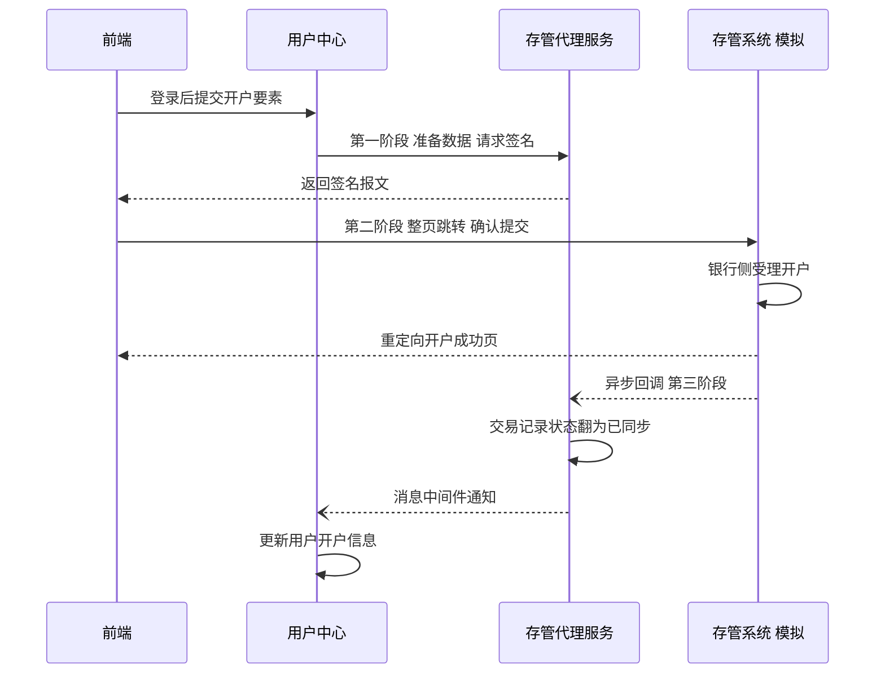

# 开户第三阶段功能测试：一次端到端联调，把异步通知的闭环走通

第三阶段的代码已经写完：存管代理接收银行回调、交易记录状态从未同步翻成已同步、再经消息中间件通知用户中心更新开户信息。代码齐了不等于功能对了，这条链路横跨存管系统（模拟）、消息中间件、两个平台微服务与前端，任何一个环节断了，开户状态就悬在半空。这一课把整条链路从登录走到验证，顺带解决一个配置注入引发的启动故障。

## 先给结论

- 第三阶段无法单独测试，必须从第一阶段开始把开户流程整条走完，通知才会真实发生。
- 测试前要解开存管端两行被注释的消息发送代码，前两个阶段不依赖 MQ，注释是为了不干扰，现在必须放开。
- 用户中心启动报「消费者组为空」，根因是在构造方法里读取 `@Value` 注入的字段，对象还没创建完注入根本没发生，改成构造器注入解决。
- 验收看三处：用户中心控制台的消息体、消息中间件控制台的主题与消息详情、数据库里状态字段是否翻转。
- 状态翻成已同步、用户绑定标记置 1，开户业务全链路收官。

## 测试前的三件准备工作

第一件事在存管系统（模拟）的代码里。它是银行侧的现成系统，正常情况下一行不用改，但它的业务处理完会向存管代理发消息，做这一步的是业务服务里两行发送代码：处理成功发一条，处理失败发一条。课程资料交付时这两行被注释着，因为前两个阶段的测试不涉及消息中间件，留着会在环境缺失时干扰测试。现在测的就是通知链路，注释必须解开。

第二件事是环境。消息中间件的 NameServer 与 Broker、它的管理控制台、Apollo、存管系统（模拟）、平台侧全部微服务、前端工程，一个都不能少，启动清单比前两个阶段长了一截。注册中心、网关、用户中心 53050、存管代理 53070、存管端 55010 各就各位。

第三件事是测试数据。以前的测试可能把账号状态搅乱了，重复测试容易踩到脏数据，课程提供了初始化脚本，重建五个新用户与配套账号，手机号即用户名，密码为手机号的加密密文，字段值以占位示意：

```sql
-- 用户中心库 造五个未开户用户
USE finance_consumer;
INSERT INTO `consumer` (`ID`, `USERNAME`, `MOBILE`, `IS_BIND_CARD`) VALUES
('C001', '13800000001', '13800000001', 0),
('C002', '13800000002', '13800000002', 0),
('C003', '13800000003', '13800000003', 0);

-- 统一账户库 配套账号 密码存密文
USE finance_account;
INSERT INTO `account` (`ID`, `USERNAME`, `MOBILE`, `PASSWORD`, `DOMAIN`) VALUES
('C001', '13800000001', '13800000001', '<手机号对应的密码密文>', 'c'),
('C002', '13800000002', '13800000002', '<手机号对应的密码密文>', 'c'),
('C003', '13800000003', '13800000003', '<手机号对应的密码密文>', 'c');
```

脚本里的手机号列既是用户名也是登录密码原文的来源，实际执行以课程脚本提供的真实占位数据为准。

## 启动就报错：构造方法里的 `@Value`

用户中心一启动就抛异常，异常链指向 MQ 消费者初始化：`MQClientException: the specified group is blank`，指定的消费者组为空。组名来自配置，代码里用 `@Value` 声明在字段上，看起来天经地义。在构造方法里加断点重启，真相出来了：断点停下时，那两个字段全是 `null`。

原理在 Spring 的注入时序里。`@Value` 属于字段注入，发生在对象实例化之后、由容器通过反射回填字段值；而构造方法在实例化那一刻执行。构造方法里去读这些字段，等于在容器还没来得及注入时就消费它们，拿到的自然是空值。之前在短信验证码服务里同样用 `@Value` 却没出过事，区别在于用这些字段的代码写在普通方法里，调用发生时对象早已装配完毕。

改造方式是把值挪到构造参数上：

```java
/** 用户中心的 MQ 通知消费者 节选 包名按 com.study.finance 系改写 */
@Component
public class GatewayNotifyConsumer {

    private final DefaultMQPushConsumer defaultMQPushConsumer;

    /** 构造器注入 Apollo 配置项作为构造参数 进入方法体前值已就位 */
    public GatewayNotifyConsumer(
            @Value("${rocketmq.consumer.group}") String consumerGroup,
            @Value("${rocketmq.name-server}") String nameServer) throws MQClientException {
        defaultMQPushConsumer = new DefaultMQPushConsumer(consumerGroup);
        defaultMQPushConsumer.setNamesrvAddr(nameServer);
        defaultMQPushConsumer.subscribe("TP_GATEWAY_NOTIFY_AGENT", "*");
        defaultMQPushConsumer.registerMessageListener((MessageListenerConcurrently) (msgs, context) -> {
            for (MessageExt msg : msgs) {
                String body = new String(msg.getBody(), StandardCharsets.UTF_8);
                if ("PERSONAL_REGISTER".equals(msg.getTags())) {
                    consumerService.modifyResult(body);
                }
            }
            return ConsumeConcurrentlyStatus.CONSUME_SUCCESS;
        });
        defaultMQPushConsumer.start();
    }
}
```

两个参数照旧映射 Apollo 上的 `rocketmq.consumer.group` 与 `rocketmq.name-server`，但参数注入发生在构造调用前，方法体拿到的必然是配置值。订阅的主题、标签匹配、回调里调用用户中心业务更新结果，这些逻辑一行没动。重启用户中心，启动干净通过。这是字段注入与构造器注入差异的一次实战展示：依赖在构造期就要用，就必须构造器注入。

## 从登录到成功页：把三阶段连起来走

测试入口在登录之后。用一个新脚本账号登录，进「开通存管」入口，第一阶段表单要求填真实姓名、身份证号、手机号、银行卡号。这些要素不能随手编，得用存管系统（模拟）库里已有的数据：从银行用户表挑一个人取姓名、身份证号、手机号，再按他的用户编号去银行卡表取卡号，保证银行侧要素校验能通过。提交后走完第一阶段的准备与签名，前端随即整页跳转到存管系统页面，填支付密码确认，银行侧受理开户，处理完重定向到开户成功页。这张图在讲从提交到验证的完整时序：



关键路径是成功页之后那两条虚线：浏览器看到的成功页只代表银行侧受理完成，平台侧的状态流转靠回调与消息再走两跳，测试真正要盯的正是这两跳。

## 三个观察点收口验证

用户中心控制台是第一手证据。收到的消息体被打印出来，内容里有交易状态为成功、本次开户的请求流水号、银行侧标识与 `PERSONAL_REGISTER` 标签，与提交时的数据能一一对上，说明消费者确实收到并处理了通知。

消息中间件控制台是第二重证据。主题列表里能看到存管代理发往用户中心所用的主题，银行内部的主题不必理会；消费者列表里用户中心的消费组在线；点开最新一条消息详情，Topic、Tag 与消息体和用户中心打印的完全一致，发送端、存储、消费端三方闭环。

数据库是最终裁决。用户中心库里该用户的绑卡标记由 0 翻成 1，存管代理库里对应交易记录状态由未同步翻为已同步。三处证据齐了，第三阶段功能测试通过，整个开户业务至此开发完毕、测试收官。

## 常见误区

- **想跳过前两个阶段单独触发第三阶段。** 错例：直接调用户中心的结果更新接口冒充通知。正解：通知由银行侧真实回调触发，只有完整走完开户流程才会发生，单独构造的消息只能验证消费逻辑，验证不了链路。
- **忘了放开存管端的消息发送代码。** 错例：环境全起了，流程走完，通知却永远不来。正解：测试前核对存管端两行发送代码的注释已解开，这是本课刻意埋的开关。
- **在构造方法里使用 `@Value` 字段。** 错例：消费者组配置写进字段，构造方法里直接 new 消费者。正解：改为构造器注入，或者把初始化挪到 `@PostConstruct` 等生命周期回调里，保证使用时值已就位。
- **拿旧账号反复测。** 错例：用户早已开户，重复申请直接被「用户已开户」拦下，看不出新代码效果。正解：每轮测试用脚本重建的干净账号，状态从零开始。

## 面试可能被问到的问题

1. 面试官追问：「开户第二阶段银行已经受理成功了，为什么还需要第三阶段？」
   答：银行侧处理时机不受平台控制，可能很快也可能很慢，用户还可能在跳转成功页前断网。同步等待体验差也不可靠，所以银行受理后通过异步回调把结果交给存管代理，再经消息中间件通知用户中心落状态，保证平台侧数据最终一致，用户不用陪跑。
2. 面试官追问：「为什么通知到存管代理后，还要经消息中间件转发给用户中心，而不是直接调用？」
   答：存管代理只负责与银行对接，不该知道哪些业务服务关心这笔开户；用户中心消费自己订阅的主题即可，两边解耦。消息中间件还提供堆积与重试能力，用户中心短不可用消息不丢，比同步调用更抗抖动。
3. 面试官追问：「`@Value` 在构造方法里拿不到值的根因是什么？」
   答：字段注入发生在对象实例化之后，由容器反射回填；构造方法在实例化时执行，那时字段还没被赋值。要么把依赖挪到构造参数上做构造器注入，要么把使用时机推迟到 `@PostConstruct` 或普通业务方法，容器装配完成后再执行。
4. 面试官追问：「这样的端到端测试要起十来个组件，成本很高，工程上怎么降？」
   答：分层替换。日常用测试替身或嵌入式中间件验证单服务逻辑；集成环境才起全量组件，且按依赖顺序冒烟：注册中心、配置中心先稳，再起业务服务；用可重置的测试数据脚本保证每轮从干净状态开始，减少重复排障成本。
5. 面试官追问：「消费开户结果消息时要注意什么，重复消费会怎样？」
   答：更新逻辑要做成幂等，以请求流水号为业务键，状态已同步就跳过重复更新；消息中间件本身有重试机制，消费失败会重投，幂等才能保证重投无害。同时把消息体里的关键字段与库里记录核对，状态对不上时留痕排查。

## 配套资料

- 讲义：`materials/docs/10/万信金融-第2章-讲义-开户v1.0.md`，3.3 开户第三阶段与功能测试相关小节；测试账号初始化脚本随课程资料提供。
- 代码：`materials/code/10/wanxinp2p/`，P2P 工程归档（目录保留原始命名，路径只列到该层级），用户中心工程结构可对照 MQ 通知消费者所在位置，存管端工程与消息中间件安装包随课程资料单独提供。
- 说明：测试数据脚本中的手机号与密码密文以占位符示意，实际值以课程脚本为准；`GatewayNotifyConsumer` 为按本课实现口径整理的节选，消息体字段以接口说明与运行输出为准；消息中间件环境细节此处做泛化描述，不展开具体部署参数。
