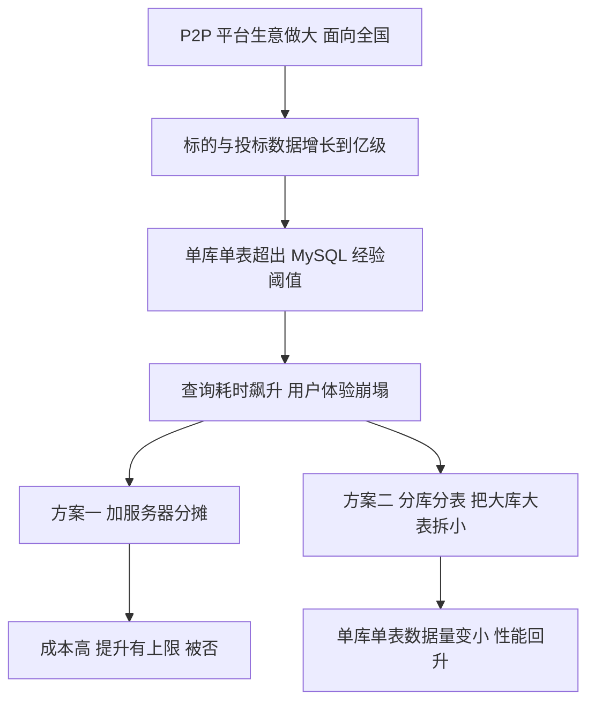

# 分库分表的原因：生意做大了，单库单表撑不住亿级数据

发标的需求分析与接口骨架都已就位，按理说该动手写实现了，这一课却按下暂停键，先回答一个更前面的问题：交易中心的数据将来会长到什么量级，现在的库表结构扛不扛得住。答案是不扛，所以在写第一行业务代码之前，得先把「为什么要分库分表」想透，后面的技术选型才有依据。

## 先给结论

- P2P 平台生意做大了，标的信息、投标信息这些交易数据会涨到亿级，随之而来的是查询等两分钟这种用户直接流失的体验灾难。
- 规律很朴素：数据量越大，数据库操作花的时间越长，一张千万行的表和一张万行的表做增删改查，耗时差距会非常明显。
- 以 MySQL 为例的经验阈值：单库数据量最好控制在 5000 万以内，单表最好不超过 1000 万，超过之后性能明显下降，严重时会卡死甚至拖垮整个系统。
- 加服务器堆硬件能缓解，但成本高且提升有上限；推荐方案是分库分表，把大库大表按某种策略拆小，改造可控，几乎不增加硬件成本。
- 分库分表的本质：让单个库、单张表的数据量变小，从而减小数据库负担、提高效率、缩短查询时间。

## 一个能看见的灾难现场

设想这个 P2P 平台生意火爆，面向全国，跻身行业前三。借款人不断发标，投资人不断投标，标的与投标产生的数据量成几何级增长，涨到一亿这个级别并不夸张，头部电商平台的数据量早就在这个量级上运转了很多年。平台自己存的数据里，标的信息表、投标信息表都很容易冲到这个规模。

麻烦在用户体验这一头。投资人投资前要浏览标的：平台上有多少借款人发了什么标，利率多少、期限多长，看中哪个再决定出借。当数据量涨到亿级，点一次查询等两分钟才出结果，投资人不会陪着平台等，卷着钱就去别的平台了，查个列表等两分钟，这个平台等于被判了死刑。

原因不需要高深的理论：数据量越大，对这个库、这张表做的增删改查耗时越长。一千行的表和一亿行的表，同样的 `SELECT`、同样的索引查找，B+ 树的高度、扫描与回表的数据页数量完全不在一个级别上。所以只要数据会涨，这个问题就必然出现，区别只是早一天晚一天。

## MySQL 的两条经验红线

以本课使用的 MySQL 为例，行业里沉淀出两条经验阈值。单库层面，一个数据库的总数据量最好控制在 5000 万以内，超过之后性能会明显下降。单表层面，一张表的数据量最好不要超过 1000 万，再往上性能同样下降得厉害，操作耗时明显变长，极端情况下会卡死、把整个系统拖垮。

交易中心恰好是这两条红线最容易被踩穿的地方。发标进入交易阶段后，标的信息表、投标信息表都是随业务持续膨胀的大表，功能开发出来时也许一切正常，等数据量爬过阈值，同样的代码同样的 SQL，表现会断崖式下滑。性能瓶颈必须在动手实现业务之前就纳入设计，而不是等上线后救火。

## 两条备选路线，一条被成本否掉

问题出在单库单表数据量太大，最直接的思路就是减少单库单表中的数据量。但生意不能不做，数据也不能不存，于是有两种可行路线。

**第一种，加服务器。** 原来一台服务器上一个数据库，一亿行数据压在一个库里；现在买十台服务器，每台装一个数据库，一亿行分摊下去，每个库每个表的数据量立刻降下来了。这条路线技术上完全成立，问题在成本：服务器很贵，买回来还要持续维护，为分摊数据量十倍扩容硬件，这笔钱花不起也不该花。何况硬件提升本身有上限，瓶颈若在 MySQL 自身，堆硬件也堆不上去。方案先按下不表。

**第二种，拆。** 一块蛋糕太大，切成十块，每块就小了。把一个太大的数据库拆成若干个小库，把一张太大的表拆成若干张小表，数据分散存储之后，单库单表的数据量同步变小，数据库的负担、查询耗时跟着下降。这就是分库分表：把较大的数据库和数据表按照某种策略进行拆分，目的是降低每个库每张表的数据量，减小数据库的负担，提高数据库的效率，缩短查询时间。

这条路线还有两个隐藏的优点。成本上，它几乎不需要新增硬件，还是原来那台服务器，只是把库拆了、表拆了。风险上，这种改造是可控的，底层依然是 RDBMS，整个数据库的运维体系以及相关基础设施都原样可用，不存在换存储引擎、换技术栈那种伤筋动骨的迁移。

这张图把问题与对策串成一条线：



关键分叉在 E 与 G：同样是为「让单个库表变小」服务，加服务器花的是硬件钱，分库分表花的是设计与改造的工夫，后者才是性价比与可控性兼得的路线。

## 拆之前先立好靶子

用一个查询把问题钉住。投资人浏览标的列表，在亿级单表上走这样的语句：

```sql
-- 示例：按本课场景补写 亿级单表的列表查询
SELECT id, name, amount, annual_rate, period
FROM project
WHERE project_status = 'COLLECTING'
ORDER BY create_date DESC
LIMIT 0, 20;
```

表越大，这条语句在过滤、排序、取页上的开销越大，这就是等两分钟的来源。分库分表之后，同样这份数据被拆到多个库多张表里，单表只剩下一部分行：

```text
拆分前  单库 finance_transaction 单表 project  一亿行
拆分后  多个库 每库若干张表      单表千万行以内 查询耗时可控
```

怎么拆、按什么键拆、拆成几张，是接下来几课的主题；本课先把这个「为什么要拆」的决策依据立住：阈值红线摆在那里，数据增长摆在那里，方案比较摆在那里，分库分表是进入交易阶段后的第一道架构决策。

## 常见误区

- **把分库分表当成越早越好的银弹。** 错例：数据量还小就急着把所有表都拆了。正解：分库分表会引入跨库查询、分布式事务等新问题，等数据量与访问压力真正逼近阈值时再拆，决策依据就是本课的两条经验红线。
- **以为加机器可以无脑替代拆分。** 错例：性能不够就加服务器，永不考虑表结构。正解：硬件提升有上限，成本随数据量线性增长，而分库分表改造可控、复用现有运维体系，两者通常组合使用，但不能指望硬件单线救场。
- **只盯着查询慢，忽略写入与维护成本。** 错例：以为大表只是查询慢。正解：增删改、索引维护、锁竞争都随数据量恶化，亿级表上的每一次写都要付出更高的 B+ 树维护代价。
- **以为拆分就是简单把表复制几份。** 错例：把同一张表完整复制到多个库当成分库分表。正解：拆分是把一份数据按策略分散存储，每个库每张表只持有其中一部分，总数据量不变而单点变小。

## 面试可能被问到的问题

1. 面试官追问：「什么情况下需要考虑分库分表？」
   答：核心依据是数据量与访问压力逼近数据库阈值。以 MySQL 为例，经验上单库数据量控制在 5000 万以内、单表控制在 1000 万以内，超过后性能明显下降；标的、订单、流水这类持续增长的交易型大表，在设计阶段就要预留拆分方案。
2. 面试官追问：「为什么不直接升级硬件，而要拆库拆表？」
   答：升级硬件成本高，且提升有上限，瓶颈在数据库自身时堆硬件收益很小。分库分表让单库单表数据量变小，从数据规模上解决问题，底层仍是关系型数据库，运维体系和基础设施原样可用，改造可控，综合成本远低于无限扩容硬件。
3. 面试官追问：「分库分表能带来哪些收益？」
   答：单库单表数据量变小，减小数据库负担，提高效率，缩短查询时间；减少 IO 争抢与锁表几率；突破单机存储容量、连接数、处理能力的瓶颈，让系统在数据持续增长下保持可用。
4. 面试官追问：「数据量大会怎样拖慢一条 SQL？」
   答：表越大，索引树越高，一次查询要访问的数据页越多，扫描与排序的开销越大；同时热点表的写操作互相争锁，锁表几率上升。同样是取前 20 条，万级表可能毫秒级返回，亿级表在不拆分、缺索引时可能拖到分钟级。
5. 面试官追问：「业务量增长后，除了分库分表还有哪些过渡手段？」
   答：先做性价比高的：加缓存挡住热点读，读写分离把查询分流到从库，优化索引与 SQL，必要时归档历史数据。这些手段能把阈值到来的时间推迟很久，数据量极大且持续增长时，再上分库分表才是合理节奏。

## 配套资料

- 讲义：`materials/docs/10/Sharding-jdbc专题-v1.0.md`，1.1 分库分表是什么：性能瓶颈分析与两种方案；1.2 分库分表的方式开篇：拆分目的与改造可控性。
- 讲义：`materials/docs/10/万信金融-第3章-讲义-发标v1.0.md`，第 2 节分库分表（指向分库分表专题资料）。
- 代码：`materials/code/10/基础代码/基础代码/dbsharding/`，分库分表演示工程归档（目录保留原始命名，路径只列到该层级）。
- 说明：SQL 与数据量对照为按本课场景补写的示例，非课程源码；MySQL 经验阈值口径以本课讲解为准。
