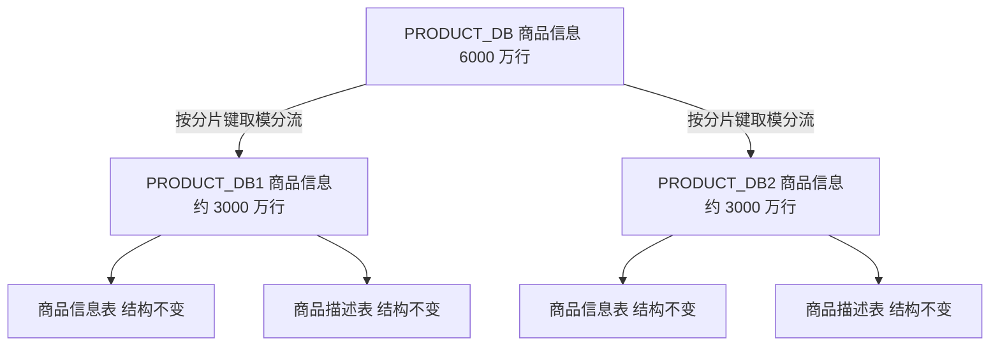
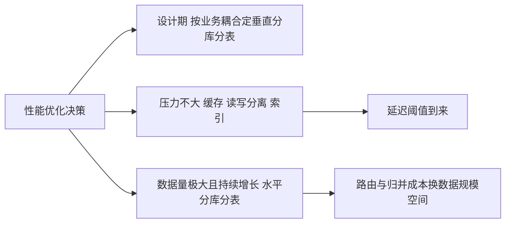

# 水平分库分表：按行把数据切小，路由规则是灵魂

垂直拆分把宽表削瘦、把业务归库，但行数这道坎还在原地：不管字段怎么切、表怎么归库，单张表的行数照样能涨到千万上亿。水平拆分换一种刀法，直接对表里的数据行下手，这一课把水平分库与水平分表两种拆法讲清，并给出整张拆分决策地图的收口。

## 先给结论

- 水平拆分拆的是表里的数据（行）：把一个表的数据按一定规则拆分到不同库或不同表，每片的表结构完全一致。
- 水平分库把同一表的数据按规则拆到不同的数据库，每个库可以放在不同服务器上；水平分表在同一个数据库内把数据拆到多个表里，它是水平分库的一个补充优化。
- 拆分效果最直接：一个 6000 万行的大表按奇偶一拆，两个目标各剩约 3000 万行，单库大数据、高并发的瓶颈随之缓解。
- 拆分的钥匙是分片键与路由规则，常用形态是按分片键取模：分片键是奇数落一边、偶数落另一边。
- 代价同样明确：原本一表一库的数据散到多库多表后，查询要先定位再合并，系统复杂度大大增加。
- 选型收口：设计阶段按业务耦合度定垂直拆分；数据量与压力不大时优先缓存、读写分离、索引；数据量极大且持续增长，才上水平分库分表。

## 水平拆分拆的是什么

垂直拆分不够彻底。垂直分表把字段分摊到多个表，但每个表的行数还可以无限增长；垂直分库把表归到不同业务库，单库内的行数压力依旧。要真正把单表数据量压下来，必须对行动刀。水平拆分说白了就是拆表里的数据：一张表有一千万行，把前五百万行放到一个库一张表，把后五百万行放到另一个库另一张表，两边的表结构一模一样，只是各持一半的行。

拆行需要规则，最常用的规则是对分片键取模。以商品数据为例，取商品 ID 作分片键，看它的奇偶：ID 对 2 取模余 0 的行落一个库，余 1 的落另一个库。这种「按 ID 奇偶分流」的思路在后面的入门案例与项目落地里反复出现，是理解分片路由的最小样本。

## 水平分库：一个表的数据住进两个库

看场景。一个商品库 `PRODUCT_DB` 里放着商品信息表与商品描述表，假设两张表的数据量都涨到了几千万行，单库已经扛不住，而业务上已无法再垂直切分。此时按分片键的奇偶把数据拆进两个库：`PRODUCT_DB1` 与 `PRODUCT_DB2`，每个库里的表结构完全一样。操作某条数据前，先按它的分片键算一下该去哪个库，访问库的表达式形如 `product_db_$->{分片键 % 2 + 1}`。这张图在讲数据如何按奇偶分流进两个库：



定义成形：水平分库是把同一个表的数据按一定规则拆到不同的数据库中，每个库可以放在不同的服务器上。带来的提升非常直观：解决了单库大数据、高并发的性能瓶颈，原库 6000 万行一拆，两边各剩约 3000 万，提高了系统的稳定性与可用性。

代价必须同步记下。原本一个表的数据现在散在两个数据库，查询时数据可能在这边也可能在那边，怎么查成了一个新问题；路由规则、结果合并、跨库事务都接踵而至。水平拆分会大大增加系统的复杂度，这些复杂度不是靠一句「拆」就能消掉的，后面有专门的一课拆解它们。

## 水平分表：同样的刀法落在同一个库

有水平分库自然有水平分表。两者拆的都是行，差别只在数据往哪儿放：水平分库把数据拆到不同的数据库里，水平分表不分库，把拆出来的数据存到当前这个库的另外几张表里。库里原有一张商品信息表，按商品 ID 奇偶拆成商品信息一与商品信息二，自始至终还是一个库；商品描述表同样拆成两张。6000 万行的商品信息表拆完，两张表各约 3000 万行。

```sql
-- 水平分表示意 同库内按分片键奇偶落表 示例按本课场景补写
-- 逻辑表 product_info 由真实表 product_info_1 与 product_info_2 组成
INSERT INTO product_info(id, name, price, stock, status)
VALUES (246, '示例商品', 199.00, 100, 1);
-- 分片键 246 为偶数 实际落 product_info_1

INSERT INTO product_info(id, name, price, stock, status)
VALUES (357, '示例商品', 299.00, 80, 1);
-- 分片键 357 为奇数 实际落 product_info_2
```

定义：水平分表是在同一个数据库内，把同一个表的数据按一定规则拆到多个表中。它带来的提升与分库一脉相承：解决单一表数据量过大产生的性能问题，避免 IO 争抢并减少锁表几率；分出来的小表只含一部分数据，检索性能随之提高。区别于分库的地方在力度：它不新增服务器，仅在库内腾挪，因此通常作为水平分库的一个补充优化，而不是独立的主力方案。

查询侧的变化也一目了然。以前一条 `SELECT ... FROM 商品信息` 一把查完，现在同一份数据散在多张表，不带分片键的查询要所有真实表一起出力，再由中间层把结果归并，复杂度与分库同源，同样要靠后续的工具链来消化。

```sql
-- 不带分片键的查询 示例按本课场景补写
SELECT id, name, price, stock
FROM product_info
WHERE status = 1;

-- 同一条逻辑 SQL 被改写成对所有真实表的广播
SELECT id, name, price, stock FROM product_info_1 WHERE status = 1;
SELECT id, name, price, stock FROM product_info_2 WHERE status = 1;
```

## 决策收口：什么时候用哪种拆法

四种方式摆在面前，工程上怎么取舍，有一段值得背下来的决策顺序。系统设计阶段就应根据业务的耦合程度，确定要不要垂直分库、要不要垂直分表，让业务边界先立起来。在数据量与访问压力不是特别大的情况下，优先考虑缓存、读写分离、索引这些性价比更高的技术方案。若数据量极大且持续增长，才进入水平分库分表的节奏，因为它产生的效果最直接：一个表 6000 万行，拆成三份每份只剩 2000 万。



分库分表不是讲了就必须用，拆与不拆要看项目情况与业务发展速度，这是本课最想留在记忆里的一段。

## 常见误区

- **把水平拆分当成改表结构。** 错例：以为水平分表要给每张表设计不同的列。正解：水平拆的是行，所有分片的表结构与逻辑表完全一致，变的只是数据分布。
- **只记收益，忘掉路由成本。** 错例：拆完就觉得万事大吉，业务代码照旧写。正解：数据散到多库多表后，查询要按分片键路由、结果要归并，不带分片键的查询会扩大扫描面，系统复杂度显著上升，必须配套分片中间件与规范。
- **分片键随手挑。** 错例：拿一个业务上毫无定位意义的字段做分片键，导致常用查询全部路由失效。正解：分片键要选最高频查询条件所依赖的字段，让绝大多数 SQL 能一次命中单片。
- **一有性能压力就上水平拆分。** 错例：数据量百万级就急着分库分表。正解：先垂直拆分理清业务，再用缓存、读写分离、索引扛压力，数据量极大且持续增长时才动水平拆分。

## 面试可能被问到的问题

1. 面试官追问：「水平分库和水平分表的区别是什么？」
   答：两者都按行拆数据，差别在落点。水平分库把同一个表的数据按规则拆到不同的数据库，每个库可放在不同服务器，解决单库大数据与高并发瓶颈；水平分表在同一个数据库内把数据拆到多个表，不新增机器，解决单表数据量过大问题，通常作为水平分库的补充优化。
2. 面试官追问：「水平拆分的路由规则怎么设计？」
   答：核心是选定分片键并对它施加确定性算法，最常见的是取模：如按商品 ID 奇偶分流到两个库或两张表，访问目标可用行表达式 `product_db_$->{id % 2 + 1}` 这类形式表达。规则必须保证同一条数据永远算出同一个落点，且与高频查询条件匹配。
3. 面试官追问：「水平拆分 6000 万行的表，效果与代价分别是什么？」
   答：效果最直接，按奇偶一拆两边各约 3000 万行，单表数据量过大的性能问题、IO 争抢与锁表几率都明显缓解，系统稳定性与可用性提高。代价是数据散到多库多表后，查询需要路由与结果合并，跨库事务、主键唯一性等新问题出现，系统复杂度大大增加。
4. 面试官追问：「分库分表四种方式的整体选型顺序是什么？」
   答：设计阶段根据业务耦合程度先定垂直分库、垂直分表，把业务边界立好；数据量与压力不大时优先缓存、读写分离、索引等方案；数据量极大且持续增长时再上水平分库分表。拆分不是默认选项，要结合项目情况与业务发展速度决定。
5. 面试官追问：「不带分片键的查询在水平拆分后会发生什么？」
   答：无法按规则定位到单片，只能广播到所有分片执行，把每个真实表的结果取回后归并，扫描面与耗时随分片数量线性放大。所以业务查询要尽量携带分片键，确需全局查询的场景要靠索引表、冗余字段或专门的检索服务兜底。

## 配套资料

- 讲义：`materials/docs/10/Sharding-jdbc专题-v1.0.md`，1.2.3 水平分库：拆分案例、提升与复杂度；1.2.4 水平分表：定义与定位；1.2.5 小结：四种方式对比与选型顺序。
- 代码：`materials/code/10/基础代码/基础代码/dbsharding/`，分库分表演示工程归档（目录保留原始命名，路径只列到该层级），商品信息表按分片键奇偶落库落表可在演示工程中对照。
- 说明：`INSERT` 路由示意与行表达式为按本课写法补全的示例，非课程工程源码；库表命名沿用画面线示例口径。
