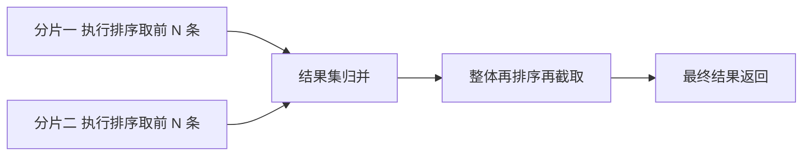

# 分库分表带来的问题：性能的账好算，一致性与查询的账难算

拆分路线定下来，性能的收益看得见，但凡事都有两面性。分库分表有效缓解了单机单库的性能瓶颈与压力，突破了网络 IO、硬件资源、连接数的限制，代价是数据从「一个库里的一张表」变成「散落在多个库甚至多台服务器上」，一系列原本一句 SQL 就能搞定的事情，现在都成了新问题。这一课把最常见的四类问题过一遍，并交代它们最终的出路。

## 先给结论

- 事务一致性：数据分布在不同库甚至不同服务器，本地事务罩不住，升级为分布式事务问题，需要额外编程与框架支持。
- 跨节点关联查询：原来同库内随便 `JOIN`，分库后两表可能不在一个库、不在一台服务器，只能拆成多次查询在应用层拼装。
- 跨节点分页、排序、聚合：`LIMIT` 与 `ORDER BY` 无法直接生效，各分片先执行再归并再排序，取的页越深性能越差；`MAX`、`MIN`、`SUM`、`COUNT` 等聚合同理。
- 主键避重：各分片各自自增，主键必然重复，必须设计全局唯一主键。
- 小表有公共表的解法：参数表、字典表这类小而少变、高频联查的表，每个库存一份，更新操作广播到所有分库。
- 这些问题不必全靠应用层硬扛，行业里有专门的中间件承接，Sharding-JDBC 就是流行度较高的一种，交易项目后续就用它落地。

## 事务一致性：本地事务罩不住了

没有分库分表时，一笔业务的多条 `INSERT`、`UPDATE` 落在同一个库，一个本地事务就能保证同生共死。拆分之后，原本同库同表的数据散在不同表、不同数据库、甚至不同服务器上，跨库操作没有共享的事务边界，一致性从数据库层面掉到了应用层面，这就是分布式事务问题。解法是有的，但要么引入事务框架，要么自己写补偿逻辑，额外编程的成本实实在在。对交易系统来说，标的信息与投标信息一旦分库，资金相关的每一笔写操作都要回答「半路挂了怎么办」，这道题躲不掉。

## 跨节点关联查询：一句 JOIN 变成两次查询

以前数据都在一个库，商品列表想带上店铺名称与信誉，一句关联查询搞定：

```sql
-- 拆分前 同库内随意的关联查询 示例按画面线口径整理
SELECT p.*, s.store_name, s.credit
FROM product_info p
LEFT JOIN store_info s ON p.store_id = s.id
WHERE ...
ORDER BY ...
LIMIT ...;
```

垂直分库之后，商品信息在商品库，店铺信息在店铺库，两张表不在一个数据库，甚至不在一台服务器上，数据库层面已经无法关联。可行的解法是把一次关联拆成两次查询：先查主表，从结果集中找出关联数据的 ID，再拿这些 ID 发起第二次请求取回关联数据，最后在应用层把两份结果拼装起来。功能能实现，但一次请求变成了多次往返，代码也要自己负责拼装与对齐，这就是拆分换来的编程负担。

```sql
-- 拆分后 两次查询加应用层拼装 示例按画面线口径整理
SELECT p.*, p.store_id
FROM product_info p
WHERE ... ORDER BY ... LIMIT ...;

SELECT id, store_name, credit
FROM store_info
WHERE id IN (/* 第一次查询结果中的店铺ID集合 */);
```

## 分页、排序、聚合：先分片执行，再归并计算

分页与排序是更隐蔽的坑。数据都在一起时，`ORDER BY p.id DESC LIMIT 0, 10` 一句生效；水平拆分后，商品数据散在两个库里，各自排序的结果互不相认。这张图在讲跨节点分页的归并过程：



关键路径在后半段：每个分片先按同样的排序条件执行一遍，把各自的前 N 条交上来，归并层再做一次整体排序与截取。取第一页时每个分片只需要交出自己的前 N 条，性能影响不大；麻烦在取第 N 页，各节点前 N 页的数据都要取出来合并后整体排序，请求的页数越深，搬运与排序的数据越多，性能越差。聚合函数与排序同理：想查全部分片里最贵的商品，不知道它在哪个库，只能每个分片各查一个 `MAX`，把结果汇总再比一次；`SUM`、`COUNT`、`MIN` 也都是先分片执行、再归并计算的套路。有些场景光归并还不够，聚合的精度与排序的完整性都要格外当心。

## 主键避重：自增长失效了

现有表的主键大多靠数据库自增长，插入时各编各的号，永远不会撞车。分库分表之后，同一张逻辑表在 DB1 里有一份、在 DB2 里也有一份，各自维持自己的自增序列，DB1 里长到 1 到 7，DB2 里也是 1 到 7：

```text
DB1 商品信息表  主键 1 2 3 4 5 6 7
DB2 商品信息表  主键 1 2 3 4 5 6 7   冲突 无法保证全局唯一
```

两个库各说各话，主键重复，常规的自增长直接废掉。必须单独设计全局主键，保证无论怎么分库分表，ID 在任何库任何表里都不重复。业内成熟的答案是分布式 ID 方案，例如雪花算法，由客户端在插入前生成一个全局唯一的 ID，替换数据库原生的自增列，这也正是后面入门案例里主键生成策略配置 `SNOWFLAKE` 的用武之地。

## 公共表：小表的另一条路

问题清单里还有一类特殊的表。参数表、数据字典表这类数据量很小、变动很少，却经常被其他表关联查询依赖，地理区域表就是典型。让它们也参与分片毫无必要，惯用做法是每个数据库都保存一份完整的公共表，所有对公共表的更新操作同时发送到所有分库执行，保证每个库里的副本一致。小表跟着大表走全量拷贝，换来的是关联查询永远不出库。

## 出路：把这些问题交给中间件

把四类问题排在一起看：分布式事务要框架，跨库查询要拼装，分页排序要归并，全局主键要算法。每一项都自己造轮子，业务代码会淹没在基础设施里。好在这些问题并非全部需要应用层手工解决，市面上有不少分库分表中间件专门承接它们，Sharding-JDBC 是流行度较高的一款，数据分片、读写分离这些核心能力正是交易项目接下来要真正用上的东西。

## 常见误区

- **以为分库分表只有收益。** 错例：拆完只看单表变小、查询变快，不考虑事务与查询的额外成本。正解：拆分同时引入分布式事务、跨节点查询、归并排序、主键避重四类问题，收益与代价要一起进决策。
- **跨库查询还按老习惯写 JOIN。** 错例：商品库与店铺库分家后，SQL 里仍然写跨库关联。正解：跨节点的表无法在数据库层关联，改为两次查询加应用层拼装，或把强关联的表放进同一个库。
- **分页排序当成本地 SQL 直接用。** 错例：以为各分片查完拼一起就是正确结果。正解：必须在每个分片按同样条件排序取数，再整体归并重排；深分页要把各节点前 N 页都取回来，页越深代价越大，业务上应限制页深或改用基于游标的翻页。
- **继续依赖数据库自增主键。** 错例：分表后沿用自增列，各分片从 1 开始各编各的号。正解：改用全局唯一 ID 方案（如雪花算法），在写入前由客户端生成主键，杜绝跨库重复。

## 面试可能被问到的问题

1. 面试官追问：「分库分表带来了哪些典型问题？」
   答：四类最常见：数据分散导致分布式事务问题；跨节点的表无法关联查询，需要多次查询加应用层拼装；跨节点分页、排序、聚合要在各分片先执行再归并，深分页性能差；自增主键失效，需要全局唯一主键方案。参数表等小表可用公共表方式每个库存一份。
2. 面试官追问：「跨节点分页为什么越翻越慢？」
   答：归并层要保证全局有序，取第 N 页时各分片前 N 页的数据都必须取回来合并后整体排序，请求页数越大搬运的数据越多。缓解思路是限制页深、要求查询携带分片键缩小扫描面，或改用基于上一页末尾游标的续查方式。
3. 面试官追问：「为什么分库后主键不能用自增长？」
   答：同一逻辑表在多个库各有一份，自增序列各自维护，必然出现跨库重复的 ID。需要全局唯一主键方案，比如雪花算法在客户端生成趋势递增的全局 ID，替代数据库原生自增列，这也是分片中间件主键生成策略的常用配置。
4. 面试官追问：「跨节点关联查询怎么解决，有哪些取舍？」
   答：主流做法是拆成两次查询：先查主表，收集关联 ID，再按 ID 查关联表，应用层拼装。取舍在于一次请求变成多次数据库往返，代码承担对齐职责；对强关联、高频的表，可以在垂直分库阶段就归入同一个库，从根上避免跨库。
5. 面试官追问：「这些问题一般怎么工程化解决？」
   答：引入分库分表中间件承接路由、改写与归并，事务用分布式事务框架或补偿机制兜底，主键用分布式 ID 方案，公共表靠每库一份加广播更新。应用层保留的业务改造主要是接受两次查询模式与规范分片键的使用。

## 配套资料

- 讲义：`materials/docs/10/Sharding-jdbc专题-v1.0.md`，1.3 分库分表带来的问题：1.3.1 事务一致性、1.3.2 跨节点关联查询、1.3.3 跨节点分页排序函数、1.3.4 主键避重、1.3.5 公共表。
- 讲义：`materials/docs/10/万信金融-第3章-讲义-发标v1.0.md`，第 2 节分库分表（指向分库分表专题资料）。
- 代码：`materials/code/10/基础代码/基础代码/dbsharding/`，分库分表演示工程归档（目录保留原始命名，路径只列到该层级）。
- 说明：关联查询与两次查询的 SQL 为按画面线口径整理的示例，归并流程与主键冲突示意按本课讲解补写，非课程工程源码。
