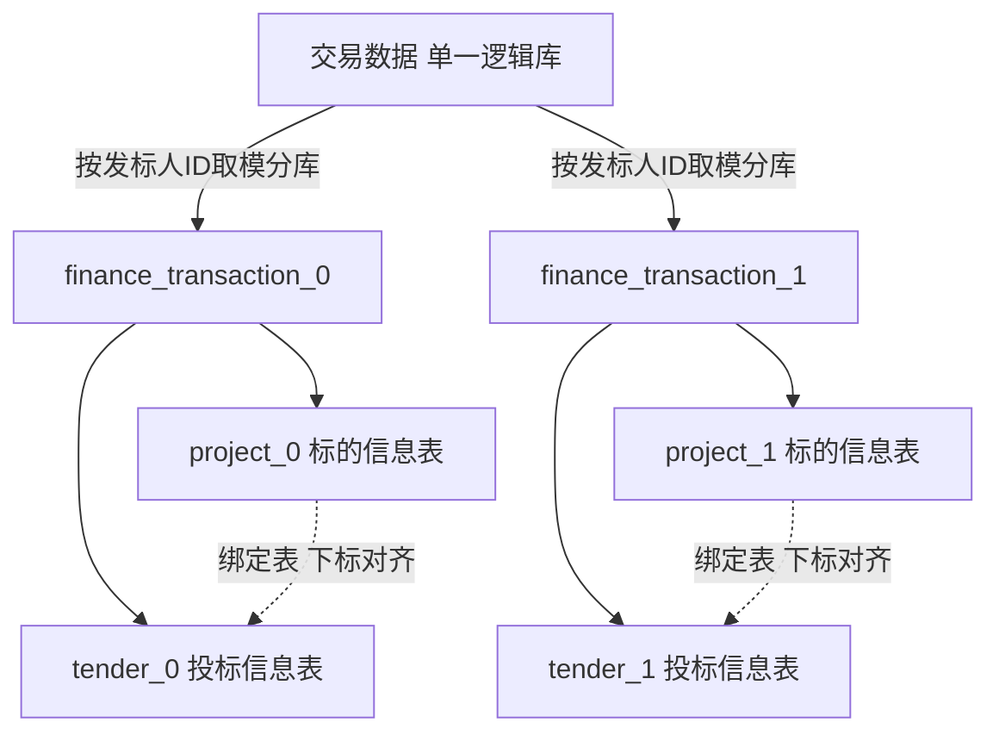

# P2P 项目分库分表落地：发标人定库，标的 ID 定表

分库分表的理论与 Sharding-JDBC 的用法都已备齐，现在回到当初出发的地方。之所以在写发标功能前先插进来这一整块，就是因为交易数据会涨到亿级，MySQL 单库 5000 万、单表 1000 万的经验阈值扛不住。这一课把万信金融的交易库设计敲定：哪些库、哪些表、按什么键拆、绑定关系怎么声明，最后用一套分片配置收口。

## 先给结论

- 交易相关数据单独建库，专门存放标的信息与投标信息；平台其他业务库不在本次设计范围。
- 先垂直分库再水平分库：分库以发标人 ID 作为分片键，按奇偶分流到两个交易库，保证同一发标人的数据永远不跨库。
- 水平分表以标的 ID 作为分片键：标的信息表与投标信息表各拆两张，按标的 ID 奇偶落表。
- 标的信息表与投标信息表互为绑定表，分片规则一致，关联查询按同一下标组合，不产生笛卡尔积。
- 建库建表在第一章初始化环境时已由脚本完成，主从架构与数据同步可参考入门案例自行搭建。
- Sharding-JDBC 承担数据分片与读写分离两项核心功能，应用层照常写逻辑表，路由由它接管。

## 需求回放：为什么是交易库

平台生意越做越大，越来越多人通过平台借款与投资，交易数据量成几何级增长，亿级是设计目标。MySQL 的红线摆在那里：单库最好控制在 5000 万以内，单表不要超过 1000 万，否则性能严重下降。所以在交易中心真正铺开发标、投标功能之前，要先对交易数据做分库分表的性能提升，同时引入 Sharding-JDBC，靠它的数据分片与读写分离核心功能承接拆分带来的路由与归并问题。

设计范围要先划清。交易数据主要指标的相关数据：发标的信息与投标的信息，亿级目标针对的正是这两类。平台之前建的其他库不动，本次讨论只围绕交易数据库展开。具体做法是单独创建交易数据库，把交易相关的表集中安放，这就是垂直分库的思路：按业务把交易这一坨独立出去，专库专用。

## 分库：同一发标人的数据不拆开

水平分库的关键是选对分片键。交易场景里有一条业务铁律：相同发标人的数据不能分开存储。发标人就是借款人，一个借款人可以在平台上多次借款、多次发标，他的标的、围绕这些标的产生的数据，如果散落到不同库里，日后任何一次「查这个人名下所有借款」都要跨库，代价极高。

把发标人 ID 定为分库分片键，铁律就自动成立。发标人的 ID 永远不变，以它对 2 取模：余 0 落交易库一，余 1 落交易库二。某个发标人 ID 一旦确定，他名下所有数据的落库永远唯一，不存在跨库查询的问题。交易库按本课命名口径记作 `finance_transaction_0` 与 `finance_transaction_1`，由最初的一个逻辑交易库拆分而来。这张图在讲库与表的最终形态：



## 分表：标的 ID 决定进哪张表

光分库不够，库内的大表还要水平分表。标的信息表与投标信息表是亿级增长的主角，两张表都要拆。分表分片键选标的 ID，这是行业常见做法：标的 ID 对 2 取模，奇偶决定落 `project_0` 还是 `project_1`；投标信息表里带着标的 ID 字段，同样按它取模落 `tender_0` 或 `tender_1`。

两张表的分片规则一致，它们因此互为绑定表：分片键相同、算法相同，同一个标的的信息与它的投标记录在库与表两个层面永远对齐。这带来两个直接好处，其一，围绕同一标的的关联查询不产生笛卡尔积组合，路由结果两两配对；其二，同一发标人的数据不跨库这条铁律在表层面同样成立，标的数据与投标数据按标的 ID 归拢，业务查询始终有明确的落点。

至于投标业务本身，那是后续章节的开发内容，这里先把它的表位留好：投标指投资人把钱出借给某个标的，产生的投标记录与标的 ID 强关联，表怎么拆、放在哪，现在就随分库分表一次设计到位，后面开发时直接落进规则里。

## 配置落地：分片键与绑定表写进规则

数据库与表的物理形态已在第一章初始化环境时由脚本建好，两个交易库各含标的信息表两张、投标信息表两张（库中另有几张尚未启用的表，不在本次范围，不用理会）。剩下的工作就是把分片口径翻译成 Sharding-JDBC 的配置，让应用面向逻辑表编程：

```properties
# 示例 按本课分片口径整理 库名按 com.study.finance 系口径改写

# 标的信息表的数据节点 两个库各两张真实表
spring.shardingsphere.sharding.tables.project.actual-data-nodes = finance_transaction_$->{0..1}.project_$->{0..1}
# 分库策略 分片键为发标人ID
spring.shardingsphere.sharding.tables.project.database-strategy.inline.sharding-column = consumer_id
spring.shardingsphere.sharding.tables.project.database-strategy.inline.algorithm-expression = finance_transaction_$->{consumer_id % 2}
# 分表策略 分片键为标的ID 主键
spring.shardingsphere.sharding.tables.project.table-strategy.inline.sharding-column = id
spring.shardingsphere.sharding.tables.project.table-strategy.inline.algorithm-expression = project_$->{id % 2}
# 主键交给雪花算法 避免各库自增冲突
spring.shardingsphere.sharding.tables.project.key-generator.column = id
spring.shardingsphere.sharding.tables.project.key-generator.type = SNOWFLAKE

# 投标信息表 与标的表同口径拆分
spring.shardingsphere.sharding.tables.tender.actual-data-nodes = finance_transaction_$->{0..1}.tender_$->{0..1}
spring.shardingsphere.sharding.tables.tender.table-strategy.inline.sharding-column = project_id
spring.shardingsphere.sharding.tables.tender.table-strategy.inline.algorithm-expression = tender_$->{project_id % 2}

# 两张表互为绑定表 关联查询按下标对齐路由
spring.shardingsphere.sharding.binding-tables = project,tender
```

对照读一遍：`actual-data-nodes` 声明逻辑表的数据分布范围，`database-strategy` 用发标人 ID 定库，`table-strategy` 用标的 ID 定表，`key-generator` 用雪花算法解决上一课提出的主键避重问题，`binding-tables` 把绑定关系登记在案。发标业务保存标的信息时，代码里写的仍是逻辑表 `project`，落库位置由这套规则自动算出。交易中心业务层保存标的的代码节选如下，注意 `consumerId` 与主键的赋值正是两个分片键的来源：

```java
/** 交易中心保存标的信息 节选 包名按 com.study.finance 系改写 */
@Service
@Slf4j
public class ProjectServiceImpl extends ServiceImpl<ProjectMapper, Project>
        implements ProjectService {

    @Autowired
    private ConsumerApiAgent consumerApiAgent;

    @Override
    public ProjectDTO createProject(ProjectDTO projectDTO) {
        // 远程调用用户中心 取当前登录借款人
        final RestResponse<ConsumerDTO> consumer = consumerApiAgent.getCurrConsumer();
        // 设置用户id 该值即分库分片键 发标人ID
        projectDTO.setConsumerId(consumer.getResult().getId());
        // 生成标的编码
        projectDTO.setProjectNo(CodeNoUtil.getNo(CodePrefixCode.CODE_PROJECT_PREFIX));
        // 标的状态修改 募集中
        projectDTO.setProjectStatus(ProjectCode.COLLECTING.getCode());
        // 标的可用状态修改 未同步
        projectDTO.setStatus(StatusCode.STATUS_OUT.getCode());
        // dto 转 entity 后保存 面向逻辑表 project 落库路由交给分片规则
        final Project project = convertProjectDTOToEntity(projectDTO);
        save(project);
        return projectDTO;
    }
}
```

主从架构与数据同步在本次不再演示，入门案例里整套东西已经搭建并验证过，P2P 这边要采用同样的形态，参考入门案例的配置自行搭建即可。

## 常见误区

- **分库键随手挑一个字段。** 错例：拿标的创建时间或流水号当分库分片键。正解：分片键必须服务高频业务约束，交易场景的核心约束是同一发标人的数据不跨库，所以分库键只能是发标人 ID；它稳定不变，落库才永远唯一。
- **以为发标人换马甲数据会搬家。** 错例：担心用户改了资料导致数据落点变化。正解：取模用的是用户 ID 主键，ID 终身不变，昵称、手机号怎么改都不影响路由结果。
- **把绑定表拆成两套规则。** 错例：标的表按标的 ID 取模、投标表按投标记录主键取模，关联查询出现笛卡尔积。正解：绑定表必须共用同一个分片键与算法，投标表按标的 ID 取模，与标的表下标严格对齐。
- **忘记全局主键。** 错例：标的表沿用数据库自增主键，两个库各自从 1 开始编。正解：配置雪花算法等分布式主键生成策略，写入前生成全局唯一 ID，跨库永不重复。

## 面试可能被问到的问题

1. 面试官追问：「你们的交易库是怎么分库分表的？」
   答：交易数据单独建库，先垂直分库把交易业务独立出来，再按发标人 ID 取模水平分成两个库；库内标的信息表与投标信息表各按标的 ID 取模拆成两张表，两表互为绑定表。目标是亿级数据下单库单表都控制在阈值内。
2. 面试官追问：「分库分片键为什么选发标人 ID？」
   答：交易业务的核心约束是同一发标人的数据不能分开存储，借款人会多次发标，名下所有标的与相关数据必须能一次查全。发标人 ID 终身不变，用它取模分库，同一发标人的数据落库永远唯一，从根上避免跨库查询。
3. 面试官追问：「绑定表是什么，为什么投标表要和标的表绑定？」
   答：绑定表指分片规则一致的主表与子表，分片键完全相同。投标记录通过标的 ID 与标的信息强关联，两表按同一个标的 ID 取模，下标永远对齐，关联查询按同一下标两两组合，不会产生笛卡尔积，路由与归并的开销最小。
4. 面试官追问：「拆表后主键怎么保证全局唯一？」
   答：放弃数据库自增，改用分布式主键方案，配置雪花算法由客户端在写入前生成全局唯一 ID。它趋势递增、不依赖单点发号器，标的信息表与投标信息表的主键都由它生成，跨库跨表永不重复。
5. 面试官追问：「应用层需要感知分了几库几张表吗？」
   答：不需要。代码面向逻辑表编写，`insert into project` 这样写即可，实际落哪个库哪张表由 Sharding-JDBC 按分片规则解析路由改写后执行；查询、关联同理。这保证了拆分对业务代码透明，后续调整分片规则也不用动业务代码。

## 配套资料

- 讲义：`materials/docs/10/万信金融-第3章-讲义-发标v1.0.md`，第 2 节分库分表（指向分库分表专题资料）；3.2 交易中心保存标的信息：`ProjectMapper`、`ProjectService` 与 `consumerId` 字段的出处。
- 讲义：`materials/docs/10/万信金融-第1章-讲义-开发环境搭建v1.0.md`，1.1 数据库环境：交易数据库两个库的清单与初始化脚本说明。
- 讲义：`materials/docs/10/Sharding-jdbc专题-v1.0.md`，1.2 分库分表的方式与 3.1 基本概念（数据节点、绑定表、分片键）。
- 代码：`materials/code/10/wanxinp2p/`，P2P 工程归档（目录保留原始命名，路径只列到该层级），交易中心工程结构与实体命名可对照；交易中心工程的分片配置随课程资料单独提供。
- 说明：分片配置示例为按本课分片口径整理的补全，库名按 `com.study.finance` 系口径改写，实际工程配置以课程提供的交易中心工程为准；投标表完整分片规则以第 4 章投标功能与工程配置为准。
