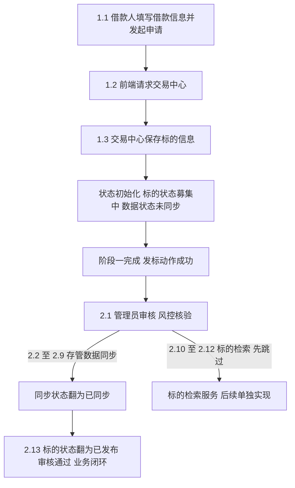

# 用户发标需求分析：一条时序图拆成两段，各工程各管一段

交易中心工程导入完毕、Apollo 配置就绪，写代码前的最后一道工序是需求分析。第三章开篇时已经回答过「什么是发标」，这一次的任务不同：面对完整的发标时序图，把链路上每个工程的位置与职责拆清楚，把标的信息从落库到上架要经历的状态变化摸清楚。图比较长，照开户业务的老办法化整为零，一段一段吃下来。

## 先给结论

- 发标时序图天然分成两段：1.1 到 1.3 是借款人发标与交易中心保存标的信息，走完这段发标动作就算完成；2.1 起管理员介入审核，审核期间完成与存管系统的数据同步，2.13 标的状态翻成已发布，整个业务闭环。
- 链路参与者四个：前端、交易中心、存管代理服务、银行存管系统（模拟）；标的检索服务在图中单独占一段，留到后面专门学，本次跳过。
- 两条业务铁律贯穿全链路：凡是交易类功能必与银行存管系统有关，因为投资人的钱放在银行侧；凡是与银行打交道的请求必经存管代理服务，签名与交易记录都在它那里。
- 标的信息落库时就带两个状态字段：标的状态为募集中，数据状态为未同步；存管同步成功翻已同步，审核通过翻已发布。
- 编码阶段任何时候都要对着时序图写，所有业务、所有代码按图推进，图就是验收标准。

## 链路上的工程：谁在这条业务里出场

把时序图横向扫一遍，出现的服务一目了然。前端是入口，借款人发标页面长在它上面；交易中心是本次新增的微服务，平台里所有交易功能都收在它名下；存管代理服务与银行存管系统是开户阶段打下的老班底，本次原样复用。标的检索服务虽然在图里有一段位置，但它属于后面要单独学习的内容，这次直接跳过，不影响主线。

为什么发标这样的功能也要惊动银行侧？判断依据只有一条：钱在哪，交易就得跟谁对账。投资人的资金实实在在放在银行存管系统那边，任何一笔交易要素如果在银行侧没有留底，平台自己记的账就成了孤本。开户业务当初也走了同一条路，已经验证过这套通道的可靠性。而凡是要跟银行系统打交道的请求，在平台侧一律先过存管代理服务：它负责对业务数据生成签名，银行对安全性的要求靠它满足；同时它还要登记交易记录，投标也好发标也好都是交易，记录落在它那里才有对账凭据。

## 阶段一：1.1 到 1.3，发标动作本身

前段只有三步。1.1 借款人在前端填写借款信息：选借款金额（如三万）、选借款期限（十二、二十四或三十六个月）、填借款用途，点击申请。1.2 前端把请求发给交易中心。1.3 交易中心做两件事，把标的信息保存下来，同时初始化标的状态。这张图在讲两段业务的分界与状态变化：



关键分界在阶段一结束的位置：1.1 到 1.3 走完，对借款人来说发标就已经成功了，申请受理、标的落库。但这与标的上架是两码事，能不能通过审核是后续阶段的事，借款人此时能得到的只有「申请已受理」。1.3 里初始化的两个状态各有分工：标的状态描述业务进度（此刻为募集中），数据状态描述与存管系统的一致性（此刻为未同步），两个字段互不替代，后面每一阶段都会拨动其中之一。

## 阶段二：2.1 到 2.13，审核与同步

管理员审核对应 2.1，内容是风控：核验借款人填的信息、个人信用，专业说法叫风险控制。审核被通过之前，系统里还发生着一长串数据同步动作，对应 2.2 到 2.9：交易中心请求存管代理服务生成交易记录，此刻记录状态为未同步；存管代理对标的数据签名后携带签名数据请求银行存管系统；存管系统保存标的信息，返回同步成功；存管代理更新交易记录并逐级回传；交易中心收到成功确认后把标的数据状态翻成已同步。这一整段与开户业务的同步块几乎逐句对应，签名规则、报文规范、交易记录表全部沿用，差异只在业务实体从账户信息换成了标的信息。

2.10 到 2.12 是标的检索服务的地盘，要把标的信息写进索引供前端快速检索，这块内容单独成课，先跳过。走到 2.13，审核通过落定，标的状态翻成已发布，标的信息出现在前端出借列表里供投资人挑选，整个发标业务到此才算真正做完。数一数状态变化正好三次：落库时双状态初始化、同步成功翻数据状态、审核通过翻业务状态，时序图上每个阶段都对应一次拨动。

## 接口拆解：需求落成方法签名

需求分析的收口动作是把流程翻译成接口。第三章开篇已经定义过发标入口，此处对照开户的 `createConsumer` 再拆一遍它的构成：

```java
/** 交易中心服务 API 按讲义接口定义口径整理 包名按 com.study.finance 系改写 */
public interface TransactionApi {

    /** 借款人发标：入参 ProjectDTO 承载标的六要素 返回值统一用 RestResponse 包裹 */
    @ApiOperation("借款人发标")
    @PostMapping("/my/projects")
    RestResponse<ProjectDTO> createProject(ProjectDTO projectDTO);
}
```

路径 `/my/projects` 里的 `my` 表示操作对象是当前登录借款人自己的标的，与开户接口的 `/my/consumers` 同一套语式；入参 `ProjectDTO` 对应标的六要素，返回值依旧是 `RestResponse` 统一响应结构。接口落地的第一步在交易中心业务层，保存标的信息时初始化两个状态，状态取值来自全局状态码常量：

```java
// 示例 按本课写法补全 常量取值以课程工程为准
public final class ProjectCode {
    /** 募集中 标的业务状态 */
    public static final String COLLECTING = "100001";
}

public final class StatusCode {
    /** 未同步 数据与存管系统不一致 */
    public static final String STATUS_OUT = "0";
    /** 已同步 数据与存管系统一致 */
    public static final String STATUS_IN = "1";
}
```

有了接口签名与状态取值，下一课就可以进入 `TransactionController` 与业务层的具体实现，时序图上的 1.1 到 1.3 将逐行落到代码上。

## 常见误区

- **把发标动作当成整个业务的终点。** 错例：交易中心保存完标的信息就认为功能做完了。正解：1.1 到 1.3 只是阶段一，审核、存管同步、状态翻转为已发布都在后面，业务闭环要到 2.13。
- **把标的状态和数据状态混为一谈。** 错例：只维护一个状态字段，既当业务进度又当同步进度。正解：募集中描述标的生命周期，未同步描述与存管侧的一致性，两个维度独立演进，审核通过翻前者、同步成功翻后者。
- **以为可以绕过存管代理直连存管系统。** 错例：交易中心直接调银行存管接口。正解：签名与交易记录的职责都在存管代理上，这是平台侧与银行侧之间唯一的合法通道，开户业务已经用这套模式验证过。
- **把时序图当成看完即弃的背景资料。** 错例：需求分析读完就凭记忆写代码。正解：时序图是编码与验收的唯一依据，每个编号步骤对应一段可测试的代码，写到哪一步、图上都能对上号。

## 面试可能被问到的问题

1. 面试官追问：「用户发标业务涉及哪些服务，各自负责什么？」
   答：前端负责借款信息填写与提交；交易中心负责保存标的信息并维护标的状态；存管代理服务负责生成交易记录、对标的签名数据并转发请求；银行存管系统负责在银行侧留存标的信息。标的检索服务负责把标的数据写入索引，属于链路的扩展环节。
2. 面试官追问：「为什么发标这样的功能必须对接银行存管系统？」
   答：资金在银行侧托管，交易要素必须两边留底，平台单方面记录无法对账。发标产生的标的信息是后续投标、放款、回款的业务依据，银行侧没有这笔数据，资金流转就缺乏依据，所以凡是交易类业务都要经存管链路同步到银行。
3. 面试官追问：「标的信息为什么要同时维护业务状态和同步状态两个字段？」
   答：两者回答不同的问题。业务状态描述标的生命周期位置，比如募集中、已发布，驱动前端展示与业务流转；同步状态描述平台与存管系统的数据一致性，比如未同步、已同步，是对账与补偿的依据。一个字段表达两个维度会导致状态爆炸且语义不清。
4. 面试官追问：「发标成功和审核通过是什么关系？」
   答：发标成功指 1.1 到 1.3 完成，标的落库、申请受理，借款人侧动作结束；审核通过是管理员风控核验后标的状态翻为已发布，标的信息进入出借列表。前者是受理，后者是上架，中间隔着审核与存管同步两个环节。
5. 面试官追问：「需求分析阶段做接口拆解有什么好处？」
   答：先把方法签名、入参结构、返回值约定定下来，前后端与各服务之间就拿到了契约，可以并行开发；时序图上的每个编号步骤都能映射到具体接口与实现类，开发进度与验收标准都有据可查，避免编码阶段边写边改接口。

## 配套资料

- 讲义：`materials/docs/10/万信金融-第3章-讲义-发标v1.0.md`，1.1 什么是发标与 1.2 业务流程：标的定义与借款申请页面；3.1 需求分析：链路参与者与系统交互流程编号出处。
- 讲义：`materials/docs/10/万信金融-第2章-讲义-开户v1.0.md`，开户业务中存管代理服务的签名规则与交易记录表设计，发标同步块原样复用的地基。
- 代码：`materials/code/10/wanxinp2p/`，P2P 工程归档（目录保留原始命名，路径只列到该层级），可对照公共响应结构与工具类组织；交易中心工程随课程资料单独提供。
- 说明：状态常量示例为按本课写法补全，取值口径与 0103 篇一致；`TransactionApi` 代码块按讲义接口定义口径整理，包名按 `com.study.finance` 系改写。
