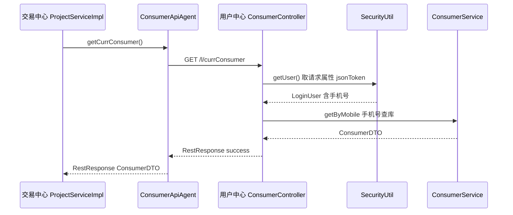
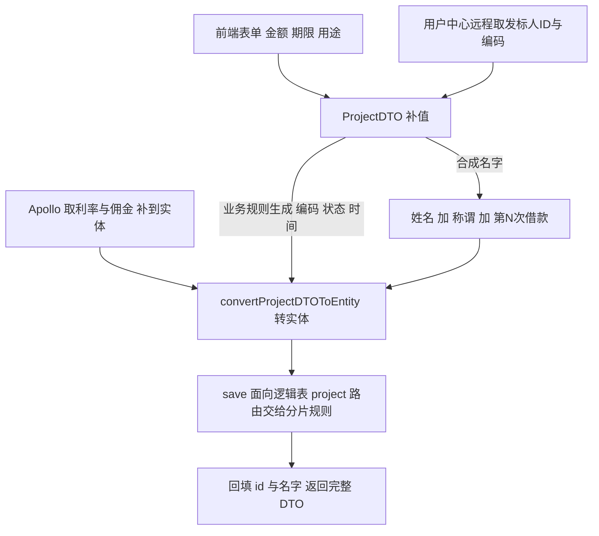

# 保存标的信息：DAO 两件套与业务层三步走，发标第一段写完

接口定义与 Controller 空实现已经就位，方法体此刻返回 null。这一课把「交易中心保存标的信息」真正实现出来：先铺数据访问层，再攻业务层。别被「就是一个保存」骗了，这个 save 方法的业务层代码有几百行，字段来源横跨三处：前端表单、用户中心远程接口、Apollo 配置中心，连标的名字都得现场拼出来。四个视频连成一气，正好走出一条完整路径。

## 先给结论

- 数据访问层两件套：`ProjectMapper` 继承 Mybatis-Plus 的 `BaseMapper<Project>`，再配一个 namespace 指向它的空 XML，增删改查方法全部继承到位。
- 业务层三步走：备齐发标人信息（Feign 调用户中心取当前登录用户），补齐 DTO 字段值（远程取的、规则生成的、Apollo 配的三路汇合），DTO 转实体落库并回填返回。
- 保存的复杂度来自三件事：实体属性太多几乎每个都要赋值；发标人信息不在 DTO 里必须远程取；业务规则要求现场生成编码、状态与名字。
- 标的名字是拼出来的：真实姓名加先生或女士（身份证第 17 位判奇偶），再加「第 N 次借款」（按发标人 ID 统计历史标数加一）。
- 会变的值进 Apollo：最小投标金额、借款人年化利率、平台佣金，经 `ConfigService` 读取，调费率只改配置不发版。

## 数据访问层：一次继承，CRUD 全到位

数据访问层照旧交给 Mybatis-Plus，简单到有些过分。Mapper 包里新建 `ProjectMapper` 接口，除了继承什么都不用写：

```java
/** 标的信息 Mapper 接口 按讲义口径整理 包名按 com.study.finance 系改写 */
public interface ProjectMapper extends BaseMapper<Project> {
}
```

这一继承动作的收益立竿见影：接口从此不再是空接口，`insert`、`deleteById`、`updateById`、`selectOne` 这些通用方法全部继承进来，单表的增删改查不用写一行 SQL。配套的 XML 也要建一个，IDEA 里此前配好的文件模板直接复用，建文件时只需把 namespace 改成交易中心的 Mapper 接口全限定名：

```xml
<?xml version="1.0" encoding="UTF-8"?>
<!DOCTYPE mapper PUBLIC "-//mybatis.org//DTD Mapper 3.0//EN"
        "http://mybatis.org/dtd/mybatis-3-mapper.dtd">
<!-- namespace 必须与 Mapper 接口的全限定名一致 -->
<mapper namespace="com.study.finance.transaction.mapper.ProjectMapper">
</mapper>
```

XML 此刻是空的，它的作用是为将来写自定义 SQL 占位：通用操作走 `BaseMapper`，复杂查询才落到这个文件里。让这套机制真正咬合的还有实体侧的映射注解：`Project` 实体类上标注 `@TableName` 指向逻辑表 `project`，每个属性上用 `@TableField` 写明对应的数据库列名，主键用 `@TableId` 标识。交易库的列名统一是大写风格，比如 `CONSUMER_ID`、`PROJECT_NO`，属性与列名的对应关系全靠这些注解钉死，Mybatis-Plus 生成 SQL 时才不会张冠李戴。实体、Mapper、XML 三样备齐，数据访问层到此收工，真正的战场在业务层。

## 业务层为什么比想象中难写

按老规矩，业务层一个接口一个实现类。`ProjectService` 接口先定义出来，入参与返回值都是 `ProjectDTO`，返回它是因为保存完的信息马上还要被别处使用：

```java
/** 交易中心 service 接口 按画面线口径整理 */
public interface ProjectService {
    /**
     * 创建标的
     * @param projectDTO 标的信息
     * @return 补齐完整信息后的 DTO
     */
    ProjectDTO createProject(ProjectDTO projectDTO);
}
```

实现类 `ProjectServiceImpl` 继承 Mybatis-Plus 的 `ServiceImpl<ProjectMapper, Project>` 同时实现接口，`save` 方法正是从父类白拿的。代码量大的原因值得提前想明白，否则会觉得「一个保存怎么这么多行」。**第一，实体属性太多。** `Project` 实体对应标的信息表，字段几十个，保存时几乎每个都要有值，光赋值语句就是一长串。**第二，有些值 DTO 里根本没有。** 发标人的用户标识、用户编码这类信息在用户中心那边，前端传来的 DTO 里没有，必须远程去查。**第三，要做的业务处理不少。** 标的编码要生成，标的状态要初始化，名字要拼装，利率佣金要从配置里取。三个因素叠加，业务层自然就厚了。

## 第一步：备齐发标人信息，远程调用户中心

登录的人就是发标人，所以「发标人是谁」这个问题等于「当前登录用户是谁」。答案不在交易中心，在用户中心，得先让用户中心提供这个能力。用户中心的 `ConsumerAPI` 接口新增一个获取当前登录用户的方法，方法不需要任何参数：身份信息就藏在请求头的令牌里，网关解析后挂在请求上，传参反而是多此一举，还给了前端伪造他人身份的空间；`ConsumerController` 实现它：

```java
/** 用户中心获取当前登录用户 按画面线与讲义口径整理 包名按 com.study.finance 系改写 */
@ApiOperation("获取登录用户信息")
@GetMapping("/l/currConsumer")
public RestResponse<ConsumerDTO> getCurrConsumer() {
    // SecurityUtil 从请求属性中取出网关解析后的登录用户 再按手机号查全量信息
    final ConsumerDTO consumerDTO =
            consumerService.getByMobile(SecurityUtil.getUser().getMobile());
    return RestResponse.success(consumerDTO);
}
```

这条链路能跑起来，靠的是 `SecurityUtil` 这个工具类。它是第四章认证拦截时封装好的：网关校验令牌通过后，把解析出来的登录用户放进请求属性，微服务里再从请求上取回来：

```java
/** 从请求属性中还原登录用户 画面线原样整理 */
public static LoginUser getUser() {
    ServletRequestAttributes attrs = (ServletRequestAttributes)
            RequestContextHolder.getRequestAttributes();
    if (attrs != null) {
        HttpServletRequest request = attrs.getRequest();
        // 网关解析令牌后放入的登录用户
        Object jwt = request.getAttribute("jsonToken");
        if (jwt instanceof LoginUser) {
            return (LoginUser) jwt;
        }
    }
    return new LoginUser();
}
```

拿到 `LoginUser` 里的手机号，业务层按手机号查库就能拿到完整的用户信息。`getByMobile` 这个方法以前在注册功能里写过，当时是私有方法，现在把可见性放开成 public、返回值改为 `ConsumerDTO`，旧代码零改动就能满足新需求。有个细节要记住：这个接口是供其他微服务调用的，按项目编码规约，路径以 `/l` 开头，与面向前端的 `/my`、`/m` 路径区分开。还有一个坑讲义里专门标注过：`SecurityUtil.getUser()` 不能随意使用，只有收到了网关转发请求的微服务才能从请求属性里取到登录用户，直接访问微服务绕过网关时取到的是空对象，这类「本地调试正常、联调拿到空用户」的问题多半出在这里。这张图在讲发标人信息是怎么流回交易中心的：



交易中心这一侧的调用入口是 Feign 代理。`agent` 包里新建 `ConsumerApiAgent` 接口，方法签名与用户中心的接口保持一致，路径也要对上：

```java
/** 用户中心远程代理 按画面线口径整理 包名按 com.study.finance 系改写 */
@FeignClient(value = "consumer-service")
public interface ConsumerApiAgent {

    /** 获取当前登录用户 路径与用户中心接口保持一致 */
    @GetMapping("/l/currConsumer")
    RestResponse<ConsumerDTO> getCurrConsumer();
}
```

## 第二步：三路取值，把 DTO 填满

代理注入进来后，`createProject` 的第一行业务代码就是发起远程调用，接收 `RestResponse<ConsumerDTO>`。此刻 DTO 里只有前端填的三样东西：借款金额、借款期限、借款用途，离「每个字段都有值」还差一大截。补值分三路，先补远程取来的：发标人 ID 与用户编码都从当前登录用户身上拿，其中发标人 ID 正是分库分片键，它的取值直接决定这条数据将来落在哪个库：

```java
// 远程取回当前登录用户 即发标人
final RestResponse<ConsumerDTO> consumer = consumerApiAgent.getCurrConsumer();
// 发标人ID与用户编码 来自用户中心 前者为分库分片键
projectDTO.setConsumerId(consumer.getResult().getId());
projectDTO.setUserNo(consumer.getResult().getUserNo());
// 标的编码 前缀加雪花 业务号生成工具与注册功能同款
projectDTO.setProjectNo(CodeNoUtil.getNo(CodePrefixCode.CODE_PROJECT_PREFIX));
// 标的业务状态初始化 募集中 等待投资人出借
projectDTO.setProjectStatus(ProjectCode.COLLECTING.getCode());
// 数据同步状态初始化 未同步 存管同步完成后翻转
projectDTO.setStatus(StatusCode.STATUS_OUT.getCode());
// 创建时间与标的类型 新发标的类型记为 NEW
projectDTO.setCreateDate(LocalDateTime.now());
projectDTO.setRepaymentWay(RepaymentWay.FIXED_REPAYMENT.getCode());
projectDTO.setType("NEW");
```

第二路是业务规则生成的值：标的编码用编码工具按前缀规则生成，前缀枚举里登记着标的号专属的头部，主体是雪花算法补的不重复数字，与注册时生成用户编码同一套工具；标的状态给了「募集中」，意思是新标的刚发布，等着投资人出借，状态枚举里还备着已满标、还款中、已结标这些后续阶段的取值；可用状态即同步状态给了「未同步」，审核通过存管同步完成后才翻成已同步；还款方式先固定给等额本息，先息后本、等额本金这些选项留给计算利息的环节再启用。补值顺序上有一个隐含的硬约束：发标人 ID 这个分库分片键必须在保存之前赋上值，它一旦缺失或错位，Sharding-JDBC 的分库路由立即失效，写入要么报错要么落错库，所以远程取回用户信息这一步被排在主流程的最前面。第三路 Apollo 配置的值单独成段，接着看。这张图在讲三路取值怎么汇进一个 save：



## 第三步：会变的值交给 Apollo

利率与佣金这类数字有个共同脾气：会变。平台搞活动时佣金可能降甚至免掉，刺激交易活跃度；活动结束又调回来。写死在代码里，每次调费率都得改代码、重新打包、重新部署，运维成本全在发版上。它们的归宿是 Apollo：配置项提前准备在文本文件里，粘到交易中心项目的 `application` 名称空间末尾，提交之后点发布，配置才算生效。涉及金融的配置项逐个过：最小投标金额，规定投资人单笔出借的下限，比如最少一百，避免一块钱的出借记录刷屏；借款人的年化利率，借款人借钱要付的利息水平；两笔平台佣金，一笔向借款人收、一笔向投资人收，平台靠它们盈利，费率随业务灵活调整；债权转让的佣金本阶段用不到，先给 0 占位。取值的代码在初始工程里已经备好，注入 `ConfigService` 直接调：

```java
/** 配置读取 按画面线口径整理 键名以课程工程为准 包名按 com.study.finance 系改写 */
@Service
public class ConfigService {

    /** Apollo 客户端 与框架静态类同名 此处持有实例 */
    private final Config config = com.ctrip.framework.apollo.ConfigService.getAppConfig();

    /** 投资人年化利率 = 借款人年化利率 - 平台佣金 */
    public BigDecimal getAnnualRate() {
        return getBorrowerAnnualRate().subtract(getCommissionAnnualRate());
    }

    /** 最小投标金额 默认 100 */
    public BigDecimal getMinInvestmentAmount() {
        return new BigDecimal(config.getProperty("mini.investment.amount", "100.0"));
    }
}
```

核心思路一眼即明：Apollo 客户端按键取值并给默认值；投资人的年化利率不是单独配置的，而是借款人年化利率减去平台佣金算出来的，费率只登记一处，口径天然一致。取出的这几项补在实体上，转换环节一并落库。

## 第四步：标的名字是拼出来的

DTO 还差一个字段：标的名称。它麻烦在没法让用户填，也没法生成随机串，页面要求它长得像「某某第 3 次借款」这样的人话。三样原料缺一不可：借款人的真实姓名、性别称谓、借款次数。姓名在用户信息里有；性别藏在身份证号里，身份证第 17 位是性别位，奇数为男、偶数为女，对 2 取模判断整除与否即可；次数得查库，发一次标就是标的信息表里一行记录，按发标人 ID 做计数再加一，就是本次的序号：

```java
// 组合标的名字 真实姓名 加 称谓 加 第N次借款 按画面线与讲解口径整理
final String idNumber = consumer.getResult().getIdNumber();
// 身份证第 17 位为性别位 偶数为女 奇数为男
final int sexFlag = Integer.parseInt(idNumber.substring(16, 17)) % 2;
// 历史发标记录数加一 即本次是第几次借款
final Integer count = count(new QueryWrapper<Project>()
        .eq("consumer_id", consumer.getResult().getId()));
final String name = consumer.getResult().getUsername()
        + (sexFlag == 0 ? "女士" : "先生") + "第" + (count + 1) + "次借款";
projectDTO.setName(name);
```

`count` 方法同样来自 Mybatis-Plus 的父类，条件构造器按 `consumer_id` 过滤，一行代码拿到次数。substring 的下标从 0 起算，第 17 位对应参数 16，这里差一位结果就全部颠倒，值得写完自测一次。

## 收尾：转换、落库与回填

值补齐了还不能直接 save。`save` 要的是与表对应的实体 `Project`，手上是 `ProjectDTO`，中间隔着一层类型转换。转换逻辑单独抽一个私有方法 `convertProjectDTOToEntity`，把 DTO 的属性逐个复制到实体上，不让转换代码散在主流程里：

```java
// DTO 转实体 转换逻辑单独抽方法 主流程保持清晰
final Project project = convertProjectDTOToEntity(projectDTO);
// 面向逻辑表 project 落库 路由交给分片规则
save(project);
// 保存成功后回填主键与合成名字 返回给前端的是完整 DTO
projectDTO.setId(project.getId());
projectDTO.setName(project.getName());
return projectDTO;
```

`save` 写的是逻辑表 `project`，真实落进哪个库哪张表由 Sharding-JDBC 按发标人 ID 定库、标的 ID 定表的规则自动路由，业务代码对此完全无感，这正是前几课铺分片配置的意义。想亲眼验证路由是否生效，可以在日志里观察：Sharding-JDBC 打开 SQL 日志后，能清楚看到一条写向逻辑表 `project` 的 insert 被改写成指向 `finance_transaction_0` 或 `finance_transaction_1` 下某张 `project_0`、`project_1` 的真实 SQL，逻辑与物理的对应关系一目了然，排查落库问题就靠这条日志。回填一步别省略：id 是保存时才由雪花算法生成的主键，名字是刚刚合成的字符串，DTO 一开始两者都没有，不回填的话前端拿到的响应里就缺了这两个关键字段。到这里，保存标的信息的功能开发完毕，时序图上的 1.1 到 1.3 有了完整实现，借款人提交申请后，一条状态为募集中、同步状态为未同步的标的信息就躺在交易库的某一张真实表里了。

## 常见误区

- **`SecurityUtil.getUser()` 当万能钥匙用。** 错例：本地直接调微服务接口调试，取当前登录用户得到空对象，还以为是工具类坏了。正解：登录用户是网关校验令牌后放进请求属性的，只有经网关转发进来的请求才能取到，直连服务必然为空，调试要走网关链路。
- **身份证性别位下标取错。** 错例：`substring(17, 18)` 取到校验位，性别判断全线出错。正解：身份证号第 17 位对应 substring 的下标 16，奇数为男、偶数为女，用真实身份证号自测一遍再上线。
- **费率写死在业务代码里。** 错例：年化利率、佣金直接硬编码常量，平台调费率要发版。正解：会变的经营参数进 Apollo 的 `application` 名称空间，经 `ConfigService` 读取并给默认值，改配置点发布即可生效。
- **保存后直接返回原始 DTO。** 错例：方法末尾 `return projectDTO`，前端拿到的对象没有 id 和名字。正解：保存后把实体上生成的主键与合成的名字回填进 DTO 再返回，接口给出去的数据必须完整。

## 面试可能被问到的问题

1. 面试官追问：「一个保存操作为什么业务层代码这么长？」
   答：三个原因叠加。标的信息实体属性几十个，保存时几乎每个字段都要赋值；一部分字段不在请求范围内，要远程调用户中心取当前登录用户补上发标人标识；还有一批业务规则要执行，编码生成、状态初始化、名字拼装、费率读取。保存本身只是一行 save，前后的取值与校验才是主体。
2. 面试官追问：「微服务里怎么拿到当前登录用户？」
   答：请求经网关时校验令牌，网关把解析出的登录用户封装成 LoginUser 放进请求属性；微服务内用 SecurityUtil 从请求上下文取回这个属性，拿到手机号后查库补全用户信息。前提是该请求必须经过网关转发，绕过网关直连服务时请求属性为空。
3. 面试官追问：「利率佣金为什么要放配置中心，直接写常量不行吗？」
   答：这类经营参数变更频率高，平台做活动随时可能调整佣金。放 Apollo 后修改只需发布配置，服务实时拿到新值，不用改代码、打包、发版；还能给默认值兜底，配置缺失时按保守值运行。投资人年化利率由借款人利率减佣金算出，口径只登记一处。
4. 面试官追问：「标的名称是怎么生成的，并发下统计次数会有什么问题？」
   答：名字由借款人真实姓名、性别称谓、第 N 次借款三段拼成，性别取身份证第 17 位判奇偶，次数按发标人 ID 统计历史标数加一。并发下两个请求同时统计可能得到相同序号，名字出现重复计数；严格场景要用原子计数或数据库唯一约束兜底，本课程先用简单计数展示思路，幂等与并发控制后续章节专门处理。
5. 面试官追问：「为什么保存的是逻辑表，分库分表却不影响业务代码？」
   答：业务层只写逻辑表 project，Sharding-JDBC 在 SQL 解析阶段按分片规则路由：分库键是发标人 ID，分表键是标的 ID，改写后的 SQL 落到真实表执行。分片对业务透明，是拆分方案能落地的前提，调整分片规则也不用动业务代码。
6. 面试官追问：「DTO 转实体的转换逻辑放哪比较合适？」
   答：单独抽转换方法或交给统一的对象映射工具，不要散落在业务方法里。转换是映射职责，与业务规则无关，集中管理后字段增减只改一处，主流程读起来始终是「取值、补值、转换、保存」的干净脉络。

## 配套资料

- 讲义：`materials/docs/10/万信金融-第3章-讲义-发标v1.0.md`，3.2.2 功能实现：`ProjectMapper`、`ProjectMapper.xml`、`ProjectService` 与 `ProjectServiceImpl` 的定义顺序；3.2.4 前后端集成测试：`SecurityUtil.getUser()` 依赖网关转发的细节标注。
- 讲义：`materials/docs/10/万信金融-第2章-讲义-开户v1.0.md`，按手机号查用户与编码生成工具的首次出处，本课 `getByMobile` 开放复用的原型。
- 讲义：`materials/docs/10/万信金融-生产环境-部署文档.md`，交易服务端口 53060 等服务清单，联调验证时的启动顺序依据。
- 代码：`materials/code/10/wanxinp2p/`，P2P 工程归档（目录保留原始命名，路径只列到该层级），公共工具类与响应结构可对照；交易中心工程与 `ProjectServiceImpl` 完整源码随课程资料单独提供。
- 说明：正文代码按画面线与讲义口径整理，包名一律按 `com.study.finance` 系改写；`ConfigService` 的 Apollo 配置键名与名字合成片段为按讲解口径还原的示例补全，取值以课程工程源码为准。
