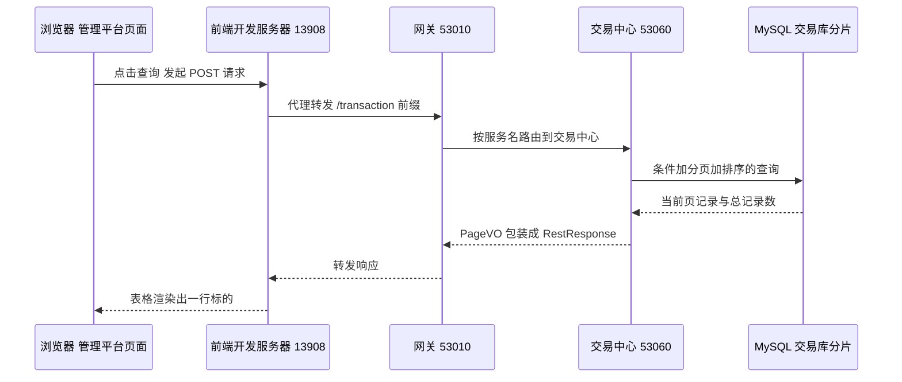

# 查询标的信息前后端集成测试：页面一次点击，链路层层核对

接口定义、业务实现、数据访问层都已经写完，控制器的空实现也该补上了。但代码写完只代表编译通过，查询标的信息这个功能能不能用，要等管理平台页面真实发起一次请求、请求穿过网关落到交易中心、再由 MyBatis-Plus 拼出 SQL 从分片后的交易库里把数据捞回来，才算数。这一课做两件事：把控制器收口，然后启动一整套环境做前后端集成测试。

## 先给结论

- 控制器收尾是固定套路：调用业务层方法拿到 `PageVO<ProjectDTO>`，套上 `RestResponse.success` 返回，一行调用加一层包装。
- 启动清单按「这条请求链路要经过谁」来定：配置中心 Apollo、注册中心、网关、登录相关的用户中心与认证服务、交易中心；存管代理这次不参与，可以不起。
- 前端要启动的是 P2P 管理平台前端，不是用户端前端，两个工程别搞混，在 HBuilderX 里 `npm run dev` 起开发服务器。
- 联调核对三个位置：页面渲染有数据、Network 面板里请求路径与参数对得上、响应 JSON 与表格字段一一对应。
- 表里只有一条测试数据时只能验证「通不通」，分页与条件筛选要造够数据再下结论。

## 控制器收口：一行调用加一层响应壳

空实现补全的代码没有新东西，照着业务层方法签名调用，结果交给统一响应壳：

```java
/** 交易中心控制器 检索标的收口 包名按 com.study.finance 系改写 */
@Override
@PostMapping("/projects/q")
public RestResponse<PageVO<ProjectDTO>> queryProjects(@RequestBody ProjectQueryDTO projectQueryDTO,
        String order, Integer pageNo, Integer pageSize, String sortBy) {
    PageVO<ProjectDTO> projects = projectService.queryProjectsByQueryDTO(projectQueryDTO,
            order, pageNo, pageSize, sortBy);
    return RestResponse.success(projects);
}
```

有一个细节值得留意：控制器最终把检索路径定为 `/projects/q`，比 API 接口上声明的 `/projects` 多了一个 `/q` 后缀。对外真正生效的是控制器自己的映射，前端开发也按 `/projects/q` 这个地址调用，联调前两边对齐即可。`/q` 的语义就是 query，用路径后缀区分同资源下的查询动作，是 REST 风格里常见的写法。

到这里，查询标的信息的功能代码全部就位：条件、分页、排序在业务层四步走完，控制器只负责转手与包装。

## 启动清单：沿着请求链路点服务

集成测试不是把所有微服务一口气全拉起来，而是先想清楚这次请求要经过哪些环节。查询请求从管理平台页面出发，要过网关，要进交易中心，交易中心要连数据库，而登录是前置动作，所以与登录相关的服务也得在。逐项对下来：

```bash
# 配置中心 Apollo 常驻启动
# 注册中心与网关
# 登录相关 用户中心 consumer 认证 uaa 账户 account
# 交易中心 transaction
# 存管代理 depository-agent 本次查询用不到 可以不启动
```

前端工程的启动也有讲究。仓库里有两个前端：一个是用户端的借款投资页面，一个是这次刚部署的管理平台前端。要起的是后者，进入管理平台前端工程目录执行 `npm run dev`，开发服务器起来后浏览器访问页面。前端没反应时先别急着怀疑后端，多半是视图或端口的小状况，刷新或重起即可。

## 页面联调：三个位置核对一张表

用管理员账号 admin 登录管理平台，进入借贷管理页面，标的列表立即查询出一条数据：白瑞女士第 12 次借款，金额 10000 元，期限 12 个月，年化利率 15%，状态募集中。这正是此前发标测试留下的那条记录。页面有数据只是第一层核对，接着打开开发者工具的 Network 面板看请求本身：

```bash
POST /transaction/projects/q?pageNo=1&pageSize=10
Content-Type: application/json

{"projectStatus": "COLLECTING"}
```

请求方法与控制器一致是 POST；路径 `/transaction/projects/q` 里，`/transaction` 是路由前缀，`/projects/q` 对上控制器的映射；URL 上挂页码与每页行数，请求体 JSON 装筛选条件，`COLLECTING` 表示募集中，相当于新标。整条请求的流转路径如下图：



读图时抓关键一跳：网关按 `/transaction` 前缀把请求交给交易中心，交易中心所在的 53060 端口对前端完全透明，前端只认网关入口。响应状态 200，响应体里的 `content` 装着这一行标的，`total` 是 1，翻页控件据此显示只有一页。联调时前端代码里分页参数重复拼了一次，属于前端的小瑕疵，不影响接口本身的验证，浏览器控制台里一些无关的报错也可以先放一边，那些是尚未开发的功能发出的请求。

## 数据量与下一步验证

一条数据只能证明链路通，证明不了分页与筛选的正确。要真正测出翻页行为，至少得有一页以上的数据：回到发标功能多发几次标，造出一二十条记录，再回到列表页翻页观察 `pageNo` 变化时返回的 `content` 是否跟着换。条件筛选同理，分别只传类型、只框利率区间、只传状态，核对每次返回的行数与字段是否符合预期。想在参数层面更自由地组合，用 Postman 直接调 `/projects/q` 接口比页面点选灵活得多，改哪个参数、看结果怎么变，一目了然。这些验证做完，查询标的信息功能正式收官，下一课的审核动作就落在这张列表的每一行上。

## 常见误区

- **把服务全量启动当成稳妥。** 错例：不管测什么，把所有微服务都拉起来。正解：按请求链路点服务，查询测试不碰银行存管，存管代理不必启动，少起一个就少排一处错。
- **前端工程搞混。** 错例：起了用户端前端，半天找不到管理页面。正解：确认启动的是管理平台前端工程，两个前端的入口与端口都不同。
- **页面有数据就算测试通过。** 错例：不看请求，只确认表格渲染出来。正解：在 Network 面板核对请求方法、路径、参数与响应体，页面数据必须来自真实接口返回。
- **数据只有一条就认为分页没问题。** 错例：用一条测试数据宣布分页正常。正解：造满两页以上数据再验证翻页，小数据量会掩盖分页与排序的问题。

## 面试可能被问到的问题

1. 面试官追问：「前后端集成测试前，你如何决定要启动哪些服务？」
   答：沿请求链路倒推依赖。这次查询要过网关、进交易中心、查数据库，且登录是前置动作，所以配置中心、注册中心、网关、用户与认证服务、交易中心都要在；链路外的存管代理可以不启动。按链路启动能把问题域收窄，报错时也更容易定位是哪一环。
2. 面试官追问：「前端为什么不直连交易中心，要经过网关？」
   答：网关是统一入口，负责路由、鉴权与跨域等横切处理，前端不需要感知每个服务的地址与端口。服务多了以后，直连意味着前端维护一堆地址，扩缩容或服务迁移都会牵动前端改动；走网关这些变化都被收敛在路由配置里。
3. 面试官追问：「联调时如何区分是前端的问题还是后端的问题？」
   答：看请求是否发出、方法与路径是否正确、参数是否符合接口约定，这三样都对而结果不对，问题在后端；请求本身缺失或参数错误，问题在前端。响应码与响应体是分界线，200 但字段对不上就是两边的契约理解有偏差。
4. 面试官追问：「测试数据很少时，这类列表查询最容易漏掉什么问题？」
   答：分页与排序。一页都装不满时，翻页逻辑、每页行数、总数计算、排序稳定性全都验证不到；条件组合的边界（比如区间只传一端）也容易漏。所以集成测试要刻意造数据，把参数组合铺开测。

## 配套资料

- 讲义：`materials/docs/10/万信金融-第3章-讲义-发标v1.0.md`，3.4.3 前后端集成测试：控制器收口与联调步骤的出处。
- 代码：`materials/code/10/wanxinp2p_apollo/`，公共模块归档（目录保留原始命名，路径只列到该层级），`RestResponse` 等公共类真实源码可对照。
- 代码：`materials/code/10/wanxinp2p/`，P2P 工程归档（目录保留原始命名，路径只列到该层级），工程结构与公共工具可对照。
- 说明：管理平台前端工程与交易中心工程未随仓库归档；控制器实现与联调请求按画面线与讲义口径整理，包名按 `com.study.finance` 系改写。
