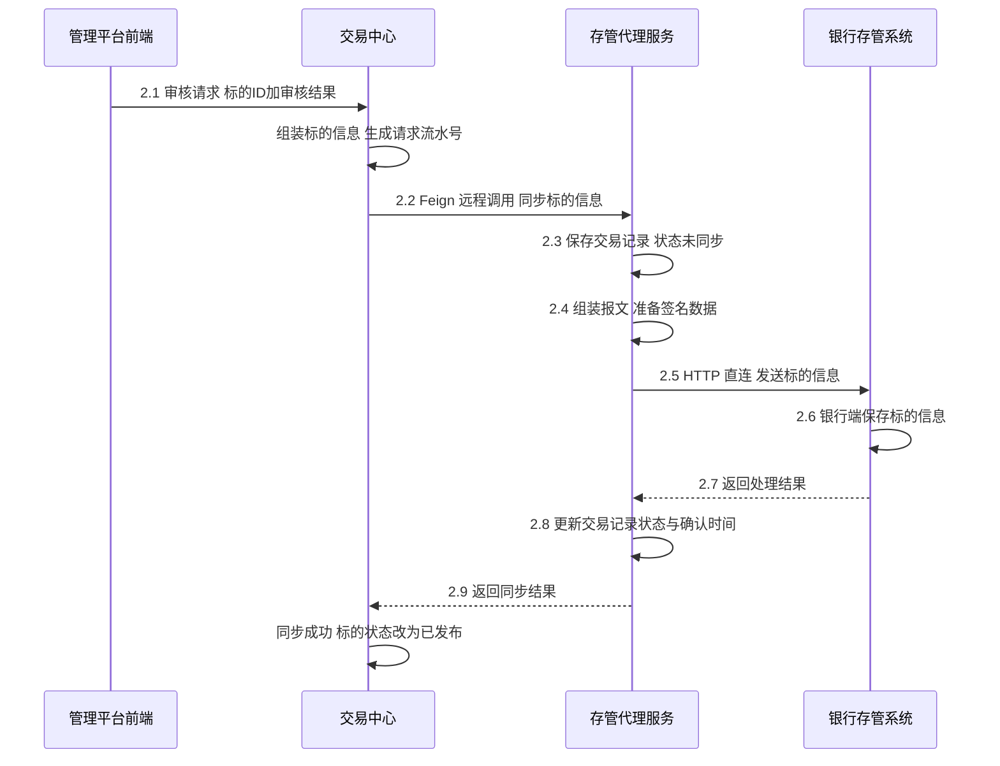

# 审核标的全链路实现：交易中心定结果，存管代理报银行

管理平台列表页已经能查出标的，每行末尾挂着审核按钮。管理员点下「审核」，弹窗里选通过还是拒绝，前端只产生一个数字，后端却要跑完一条跨三个系统的链路：交易中心改本地状态，存管代理把审核的标的信息登记到银行存管系统。这条链路涉及两个微服务的接口设计与两套实现逻辑，五个视频按「定义接口、交易中心实现、存管代理实现」的顺序讲完，正好融合成一篇完整的实战记录。

## 先给结论

- 审核结果在前端就产生了：通过传 1、拒绝传 2，后端不生成结果，只执行结果。
- 两个微服务各定义一个接口：交易中心 `projectsApprovalStatus(Long id, String approveStatus)` 返回 `RestResponse<String>`；存管代理 `createProject(ProjectDTO)` 返回 `RestResponse<String>`，路径挂在 `/l/createProject` 下，`/l` 开头是内部接口，只对微服务开放，不给前端。
- 传输方式分两轨：服务之间走 Feign，服务对银行走 HTTP 直连，银行不归项目管，也不在注册中心里。
- 交易中心实现五步：按 ID 查标的转 DTO、生成请求流水号、Feign 调存管代理、按银行返回码分支处理、成功改状态失败抛业务异常。
- 存管代理实现四步：保存交易记录（状态未同步）、组装签名数据（DTO 转 JSON 再 Base64 编码）、经 OkHttp 加签名拦截器把数据发往银行、按验签结果更新交易记录并返回。

## 把时序图摊开：一次审核要跨几个系统

动手之前先把发标的时序图回放一遍。审核业务从 2.1 开始：管理员点击审核按钮，前端发起请求到交易中心；交易中心的核心动作是改状态，审核通过后通过 Feign 远程调用存管代理，把标的信息送出去；存管代理是项目与银行之间唯一的通道，与银行打交道前先签名、保存交易记录，然后把数据发往银行存管系统，银行保存标的并返回结果，存管代理更新交易记录状态后把结果传回交易中心；交易中心收到同步成功的回执，把标的状态改成已发布，整条链路收束。2.10 往后的标的信息检索同步属于 ES 与 Logstash 的内容，后续课程单独处理，这条主链路只走到 2.9：



读这张图要抓出一个固定套路：凡与交易相关的数据，最终都要在银行存管系统存一份；凡与银行打交道，都要经过存管代理，而存管代理每次都做同样四件事，生成签名、保存交易记录、发送数据到银行、按结果改状态。开户如此，发标如此，后续的投标、放款还是如此。把这个套路记下来，后面的开发会越来越轻松。

## 接口定义：两个微服务各出一根桩

接口照例先在 API 工程里落。交易中心的审核接口参数不多，但每个都要想清楚来路：审核动作可以拆成两个问题，审核哪个标的，审核结果是什么。标的身份用 ID 表达，结果用状态值表达，两个参数足够：

```java
/** 交易中心 API 新增审核方法 包名按 com.study.finance 系改写 */
/**
 * 管理员审核标的信息
 * @param id 标的ID
 * @param approveStatus 审核结果 1通过 2拒绝
 * @return String
 */
RestResponse<String> projectsApprovalStatus(Long id, String approveStatus);
```

控制器实现先落空壳，补上 Spring MVC 与 Swagger 注解。两个参数全部走路径传值，是标准的 REST 风格，路径上的两个占位符对应 `@PathVariable`：

```java
/** 交易中心控制器 审核标的骨架 包名按 com.study.finance 系改写 */
@Override
@ApiOperation("管理员审核标的信息")
@ApiImplicitParams({
        @ApiImplicitParam(name = "id", value = "标的id", required = true,
                dataType = "long", paramType = "path"),
        @ApiImplicitParam(name = "approveStatus", value = "审批状态",
                required = true, dataType = "string", paramType = "path")
})
@PutMapping("/m/projects/{id}/projectStatus/{approveStatus}")
public RestResponse<String> projectsApprovalStatus(@PathVariable("id") Long id,
        @PathVariable("approveStatus") String approveStatus) {
    return null;
}
```

路径挂在 `/m/` 前缀下，与借款人端的 `/my/` 系列区分开，管理端接口自成一族。两个 `@PathVariable` 千万不能漏，这是最容易忘的一处：注解缺失时 Spring 不知道要把路径占位符绑进方法参数，前端传了值后端也接不到。Swagger 注解里 `paramType` 写 `path`，把参数来源讲给接口文档听，前端对着文档就能联调。

存管代理这边的接口在 `DepositoryAgentApi` 里新增，紧挨着此前开户用的 `createConsumer`：

```java
/** 存管代理服务 API 新增标的信息同步方法 包名按 com.study.finance 系改写 */
/**
 * 保存标的
 * @param projectDTO 标的信息
 * @return
 */
@PostMapping("/l/createProject")
RestResponse<String> createProject(@RequestBody ProjectDTO projectDTO);
```

参数是整个 `ProjectDTO`，因为银行那边要保存标的的全量信息，ID 一个字段远远不够；返回是字符串结果，处理成功与否一个码就够了，封装在 `RestResponse` 里回给调用方交易中心。这条接口的访问路径以 `/l` 开头，课程里约定过：`/l` 开头的接口只对微服务内部开放，供 A 服务调用 B 服务使用，不对前端暴露。存管代理的接口天然是内部接口，它的调用方只有交易中心一个。

交易中心要通过 Feign 调这个接口，提前准备一个 Feign 代理。名字延续 `Agent` 后缀的惯例：

```java
/** 交易中心侧 Feign 代理 包名按 com.study.finance 系改写 */
@FeignClient(value = "finance-depository-agent-service")
public interface DepositoryAgentApiAgent {

    @PostMapping(value = "/depository-agent/l/createProject")
    RestResponse<String> createProject(ProjectDTO projectDTO);
}
```

这里埋着一个吃过亏的坑：`@PostMapping` 的值必须写全 `/depository-agent/l/createProject`，前面的 `/depository-agent` 是存管代理服务的基本访问路径，后面才是控制器映射。当初登录调用户中心时就因为漏了这一层路径吃过 404 的亏。Feign 只认服务名做负载均衡，路径部分要自己拼完整，一层都不能少。

## 交易中心：审核逻辑五步落码

实现之前先把审核结果的来路说清楚。管理平台前端页面上，审核按钮点击后弹出通过与拒绝两个选项，前端代码里点击「通过」传 1，点击「拒绝」传 2，结果在点击那一刻就定死了，随后随请求发到后端。所以交易中心拿到请求时，结果已经装在 `approveStatus` 参数里，要做的是执行而不是判断。

业务层接口新增 `projectsApprovalStatus(Long id, String approveStatus)` 返回 `String`，签名照控制器抄、去掉 `RestResponse` 壳。实现类里的方法按五步展开：

```java
/** 交易中心业务层审核实现 按讲义口径整理 包名按 com.study.finance 系改写 */
@Override
public String projectsApprovalStatus(Long id, String approveStatus) {
    // 1.根据id查询出标的信息并转换为DTO对象
    final Project project = getById(id);
    final ProjectDTO projectDTO = convertProjectEntityToDTO(project);
    // 2.生成请求流水号
    projectDTO.setRequestNo(CodeNoUtil.getNo(CodePrefixCode.CODE_REQUEST_PREFIX));
    // 3.调用存管代理服务同步标的信息
    final RestResponse<String> restResponse = depositoryAgentApiAgent.createProject(projectDTO);
    // 4.同步成功 修改标的的数据状态为审核结果对应的值
    if (DepositoryReturnCode.RETURN_CODE_00000.getCode().equals(restResponse.getResult())) {
        update(Wrappers.<Project>lambdaUpdate().set(Project::getStatus,
                Integer.parseInt(approveStatus)).eq(Project::getId, id));
        return "success";
    }
    // 5.失败抛出业务异常
    throw new BusinessException(TransactionErrorCode.E_150113);
}
```

第一步查询与转换。`getById` 是业务基类自带的方法，把 ID 扔进去就查回 `Project` 实体。但实体不能出门，网络传输一律用 DTO，所以要补一个单对象的转换方法 `convertProjectEntityToDTO`，字段拷贝交给 Spring 的 `BeanUtils.copyProperties`，与此前查询列表用的集合转换方法互为补充，一个对付单条一个对付一批。

第二步生成流水号。发标是一种交易，交易要有唯一标识，这个标识就是请求流水号。生成方式还是工具类加枚举的老搭档：`CodeNoUtil.getNo` 配 `CodePrefixCode.CODE_REQUEST_PREFIX`，请求流水号的前缀是 `REQ_`，与标的编码的 `PRO_` 前缀区分开，两套编号各管各的业务，看前缀就知道编号是谁的。流水号塞进 `projectDTO` 的 `requestNo` 字段，随标的信息一起出发。

第三步远程调用。注入 `DepositoryAgentApiAgent`，调 `createProject` 把 DTO 传过去，对应时序图的 2.2。调用返回 `RestResponse<String>`，结果怎么用是下一步的事。

第四步按返回码分支。判断条件是 `DepositoryReturnCode.RETURN_CODE_00000.getCode().equals(restResponse.getResult())`，五个零表示成功，这是与银行存管系统约定好的返回码口径，开户时用过。值得留意的是比对对象：拿返回码去比 `restResponse.getResult()` 而不是什么 `resultCode` 字段，这个看似奇怪的写法要到下一课看了存管代理的控制器才能揭晓，那边把银行的返回码装进了 `RestResponse` 的 `result` 字段。成功分支里做状态更新，`Wrappers.<Project>lambdaUpdate()` 链式拼装：`set` 指定改哪个字段、改成什么值，`eq` 指定按 ID 匹配哪一行，`update` 执行。改的是标的的数据状态，值为 `Integer.parseInt(approveStatus)`，前端传来的 1 或 2 是字符串，落库前要转成数值；审核通过即 1，标的由「未发布」变为「已发布」。方法最后返回 `success` 字符串。

第五步失败抛异常。同步失败时不能沉默，抛出 `BusinessException`，错误码取交易中心错误码枚举里的 `E_150113`，枚举里没有贴切选项时可以自己加一条，语义写成「存管代理服务审核标的处理失败」之类，错误码的值与文案按自己的口径维护。

## 存管代理：四步把标的报给银行

存管代理的业务层接口 `DepositoryRecordService` 新增同名方法 `createProject`，返回值不再是 `RestResponse`，而是 `DepositoryResponseDTO<DepositoryBaseResponse>`，这两个类型从课程资料里复制进 API 工程的 model 包。`DepositoryBaseResponse` 里装着银行返回的细节数据，返回码、描述信息、交易状态、请求流水号；外层的 `DepositoryResponseDTO` 再带一个签名数据字段。服务层方法体拆成四个小功能：保存交易记录、签名数据、发送数据、按结果改状态并返回。

第一步保存交易记录。发标是交易，所有交易都要在存管代理这边落一条交易记录，开户时就是这么做的。记录的类型是 `DepositoryRecord`，属性不少，所以封装成独立方法，主流程一眼能看清四步结构：

```java
/** 保存交易记录 按讲义口径整理 包名按 com.study.finance 系改写 */
private DepositoryRecord saveDepositoryRecord(String requestNo, String requestType,
        String objectType, Long objectId) {
    DepositoryRecord depositoryRecord = new DepositoryRecord();
    // 设置请求流水号
    depositoryRecord.setRequestNo(requestNo);
    // 设置请求类型
    depositoryRecord.setRequestType(requestType);
    // 设置关联业务实体类型
    depositoryRecord.setObjectType(objectType);
    // 设置关联业务实体标识
    depositoryRecord.setObjectId(objectId);
    // 设置请求时间
    depositoryRecord.setCreateDate(LocalDateTime.now());
    // 设置数据同步状态 未同步
    depositoryRecord.setRequestStatus(StatusCode.STATUS_OUT.getCode());
    // 保存数据
    save(depositoryRecord);
    return depositoryRecord;
}
```

四个入参从交易中心传来的 DTO 里取：请求流水号是交易中心生成并随 DTO 传来的 `requestNo`，请求类型取枚举 `DepositoryRequestTypeCode.CREATE`，值就是 `CREATE`，含义是新增标的，这个枚举还备着投标、放款、修改状态等后续业务的类型值；关联业务实体类型写 `Project`，实体标识是标的 ID，将来凭这四个字段能反查出「哪笔交易、动了哪个标的」。状态先记「未同步」，等银行回来再改。交易记录落在存管代理自己的库里，它是对账与状态追踪的底账。

第二步组装签名数据。要发给银行的数据必须完全按银行的要求定制，银行要什么字段，报文里就得有什么字段。这个报文单独封装成 `ProjectRequestDataDTO`，属性覆盖流水号、平台编号、标的号与标的各种业务信息，值大部分与 `ProjectDTO` 重合，转换方法照旧用 `BeanUtils.copyProperties` 打底，再单独补上流水号：

```java
/** 组装签名数据 按讲义口径整理 包名按 com.study.finance 系改写 */
private ProjectRequestDataDTO convertProjectDTOToProjectRequestDataDTO(
        ProjectDTO projectDTO, String requestNo) {
    if (projectDTO == null) {
        return null;
    }
    ProjectRequestDataDTO requestDataDTO = new ProjectRequestDataDTO();
    BeanUtils.copyProperties(projectDTO, requestDataDTO);
    // 请求流水号 DTO里没有 单独塞入
    requestDataDTO.setRequestNo(requestNo);
    return requestDataDTO;
}
```

报文对象准备好后转 JSON 再做 Base64 编码，得到待签名的数据串：

```java
// 转换为JSON fastjson 出手
String jsonString = JSON.toJSONString(projectRequestDataDTO);
// base64编码 得到待发送的签名数据
String reqData = EncryptUtil.encodeUTF8StringBase64(jsonString);
```

这里要纠正一个容易产生的误会：这两行做的只是签名的准备工作，真正的签名动作不在这段业务代码里。签名功能被抽取到了一个请求拦截器里，请求发出去之前拦截器自动拦截并对数据签名，业务代码只管把 `reqData` 备好。这个设计让存管代理里所有需要签名的业务复用同一套签名逻辑，开户、发标、往后的投标放款都不用重复写。

第三步与第四步合并进一个方法：往银行发送数据，按结果修改状态并返回。发送前的两块内容先确定下来，发送地址与发送数据。地址从 Apollo 配置里取银行存管系统的基本访问路径，再拼上银行端接口的映射 `/service`，银行的创建标的等业务都挂在这一个入口下，靠参数区分业务：

```java
/** 发送数据并按结果更新状态 节选 按讲义口径整理 包名按 com.study.finance 系改写 */
private DepositoryResponseDTO<DepositoryBaseResponse> sendHttpGet(String serviceName,
        String url, String reqData, DepositoryRecord depositoryRecord) {
    // 银行端四大参数 serviceName platformNo reqData signature
    // signature 由签名拦截器自动处理 平台编号从 Apollo 取
    String platformNo = configService.getP2pCode();
    // 发送请求 验签失败时拦截器会在响应里把 signature 置为 false
    String responseBody = okHttpService.doSyncGet(url + "?serviceName=" + serviceName
            + "&platformNo=" + platformNo + "&reqData=" + reqData);
    // 银行返回JSON 解析成响应对象
    DepositoryResponseDTO<DepositoryBaseResponse> depositoryResponse = JSON.parseObject(
            responseBody, new TypeReference<DepositoryResponseDTO<DepositoryBaseResponse>>() {});
    // 按验签结果更新交易记录
    if (!"false".equals(depositoryResponse.getSignature())) {
        // 验签通过 状态改为已同步 并记录确认时间
        depositoryRecord.setRequestStatus(StatusCode.STATUS_IN.getCode());
        depositoryRecord.setConfirmDate(LocalDateTime.now());
        updateById(depositoryRecord);
    } else {
        // 验签失败 状态改为失败 记录确认时间 抛业务异常
        depositoryRecord.setRequestStatus(StatusCode.STATUS_FAIL.getCode());
        depositoryRecord.setConfirmDate(LocalDateTime.now());
        updateById(depositoryRecord);
        throw new BusinessException(DepositoryErrorCode.E_160101);
    }
    return depositoryResponse;
}
```

银行端收四个参数：`serviceName` 是业务名，本次发标对应 `CREATE_PROJECT`，这个值与银行端有约定，不能随手乱写；`platformNo` 是平台编号，银行对接的 P2P 平台不止一家，万信金融在银行那边只是一个编号，同样从 Apollo 配置取；`reqData` 是上一步备好的业务数据；`signature` 是签名，拦截器自动补上。发送工具是 `OkHttpService`，配合 `SignatureInterceptor` 两个类都从课程资料复制进工程即可，不用手写。银行返回的 JSON 串用 fastjson 的 `parseObject` 配 `TypeReference` 解析成 `DepositoryResponseDTO<DepositoryBaseResponse>`，随后判断验签结果：拦截器验签失败时会在响应里把 `signature` 置为 `false`，所以不等于 `false` 即成功，交易记录改为已同步并记下确认时间；等于 `false` 则改为失败状态，同样记时间，并抛出存管代理自己的业务异常 `E_160101`。无论成败，交易记录都要更新，成功记成功的值，失败记失败的值，时间照记，这是底账的纪律。

至此存管代理的 2.3 到 2.9 全部落码，交易中心与存管代理两侧的控制器还停在空实现上，把两端控制器补全、让整条链路真正通电，是下一课的收尾工作。

## 常见误区

- **Feign 路径漏掉服务基本路径。** 错例：`@PostMapping` 只写 `/l/createProject`，请求打不进存管代理，报 404。正解：写全 `/depository-agent/l/createProject`，服务基本访问路径一层都不能少，Feign 只管服务名寻址，路径要自己拼完整。
- **银行接口业务名随手写。** 错例：`serviceName` 自己编一个字符串。正解：业务名与银行端有约定，新增标的必须是 `CREATE_PROJECT`，写错银行端无法识别这是哪类业务。
- **以为签名在业务代码里完成。** 错例：在 `createProject` 里找签名方法，找不到就自己补一个。正解：业务代码只准备 `reqData`，签名由 `SignatureInterceptor` 在请求发出前自动完成，验签失败时它在响应里回填 `signature` 为 `false`。
- **路径参数忘加 `@PathVariable`。** 错例：方法签名里写了参数，注解漏掉，运行时参数永远是 null。正解：REST 风格的路径占位符必须配 `@PathVariable`，Swagger 注解里 `paramType` 同步写 `path`。
- **交易记录状态不更新或方向搞反。** 错例：银行返回后交易记录永远停在未同步，或成功失败写反。正解：验签通过改已同步、失败改失败状态，两条分支都要补确认时间并 `updateById` 落库。

## 面试可能被问到的问题

1. 面试官追问：「交易中心为什么不直接调银行存管系统，要隔一层存管代理？」
   答：与银行打交道的动作高度模板化，签名、验签、交易记录、状态回写，每个业务都要做一遍。存管代理把这套路数统一收口，密钥、报文定制、HTTP 细节都隔离在这一层，交易中心只管业务规则。银行侧任何变动只影响存管代理一处，也便于对接多家银行时做适配。
2. 面试官追问：「微服务之间用 Feign，对银行却用 HTTP 直连，为什么？」
   答：Feign 依赖注册中心做服务发现与负载均衡，前提是双方都是自己体系里的微服务；银行系统不归项目管，不在注册中心里，地址也不受我们控制，只能按银行给出的接口用 HTTP 直连，URL 从 Apollo 配置读取，签名拦截器补齐安全层。
3. 面试官追问：「存管代理为什么要保存交易记录？」
   答：交易记录是与银行交互的底账，记下请求流水号、业务类型、关联实体、请求时间与同步状态。对账时凭流水号核对每一笔交易的处理结果；出现异常时凭状态定位卡在哪一步；它是后续做幂等控制的基础，重复请求靠流水号与状态识别。
4. 面试官追问：「描述一下签名与验签的流程。」
   答：业务数据先按银行报文要求封装成请求 DTO，转 JSON 后做 Base64 编码得到 reqData；请求发出前拦截器用配置的密钥对请求签名，signature 随请求一起送达；银行端验签并返回结果，响应同样带签名，存管代理侧的拦截器验响应签名，失败时在响应对象里标记 `signature` 为 `false`，业务层据此走失败分支。
5. 面试官追问：「交易中心怎么判断银行同步成功了？」
   答：比对存管代理返回的 `RestResponse` 的 `result` 字段与银行返回码 `00000`，相等即成功。返回码约定五个零表示成功，交易中心只关心成败，明细数据留在存管代理的交易记录里，职责分层清晰。
6. 面试官追问：「审核拒绝的标的也会同步到银行吗，这样设计合理吗？」
   答：当前实现里无论通过还是拒绝都会走一遍银行登记，成功后把审核结果值落进标的的数据状态，这是课程为了聚焦链路的简化写法。生产上更合理的做法是在交易中心先判断审核结果，拒绝的标的不送银行、直接落本地状态，少一次无效的银行交互，也避免银行端留存被拒绝的标的数据。

## 配套资料

- 讲义：`materials/docs/10/万信金融-第3章-讲义-发标v1.0.md`，3.5 审核标的：3.5.1 定义接口（3.5.1.1 交易中心审核标的接口、3.5.1.2 存管代理服务标的同步接口）、3.5.2 功能实现（3.5.2.1 交易中心审核标的信息、3.5.2.2 存管代理服务审核标的信息）。
- 代码：`materials/code/10/wanxinp2p_apollo/`，公共模块归档（目录保留原始命名，路径只列到该层级），`RestResponse`、`CodeNoUtil`、`CodePrefixCode` 真实源码可对照，`REQ_` 请求流水号前缀出自 `CodePrefixCode`。
- 代码：`materials/code/10/wanxinp2p/`，P2P 工程归档（目录保留原始命名，路径只列到该层级），工程结构与公共工具可对照。
- 说明：交易中心与存管代理服务工程未随仓库归档；审核实现代码按画面线与讲义口径整理，包名按 `com.study.finance` 系改写；`ProjectRequestDataDTO`、`OkHttpService`、`SignatureInterceptor` 等类型随课程资料单独提供，签名密钥类配置均为 `example-*` 占位。
