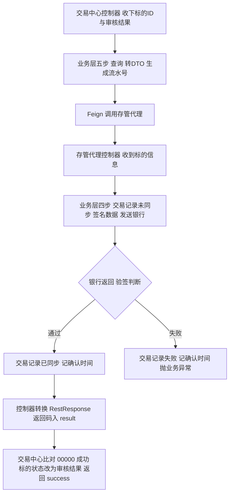

# 审核标的完善 Controller：两端收口，返回值各就各位

存管代理的 `createProject` 里，发送数据的 `sendHttpGet` 方法已经封装完毕，URL 拼好了，四大参数备齐了，但方法定义好之后还没有人调用它。方法不调用，请求就永远发不出去，银行那边什么都不会发生。与此同时，交易中心与存管代理两侧的控制器都还停在空实现上。这一课把最后的调用补上，再把两端的控制器收口，审核标的的编码工作到此全部完成，接下来就是集成测试。

## 先给结论

- `createProject` 尾部补上对 `sendHttpGet` 的调用，四个参数按位传入：业务名 `CREATE_PROJECT`、请求地址、业务数据 `reqData`、交易记录对象。
- 交易中心的控制器收口最简单：一行调用业务层方法，结果用 `RestResponse.success` 包装返回。
- 存管代理的控制器要做一次响应形态转换：业务层返回 `DepositoryResponseDTO<DepositoryBaseResponse>`，HTTP 层面对调用方的却是 `RestResponse<String>`，字段要手工搬。
- 转换的关键动作是把银行返回码装进 `RestResponse` 的 `result` 字段、把描述信息装进 `msg`，这正好解释了上一课交易中心为什么拿 `RETURN_CODE_00000` 去比对 `getResult()`。

## 补上那次调用：方法不调，请求不发

`sendHttpGet` 封装了发送与状态回写的全部逻辑，但它只是个私有方法，得由主流程显式调起来。`createProject` 的收尾就一行：

```java
/** 存管代理业务层 createProject 收尾 按讲义口径整理 包名按 com.study.finance 系改写 */
// 3.往银行存管系统发送数据 拼接银行端入口地址
String url = configService.getDepositoryUrl() + "/service";
// 4.发送请求并按结果修改状态返回结果
return sendHttpGet("CREATE_PROJECT", url, reqData, depositoryRecord);
```

四个参数各有来头。业务名 `CREATE_PROJECT` 与银行端有约定，含义是创建标的，这个值不能随手乱写，写错银行端就不知道这是哪类业务；`url` 是从 Apollo 配置取出的银行基本路径再拼上银行端接口映射 `/service`；`reqData` 是前两步组装并编码好的业务数据；`depositoryRecord` 是第一步落库的交易记录，`sendHttpGet` 内部要靠它回写同步状态与确认时间。方法内部还会从 Apollo 补一个平台编号，签名则由拦截器在请求发出前自动完成，业务代码都不用操心。调用补上后，2.3 到 2.9 的存管代理侧代码全部贯通。

## 交易中心控制器：一行调用，一层包装

交易中心这边的控制器收口没有悬念，调用业务层、包装返回：

```java
/** 交易中心控制器 审核标的收口 按讲义口径整理 包名按 com.study.finance 系改写 */
@PutMapping("/m/projects/{id}/projectStatus/{approveStatus}")
public RestResponse<String> projectsApprovalStatus(@PathVariable("id") Long id,
        @PathVariable("approveStatus") String approveStatus) {
    String result = projectService.projectsApprovalStatus(id, approveStatus);
    return RestResponse.success(result);
}
```

前端传来的标的 ID 与审核结果原样交给业务层，业务层五步走完返回 `success` 字符串；同步失败时业务层直接抛 `BusinessException`，控制器不接、不转、不吞，交给全局异常处理统一变成错误响应。控制器只做两件事：把请求参数递进业务层，把业务层的结果装进统一响应壳。业务规则与协议包装分层，是这套代码始终贯彻的口径。

## 存管代理控制器：一次响应形态的转换

存管代理的控制器有意思得多。业务层 `createProject` 返回的是 `DepositoryResponseDTO<DepositoryBaseResponse>`，这是与银行报文对应的类型，`respData` 装业务数据、`signature` 装签名；而 HTTP 层要对交易中心返回的是全项目统一的 `RestResponse<String>`。两个类型字段名对不上、语义也对不上，谁也不能直接返回给谁，控制器于是承担了一次手工组装：

```java
/** 存管代理响应对象结构 节选 包名按 com.study.finance 系改写 */
public class DepositoryResponseDTO<T> implements Serializable {

    @ApiModelProperty("业务数据报文")
    private T respData;

    @ApiModelProperty("签名")
    private String signature;
}

public class DepositoryBaseResponse implements Serializable {

    @ApiModelProperty("返回码")
    private String respCode;

    @ApiModelProperty("错误信息")
    private String respMsg;

    @ApiModelProperty("交易状态")
    private Integer status;

    @ApiModelProperty("请求流水号")
    private String requestNo;
}
```

外层的 `respData` 是泛型，指向内层 `DepositoryBaseResponse`，银行返回的明细全在里面。控制器的转换代码只取两个值：

```java
/** 存管代理控制器 响应形态转换 按讲义口径整理 包名按 com.study.finance 系改写 */
@Override
@ApiOperation(value = "向存管系统发送标的信息", required = true,
        dataType = "ProjectDTO", paramType = "body")
@PostMapping("/l/createProject")
public RestResponse<String> createProject(@RequestBody ProjectDTO projectDTO) {
    DepositoryResponseDTO<DepositoryBaseResponse> depositoryResponse =
            depositoryRecordService.createProject(projectDTO);
    RestResponse<String> restResponse = new RestResponse<String>();
    // 返回码装进 result
    restResponse.setResult(depositoryResponse.getRespData().getRespCode());
    // 描述信息装进 msg
    restResponse.setMsg(depositoryResponse.getRespData().getRespMsg());
    return restResponse;
}
```

`result` 里装的是银行返回码，`msg` 里装的是描述信息，只搬这两样，因为交易中心那边只关心成败与原因。看到这里，上一课留下的疑问就有了答案：交易中心的判断条件是 `RETURN_CODE_00000.getCode().equals(restResponse.getResult())`，拿返回码比 `result` 字段，正是因为存管代理控制器把银行返回码装在了那里。两个服务隔着一层 HTTP，返回值能严丝合缝地对上，靠的就是这次转换里约定好的字段口径。

## 状态流转与返回链路的全景

控制器收口后，整条审核链路的状态流转可以一口气串起来：



读图要盯住两个状态字段的联动：交易记录在存管代理侧从未同步走向已同步或失败，标的数据状态在交易中心侧从落库时的未发布走向审核结果对应的值，两个状态的先后由银行回执串起来，谁也不抢跑。审核结果本身始终是前端传入的 1 或 2，后端只是搬运与执行。到这里，交易中心与存管代理两侧的代码全部完成，联调测试之后这条链路就能在管理平台上真实跑通。

## 常见误区

- **方法定义了却忘了调用。** 错例：`sendHttpGet` 写完就以为请求会自动发出，测试时无报错但银行端查不到记录。正解：私有方法必须显式调用，`createProject` 尾部补上四参数调用，缺失调用不会报编译错误，只能靠测试发现。
- **把 `DepositoryResponseDTO` 直接返回给调用方。** 错例：控制器原样透传业务层返回值，破坏全项目统一的响应形态。正解：手工转换成 `RestResponse<String>`，取银行返回码与描述信息两个字段组装。
- **`result` 与 `msg` 张冠李戴。** 错例：把描述信息装进 `result`、返回码装进 `msg`。正解：`result` 装银行返回码，供交易中心与 `00000` 比对；`msg` 装描述信息，装反了判断条件永远不成立。
- **在控制器里堆业务逻辑。** 错例：状态修改、银行调用写进控制器方法。正解：控制器只做参数转手与响应包装，规则留在业务层，异常交给全局处理。

## 面试可能被问到的问题

1. 面试官追问：「为什么业务层和控制器层的返回类型不一样？」
   答：业务层面向领域与内部调用，返回贴近业务语义的类型，比如存管代理的 `DepositoryResponseDTO`；控制器面向 HTTP 契约，必须返回全项目统一的 `RestResponse` 壳。两层各自稳定，转换成本集中放在控制器一处，业务层重构不影响对外契约。
2. 面试官追问：「`RestResponse` 的 `result` 字段装银行返回码，不会显得语义混乱吗？」
   答：这是调用方与被调方的约定取舍。交易中心只关心同步成败，把银行返回码放进 `result` 让调用方一次比对就能拿到结论；报文明细留在存管代理的交易记录里。更严格的方案是扩展返回码枚举或封装专用结果对象，代价是契约变复杂，两套口径各有适用场景。
3. 面试官追问：「控制器层应该承担哪些职责，哪些不该？」
   答：该做的只有参数校验与绑定、调用业务层、包装响应三件；不该做业务规则、状态修改、跨服务调用编排。本课交易中心控制器一行调用加一层包装就是标准形态，存管代理的响应转换也只搬字段，不掺规则。
4. 面试官追问：「怎么验证存管代理这段代码真的生效了？」
   答：看交易记录表的状态变化：审核触发后记录从未同步变已同步或失败，确认时间被回写；再看交易中心标的的数据状态是否随审核结果更新。集成测试时两侧状态联动，任何一侧不动都能定位问题在哪层。

## 配套资料

- 讲义：`materials/docs/10/万信金融-第3章-讲义-发标v1.0.md`，3.5.2 功能实现：3.5.2.1 第 4 步完善 `TransactionController`、3.5.2.2 第 5 步完善 `DepositoryAgentController`，响应转换与调用收尾的出处。
- 代码：`materials/code/10/wanxinp2p_apollo/`，公共模块归档（目录保留原始命名，路径只列到该层级），`RestResponse` 真实源码可对照，其 `code`、`msg`、`result` 三字段与 `setMsg` 方法名是转换代码的依据。
- 代码：`materials/code/10/wanxinp2p/`，P2P 工程归档（目录保留原始命名，路径只列到该层级），工程结构与公共工具可对照。
- 说明：交易中心与存管代理服务工程未随仓库归档；控制器实现与 `DepositoryResponseDTO`、`DepositoryBaseResponse` 结构按画面线与讲义口径整理，包名按 `com.study.finance` 系改写。
