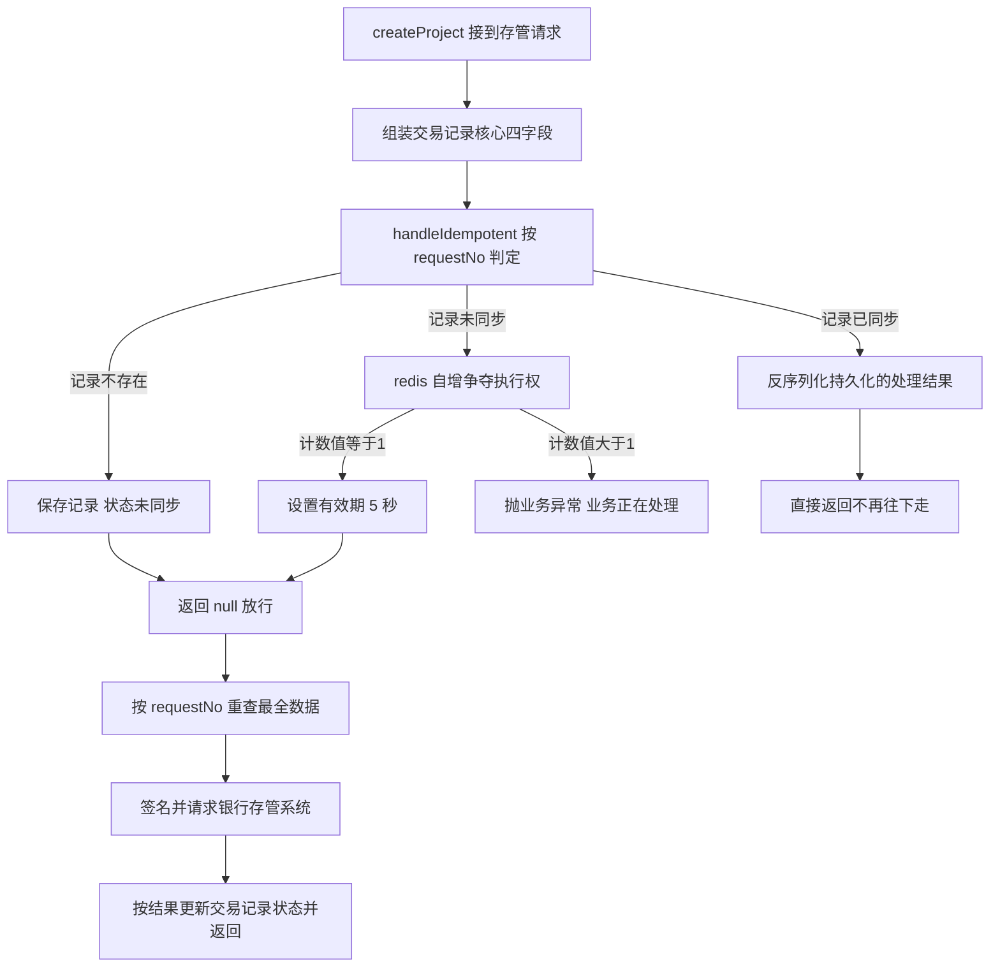

# 幂等性功能实现：把三段式防重写进审核链路

防重思路已经定稿：按 `requestNo` 查交易记录，按不存在、未同步、已同步三种情况分流。剩下的工作就是把它落成代码。落点在存管代理服务的 `DepositoryRecordServiceImpl`：新增两个按流水号查询的私有方法，改造保存方法，把幂等处理方法的三段逻辑写全，再调整 `createProject` 的执行顺序并注入 Redis 操作类。写完之后，同一笔审核无论重复多少次，数据库里都只会有一条交易记录。

## 先给结论

- 查询封装成两个私有方法：`getEntityByRequestNo` 用条件构造器按 `requestNo` 查实体，`getByRequestNo` 在其上把实体转成 DTO。
- `saveDepositoryRecord` 改造为接收现成对象的版本，方法内只补创建时间与未同步状态再保存，核心字段由调用方组装。
- `handleIdempotent` 三段式：记录不存在则保存并返回 `null` 放行；记录未同步则 `cache.incrBy(requestNo, 1L)` 争夺执行权，计数值等于 1 设 5 秒有效期后放行，大于 1 抛业务异常；记录已同步则把持久化的处理结果反序列化后直接返回。
- `createProject` 改为先组装交易记录对象交给 `handleIdempotent`，返回非空直接短路返回，返回 `null` 才继续签名与调用银行存管系统。
- 细节一：组装对象时只放了四个核心字段，保存方法补齐两个字段，所以发送银行前要按 `requestNo` 重查一次，保证发出的数据最全。
- 细节二：Redis 操作通过公共工程的 `Cache` 接口注入，实现类 `RedisCache` 封装 `StringRedisTemplate`。

## 第一步：两个按流水号查询的方法

判断记录是否存在，靠一个按 `requestNo` 等值查询。讲义把它封装成两层：底层查实体，上层转 DTO。条件构造器用 MyBatis-Plus 的 `QueryWrapper`，范型对着表实体：

```java
/** 按请求流水号查询 包名按 com.study.finance 系改写 */
private DepositoryRecord getEntityByRequestNo(String requestNo) {
    return getOne(new QueryWrapper<DepositoryRecord>().lambda()
            .eq(DepositoryRecord::getRequestNo, requestNo));
}

private DepositoryRecordDTO getByRequestNo(String requestNo) {
    DepositoryRecord depositoryRecord = getEntityByRequestNo(requestNo);
    if (depositoryRecord == null) {
        return null;
    }
    DepositoryRecordDTO depositoryRecordDTO = new DepositoryRecordDTO();
    BeanUtils.copyProperties(depositoryRecord, depositoryRecordDTO);
    return depositoryRecordDTO;
}
```

两层各司其职：底层方法返回实体，后面重查发送数据时直接复用；上层方法返回 DTO，幂等判断里读状态、读响应数据用的都是 DTO 的字段。`getOne` 配合 `requestNo` 的唯一索引，最多命中一行，语义干净。

## 第二步：保存方法改造成接收现成对象

旧版 `saveDepositoryRecord` 逐个字段赋值再保存，流水号、类型、关联实体这些信息散在方法内部。为了让幂等方法在「保存」之前就能拿到完整的记录对象，把组装动作挪到调用方，保存方法改成接收现成对象，只补两个公共字段：

```java
/** 保存交易记录 重载版 核心字段由调用方组装 包名按 com.study.finance 系改写 */
private void saveDepositoryRecord(DepositoryRecord depositoryRecord) {
    // 设置请求时间
    depositoryRecord.setCreateDate(LocalDateTime.now());
    // 设置数据同步状态 未同步
    depositoryRecord.setRequestStatus(StatusCode.STATUS_OUT.getCode());
    // 保存数据
    save(depositoryRecord);
}
```

调用方在组装对象时给四个核心字段赋值：请求流水号、请求类型（发标业务对应创建类型常量）、关联业务实体类型（标的信息对应字符串 `Project`）、关联业务实体 ID（标的表主键）。时间与同步状态属于存储细节，留在保存方法里补齐，职责边界清晰。

## 第三步：handleIdempotent 三段式落地

核心方法按讲义口径完整实现。三段逻辑的顺序经过刻意的调整：分析时按「不存在、已同步、未同步」讲，编码时把已同步的判断挪到最后，因为已同步是终态，最需要尽早拦截的并发窗口要排在前面：

```java
/**
 * 实现幂等性
 * @param depositoryRecord 交易记录对象
 * @return 需要直接返回的响应 为 null 表示放行
 */
private DepositoryResponseDTO<DepositoryBaseResponse> handleIdempotent(
        DepositoryRecord depositoryRecord) {
    // 根据 requestNo 查询交易记录
    String requestNo = depositoryRecord.getRequestNo();
    DepositoryRecordDTO depositoryRecordDTO = getByRequestNo(requestNo);

    // 1. 交易记录不存在 说明此前请求没有成功过 保存后放行
    if (depositoryRecordDTO == null) {
        saveDepositoryRecord(depositoryRecord);
        return null;
    }

    // 2. 交易记录存在且状态为未同步 并发窗口 用 redis 原子自增争夺执行权
    if (StatusCode.STATUS_OUT.getCode() == depositoryRecordDTO.getRequestStatus()) {
        // 如果 requestNo 不存在则返回 1 已存在则返回 已有个数加 1
        Long count = cache.incrBy(requestNo, 1L);
        if (count == 1) {
            // 抢到执行权 设置有效期 覆盖整条链路的估计耗时
            cache.expire(requestNo, 5);
            return null;
        }
        // 计数值大于 1 已有线程在执行 直接返回业务正在处理
        throw new BusinessException(DepositoryErrorCode.E_160103);
    }

    // 3. 交易记录存在且状态为已同步 核心业务已处理完 直接返回持久化的处理结果
    return JSON.parseObject(depositoryRecordDTO.getResponseData(),
            new TypeReference<DepositoryResponseDTO<DepositoryBaseResponse>>() {});
}
```

三个出口对应三种命运：返回 `null` 放行、抛业务异常短路、返回处理结果。第一段解决数据重复保存，第二段解决短时间重复点击，第三段让超时后的迟到请求也能拿到与首次执行完全一致的结果。

Redis 操作的注入依赖公共工程的缓存封装。公共工程定义了 `Cache` 接口，`RedisCache` 是它的 Redis 实现，内部包着 `StringRedisTemplate`。幂等逻辑里用到的两个方法，真实源码节选如下：

```java
/** Cache 接口的 Redis 实现 节选自公共缓存封装 包名按 com.study.finance 系改写 */
@Autowired
private Cache cache;

public Long incrBy(String key, Long delta) {
    return redisTemplate.opsForValue().increment(key, delta);
}

public void expire(String key, int expire) {
    redisTemplate.expire(key, expire, TimeUnit.SECONDS);
}
```

业务代码面向 `Cache` 接口注入，底层实现是 Redis 还是别的缓存都随时可换，这也是公共工程把缓存操作抽成接口的意义。`incrBy` 的原子性由 Redis 保证，多实例集群同时自增同一个 key 也不会计数错乱，这正是方案敢把它当执行权裁判的底气。

## 第四步：createProject 的执行顺序重排

幂等方法写好了，调用方 `createProject` 也要动刀。改造前它组装完记录直接保存、签名、发银行；改造后组装动作保留，保存动作交给幂等方法代管：

```java
/** 存管代理保存标的 改造后 节选 包名按 com.study.finance 系改写 */
@Override
public DepositoryResponseDTO<DepositoryBaseResponse> createProject(ProjectDTO projectDTO) {
    // 组装交易记录核心字段 流水号 业务类型 关联实体类型 关联实体ID
    DepositoryRecord depositoryRecord = new DepositoryRecord(
            projectDTO.getRequestNo(), DepositoryRequestTypeCode.CREATE.getCode(),
            "Project", projectDTO.getId());

    // 1. 幂等性实现 返回非 null 表示可直接返回上次处理结果
    DepositoryResponseDTO<DepositoryBaseResponse> responseDTO = handleIdempotent(depositoryRecord);
    if (responseDTO != null) {
        return responseDTO;
    }

    // 按 requestNo 重查一次 拿到补齐了创建时间与状态的最全数据
    depositoryRecord = getEntityByRequestNo(projectDTO.getRequestNo());

    // 2. 签名数据 ProjectDTO 转 ProjectRequestDataDTO 转 JSON 再 Base64 编码
    // 3. 往银行存管系统发送数据 根据结果修改交易记录状态并返回结果
    String jsonString = JSON.toJSONString(
            convertProjectDTOToProjectRequestDataDTO(projectDTO, projectDTO.getRequestNo()));
    String reqData = EncryptUtil.encodeUTF8StringBase64(jsonString);
    return sendHttpGet("CREATE_PROJECT", configService.getDepositoryUrl() + "/service",
            reqData, depositoryRecord);
}
```

返回值的判断逻辑要吃透。`handleIdempotent` 的三个出口里，抛异常的分支不会返回，直接被全局异常处理接住；返回非空只有已同步一种可能，调用方拿到就原路返回，本次请求到此结束；返回 `null` 说明要么刚保存了记录（情况一），要么刚抢到执行权（情况二），这两种都要继续往下走签名与同步。一个 `null` 判断，背后是三种分支的收敛。

这张图在讲改造后 `createProject` 的完整执行流：



## 为什么发送前要重查一次

改造带来一个不起眼但必须处理的细节。调用方组装的记录对象只有四个核心字段，保存方法在落库时补了创建时间与同步状态，这两个值只存在于数据库里，原对象引用里没有。后续更新交易记录状态时如果直接用原对象，会把这两个字段写丢；发给银行存管系统的数据也要最全的那份。所以在继续往下走之前，按 `requestNo` 重查一次，让 `depositoryRecord` 指向数据库里最完整的行，再进入签名与发送环节。重查一行数据成本极低，换来的是数据一致性，这笔账怎么算都划算。

## 常见误区

- **计数值判断写歪。** 错例：把 `count == 1` 写成 `count <= 1` 或对 `null` 不设防，语义从「第一个到达者」变成别的含义。正解：自增返回 1 就是本 key 的第一个操作者，判定就用等值比较，其余值一律拦截。
- **抢到执行权忘记设有效期。** 错例：只自增不 `expire`，流水号 key 永久残留，内存被无意义占用。正解：设为 1 立刻设置有效期，取值覆盖整条链路估计耗时。
- **放行分支误返回了响应对象。** 错例：情况一保存后顺手 `return responseDTO`，而 `responseDTO` 为 `null` 恰好是放行信号，直接返回导致调用方拿不到结果继续走，日志里还以为正常。正解：方法出口按约定统一，放行就是 `return null`，结果返回只在已同步分支发生。
- **重查环节省掉，直接用原对象更新。** 错例：组装对象只有四个字段，保存方法补的两个字段不在对象里，后续 `updateById` 会把它们写回空值。正解：保存动作发生在方法内部时，用原对象做后续更新前必须重查。
- **异常分支当普通返回处理。** 错例：在 `createProject` 里 try 住幂等方法，把「业务正在处理」的异常吞掉继续执行。正解：抛异常就是要短路，让全局异常处理器把它转成业务提示返回给调用方。

## 面试可能被问到的问题

1. 面试官追问：「`incrBy` 返回 1 和大于 1 分别意味着什么？」
   答：返回 1 表示这个流水号 key 在 Redis 里此前不存在，本次请求是第一个到达者，获得执行权；返回大于 1 表示 key 已存在且已有请求在执行，本次请求应立即返回正在处理的提示。自增的原子性让这个判定在并发下依然准确。
2. 面试官追问：「有效期为什么设 5 秒？设长设短分别有什么后果？」
   答：按整条审核链路的估计耗时设定，包含签名与银行同步的时间。设太短，首次请求还没执行完 key 就过期，超时后的重试会绕过防重再走一遍；设太长，窗口内的合法重试会被误挡为正在处理。取值要与业务耗时匹配，必要时做成可配置。
3. 面试官追问：「已同步的分支为什么能直接返回结果？结果从哪来的？」
   答：已同步说明首次请求已把银行同步做完，结果报文在那一刻随交易记录一起持久化到了响应数据字段，重复请求反序列化后原样返回，调用方拿到的内容与首次执行完全一致。若结果没有持久化，这条分支就无果可返，方案不成立。
4. 面试官追问：「为什么注入 `Cache` 接口而不是直接用 `StringRedisTemplate`？」
   答：公共工程把缓存操作抽成接口并给出 Redis 实现，业务面向接口编程，底层缓存实现可替换；接口方法名是业务语义化的 `incrBy`、`expire`，比直接暴露模板对象的 API 可读性更好，也便于统一维护过期策略。
5. 面试官追问：「`getOne` 查到多条会怎样，为什么这里敢用？」
   答：MyBatis-Plus 的 `getOne` 期望最多一行，多条时会抛异常。这里敢用是因为 `requestNo` 建了唯一索引，物理上保证了最多一条命中，查询语义与约束一致；如果字段没有唯一约束，就该换 `list` 加业务判断或先补约束。
6. 面试官追问：「幂等方法抛出的业务异常最终以什么形式返回给前端？」
   答：全局异常处理器捕获 `BusinessException`，按错误码字典翻译成统一响应结构返回，前端收到的是「业务正在处理」这类业务提示而不是 500 报错。防重的拒绝动作以业务语义呈现，用户知道稍后重试即可。

## 配套资料

- 讲义：`materials/docs/10/万信金融-第3章-讲义-发标v1.0.md`，3.6.2 功能实现（`handleIdempotent`、`getByRequestNo`、`getEntityByRequestNo` 完整代码与 `createProject` 改造）。
- 代码：`materials/code/10/sailing/`，公共缓存封装归档（目录保留原始命名，路径只列到该层级），`Cache` 接口与 `RedisCache` 实现真实源码可对照，`incrBy`、`expire` 方法节选自该文件。
- 代码：`materials/code/10/wanxinp2p_apollo/`，公共模块归档（目录保留原始命名，路径只列到该层级），`EncryptUtil` 的 Base64 编码方法可对照。
- 说明：存管代理服务工程随课程资料单独提供，未随仓库归档，幂等实现代码按讲义口径整理，包名按 `com.study.finance` 系改写；错误码字典以课程错误码常量为准。
