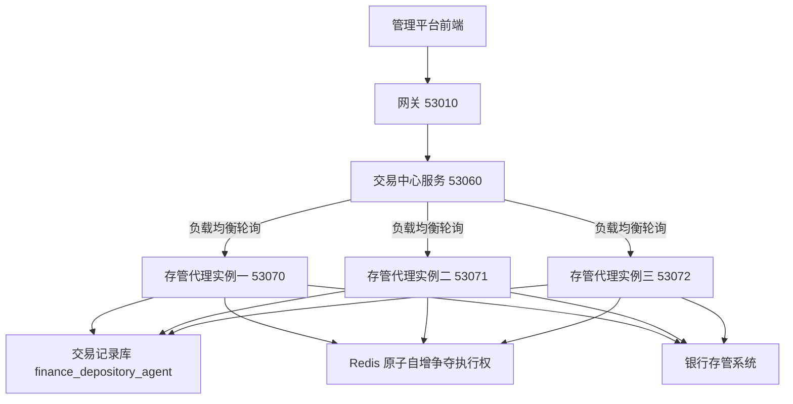
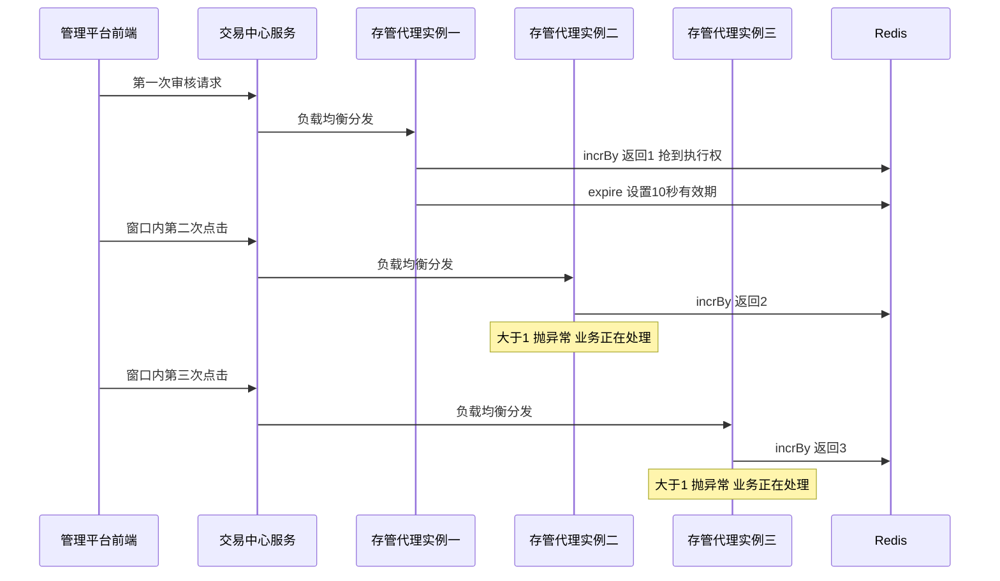

# 幂等性测试：流水号持久化、三实例集群与重复请求实测

幂等性的三段式防重代码已经写进审核链路，按理说接下来就是功能测试。但直接开测会撞上一个尴尬的现实：幂等代码依赖请求流水号 `requestNo` 做判定，而流水号现在的生成方式恰好让防重完全失效。所以这一课分成两段：先做测试准备，把流水号的生成与持久化方式改掉，再把银行返回的处理结果存下来，为三种情况补齐数据基础；然后按真实集群环境实测，验证重复保存被拦住、重复请求只放行一个。两个视频合起来正好是幂等性的完整收官。

## 先给结论

- 溯源发现：幂等判定用的 `requestNo` 是交易中心在每次收到请求时用工具类现场生成的，UUID 拼接保证每次都不同，幂等查询永远查空，防重形同虚设，这是测试前必须修掉的欠账。
- 改造一：标的信息表新增 `REQUEST_NO` 字段，分库分表下四个真实表都要加；交易中心生成流水号前先查标的记录，为空才生成，生成后立即回写持久化，后续请求复用第一次的值。
- 改造二：交易记录表新增 `RESPONSE_DATA` 字段，银行存管系统返回的处理结果在收到时随交易记录一起更新落库，幂等第三种情况「直接返回处理结果」才有数据可返。
- 测试环境：存管代理服务本地启动三个实例（53070、53071、53072）模拟集群，另外要启动 Redis，因为第二种情况依赖它的原子自增；内容检索服务与本课无关可以不启。
- 实测两个用例：同一笔审核发两次请求，交易记录只保存一次；10 秒窗口内连发三次请求，只有第一次拿到执行权，后两次被「业务正在处理」挡回。

## 测试准备：幂等代码之外的欠账

### 追着 requestNo 走一遍：它出生在交易中心

幂等代码在存管代理服务里，判定依据是参数对象里的 `requestNo`。这个值从哪来，值得从消费端一路往回追。`handleIdempotent` 从入参的交易记录对象里取流水号；交易记录对象在 `createProject` 方法里组装，流水号来自入参的标的信息 DTO；再往上，DTO 是 Controller 方法参数经 Feign 远程调用传进来的；而 Controller 的调用方在交易中心。交易中心业务层的审核方法里找到了出生地：请求流水号通过工具类生成，工具类的真实实现是把业务前缀拼上一个去掉横线的大写 UUID：

```java
/** 流水号生成工具 节选自公共工程真实源码 包名按 com.study.finance 系改写 */
public class CodeNoUtil {

    /**
     * 使用 UUID 生成编码
     * @param prefixCode 前缀用于标识不同业务 已用枚举类型规定业务名称
     */
    public static String getNo(CodePrefixCode prefixCode) {
        return prefixCode.getCode()
                + UUID.randomUUID().toString().replaceAll("-", "").toUpperCase();
    }
}
```

前缀来自公共工程的枚举常量，请求流水号对应 `REQ_` 前缀。UUID 每次生成都不同，这正是发标编码这类场景要的特性，却也恰恰是幂等场景的毒药。

### 每次都重新生成，幂等形同虚设

问题在调用时机上。审核方法收到请求就调用生成器，前端每发一次请求，交易中心就生成一个全新的 `requestNo`。幂等处理按流水号查交易记录，流水号每次都不同，查询永远落空，每个请求都被当成第一次，保存动作每次都执行，防重等于没做。方案设计的凭证机制没错，错在凭证没有传承：同一个业务操作的重试，必须携带同一个流水号，判定才有意义。

解决思路由此明确：让流水号只有第一次请求生成新值，之后的所有请求都复用第一次的值。承载复用的载体就是数据库，把第一次生成的值存到标的信息表里，后续请求先查表，有值直接用，没值才生成。凭证从「每次现场发放」变成「首次发放、终身持有」。

### 改造一：流水号第一次生成后持久化到标的表

标的信息表在分库分表下已经是四个真实表：两个交易库各两张。任何标的都可能落进其中任何一张，四个表都要加字段，SQL 脚本按讲义口径整理如下（库名按本项目命名口径改写）：

```sql
-- 标的信息表新增发标请求流水号字段 四个真实表都要加
ALTER TABLE `finance_transaction_0`.`project_0`
    ADD COLUMN `REQUEST_NO` varchar(50) NULL COMMENT '发标请求流水号' AFTER `IS_ASSIGNMENT`;
ALTER TABLE `finance_transaction_0`.`project_1`
    ADD COLUMN `REQUEST_NO` varchar(50) NULL COMMENT '发标请求流水号' AFTER `IS_ASSIGNMENT`;
ALTER TABLE `finance_transaction_1`.`project_0`
    ADD COLUMN `REQUEST_NO` varchar(50) NULL COMMENT '发标请求流水号' AFTER `IS_ASSIGNMENT`;
ALTER TABLE `finance_transaction_1`.`project_1`
    ADD COLUMN `REQUEST_NO` varchar(50) NULL COMMENT '发标请求流水号' AFTER `IS_ASSIGNMENT`;
```

表加了字段，配套的实体类要加属性：标的表实体 `Project` 与传输对象 `ProjectDTO` 各新增一个 `requestNo` 属性，字段映射用 `@TableField("REQUEST_NO")` 声明。真正见功力的是交易中心审核方法的改造，改动集中在生成流水号的那一步：

```java
/** 交易中心审核方法 流水号生成部分改造 包名按 com.study.finance 系改写 */
@Override
public String projectsApprovalStatus(Long id, String approveStatus) {
    // 1. 根据 id 查询标的信息并转换为 DTO 对象
    Project project = getById(id);
    ProjectDTO projectDTO = convertProjectEntityToDTO(project);

    // 2. 生成流水号 不存在才生成
    if (StringUtils.isBlank(project.getRequestNo())) {
        projectDTO.setRequestNo(CodeNoUtil.getNo(CodePrefixCode.CODE_REQUEST_PREFIX));
        // 第一次生成后回写持久化 后续请求查表复用
        this.update(Wrappers.<Project>lambdaUpdate()
                .set(Project::getRequestNo, projectDTO.getRequestNo())
                .eq(Project::getId, id));
    }
    // 3. 后续逻辑不变 携带流水号调用存管代理服务同步标的信息
    // ...
}
```

改造后的时序是：前端第一次点击审核，交易中心查标的记录，`requestNo` 为空，生成新值并回写标的表，然后带着这个值调用存管代理；幂等方法按它查交易记录，查空，保存，放行，一切如常。前端紧接着再发请求（无论重试还是连点），交易中心查表发现 `requestNo` 已有值，跳过生成，直接复用，存管代理按同一个流水号查到了上次保存的交易记录，防重逻辑开始真正工作。字符串判空用 `StringUtils.isBlank`，空值、空串都算未生成，比 `== null` 严谨。

### 改造二：把银行返回的处理结果存下来

幂等方案里有一种情况是：交易记录存在且状态已同步，本次请求什么都不做，直接返回上次的处理结果。上次的结果从哪拿？它从未被持久化过。银行存管系统返回的报文在第一次请求里被解析、被使用，然后就丢在内存里了，重复请求来了无果可返。所以要给交易记录表补一个字段，专门存这个结果：

```sql
-- 交易记录表新增处理结果字段 text 类型 银行返回报文可能较长
ALTER TABLE `finance_depository_agent`.`depository_record`
    ADD COLUMN `RESPONSE_DATA` text NULL COMMENT '处理结果' AFTER `CONFIRM_DATE`;
```

配套修改三处：交易记录实体 `DepositoryRecord` 与 `DepositoryRecordDTO` 各新增 `responseData` 属性；存管代理向银行发送请求并接收响应的方法里加一行赋值，把解析出的响应对象存进交易记录：

```java
/** sendHttpGet 方法新增的关键赋值 节选 包名按 com.study.finance 系改写 */
// 银行存管系统返回结果解析成功后 存入交易记录供幂等情况三复用
depositoryRecord.setResponseData(responseBody);
```

赋值这行加在状态判断之前，方法后面的成功与失败两个分支都会按 ID 执行 `updateById` 更新交易记录，无论银行同步成败，响应报文都随之落库。幂等情况三从此有了取数的来源：查到已同步的交易记录，读出 `responseData`，反序列化后原样返回，重复请求拿到与首次执行完全一致的结果。至此测试准备的两大块修改全部就位：一块围绕流水号的持久化，一块围绕处理结果的持久化，少改一处，测试都会出问题。

## 功能测试：把问题发生的场景搭出来

### 环境清单与三实例集群

测试要启动的东西比平时多。配置中心 Apollo 照常；Redis 必须启动，幂等情况二的自增争夺就靠它；后端微服务除内容检索服务外全部启动，内容检索属于后续章节的功能，本课用不到；管理平台前端启动管理端工程，审核操作从它的标的列表发起。

最关键的一步是把幂等问题发生的场景真实搭出来：存管代理服务在本地启动三个实例，端口分别为 53070、53071、53072，构成一个小集群。不模拟集群，所有请求都落在同一台机器上，跨节点的重复保存场景根本复现不出来，幂等测试就退化成单机自嗨。负载均衡会把交易中心发出的请求轮流分发到三个实例上，这张图在讲测试环境的拓扑与请求走向：



测试重点放在前两种情况：它们分别对应数据重复保存与短时间重复点击两个原始问题。第三种情况（已同步直接返回结果）逻辑最简单，留作动手练习，提示只有一个：断点必须加在交易记录状态被更新为已同步的那一步之后，状态没变，判定就不成立，断点位置加错会得出完全相反的观察结果。

### 用例一：交易记录只保存一次

验证目标是不管发多少次请求，交易记录只落一条。断点加在幂等方法的情况一判断处。第一次请求发出，请求落到某个实例上，断点命中，此时按流水号查出的 DTO 为 `null`，走保存分支。同时可以核对交易中心的改动：标的表里新增的 `REQUEST_NO` 字段，第一次请求前刷新是空值，请求发出后刷新出现了本次生成的流水号，实测中以 8155 开头的那串值为例，前后对比一目了然。流水号持久化的效果在数据库层面先得到确认。

单步放行，交易记录保存成功，方法返回 `null`，请求继续走签名与银行同步。紧接着发第二次请求，这次它可能落到另一个实例上，断点再次命中，观察点来了：DTO 不再是 `null`，按流水号查到了第一次保存的交易记录，保存分支被完整跳过，执行直接进入未同步状态的判断。两个请求，一条记录，数据重复保存的问题实测闭环。这一步的意义在于证明防重判定跨实例有效：第一次请求与第二次请求很可能由不同的 JVM 处理，它们靠数据库里的流水号与交易记录对齐状态，而不是靠各自内存里的任何东西。

### 用例二：短时间重复请求只放行一个

验证目标是执行权的争夺。为了模拟方便，把有效期从 5 秒临时改成 10 秒，给手速留出余量，改完三个实例都要重启。断点加在自增与设有效期的两行上。

第一次请求发出，断点命中，`cache.incrBy` 返回 1，Redis 里这个流水号是第一次出现；放行执行设置有效期那一行，10 秒的窗口开始计时。此刻立刻回到前端连点两次，拼手速的环节。两次请求先后到达交易中心，经负载均衡分别落到另外两个实例上，两个实例的断点先后命中，观察各自的 `count` 值：一个是 2，一个是 3，都大于 1，执行流直接走进抛异常的分支，业务异常带着「业务正在处理」的错误码被全局异常处理器转成响应返回。这张时序图在讲三次请求的执行权争夺过程：



三次请求，一个执行权，两个「正在处理」，方案的行为与设计完全一致。顺带验证了窗口机制本身：10 秒之后再点，key 已过期自清，新请求的自增又返回 1，按正常流程放行。短时间连点被挡、超时重试放行，两种重试语义被同一个机制区分开。

### 用例三：已同步直接返回结果，留给自己动手

第三种情况的测试方法给出提示但不再代劳。前置条件是某次请求把整条链路走完，交易记录状态已更新为已同步，响应报文已随更新写入 `RESPONSE_DATA` 字段。此时再发请求，幂等方法查出已同步的记录，读出响应数据反序列化直接返回，前端拿到与首次执行完全一致的结果。断点位置放在状态更新为已同步之后，再往后的请求就能在幂等方法内部观察到第三条分支的完整执行。这个用例的验证点还有一个隐藏项：核对交易记录表里 `RESPONSE_DATA` 字段确实存了银行返回的报文，没有这一列的持久化，第三条分支就是空中楼阁。

## 发标章收官复盘

幂等性测试通过，发标这一章的全部内容就此收官。回望整条路径：从发标需求分析出发，先为亿级交易数据做了分库分表的设计与落地，交易中心微服务环境搭建完成后，保存标的信息、查询标的信息两个基础能力依次成型，管理平台前端部署到位后进入审核标的的开发，交易中心与存管代理两端实现并集成测试通过，最后补上幂等性这道金融业务的底线防线。每个环节都在为下一个环节铺路：没有分库分表时的分片键设计，就没有后来四个真实表的字段变更；没有保存标的时搭好的 MyBatis-Plus 环境，就没有审核方法里顺手可得的条件构造器写法；没有审核链路对交易记录的落库，幂等判定就没有基线可依。

功能之外，这一章沉淀下来的方法论同样值钱：先分析并发场景再写防重代码；判定凭证必须持久化并且全局唯一；处理结果要留存，让重复请求无害通过；测试要按生产形态搭环境，集群场景不能省。这些原则会原样迁移到后续的投标、放款、还款章节，那里面的每一笔业务都更直接地触碰资金。

## 常见误区

- **只给一个表加字段。** 错例：只改了 `finance_transaction_0` 库的两张表，`finance_transaction_1` 库漏掉。正解：分库分表下同一逻辑表对应多个真实表，实体面向逻辑表操作，数据落进哪张表不确定，四个表必须同步加字段，漏一张就会在数据落进那张表时报错。
- **流水号判空用 `== null`。** 错例：`if (project.getRequestNo() == null)` 漏掉空串场景。正解：字符串判空用 `StringUtils.isBlank`，未生成、空串、空白统一视为没有值，避免脏数据绕过生成逻辑。
- **集群只起一个实例。** 错例：本地起一个存管代理实例就开测，重复请求全部落同一台。正解：至少三个实例模拟集群，让重复请求经负载均衡落到不同节点，才能验证防重跨实例有效。
- **有效期不改长就模拟连点。** 错例：按 5 秒的默认值连点，手速不够快窗口已过，观察不到争夺过程。正解：测试时把有效期临时调大（如 10 秒），测完记得改回业务值，调整参数是测试的自由，但环境要随参数重启。
- **情况三的断点加在状态更新之前。** 错例：断点加在银行同步完成前，交易记录还是未同步，怎么测都走不进「已同步返回结果」的分支。正解：断点加在状态更新为已同步的那一步之后，先让首次请求把状态固化，再做重复请求的验证。

## 面试可能被问到的问题

1. 面试官追问：「为什么请求流水号必须持久化到业务表，不能每次请求现生成？」
   答：流水号是幂等判定的凭证，同一业务操作的所有重试必须携带同一个流水号，服务端才有机会识别「这是同一件事」。现生成意味着每次请求都换一个凭证，防重查询永远落空。持久化到业务表后，首次生成终身复用，凭证有了传承，幂等判定才有意义。
2. 面试官追问：「流水号机制和数据库唯一索引各自兜什么底？」
   答：流水号加唯一索引拦截的是「同时查空、同时保存」的极短并发窗口，两个并发请求都判定记录不存在时，唯一约束保证只有一条插入成功；流水号机制拦截的是记录已存在后的重复执行。两者覆盖的窗口不同，合起来才是完整的防线。
3. 面试官追问：「本地怎么模拟微服务集群验证分布式问题？」
   答：同一个服务用不同端口启动多个实例，本项目存管代理用 53070、53071、53072 三实例模拟，配合注册中心的负载均衡，请求会轮流落到不同节点。跨节点的重复保存、执行权争夺这类问题只有在这个拓扑下才能复现，单实例测试对分布式缺陷基本是盲区。
4. 面试官追问：「处理结果为什么要持久化，幂等的第三种情况靠它做什么？」
   答：重复请求的语义不是「再执行一遍」而是「告诉我结果」，已同步分支要返回的是与首次执行完全一致的响应。把银行返回的报文随交易记录落库，重复请求才能原样递回结果；没有这份数据，要么伪造响应破坏一致性，要么只能报错，幂等就不完整。
5. 面试官追问：「自增 key 的有效期过大或过小有什么风险，你们怎么定的？」
   答：过小则首次请求还没执行完 key 就过期，窗口内的后续请求会绕过防重再走一遍；过大则合法的迟到重试被误挡为正在处理，用户体验受损。按整条链路估计耗时设定并留余量，本课按约五秒链路耗时设 5 秒，测试演示时临时调到 10 秒。
6. 面试官追问：「幂等测试的断点应该怎么加？」
   答：按验证目标定位。验证只保存一次，断点加在记录存在性判断处，观察两次请求的查询结果差异；验证执行权争夺，断点加在自增与设有效期处，观察计数值；验证已同步返回结果，断点必须加在状态更新为已同步之后。断点位置决定观察能否成立，加错位置结论会完全相反。

## 配套资料

- 讲义：`materials/docs/10/万信金融-第3章-讲义-发标v1.0.md`，3.6.3 功能测试（`REQUEST_NO` 与 `RESPONSE_DATA` 字段变更、实体与 DTO 属性新增、`projectsApprovalStatus` 与 `sendHttpGet` 修改、三实例集群启动注意事项）。
- 代码：`materials/code/10/wanxinp2p_apollo/`，公共模块归档（目录保留原始命名，路径只列到该层级），`CodeNoUtil` 与 `CodePrefixCode`（`REQ_` 请求流水号前缀）真实源码可对照。
- 代码：`materials/code/10/sailing/`，公共缓存封装归档（目录保留原始命名，路径只列到该层级），`Cache` 接口与 `RedisCache` 实现的 `incrBy`、`expire` 真实源码可对照。
- 说明：交易中心与存管代理服务工程随课程资料单独提供，未随仓库归档，字段变更脚本与改造代码按讲义口径整理，库名与包名按 `com.study.finance` 系口径改写；Redis 环境搭建见 `materials/docs/10/Redis安装指南.md`。
