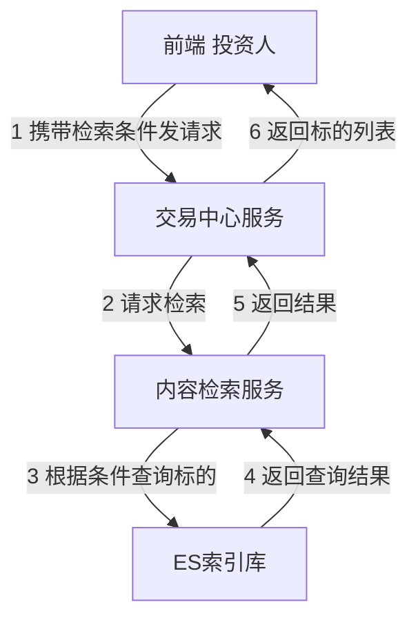
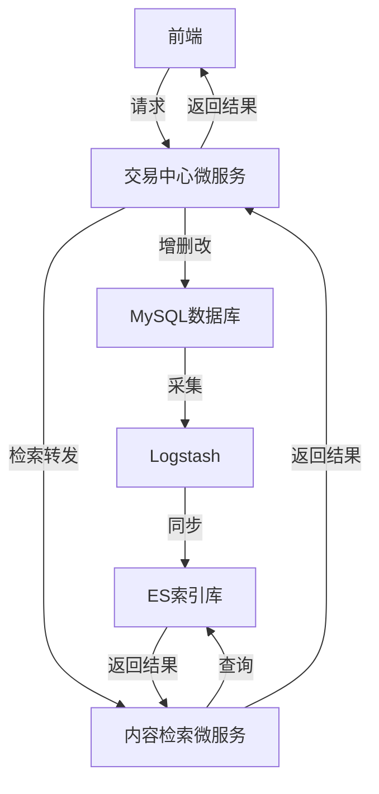

# 标的快速检索需求分析：分库分表之后，为什么还要上 Elasticsearch

发标与审核的功能已经落地，平台上的标会越积越多。投资人登录后想挑一个「利率高、期限短」的标，如果只能靠翻页慢慢找，体验显然说不过去；按利率区间、期限范围、还款方式组合筛选，才是投资人真正要用的功能。这套能力在 3.4 节其实做过一版：带条件、带排序、带分页的标的信息查询。既然功能已经有了，为什么还要专门开一节做「标的快速检索」？答案只有一个字：慢。

## 先给结论

- 已有的标的信息查询功能并不缺功能，缺的是性能：分页、按主键查、按分片字段查都没问题，撑不住的是模糊匹配与多字段过滤这类查询。
- 解决思路是全文检索技术：单独新建一个内容检索微服务，为整个项目提供全文检索能力，标的信息检索只是它的业务之一。
- 读写路径彻底分开：增删改继续操作 MySQL 数据库，快速检索一律走 Elasticsearch 索引库。
- MySQL 与 ES 是两个独立的库，必然引出数据同步问题，方案里用 Logstash 自动采集 MySQL 变化并同步到 ES，不需要人工干预。
- 交互链路固定六步：前端请求交易中心，交易中心远程调用内容检索服务，内容检索服务查 ES 索引库，结果原路逐层返回。

## 已有的查询为什么不敷使用

回看 3.4 节实现的那一版查询，接口定义是完整的，讲义里的签名带着条件对象、排序、分页三组参数：

```java
/**
 * 查询标的信息 3.4 节已实现的数据库分页查询 接口签名按讲义口径
 * @param projectQueryDTO 封装查询条件
 * @param pageNo 页码
 * @param pageSize 每页记录数
 * @param sortBy 排序字段
 * @param order 排序顺序
 * @return 分页后的标的信息
 */
RestResponse<PageVO<ProjectDTO>> queryProjects(ProjectQueryDTO projectQueryDTO,
        Integer pageNo, Integer pageSize, String sortBy, String order);
```

功能上挑不出毛病，问题藏在数据量里。为了提高数据库性能，交易中心的数据库已经做过分库分表与读写分离，但这套优化对查询类型的偏好非常明显：按主键查、按分片字段查、按分页翻，性能都没问题。客户实际要的查询却是另一类，比如在标的名称里模糊搜一个关键词，再叠加利率区间、期限范围多个字段过滤。模糊匹配落到 SQL 上就是 `LIKE`，而前置通配的 `LIKE` 无法利用索引，只能整表扫描。下面这条查询（表名按本项目分库分表口径，写法为按本课场景补的示例）在数据量上去之后会明显变慢：

```sql
-- 模糊匹配叠加多字段过滤 索引几乎帮不上忙
SELECT * FROM `finance_transaction_0`.`project_0`
WHERE NAME LIKE '%装修%'
  AND ANNUAL_RATE >= 8.0
  AND PERIOD <= 12
  AND PROJECT_STATUS = 'AUCTIONING';
```

分库分表还让这件事雪上加霜：同样的条件要在两个库的四张表上各查一遍再归并，扫描的总量不减反增。瓶颈不在功能实现，而在 MySQL 这类关系型数据库对全文检索场景的天生短板，所以引入 Elasticsearch 这类全文检索引擎，是分库分表、读写分离之后顺理成章的下一步优化。

## 检索链路：新建一个专职微服务

全文检索能力不是只服务标的这一处业务，项目里会有多处数据需要类似的检索，所以方案是单独创建一个微服务工程，即架构图里的内容检索服务，为整个项目提供全文检索服务。技术选型以 Elasticsearch 为主，Logstash 负责后面会讲到的数据同步。这张图在讲一次检索请求要经过的完整链路：



关键点在第二步：交易中心接到检索请求后不查自己的数据库，而是远程调用内容检索服务。交易中心的角色从「数据的持有者」退成「检索的转发者」，真正的查询发生在内容检索服务与 ES 索引库之间。整条链路没有写操作，纯粹是一个检索，性能优势完全来自查询目标从 MySQL 换成了 ES。

## 技术方案：增删改与查询分流

链路理顺之后，一个绕不开的问题立刻浮出来。标的信息的增删改，包括已经完成的发标、审核，操作的都是 MySQL 数据库；而快速检索要从 ES 索引库里查。ES 索引库不会自己长出数据来，用户刚发一个标、存进了 MySQL，紧接着来检索，ES 里根本没有这条数据，查了个寂寞。用一句话概括这个待解决问题：保证 MySQL 数据库和 ES 索引库两库之间的数据时刻保持同步。

最朴素的办法是增删改的时候两边都写：交易中心保存标的信息时，往 MySQL 写一份，再往 ES 写一份；删和改同样双写。能用，但业务代码要同时维护两种存储，交易中心的每个写接口都得背上这份复杂度。方案选了更省事的路径：用 Logstash 这个 Elasticsearch 生态里的实时数据采集引擎，专门负责两库同步。这张图在讲读写分流与同步通道的全貌：



分流规则看图即明：所有增删改只走 MySQL 这条线，Logstash 在旁边持续采集 MySQL 的变化并同步进 ES；所有快速检索走内容检索服务与 ES 这条线。业务代码完全不感知 ES 的存在，同步这件事由 Logstash 通过配置自动完成，后续只需要把它的配置文件准备到位。至于 Logstash 怎么安装、怎么配置增量采集、怎么测试，是接下来几课的全部内容。

## 常见误区

- **以为已有查询功能重复建设。** 错例：看到「快速检索」与 3.4 节的「查询标的信息」参数几乎一样，认为功能重复。正解：两版接口的差别在数据源，前者查 MySQL，满足常规分页查询；后者查 ES 索引库，专为模糊匹配与多字段过滤这类慢查询兜底，是性能分层而不是功能重复。
- **在交易中心里双写 ES。** 错例：发标、审核的每个写接口里同时写 MySQL 与 ES。正解：双写让业务代码耦合第二种存储，增删改的每一个入口都要维护；改用 Logstash 独立同步后，业务代码只面对 MySQL，同步策略集中在 Logstash 配置里调整。
- **忽略分库分表对慢查询的放大效应。** 错例：认为分库分表之后所有查询都变快了。正解：分库分表优化的是按主键、按分片键的查询，模糊匹配与多字段过滤依然要扫表，而且同样的条件要扫两个库的四张表再归并，瓶颈反而更突出。

## 面试可能被问到的问题

1. 面试官追问：「项目已经做了分库分表，为什么还要引入 Elasticsearch？」
   答：分库分表与读写分离优化的是按主键、按分片字段、按分页的查询路径，而模糊匹配、多字段过滤这类查询无法走索引，数据量大时仍然要扫表，分库后还要扫多个库再归并。全文检索引擎用倒排索引解决这类查询，是针对查询类型的补充优化，两者解决的不是同一个瓶颈。
2. 面试官追问：「MySQL 和 ES 的数据同步有哪些方案，你们为什么选 Logstash？」
   答：常见方案有业务代码双写、监听 binlog 的中间件（如 Canal）、以及 Logstash 定时轮询采集。双写侵入业务代码且难以处理失败补偿；binlog 方案对基础设施有额外要求。Logstash 只需要一份配置文件，通过 JDBC 轮询加时间戳条件即可实现增量同步，成本低、改动小，对本项目的同步实时性要求（秒级延迟可接受）完全够用。
3. 面试官追问：「内容检索服务为什么要单独拆一个微服务，而不是在交易中心里加一个 ES 查询模块？」
   答：项目里有多处业务数据都有全文检索需求，检索能力是全项目共享的基础能力，不是交易中心一家的私产。拆成独立微服务后，ES 客户端配置、索引管理、检索实现集中在一处，其他微服务通过远程调用复用，交易中心也保持了自己「只管交易写路径」的单一职责。
4. 面试官追问：「检索请求为什么由交易中心转发，前端直接请求内容检索服务不行吗？」
   答：架构上所有前端请求统一经网关按业务路由，交易中心是标的业务的归属方，前端对「标的检索」这个业务的依赖对象是交易中心。让交易中心转发还能在内部统一做鉴权、限流与结果加工，前端不需要感知后端有几种数据源。
5. 面试官追问：「引入 ES 之后，系统一致性风险点在哪里？」
   答：风险点在两库之间的同步窗口。MySQL 写成功到 Logstash 完成同步之间存在秒级延迟，期间检索结果会滞后；若同步任务故障，滞后会拉长。应对方式是监控同步任务、利用 `sql_last_value` 断点续传机制保证不丢数据，并对检索结果允许短暂滞后的业务语义达成共识。

## 配套资料

- 讲义：`materials/docs/10/万信金融-第3章-讲义-发标v1.0.md`，第 4 节「标的快速检索」（4.1 需求分析、4.2 技术方案，含交互流程与技术选型）。
- 代码：`materials/code/10/wanxinp2p_apollo/`，项目公共模块归档（目录保留原始命名，路径只列到该层级），`RestResponse`、`PageVO` 等接口签名涉及的公共类型真实源码可对照。
- 说明：内容检索微服务与 Logstash 配置随课程资料单独提供，未随仓库归档；示例 SQL 按本课场景按主流写法补全，表名、索引库名与包名均按 `com.study.finance` 系口径改写。
