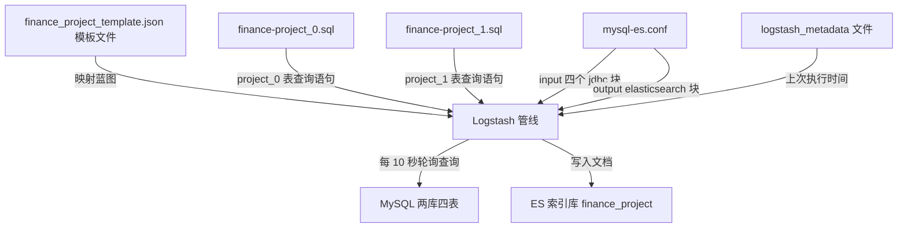
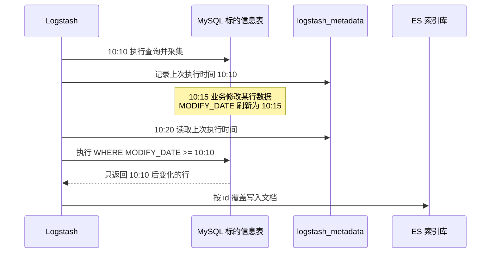

# Logstash 数据同步：从安装插件到增量采集，把标的信息搬进 ES 索引库

> 🔒 安全提示：文中示例的口令/密钥均为课程教学环境演示口径，生产环境的安全要求见《安全与合规须知》。

ES 环境立起来了，标的索引库 `finance_project` 与映射也已就位，但索引库还是空的。标的信息的增删改都发生在 MySQL，两库之间的同步靠 Logstash 完成。这一课把 Logstash 从零到可用完整走一遍：下载安装、装采集插件、准备配置文件、理解增量采集原理，最后用真实数据修改验证同步真的在工作。内容覆盖环境搭建、两段配置、工作原理与测试四个环节，环环相扣，任何一环缺位，后面开发检索功能时 ES 里都查不到数据。

## 先给结论

- Logstash 版本取 7.3.1，与 Elasticsearch 版本严格一致；它在本项目中的唯一职责是从 MySQL 采集标的信息并写入 ES 索引库。
- 从数据库采集数据靠 `logstash-input-jdbc` 插件，Logstash 本身不带，需先装 Ruby 2.6 再联网安装；课件提供已装好插件的 Logstash，可直接使用。
- 使用 Logstash 核心是两个配置文件：模板 JSON 文件定义索引映射，`mysql-es.conf` 定义从哪读、往哪写；分库分表下标的信息有四张真实表，`input` 里对应四个 `jdbc` 块。
- 增量采集的关键是查询语句带条件 `MODIFY_DATE >= :sql_last_value`：占位符的值是 Logstash 上次执行时间，记录在 `logstash_metadata` 文件里，每次只采上次之后变化的数据。
- `MODIFY_DATE` 字段的维护责任在业务代码：增删改标的信息时必须把它刷新为当前时间，Logstash 不会替你维护这个值。
- 测试按「改数据、等轮询、看 head」三步走，顺带处理 Logstash 默认 1g 堆内存在小内存机器上的溢出问题。

## 装：Logstash 与 jdbc 采集插件

Logstash 是 Elasticsearch 生态的实时数据采集引擎，能从不同数据源采集数据并输出到 ES 建索引。在标的快速检索这个业务里，它的作用被用得非常聚焦：从 MySQL 数据库里采集数据，同步到 ES 索引库。安装包从官网下载 7.3.1 版本的 ZIP，与项目使用的 Elasticsearch 7.3.1 版本保持一致，解压到任意路径即可用，解压后能看到 `bin`、`config`、`data`、`logs` 等标准目录。

采集数据本质上是读数据库，Logstash 自身不带 JDBC 能力，要靠 `logstash-input-jdbc` 插件补上。从插件名就能读出用途：`input` 表示输入端，`jdbc` 表示通过 JDBC 连接读取，它就是让 Logstash 从数据库采集数据的那个组件。这个插件由 Ruby 脚本语言开发，安装前必须先装 Ruby 环境：到 Ruby 官网下载 2.6 版本，双击安装程序一路下一步，装完在命令行验证：

```bash
ruby -v
# ruby 2.6.3p62 (2019-04-16 revision 67580) [x64-mingw32]
```

Ruby 就绪后安装插件。命令必须在 Logstash 的 `bin` 目录下执行，因为安装动作由该目录下的插件管理程序完成，而且要求电脑联网，插件是在线下载安装的：

```bash
.\logstash-plugin.bat install logstash-input-jdbc
# 输出 Installation successful 即安装完毕
```

课件里提供了一份已经预装好该插件的 Logstash，自己装 Ruby 后直接拿这份用，可以跳过插件安装这一步，避免网络问题卡住进度。

## 备：给标的信息表补修改时间字段

配置 Logstash 之前有一个准备工作，往标的信息表里加一个字段。分库分表之后标的信息落在两个交易库的四张真实表上，四张表都要加。字段名 `MODIFY_DATE`，datetime 类型，记录数据的修改时间（库名按本项目命名口径改写，讲义原始库名不进正文）：

```sql
-- 四个真实表都要加 修改时间字段是增量采集的依据
ALTER TABLE `finance_transaction_0`.`project_0`
    ADD COLUMN `MODIFY_DATE` datetime(0) NULL DEFAULT NULL COMMENT '修改时间' AFTER `CREATE_DATE`;
ALTER TABLE `finance_transaction_0`.`project_1`
    ADD COLUMN `MODIFY_DATE` datetime(0) NULL DEFAULT NULL COMMENT '修改时间' AFTER `CREATE_DATE`;
ALTER TABLE `finance_transaction_1`.`project_0`
    ADD COLUMN `MODIFY_DATE` datetime(0) NULL DEFAULT NULL COMMENT '修改时间' AFTER `CREATE_DATE`;
ALTER TABLE `finance_transaction_1`.`project_1`
    ADD COLUMN `MODIFY_DATE` datetime(0) NULL DEFAULT NULL COMMENT '修改时间' AFTER `CREATE_DATE`;
```

这个字段的语义很直白：表里任何一行数据发生变化，该行的 `MODIFY_DATE` 就要被更新为修改动作发生时的当前时间。改借款金额，记当前时间；之后又改了别的字段，时间再次刷新。它为什么如此重要，后面讲增量采集原理时会看到它是整条同步链路的支点。要强调的是，Logstash 不会替业务维护这个值，交易中心的保存、审核等写操作在更新标的信息时，必须同时把 `MODIFY_DATE` 赋成当前时间，这是业务代码自己的责任。

## 配：模板文件，索引映射的蓝图

Logstash 要干活，必须被明确告知两件事：从哪个数据库哪些表读数据，读到的数据写到哪个 ES 索引库。这对应两个配置文件，一起放在 Logstash 的 `config` 目录下。模板文件先来，扩展名就是 JSON，作用是配置索引库的映射信息，相当于给 ES 提供一份「表结构」：有哪些字段、什么类型、哪些字段分词。文件名按本项目口径记作 `finance_project_template.json`：

```json
{
  "mappings": {
    "properties": {
      "id":                { "type": "long" },
      "consumerid":        { "type": "long" },
      "userno":            { "type": "keyword" },
      "projectno":         { "type": "keyword" },
      "name":              { "type": "text", "analyzer": "ik_max_word" },
      "description":       { "type": "text", "analyzer": "ik_max_word" },
      "amount":            { "type": "double" },
      "annualrate":        { "type": "double" },
      "borrowerannualrate":{ "type": "double" },
      "period":            { "type": "integer" },
      "repaymentway":      { "type": "keyword" },
      "projectstatus":     { "type": "keyword" },
      "isassignment":      { "type": "keyword" },
      "type":              { "type": "keyword" },
      "status":            { "type": "keyword" },
      "createdate":        { "type": "date" },
      "modifydate":        { "type": "date" }
    }
  },
  "template": "finance_project"
}
```

结构与上一课用 Postman 建的映射如出一辙：`mappings` 下 `properties` 列字段，`analyzer` 标记分词策略，标的名称与描述两个字段用 `ik_max_word` 分词，其余精确匹配。末尾的 `template` 是模板名，可自定义，取与索引库一致的名字方便辨认。这份模板的意义在于：Logstash 往 ES 写数据时如果索引尚不存在，会按这份模板自动建索引并应用映射；若上一课已手工建过同结构的索引，模板则与既有映射保持一致，两条路殊途同归。

## 配：mysql-es.conf，四段读入一段写出

第二个配置文件是重头戏，名字随意（课件口径为 `mysql-es.conf`），Logstash 启动时以 `-f` 参数指定它。整个文件分成两大块：`input` 配置数据从哪来，`output` 配置数据往哪去。`input` 里不是一段配置，而是四段几乎相同的 `jdbc` 块，因为标的信息分库分表后有两库四表，四张表一段都不能少，少一段那一表的变更就同步不进 ES。第一段（连 `finance_transaction_0` 库、查 `project_0` 表）长这样：

```text
input {
  jdbc {
    jdbc_connection_string => "jdbc:mysql://localhost:3306/finance_transaction_0?useUnicode=true&characterEncoding=utf-8&useSSL=false"
    jdbc_user => "root"
    jdbc_password => "123456"
    jdbc_driver_library => "D:/jdbc/mysql-connector-java-8.0.11.jar"
    jdbc_driver_class => "com.mysql.cj.jdbc.Driver"
    jdbc_paging_enabled => true
    jdbc_page_size => "50000"
    # 时区设置 必须配置 否则按格林尼治时间处理
    jdbc_default_timezone => "Asia/Shanghai"
    # 要执行的 sql
    statement_filepath => "D:/logstash-sql/finance-project_0.sql"
    # 每隔 10 秒执行一次
    schedule => "*/10 * * * * *"
    # 是否记录最后一次运行时间
    record_last_run => true
    # 记录最后一次运行时间的位置
    last_run_metadata_path => "./logstash_metadata"
  }
  # 另外三个 jdbc 块结构完全相同 仅连接串与 sql 文件不同
}
```

逐项过一遍。连接串、账号、密码告诉 Logstash 连哪台服务器上的哪个库；Logstash 底层同样通过 JDBC 连库，所以 `jdbc_driver_library` 要指向本机的 MySQL 驱动 jar 包，路径任意但必须与实际位置一致。分页两行控制单次读取的批次大小。时区配置至关重要：不设置时，时间按格林尼治处理，与本地时间有八小时差，增量比较会整体错位。`statement_filepath` 指向一个 SQL 文件，里面是一条查询语句，告诉 Logstash 从哪张表查什么样的数据。`schedule` 是 cron 表达式，用空格拆成六个部分，依次对应秒、分、时、日、月、年，这里 `*/10` 表示每隔 10 秒执行一次 SQL（教学环境取这么短的间隔便于观察效果，实际按业务容忍度调整）。最后两行决定是否记录最后一次运行时间以及记录到哪：记录到当前目录下的 `logstash_metadata` 文件，这个文件没有扩展名但确是一个普通文本文件。

`output` 一段就够，目标是 ES：

```text
output {
  elasticsearch {
    # ES 服务地址
    hosts => "localhost:9200"
    # 索引库名称
    index => "finance_project"
    # 取表中主键值作为文档 ID
    document_id => "%{id}"
    # 模板文件地址
    template => "D:/logstash-7.3.1/config/finance_project_template.json"
    # 模板文件名字
    template_name => "finance_project"
    # 覆盖默认模板
    template_overwrite => true
  }
  # 日志输出 便于控制台观察采集到的数据
  stdout { codec => json_lines }
}
```

四行配置各有讲究。`hosts` 与 `index` 指定写入的 ES 地址与索引库。`document_id` 写的是 `%{id}`，这是表达式写法：从采集到的字段里取 `id` 的值作为 ES 文档 ID，而 `id` 正是标的信息表的主键，同一条标的无论被采集多少次，在 ES 里始终是同一篇文档被覆盖更新，不会越采越多。剩下三行把模板文件挂进来，模板名与索引名对应，`template_overwrite` 允许覆盖 Logstash 内置的默认模板。末尾的 `stdout` 把采集到的数据按行打印到控制台，测试阶段的全靠它观察。这张图在讲两个配置文件与 Logstash 工作管线的关系：



## 原理：增量采集为什么不会重复采集

配置就位后，Logstash 的工作循环可以一句话概括：每隔 10 秒执行一次配置里的 SQL 查询，把查到的数据输出到 ES。但细节里藏着一个必须想清楚的问题：如果查询语句不带任何条件，每次执行都是全表查询，第一次把表里的数据全采一遍写进 ES，十秒后再执行，又会把所有数据原样采一遍，其中绝大部分是上次已经采过的。表里新增一行，理想情况只希望采这一行，无条件查询却把整个表重新搬运，数据量一大就是灾难。

解决办法是让查询语句带上条件，把已经采集过的数据排除掉。靠的就是准备工作里加的 `MODIFY_DATE` 字段。SQL 文件的内容如下（`project_1` 表的版本只差表名与字段别名一致）：

```sql
SELECT
  ID AS id,
  CONSUMER_ID AS consumerId,
  USER_ID AS userId,
  PROJECT_NO AS projectNo,
  NAME AS name,
  DESCRIPTION AS description,
  TYPE AS type,
  PERIOD AS period,
  ANNUAL_RATE AS annualRate,
  BORROWER_ANNUAL_RATE AS borrowerAnnualRate,
  COMMISSION_ANNUAL_RATE AS commissionAnnualRate,
  AMOUNT AS amount,
  PROJECT_STATUS AS projectStatus,
  CREATE_DATE AS createDate,
  MODIFY_DATE AS modifyDate,
  STATUS AS status,
  IS_ASSIGNMENT AS isAssignment
FROM
  project_0
WHERE
  MODIFY_DATE >= :sql_last_value
```

条件里的 `:sql_last_value` 是占位符，它的值来自 `logstash_metadata` 文件里记录的 Logstash 上次执行时间。整个增量机制用一个例子走一遍：假设 Logstash 在 10 点 10 分执行过一次采集，这个时间被写进 `logstash_metadata`；10 点 15 分，业务上修改了表中某一条标的信息，同时该行的 `MODIFY_DATE` 被刷新成 10 点 15 分；10 点 20 分 Logstash 再次执行查询，占位符被替换成 10 点 10 分，条件变成「修改时间大于等于 10 点 10 分」，10 点 15 分修改的那一行满足条件被采出来，而 10 点 10 分之前的数据全部被条件挡在外面。查出来的数据天然不含上次已采集的内容，重复采集的问题就此解决，这种采集方式称为增量采集。

这张图在讲增量采集的完整时间线：



时间线里有两个容易忽略的依赖。一是 `MODIFY_DATE` 的刷新完全依赖业务代码，如果修改数据时忘了更新这个字段，条件比较就永远落在旧时间上，这条变更永远采不到，同步就悄悄失效了。二是时间比较的准确性依赖时区配置，`logstash_metadata` 里记录的是格林尼治时间，SQL 比较时由 `jdbc_default_timezone` 负责换算成东八区，没有这一行配置，增量窗口会整体偏移八小时。

## 测：三件套启动与增量验证

测试前把弹药备好：课件提供了一份标的信息表的测试数据 SQL，里面是一批 `INSERT` 语句，往表里多插几条标的信息，避免表里只有一条数据、一测就见底。如果表里已经有足够多的测试数据，这一步可以跳过。

启动顺序三件套。先启动 ES：`bin` 目录双击 `elasticsearch.bat`，观察控制台日志级别，出现 `ERROR` 才是失败，满屏 `INFO` 属于正常装载，IK 分词器等插件加载记录也要确认。再启动 head 插件：根目录命令行执行 `npm run start`，浏览器访问 9100 端口确认连接正常。最后启动 Logstash，在它的 `bin` 目录执行：

```bash
.\logstash.bat -f ..\config\mysql-es.conf
```

`-f` 参数指定配置文件路径，`..\config\mysql-es.conf` 表示使用上一级 `config` 目录下的那份配置。启动过程同样盯日志级别，没有 `ERROR` 就说明管道起来了。小内存机器可能在这里碰到内存溢出报错：Logstash 默认堆内存 1g，改小即可，打开 `config` 目录下的 `jvm.options`，把默认值改成 256m，报错即消失：

```text
# jvm.options 默认 1g 内存不足时改小
-Xms256m
-Xmx256m
```

启动成功后 Logstash 立刻进入工作状态，控制台能看到它周期性执行 SQL 的痕迹，表里数据没变化时查询结果为空，采集不到数据是正常现象。真正的验证按三步走。第一步，去 head 里记录当前 ES 索引的文档数，同时看一眼 MySQL 表里现有的数据。第二步，回到数据库工具，挑一条标的信息（比如某条「第二次借款」的记录），随手改一个字段值，关键动作是同步把该行的 `MODIFY_DATE` 改成当前时间，工具里可以直接选当前日期时间。第三步，等 10 秒，刷新 head：文档数加一，数据浏览里出现刚修改的那条标的；切回 Logstash 控制台，能看到采集到的数据被打印出来，没采到数据时控制台不会有这些输出，两相对照非常直观。

再补一个观察点：`bin` 目录下的 `logstash_metadata` 文件，打开就能看到最后一次执行时间确实被记录在案。文件里的时间看起来会比本地时间早八小时，因为它记录的是格林尼治时间，靠配置里的时区项在比较时换算，看到不一致不必惊慌，机制是自洽的。想继续测，可以再新增一条数据，或者随便挑一条改字段值，只要保证 `MODIFY_DATE` 晚于上次执行时间，数据就一定能被采到；同时可以观察到重复采集从未发生，同一行数据的多次修改在 ES 里只是同一篇文档被反复覆盖。

## 常见误区

- **Logstash 与 ES 版本不一致。** 错例：ES 用 7.3.1，Logstash 随手下个别的版本。正解：两者版本必须一致，跨版本混用会出现兼容性问题，安装环节就要把版本对齐。
- **漏配时区。** 错例：`jdbc_default_timezone` 没写，增量采集看似正常，实际按格林尼治时间比较，窗口偏移八小时，部分变更永远采不到。正解：时区配置必须设置，并理解 `logstash_metadata` 里的时间需要换算，观察测试结果时不要被八小时差迷惑。
- **修改数据不更新 `MODIFY_DATE`。** 错例：测试时只改字段值，`MODIFY_DATE` 还是旧时间，等再久 ES 也没有新数据。正解：增量条件比较的是修改时间，业务代码或手工测试都必须让 `MODIFY_DATE` 晚于上次执行时间，这个字段是同步链路的开关。
- **`input` 里只配一个库或一张表。** 错例：四段 `jdbc` 块只写了一两段，部分表的数据变更不进 ES，检索结果缺数据且难以排查。正解：分库分表有几张真实表就配几段，只有连接串与 SQL 文件不同，其余配置逐段保持一致。
- **不做文档 ID 规划。** 错例：不配 `document_id`，每次采集都生成新文档，ES 里同一条标的越积越多。正解：用 `%{id}` 取表主键作为文档 ID，重复采集到同一行时按 ID 覆盖更新，天然幂等。

## 面试可能被问到的问题

1. 面试官追问：「Logstash 实现 MySQL 到 ES 同步的原理是什么？」
   答：Logstash 的 `logstash-input-jdbc` 插件通过 JDBC 周期性执行配置好的查询语句，把结果集组装成文档写入 ES。执行周期由 cron 形式的 `schedule` 控制，查询语句带 `:sql_last_value` 条件实现增量，写 ES 时用业务主键作为文档 ID 保证重复采集只覆盖不追加，整体是一套基于轮询的准实时同步。
2. 面试官追问：「`:sql_last_value` 存在哪，重启 Logstash 会丢吗？」
   答：存放在 `last_run_metadata_path` 指定的文件里，本课是 `logstash_metadata`。它是磁盘上的普通文本文件，Logstash 重启后会重新读取，上次执行时间不丢，同步从断点继续，这就是断点续传能力；文件被删则从初始值重新开始，可能触发一次全量采集。
3. 面试官追问：「为什么查询语句必须带条件，无条件全查有什么后果？」
   答：无条件查询每轮都返回全表数据，绝大多数行是上一轮已经采过的，ES 写入压力与网络开销被白白放大，表越大越不可持续。带上 `MODIFY_DATE >= :sql_last_value` 后每轮只返回上次执行以来变化的行，采集量与变更量成正比，这就是增量采集的意义。
4. 面试官追问：「Logstash 轮询同步的延迟有多大，业务能接受吗？」
   答：延迟上限约等于轮询间隔加上采集写入耗时，本课间隔设 10 秒，属于秒级准实时。对投资人检索标的信息这类场景，几秒的滞后完全可接受；若业务要求更强实时性，可缩短轮询间隔，或改用监听 binlog 的方案（如 Canal）把延迟降到毫秒级，代价是引入额外组件。
5. 面试官追问：「分库分表之后同步配置要注意什么？」
   答：每个真实表都要有独立的采集通道，本课两个库四张表对应 `input` 里四个 `jdbc` 块，各自指定连接串与查询语句文件；所有通道的写入目标同一个索引、文档 ID 都取主键，保证四张表的数据在 ES 里归并成统一的标的视图。漏配任何一张表，那部分数据的变更就永远进不了检索结果。
6. 面试官追问：「Logstash 启动报内存溢出怎么处理？」
   答：Logstash 默认 JVM 堆内存 1g，小内存机器上多组件并存时容易溢出。修改 `config/jvm.options` 中的 `-Xms` 与 `-Xmx`，按机器余量调小（如 256m）后重启即可；调小后要留意采集吞吐是否够用，生产环境反而要按数据量适当调大。

## 配套资料

- 讲义：`materials/docs/10/万信金融-第3章-讲义-发标v1.0.md`，4.4 节「Logstash 数据采集和同步」（下载安装、`logstash-input-jdbc` 插件、`MODIFY_DATE` 字段变更 SQL、模板文件与 `mysql-es.conf` 完整配置、4.4.3 测试步骤与 `jvm.options` 调整）。
- 代码：`materials/code/10/wanxinp2p_apollo/`，项目公共模块归档（目录保留原始命名，路径只列到该层级），标的信息实体与分库分表表结构的对应关系可对照。
- 说明：Logstash 安装包、预装插件的发行包、SQL 查询文件与测试数据脚本随课程资料单独提供，未随仓库归档；连接串中的库名按 `com.study.finance` 系口径改写，索引库名与模板名同口径处理，驱动 jar 与 SQL 文件路径按本机实际位置填写。
