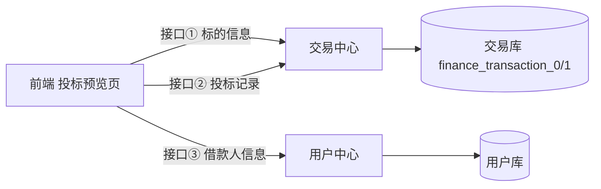

# 投标预览（上）：三个查询接口的定义与接口①的实现

用户投标的实现已经打通，投资人的钱能冻结进银行存管侧了。把视角拉回前端：投资人在出借列表里点「出借」进入详情页时，看到的标的信息、出借记录、借款人信息，这一页数据从哪来？这就是投标业务的第一阶段，投标预览。它本质上不是一笔交易，而是三路查询：查标的、查投标记录、查借款人。本课把三个接口定义出来，并顺着顺序把接口①的功能完整实现：查标的信息，连同剩余可投额度与出借人数一起算出来返回。

## 先给结论

- 投标预览要查三块信息：标的信息（含剩余可投额度与出借人数）、该标的的投标记录、借款人基本信息，分别对应三个接口，全部是查询。
- 接口①查询标的信息设计成支持多 ID：入参是逗号分割的 ID 串，返回 `List<ProjectDTO>`，单标查询只是它的特例，为的是给将来「一次查多个标的」的场景留扩展口。
- 剩余额度不是标的表里的现成字段：借款总额减去投标表里已投金额之和。已投金额用 `IFNULL(SUM(AMOUNT), 0.0)` 聚合，且只统计状态为 1（已同步）的投标；交易库分库分表后聚合结果可能返回多个值，方法返回值必须设计成 `List<BigDecimal>`，累加要用 BigDecimal 的 `add` 方法。
- 出借人数直接对 `tender` 表按标的 ID 做 `selectCount`，用 MyBatis-Plus 的 `Wrappers.lambdaQuery` 一行拼出条件。
- 三个接口的参数都走 RESTful 风格从路径上传，Controller 生成空实现时 `@PathVariable` 注解一个都不能漏。

## 预览页三块数据，拆成三个接口

回到前端现场。投资人从出借列表点进某个标的，进入投标预览页，这一页要展示的信息分三块。**第一块是标的信息**：借款金额、年化利率、期限、还款方式这些标的基本要素，外加两个动态数字，剩余可投额度和已有多少人出借。**第二块是投标记录**：这个标目前已经有哪些人投过，每人投了多少，点开「出借记录」按钮时展示。**第三块是借款人信息**：我要把钱借给他，总得知道对方的基本情况，姓名、年龄、性别这些。

三块信息对应三次查询，接口从需求阶段就明确为三个。值得想一层的是，为什么投标前要专门做一次「预览」。P2P 投资的决策依据就是信息披露：借款人是谁、借去做什么、目前已经有多少人投了多少，这些信息越透明，投资人的判断越有依据，平台的信息披露义务也落在这一页上。所以预览页不是锦上添花的展示，而是投标动作的合规前置，三块信息少一块，投资决策就缺一条腿。

这张图把三个接口分别挂到了哪个服务上：



关键在服务归属：标的信息和投标记录都在交易库，前两个接口落在交易中心；借款人是注册体系里的用户，基本信息在用户中心，接口③定义到用户中心的 API 上。本课推进到接口①的完整实现，接口②③的实现与三个接口的测试放在后面几课。

## 三个接口的定义

接口①定义在交易中心的 `TransactionApi` 里，讲义给出的方法名是 `queryProjectsIds`。名字里带着复数的 `s`，返回值泛型是集合，意图很明显：支持一次传多个 ID，查回多个标的。单看投标预览这个功能一次只查一个标的，但能查多个的自然能查一个，接口能力做宽一点，调用方不受影响。入参 `ids` 是字符串，多个 ID 之间约定用逗号分割：

```java
/** 交易中心 API 投标预览接口① 按讲义接口定义口径整理 包名按 com.study.finance 系改写 */
/**
 * 通过 ids 获取多个标的
 * @param ids 标的 id 串 多个以逗号分割
 * @return 标的信息集合
 */
RestResponse<List<ProjectDTO>> queryProjectsIds(String ids);
```

接口②还在交易中心，按标的 ID 查 `tender` 表里的投标记录，方法名 `queryTendersByProjectId`。一个标的会被多个人投标，记录必然多条，每条封装成 `TenderOverviewDTO`，`overview` 就是预览信息的意思，这个 DTO 随课程资料提供，拷入 API 工程的 transaction 模型包即可。预览场景的投标记录不需要实体里的全部字段，DTO 只挑前端要展示的那几样，这也是 `Overview` 类存在的意义：给预览这种轻展示场景裁剪一个专用视图，而不是把完整实体透出去。

```java
/** 交易中心 API 投标预览接口② 按讲义接口定义口径整理 包名按 com.study.finance 系改写 */
/**
 * 根据标的 id 查询投标记录
 * @param id 标的 id
 * @return 投标记录集合
 */
RestResponse<List<TenderOverviewDTO>> queryTendersByProjectId(Long id);
```

接口③换到用户中心。借款人是注册进来的用户，数据在用户中心，接口定义到用户中心的 `ConsumerApi` 里，方法名 `getBorrower`，`borrower` 是借款人，注意别与投资人弄混，传借款人的用户 ID，返回 `BorrowerDTO`：

```java
/** 用户中心 API 投标预览接口③ 按讲义接口定义口径整理 包名按 com.study.finance 系改写 */
/**
 * 获取借款人基本信息
 * @param id 借款人用户 id
 * @return 借款人信息
 */
RestResponse<BorrowerDTO> getBorrower(Long id);
```

`BorrowerDTO` 的字段包括用户 ID、用户名、真实姓名、身份证号、手机号，外加年龄、生日、性别，后三项用户表里没有，得靠身份证号解析，这是后续实现时的细节。两个新 DTO 都建在 API 工程而不是业务工程里，原因是 API 工程是服务间共享的契约包，任何调用方经 Feign 代理引用接口时，返回的 DTO 类型必须同时可见；DTO 放在业务工程内部，别的服务就没法反序列化返回值了。

三个接口声明落位后，各自在 Controller 生成空实现，补 Swagger 与 Spring MVC 注解。参数全走路径传值，`@PathVariable` 一个都不能漏，以接口①的 Controller 为例：

```java
/** 交易中心 Controller 接口①空实现 包名按 com.study.finance 系改写 */
@Override
@ApiOperation("通过ids获取多个标的")
@GetMapping("/projects/{ids}")
public RestResponse<List<ProjectDTO>> queryProjectsIds(@PathVariable String ids) {
    return null;
}
```

接口②的路径是 `/tenders/projects/{id}`，投标记录从属于某个标的，嵌在标的项目之下；接口③的路径是 `/my/borrowers/{id}`，沿用用户中心「我的」前缀约定。

## 接口①实现第一步：补 DAO 层的投标 Mapper

实现按「DAO 到业务层到 Controller」的顺序推进。查标的信息的 DAO 代码早已备好，不用动；缺的是投标这一侧的，也就是操作 `tender` 表的 Mapper。新建 `TenderMapper` 接口，继承 MyBatis-Plus 的 `BaseMapper`，泛型是投标实体 `Tender`：

```java
/** 投标信息 Mapper 接口 按画面线口径整理 包名按 com.study.finance 系改写 */
public interface TenderMapper extends BaseMapper<Tender> {
}
```

继承 `BaseMapper` 之后，单表的条件查询、统计、聚合这些通用能力框架直接给，业务层后面会用到它的 `selectCount`。配套的 `TenderMapper.xml` 也建一个，里面暂时只需要把接口全限定名放进 `namespace`，为将来写自定义 SQL 留位子。这里有个此前反复强调的习惯：接口与 XML 同名同位，`namespace` 指向 Mapper 接口的全限定名，框架才能把 XML 里的语句与接口方法对上号。DAO 就位，业务层接手。

业务层方法先在 `ProjectService` 接口里声明，再去 `ProjectServiceImpl` 实现，方法签名与 Controller 侧的接口一致，只是少了 HTTP 注解。实现按「DAO 到业务层到 Controller」的顺序推进时，这条接口、实现、转发三层链路是每个查询功能都重复的骨架，写到第三遍基本就是肌肉记忆了。

## 业务层主方法：拆参数、in 查询、转 DTO

读时序图时有个定位接口职责的实用技巧：把目光锁定在一个参与者的生命线上，这条线上收到的每个请求箭头就是它要实现的功能。接口①落在交易中心的生命线上，职责链是四步：处理参数、查询标的信息、转换 DTO、补齐剩余额度与出借人数。方法定义到 `ProjectService`，实现在 `ProjectServiceImpl`。

**第一步处理参数。** 传进来的是逗号分割的字符串，先用 `split(",")` 拆成字符串数组，转集合后逐个把字符串 ID 转成 `Long`，因为实体的主键是长整型：

```java
/** 接口①业务实现 按画面线与讲义口径整理 包名按 com.study.finance 系改写 */
@Override
public List<ProjectDTO> queryProjectsIds(String ids) {
    // 1. 处理参数 逗号分割 字符串转 Long 集合
    List<Long> idList = new ArrayList<>();
    Arrays.asList(ids.split(",")).forEach(str -> {
        idList.add(Long.parseLong(str));
    });
    // 2. 封装 in 条件查询标的信息 where id in (...)
    QueryWrapper<Project> queryWrapper = new QueryWrapper<>();
    queryWrapper.lambda().in(Project::getId, idList);
    List<Project> projects = list(queryWrapper);
    List<ProjectDTO> dtos = new ArrayList<>();
    // 3. 转换 DTO 并补齐额度与人数
    for (Project project : projects) {
        ProjectDTO projectDTO = convertProjectEntityToDTO(project);
        projectDTO.setRemainingAmount(getProjectRemainingAmount(project));
        projectDTO.setTenderCount(tenderMapper.selectCount(
                Wrappers.<Tender>lambdaQuery().eq(Tender::getProjectId, project.getId())));
        dtos.add(projectDTO);
    }
    return dtos;
}
```

条件封装用的是 `QueryWrapper` 的 lambda 写法，`in(Project::getId, idList)` 生成的 SQL 形如 `where id in (1, 2, 3)`，传一个 ID 就退化为单值查询，传多个就查多个。查询本身调业务层自带的 `list(queryWrapper)`，这是 MyBatis-Plus 通用业务层封装好的方法，交易中心的实现类继承的泛型绑定正是 Project 这一侧，所以标的信息的查改都能走自带方法。

**第二步转换。** 查出来的是 `Project` 实体，返回值泛型是 `ProjectDTO`，逐个经既有的转换方法转成 DTO，先建好空集合再往里装，这是此前每个查询功能都走过的套路。

## 剩余额度：一次聚合查询加一个减法

`ProjectDTO` 里有两个字段是标的表里查不出来的：剩余额度 `remainingAmount` 与出借人数 `tenderCount`，要单独算。先看剩余额度，它的业务含义是：借款人要借 10 万，已经有人投了 5 万，还剩 5 万可以投。已投多少去投标表查，剩余的拿借款总额一减。

已投金额的查询落在 `TenderMapper` 里新增一个自定义方法。条件有两个：标的 ID 等于当前标的；投标状态为已同步（可用状态 `status` 等于 1），因为只有银行存管侧处理成功、状态改成已同步的投标金额才算数，处理失败的投标不能计入。对投标金额做 `SUM` 聚合，外面套一层 `IFNULL` 把空值兜成 0.0，防止表里没数据时聚合结果为 `null` 引发空指针。状态条件与 `IFNULL` 兜底这两处小设计，一个管口径正确，一个管运行安全，都是聚合查询的标配动作，写 SQL 求和时值得形成条件反射：先问统计口径里该不该排除某些状态，再问空结果会不会炸。

```java
/** 投标 Mapper 自定义聚合查询 按讲义与画面线口径整理 包名按 com.study.finance 系改写 */
public interface TenderMapper extends BaseMapper<Tender> {

    /**
     * 根据标的 id 在线查询已投金额 无记录时返回 0.0
     * @param id 标的 id
     * @return 各分片聚合结果集合
     */
    @Select("SELECT IFNULL(SUM(AMOUNT), 0.0) FROM tender "
            + "WHERE PROJECT_ID = #{id} AND STATUS = 1")
    List<BigDecimal> selectAmountInvestedByProjectId(Long id);
}
```

这个方法的返回值设计是个重点：一条 `SUM` 明明只查出一个数，为什么接收类型是集合？根源在交易库的分库分表。`tender` 表按分片策略拆在 `tender_0`、`tender_1` 两张分表上，同一个标的的投标记录可能分散在不同分片里，经 Sharding-JDBC 执行聚合时，每个分片各返回一个求和值，最终得到的是多个结果，必须在 Java 层再累加一次才是完整的已投金额。如果图省事用单个 `BigDecimal` 接收，查出来的结果就只代表一个分片，金额直接算错。

累加与求剩余的逻辑封装成私有方法，供每个标的循环调用：

```java
/** 获取标的剩余可投额度 按讲义口径整理 包名按 com.study.finance 系改写 */
private BigDecimal getProjectRemainingAmount(Project project) {
    // 分库分表下聚合结果可能有多个值 逐个累加
    List<BigDecimal> amounts =
            tenderMapper.selectAmountInvestedByProjectId(project.getId());
    BigDecimal investedAmount = BigDecimal.ZERO;
    for (BigDecimal amount : amounts) {
        investedAmount = investedAmount.add(amount);
    }
    // 借款总额减去已投金额 即剩余可投额度
    return project.getAmount().subtract(investedAmount);
}
```

金额累加不能写加号。`BigDecimal` 不是基本类型，求和必须调 `add` 方法，减法同理用 `subtract`，这是资金计算的固定写法，跟 `compareTo` 做金额比较是同一个道理。顺带回顾金额为什么从实体设计起就选 `BigDecimal` 而不是 `double`：浮点类型的二进制表示有精度损失，资金场景差一分都不行，`BigDecimal` 用十进制标度保存，加减乘除与舍入全部显式控制，代价只是写法啰嗦一点，钱的事上这点啰嗦值得。

## 出借人数：一行条件统计

出借人数比剩余额度简单得多，对 `tender` 表按标的 ID 做一次 `COUNT` 就行。用 MyBatis-Plus 的 `selectCount` 配合 `Wrappers.lambdaQuery` 拼条件：

```java
// 统计某个标的的出借人数 即投标记录条数
tenderMapper.selectCount(
        Wrappers.<Tender>lambdaQuery().eq(Tender::getProjectId, project.getId()));
```

`Wrappers.lambdaQuery` 是条件构造器的快捷入口，泛型写明实体类型后，`eq` 一个条件就能拼出等值查询，与先前 `QueryWrapper` 再点 `lambda()` 的写法殊途同归，哪种顺手用哪种，语义完全一致。查出来的条数就是出借人数，直接 `setTenderCount` 封进 DTO。有个细节值得点出：出借人数的口径是投标记录条数，一个人对一个标多次投标时会算成多次，本课语境下一次投标就是一条记录，口径自然成立；若业务允许同人多次投标，人数与记录数就要分开统计，这是设计时要想清楚的口径问题。

两个动态字段都补齐后，DTO 装进结果集合返回，Controller 补上最后一层薄封装：调用业务层，把集合套进 `RestResponse.success` 返回前端。到这里可以回看接口①全貌：一个方法里完成参数拆分、条件查询、实体转换、两个衍生指标的计算与封装，链路虽长，每一步都是此前练过的基本功。接口①到此完整收工，下一课从它的功能测试开始，接口②③依次跟上。

## 常见误区

- **多 ID 接口入参用集合类型。** 错例：`queryProjectsIds(List<Long> ids)` 看似更自然。正解：RESTful 风格下 ID 拼在路径上必然是字符串，入参声明为 `String`，约定逗号分割，实现层拆分转 `Long`。
- **聚合查已投金额用单个 BigDecimal 接收。** 错例：方法返回 `BigDecimal`，测出一个分片的值就当总额。正解：分库分表下每个分片各返回一个聚合值，返回 `List<BigDecimal>`，累加后才是完整已投金额。
- **已投金额统计漏掉状态条件。** 错例：只按标的 ID 求 `SUM`，把存管侧处理失败的投标也计入。正解：加 `STATUS = 1` 条件，只有已同步的投标金额才算数，并用 `IFNULL` 把空聚合兜成 0.0。
- **Controller 空实现漏掉 `@PathVariable`。** 错例：方法签名照抄接口声明，参数没绑路径变量，请求到了 ID 永远取不到值。正解：三个接口的参数全走路径传值，每个参数都要加 `@PathVariable`。
- **金额累加写加号。** 错例：`sum += amount` 编译不过或精度出错。正解：BigDecimal 求和调 `add`，求差调 `subtract`，比较用 `compareTo`，资金计算全程如此。

## 面试可能被问到的问题

1. 面试官追问：「投标预览这么简单的功能，为什么要拆成三个接口，而不是一个大接口一次返回？」
   答：三块数据分属两个服务，标的信息与投标记录在交易中心，借款人信息在用户中心，一个大接口意味着交易中心远程聚合用户中心的数据，链路变长且耦合。拆开后各自就近查库，前端并行请求，哪个接口慢了也能单独定位与优化。
2. 面试官追问：「剩余可投额度为什么不直接存一个字段，每次都现算？」
   答：额度涉及多笔投标的并发扣减，落字段就得处理并发更新与和存管侧的一致性，现算以投标记录为准，天然与分库分表下的实际数据对齐。代价是每次查询多一次聚合，预览页这类读多写少的场景完全可接受，投标校验时也用同一个方法，口径统一。
3. 面试官追问：「分库分表之后，原来的聚合查询会出什么问题？」
   答：Sharding-JDBC 会把 SQL 路由到每个分片分别执行，聚合函数在各分片各自求值，返回多个结果。应用层拿到的是分片结果集合而不是全局聚合值，必须在代码里合并。所以聚合查询的返回值要设计成集合，金额累加、条数统计都要按这个思路处理。
4. 面试官追问：「为什么已投金额只统计状态为 1 的投标？」
   答：投标记录的状态字段表示存管同步状态，0 是未同步，1 是已同步。只有银行存管侧处理成功、状态置 1 的投标，资金冻结才真正生效，金额才算数；处理失败的投标记录虽然落库，但不能计入已投金额，否则剩余额度会被虚减。
5. 面试官追问：「QueryWrapper 的 lambda 写法和字符串列名写法比，好处是什么？」
   答：lambda 写法用 `Project::getId` 这样的方法引用指列，编译期就能检查字段存在性，重构改字段名时编译器直接报错；字符串写法把列名硬编码在代码里，拼写错了只能运行时发现。条件复杂度相同时优先 lambda 写法。

## 配套资料

- 讲义：`materials/docs/10/万信金融-第4章-投标放款v1.0.md`，2.2.1 接口定义：2.2.1.1 交易中心查询标的信息接口（接口①）、2.2.1.2 交易中心查询投标记录接口（接口②）、2.2.1.3 用户中心获取借款人信息接口（接口③）；2.2.2 功能实现：参数处理、in 查询、剩余额度与出借人数的实现。
- 代码：`materials/code/10/wanxinp2p/`，P2P 工程归档（目录保留原始命名，路径只列到该层级），可对照 API 工程的模块与包组织方式，交易中心与用户中心业务工程随课程资料单独提供。
- 说明：接口声明、Mapper 聚合查询与业务实现按讲义与画面线口径整理，包名与工程名按 `com.study.finance` 系改写；`TenderOverviewDTO`、`BorrowerDTO` 为课程资料包提供的类，未随仓库归档，字段以讲义口径为准。
