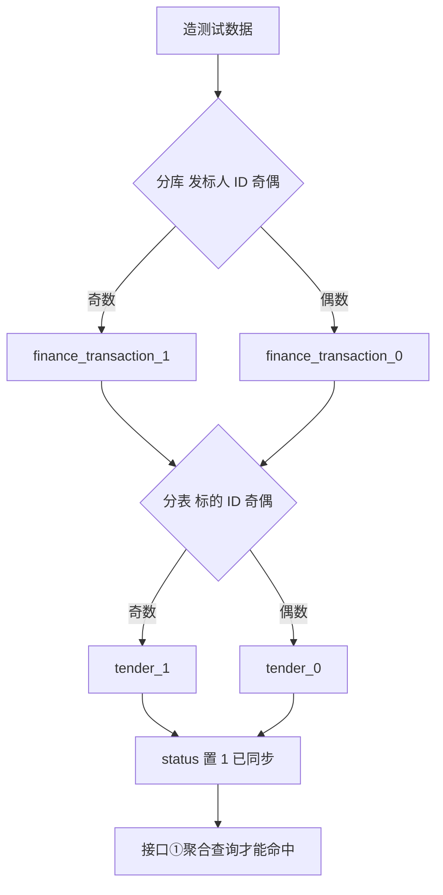

# 投标预览（下）：造数据、测三接口，顺手修一个漏封装的缺陷

接口①的实现收工，接下来是检验环节。测试不是点一下就完的事：投标功能还没开发，投标表里没有数据，得先按分库分表策略人工造数据；测的过程还揪出一个剩余额度没封装的缺陷。测完接口①，接口②查投标记录、接口③查借款人信息依次实现并测试，三个接口全部验收通过，投标预览的后端部分就齐了。

## 先给结论

- 测试前必须按分库分表策略造数据：分库按发标人 ID 的奇偶决定落 `finance_transaction_0` 还是 `finance_transaction_1`，分表按标的 ID 的奇偶决定落 `tender_0` 还是 `tender_1`，投标记录的可用状态要置 1，否则聚合统计查不到。
- 接口①在 Swagger 里按标的 ID 测试，首次执行暴露一个缺陷：剩余额度算出来了但没封装进 DTO，返回为 `null`；补上 `setRemainingAmount` 重启服务后，总额 12000、已投 2000 加 5000，剩余 5000，数值对上。
- 接口②按标的 ID 查 `tender` 表转 `TenderOverviewDTO` 返回；投标人用户名存的是手机号，展示前用 `CommonUtil.hiddenMobile` 把中间四位替换成星号，隐私保护在返回前完成。
- 接口③在用户中心按 ID 查借款人，用户表没有年龄、生日、性别，用 `IDCardUtil.getInfo` 从身份证号按位截取解析，18 位号码第 17 位奇偶判性别。
- 三个接口测试的数据对照思路一致：接口返回的每个数字都要能回到库里找到来源行，出借人数对应记录条数，金额对应各条投标金额之和，借款人信息对应发标人的用户记录。

## 接口①测试：先按分片策略造数据

功能测试的前提是库里得有数据。用户投标功能尚未开发，`tender` 表空空如也，而接口①要返回剩余可投额度与出借人数，没有投标数据这两项就是空的，测试无从谈起。过渡方案还是人工造数据，但这次造数据多了一道硬约束：交易库当时做了分库分表，数据必须严格按策略落位，否则代码没错效果也出不来，排查起来白白绕路。

策略本身此前设计分库分表时定过，造数时照着执行即可。分库看发标人 ID 的奇偶，奇数进 `finance_transaction_1`，偶数进 `finance_transaction_0`；分表看标的 ID 的奇偶，决定落在 `project_0/1` 与 `tender_0/1` 哪张分表。这张图把造数与查询的对应关系画了出来：



具体造法参考课程环境的数据：标的「左丘先生第一次借款」的发标人 ID 是奇数，标的信息落 `finance_transaction_1` 库的 `project_1` 表；该标的 ID 末位为奇数，给这个标造的两条投标记录都落 `tender_1` 表，一条金额 2000、一条金额 5000，投标金额字段即 `AMOUNT`，可用状态 `STATUS` 全部置 1。状态置 1 是关键细节，接口①的聚合 SQL 只统计 `STATUS = 1` 的记录，状态给成别的值，已投金额永远是 0，剩余额度等于借款总额，测试结果全歪。造两三条数据够用，等投标功能开发完，表里自然会有源源不断的真实数据。造完之后先别急着测接口，用数据库客户端把落位结果看一眼：库选对了没有、表落在哪张分表、状态字段是不是 1，三十秒钟的数据盘点，能省掉后面大半天对着空结果查代码的弯路。

## Swagger 测试与一个漏封装的缺陷

测试环境这次很轻：Apollo、注册中心、交易中心三个服务就够了，接口①的全部数据都在交易库，不牵扯别的服务。Swagger 测试的流程此时已经非常熟练：打开交易中心的 Swagger 文档，找到「通过 ids 获取多个标的」接口，点开 Try it out，从造好的数据里取出标的 ID 填入参数框，Execute 执行，先看状态码 200 确认请求没挂，再逐项核对返回的 `result`。这个「状态码先过、字段逐项对」的两步核对法，是接口测试阶段一直沿用的固定动作。

返回结构逐项核对：标的基本信息齐全，借款总额 12000 对得上；出借人数返回 2，正好是造的两条投标记录；唯独剩余额度是 `null`，这里有问题。

排查方向直指业务实现。出借人数正常说明 `selectCount` 那段没问题，问题出在剩余额度这一段。逐行看代码，聚合查询调到了，私有方法也执行了，缺陷一眼可见：调方法拿到了剩余额度，却忘了调用 DTO 的 `setRemainingAmount` 把结果封装进去，DTO 里这个属性保持默认值，序列化出去自然是 `null`。对照旁边出借人数的写法，人家是查完就 `set`，这里少了一行。补上封装，重启交易中心再测，剩余额度返回 5000，正好是总额 12000 减去已投的 2000 与 5000，三个数值全部对上，接口①验收通过。

重启这一步别省。改的是哪个服务就重启哪个，进程里跑的还是旧字节码，刷新页面多少遍都不会有新值；反过来也没必要全量重启，改动局部，只动对应服务，环境大的项目里全量重启一次几分钟就没了。

这类「代码逻辑对、结果不对」的缺陷有个共同特征：算出来了但没交出去。DTO 封装是数据出口，每个算出来的字段都要有对应的 `set`，漏一处前端就少一个值。测试时逐字段比对返回结构与 `ProjectDTO` 的属性清单，能把这一类问题全部拦下。

## 接口②实现：查投标记录与手机号脱敏

接口②的功能单一：根据标的 ID 查 `tender` 表的全部投标记录。DAO 层的 `TenderMapper` 在实现接口①时已经备好，`selectList` 是通用能力，直接从业务层开工。在 `ProjectService` 里新增 `queryTendersByProjectId` 方法，实现分三段：条件查询、实体转 DTO、手机号脱敏：

```java
/** 接口②业务实现 按画面线与讲义口径整理 包名按 com.study.finance 系改写 */
@Override
public List<TenderOverviewDTO> queryTendersByProjectId(Long id) {
    // 1. 按标的 id 查询投标记录
    List<Tender> tenderList = tenderMapper.selectList(
            Wrappers.<Tender>lambdaQuery().eq(Tender::getProjectId, id));
    List<TenderOverviewDTO> dtoList = new ArrayList<>();
    // 2. 逐条转换并做手机号脱敏
    tenderList.forEach(tender -> {
        TenderOverviewDTO tenderOverviewDTO = new TenderOverviewDTO();
        BeanUtils.copyProperties(tender, tenderOverviewDTO);
        // 投标人用户名存的是手机号 返回前隐藏中间四位
        tenderOverviewDTO.setConsumerUsername(
                CommonUtil.hiddenMobile(tenderOverviewDTO.getConsumerUsername()));
        dtoList.add(tenderOverviewDTO);
    });
    return dtoList;
}
```

条件只有一个 `eq(Tender::getProjectId, id)`，lambda 写法一行拼出。转换沿用 `BeanUtils.copyProperties`，把实体属性按同名规则搬进 `TenderOverviewDTO`。脱敏的处理顺序值得注意：先复制、再覆盖。`copyProperties` 已经把原始手机号搬进了 DTO，紧接着再用 `setConsumerUsername` 把这个属性覆盖成脱敏后的值，同一个属性先来后到两次赋值，最终生效的是脱敏值。如果反过来先脱敏实体，库还没动就改了实体属性，万一后续有 `updateById` 之类的操作，脏数据会写回库，先复制后覆盖只影响本次返回，边界干净。

脱敏这一步值得单独说。投标时落库的投标人用户名实际存的是手机号，这是业务约定；查询时原样返回，等于把投资人的隐私直接挂到平台上给所有浏览者看，不合适。处理方式是返回前把手机号中间四位换成星号，工具类 `CommonUtil` 里封装好了 `hiddenMobile` 方法，这份代码在公共模块归档里能找到原版：

```java
/** 手机号脱敏 真实归档代码见公共模块 CommonUtil */
public static String hiddenMobile(String mobile) {
    if (StringUtils.isBlank(mobile)) {
        return "";
    }
    return mobile.replaceAll("(\\d{3})\\d{4}(\\d{4})", "$1****$2");
}
```

正则按手机号 11 位的结构分组：前三位一组、中间四位一组、后四位一组，替换串用 `$1` 与 `$2` 引用第一、第三组，中间拼四个星号。空值先拦截返回空串，避免空手机号走进正则。脱敏放在返回前的转换环节，库里存的原值不动，只在对外展示这一层处理，这是脱敏的标准位置。

Controller 补最后一层封装，调用业务层、`RestResponse.success` 包集合返回，路径就是定义阶段的 `/tenders/projects/{id}`。

## 接口②测试：两条记录与星号

测试沿用接口①造的那两条数据。Swagger 里找到「根据标的id查询投标记录」，填入同一个标的 ID 执行，返回两条记录，与库里的 `tender_1` 表逐项对照：一条 2000、一条 5000，金额一致；投标人手机号中间四位全部变成了星号，脱敏生效；投标时间等字段与造数时一致。接口②一次通过，它逻辑简单，唯一的坑，脱敏，已经在实现层堵住了。

## 接口③实现：查借款人与身份证号解析

接口③换到用户中心，按借款人用户 ID 查基本信息。用户中心的 DAO 层早已开发完毕，`getById` 一发即可，实现重点在两处转换。业务层 `ConsumerService` 新增 `getBorrower` 方法，内部先走一个私有的 `get` 方法：按 ID 查实体，查不到抛业务异常提示用户不存在，查到转成 `ConsumerDTO` 返回。这层封装不是多此一举：按 ID 查用户并做非空校验是用户中心的高频动作，抽成私有方法后，本次的借款人查询与将来任何按 ID 取用户的场景都复用同一段代码，异常口径也统一。拿到 `ConsumerDTO` 后再转成 `BorrowerDTO`：

```java
/** 接口③业务实现 按画面线与讲义口径整理 包名按 com.study.finance 系改写 */
@Override
public BorrowerDTO getBorrower(Long id) {
    // 内部含按 id 查询与非空校验 查不到抛业务异常
    ConsumerDTO consumerDTO = get(id);
    BorrowerDTO borrowerDTO = new BorrowerDTO();
    BeanUtils.copyProperties(consumerDTO, borrowerDTO);
    // 用户表没有年龄 生日 性别 从身份证号解析
    Map<String, String> cardInfo = IDCardUtil.getInfo(consumerDTO.getIdNumber());
    borrowerDTO.setAge(Integer.parseInt(cardInfo.get("age")));
    borrowerDTO.setBirthday(cardInfo.get("birthday"));
    borrowerDTO.setGender(cardInfo.get("gender"));
    return borrowerDTO;
}
```

两个 DTO 之间的转换还是 `copyProperties` 同名复制，年龄、生日、性别三个字段在 `ConsumerDTO` 里没有对应属性，复制不到，必须单独补。这三个值从哪来？用户表里根本没有这些字段，但注册时每个用户都存了身份证号，身份证号本身携带全部答案：出生日期是固定位置的一段，年龄用当前年份减出生年份，性别看第 17 位序号的奇偶。解析逻辑封装在 `IDCardUtil.getInfo` 方法里，公共模块归档里有原版实现：

```java
/** 身份证号解析 真实归档代码见公共模块 IDCardUtil 有删减 */
public static Map<String, String> getInfo(String idNumber) {
    String birthday = "";
    String age = "";
    String gender = "";
    int year = Calendar.getInstance().get(Calendar.YEAR);
    if (idNumber.length() == 15) {
        // 15 位老号 年份前补 19
        birthday = "19" + idNumber.substring(6, 8) + "-" + idNumber.substring(8, 10)
                + "-" + idNumber.substring(10, 12);
        age = (year - Integer.parseInt("19" + idNumber.substring(6, 8))) + "";
        gender = Integer.parseInt(idNumber.substring(idNumber.length() - 3,
                idNumber.length())) % 2 == 0 ? "F" : "M";
    } else if (idNumber.length() == 18) {
        // 18 位新号 第 6 到 14 位是出生日期 第 17 位奇男偶女
        birthday = idNumber.substring(6, 10) + "-" + idNumber.substring(10, 12)
                + "-" + idNumber.substring(12, 14);
        age = (year - Integer.parseInt(idNumber.substring(6, 10))) + "";
        gender = Integer.parseInt(idNumber.substring(idNumber.length() - 4,
                idNumber.length() - 1)) % 2 == 0 ? "女" : "男";
    }
    Map<String, String> map = new HashMap<>();
    map.put("birthday", birthday);
    map.put("age", age);
    map.put("gender", gender);
    return map;
}
```

方法按 15 位与 18 位两种号码长度分别处理，出生日期、年龄都是纯字符串截取加算术，性别按序号奇偶判定。18 位号码的结构在这里值得展开一句：前六位是行政区划码，第七到十四位是出生日期，第十五到十七位是顺序码，其中第十七位奇数分配给男性、偶数分配给女性，最后一位是校验码。解析就是对这些固定位置的读取，这也是身份证号能「一座宝矿挖三样数据」的原因。15 位的老号段没有世纪位，出生年份前补 19 即可，如今新发证件都是 18 位，老号分支属于兼容性兜底。解析结果装进 Map 返回，键名固定，调用方按键取值回填 DTO，不把下标散落在业务代码里。Controller 这边补上 `/my/borrowers/{id}` 的薄封装，接口③完工。

## 接口③测试：从标的反查借款人

测试要把用户中心的微服务也启动起来，前两个接口只牵扯交易中心，这个接口多了一个服务。测试数据要顺藤摸瓜找：接口①②测的是标的 `2139483643803590657`，这个标是谁发的？到 `project` 表按标的 ID 查出记录，发标人用户标识是 27；再到用户中心的用户表按 27 定位，正是「左丘」的账号，身份证号也在这一行。造数或改数时注意别把发标人与投标人的记录弄混，前面两条投标记录是投标人，27 是借款人，两拨人。

Swagger 切到用户中心的文档，找到「获取借款人用户信息」，填入 27 执行，状态码 200，返回左丘的姓名、身份证号，年龄、生日、性别三项解析值全部带上，与身份证号手工推算的结果一致。返回的这些字段将来直接渲染到投标预览页的「原始借款人」区域，接口③验收通过。至此投标预览的三个接口全部实现并测试完毕，剩下的收尾是拉上前端做一次全链路的集成测试。

## 常见误区

- **造测试数据不看分片策略。** 错例：随手往某个库里插数据，结果接口查不到，误以为代码有 bug。正解：先核对分库分表策略，发标人 ID 定库、标的 ID 定表，数据落对了分片，聚合与条件查询才能命中。
- **投标记录的可用状态不给 1。** 错例：造数时 `STATUS` 留空或置 0，已投金额统计永远为 0。正解：聚合 SQL 只认已同步状态，造数时把 `STATUS` 置 1，与真实投标成功后的状态保持一致。
- **接口字段对不上就先怀疑前端。** 错例：返回里剩余额度是 `null`，去查页面渲染。正解：先看后端返回，返回缺字段就查封装层有没有漏 `set`，本课缺陷就是聚合结果算出来了但没封装，补一行 `setRemainingAmount` 即修复。
- **手机号原样返回给前端。** 错例：实体转 DTO 后直接返回，平台页面暴露投资人手机号。正解：在返回前的转换环节统一脱敏，库中原值不动，展示层星号替换，空值先拦截。
- **以为用户表没的字段就没法展示。** 错例：年龄生日性别表里没有，接口直接不返回这三项。正解：身份证号是用户数据的富矿，按位截取即可解析出生日、年龄与性别，工具方法一次封装处处复用。

## 面试可能被问到的问题

1. 面试官追问：「分库分表后造测试数据要注意什么？」
   答：数据必须符合分片策略，分片键的值决定数据落哪个库哪张表，插错分片后查询路由到别的分片，结果就是查不到。另外与业务状态相关的字段要给对值，比如聚合只认已同步状态，状态不对统计就是空，测试前先核对分片规则与状态约定。
2. 面试官追问：「接口返回字段为 `null`，你的排查路径是什么？」
   答：按数据流正向走。先确认请求参数正确，再看后端返回，返回缺字段就查封装层：字段有没有查询、查到有没有 `set`、类型转换有没有出错。返回完整再看前端渲染。本课剩余额度为 `null` 就是查到了但漏了封装，一行 `set` 修复。
3. 面试官追问：「手机号脱敏为什么放在后端返回前做，前端打码不行吗？」
   答：前端打码只是视觉遮盖，手机号原文已经进了浏览器，抓包就能拿到，隐私泄露在传输层就发生了。后端返回前脱敏，原文不出服务端，接口层就是数据边界。凡是身份信息对外展示，规则都应落在后端，前端只负责渲染。
4. 面试官追问：「从身份证号解析生日和性别，实现上要注意什么？」
   答：号码有 15 位与 18 位两种规格，截取位置不同，15 位老号出生年份要补 19；18 位号的性别看第 17 位序号奇偶，奇男偶女。解析前要校验号码长度与非空，解析结果用常量键名封装返回，避免调用方硬编码下标。
5. 面试官追问：「两个 DTO 之间的转换，`copyProperties` 有什么局限？」
   答：它按属性名与类型匹配做浅复制，名字不一致或类型不兼容的属性会被静默跳过，源对象为 `null` 的属性也会原样带来。本课年龄生日性别在目标 DTO 有、源 DTO 没有，复制不到必须手动补，所以用 `copyProperties` 之后要逐字段核对，重要字段宁可显式赋值。

## 配套资料

- 讲义：`materials/docs/10/万信金融-第4章-投标放款v1.0.md`，2.2.2.2 功能测试：分库分表策略与造数要求；2.2.3 交易中心查询投标记录接口（接口②）功能实现与测试；2.2.4 用户中心获取借款人信息接口（接口③）功能实现与测试。
- 代码：`materials/code/10/wanxinp2p_apollo/`，公共配置工程归档（目录保留原始命名，路径只列到该层级），其中 `wanxinp2p-common` 模块的 `src/main/java/.../common/util/` 下可找到 `CommonUtil.java` 与 `IDCardUtil.java` 原版实现，手机号脱敏正则与身份证号解析逻辑以归档代码为准。
- 代码：`materials/code/10/wanxinp2p_front/`，前端工程归档（目录保留原始命名，路径只列到该层级），投标预览页的数据展示可对照。
- 说明：接口②③业务实现按讲义与画面线口径整理，包名与工程名按 `com.study.finance` 系改写；造数 SQL 与测试数值以本机环境数据为例，Swagger 响应结构为按本课写法补全的示例。
