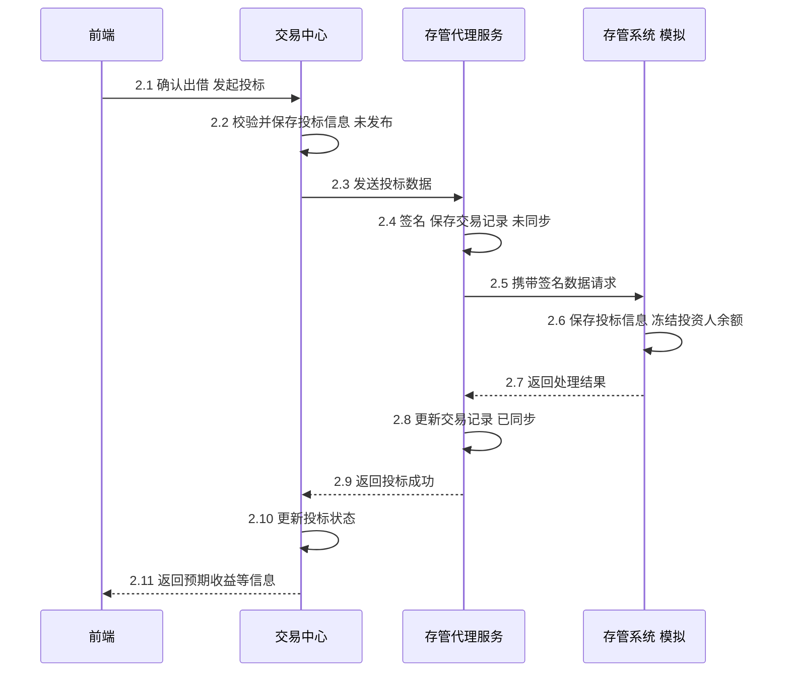

# 用户投标功能完整实现：两个接口、五道校验与一整条存管冻结链路

投标预览做完之后，投资人在详情页能看到标的信息、出借记录和借款人信息了，但真正点下「授权出借」时走的那条主链路还是空的。这条链路要接住前端请求、做五道业务校验、落投标记录、经存管代理与银行存管系统完成余额冻结、再逐级回传更新状态并算出预期收益，横跨交易中心、存管代理、用户中心与存管系统四方。本课把它一次做完：先定义接口④与接口⑤，再把接口④拆成校验、保存、调用、结果处理四段逐一实现，最后实现接口⑤的存管代理侧，整条 2.1 到 2.13 的流程全部打通。

## 先给结论

- 用户投标只新增两个接口：接口④交易中心保存投标信息（`createTender`，路径 `/my/tenders`），接口⑤存管代理预处理冻结（`userAutoPreTransaction`），其余动作都是这两个接口内部的功能拆解。
- 投标前的校验一共五道：金额不小于最小投标金额、余额充足、标的不满标、金额不超剩余可投、投后剩余额度不小于最小投标金额，任何一道不过都抛业务异常。
- 余额不在用户库里，在银行存管系统的 `balance_details` 表中；查询余额是纯读取，用户中心可以不经存管代理直接用 OkHttp 请求存管系统。
- 存管代理侧沿用开户、发标的通用套路：保存交易记录（未同步）加幂等处理，签名后经通用发送方法请求银行，银行冻结投资人余额并回传结果，交易记录更新为已同步。
- 投标成功后交易中心要做的三件事：更新投标记录同步状态、判断标的是否满标并更新标的状态、把实体转成 DTO 并封装标的信息与预期收益返回前端。

## 接口定义：两根管子接住十三个步骤

时序图上的 2.1 到 2.13 拆到工程上只有两个对外方法。全景先上图，这张图在讲两个接口各自覆盖哪些步骤：



接口④落在交易中心的 `TransactionApi` 上，入参只带标的标识与投标金额，返回 `TenderDTO`，里面装着投标全量信息与平台帮投资人算好的预期收益：

```java
/** 交易中心 API 按讲义接口定义口径整理 包名按 com.study.finance 系改写 */
@ApiOperation("用户投标")
@ApiImplicitParam(name = "projectInvestDTO", value = "投标信息", required = true,
        dataType = "ProjectInvestDTO", paramType = "body")
@PostMapping("/my/tenders")
RestResponse<TenderDTO> createTender(ProjectInvestDTO projectInvestDTO);
```

接口⑤落在存管代理服务的 `DepositoryAgentApi` 上，方法名直译是「用户自动预处理交易」，功能就是 2.4 到 2.10 的全部动作：保存交易记录、请求银行存管系统做预处理冻结、返回处理结果。它是微服务之间的内部接口，路径按约定以 `/l` 打头，前端经网关摸不到它。

两个接口定义完，先在各自的 Controller 里生成空实现，业务逻辑全部沉到业务层去写。交易中心这边的 DAO 层此前已经备齐，直接从业务层开工。

## 准备工作：最小投标金额与查余额

业务层实现按讲义拆成若干部分逐一落地，动手写校验前有两样东西要先备好。

**第一样是最小投标金额的配置。** 平台规定投标起步金额（本课环境配 100 元），这个值属于运营参数，配在 Apollo 上而不是写死在代码里。配置项为 `mini.investment.amount`，值 `100.0`，交易中心从中读取：

```java
/** 从 Apollo 读取最小投标金额 示例按本课写法补全 */
public BigDecimal getMiniInvestmentAmount() {
    // 配置缺失时兜底 100.0
    return BigDecimal.valueOf(
            config.getProperty("mini.investment.amount", "100.0"));
}
```

**第二样是查账户余额的能力。** 投标人余额存在银行存管系统侧，用户中心的库里并没有这个字段。查询余额属于纯读取，不涉及交易与资金变动，所以用户中心直接请求存管系统即可，不必绕道存管代理。用 OkHttp 发起请求的封装如下：

```java
/** 用户中心直连存管系统查余额 按画面线与讲义口径整理 包名按 com.study.finance 系改写 */
private RestResponse<BalanceDetailsDTO> getBalanceFromDepository(String userNo) {
    String url = depositoryURL + "/balance-details/" + userNo;
    Request request = new Request.Builder().url(url).build();
    try (Response response = okHttpClient.newCall(request).execute()) {
        if (response.isSuccessful()) {
            String responseBody = response.body().string();
            BalanceDetailsDTO dto = JSON.parseObject(responseBody, BalanceDetailsDTO.class);
            return RestResponse.success(dto);
        }
    } catch (IOException e) {
        log.warn("调用存管系统获取余额失败", url, e);
        return RestResponse.validFail("获取失败");
    }
    return RestResponse.validFail("获取失败");
}
```

这个私有方法之上要暴露两个入口：一个给后端微服务用，路径以 `/l` 打头，按用户编码查询，交易中心稍后经 Feign 代理调用它；另一个给前端用，无参版本，从登录上下文取出当前用户再换出用户编码，路径是 `consumer/my/balances`，前端确认出借页展示「账户余额」用的就是它。同一个查询能力按调用方拆成两个接口，是这条链路上很典型的一处接口设计。

## 五道前置校验：资金类业务的第一道闸

进入 `ProjectServiceImpl.createTender` 的正题。涉及资金的动作，校验宁可多不可少，这里一共五道，全部通过才允许保存投标信息：

```java
/** 前置条件判断 按画面线与讲义口径整理 包名按 com.study.finance 系改写 */
//1.1 投标金额是否大于最小投标金额
BigDecimal amount = new BigDecimal(projectInvestDTO.getAmount());
BigDecimal miniAmount = configService.getMiniInvestmentAmount();
if (amount.compareTo(miniAmount) < 0) {
    throw new BusinessException(TransactionErrorCode.E_150109);
}
//1.2 判断用户账户余额是否足够
LoginUser user = SecurityUtil.getUser();
RestResponse<ConsumerDTO> consumerResp =
        consumerApiAgent.getOurConsumer(user.getMobile());
String userNo = consumerResp.getResult().getUserNo();
RestResponse<BalanceDetailsDTO> balanceResp =
        consumerApiAgent.getBalance(userNo);
BigDecimal myBalance = balanceResp.getResult().getBalance();
if (myBalance.compareTo(amount) < 0) {
    throw new BusinessException(TransactionErrorCode.E_150112);
}
//1.3 判断标的是否满标 状态 FULLY 表示满标
Project project = getById(projectInvestDTO.getId());
if (project.getProjectStatus().equalsIgnoreCase(ProjectCode.FULLY.getCode())) {
    throw new BusinessException(TransactionErrorCode.E_150114);
}
//1.4 投标金额不能超过剩余可投金额
BigDecimal remainingAmount = getProjectRemainingAmount(project);
if (amount.compareTo(remainingAmount) > 0) {
    throw new BusinessException(TransactionErrorCode.E_150110);
}
//1.5 投标后剩余额度需满足最小投标金额 否则没人能再投
BigDecimal subtract = remainingAmount.subtract(amount);
if (subtract.compareTo(BigDecimal.ZERO) != 0
        && subtract.compareTo(miniAmount) < 0) {
    throw new BusinessException(TransactionErrorCode.E_150111);
}
```

逐道过一遍业务含义。**第一道拦小额投标**，平台起步 100 元，低于它直接拒绝。**第二道拦余额不足**，投资 1 万余额只有 5 千就过不去；这里顺带完成了身份信息的获取：从登录上下文拿到手机号，经 Feign 到用户中心换出用户对象与用户编码，再拿编码查余额。**第三道拦满标**，标的状态等于 `FULLY` 说明额度已被投满。**第四道拦投超**，剩余可投 2 千时投标金额不能是 3 千，剩余可投额度的计算靠封装好的私有方法 `getProjectRemainingAmount`：从投标表里查出该标的所有已投金额求和，用总额减去它。**第五道最绕**，举例说明：借款人要借 1 万，已投 8 千剩 2 千，此时投标 1950 元合法吗？金额本身合规，但投完只剩 50 元，低于最小投标金额，后面的投资人谁也投不了，等于把标卡死在 50 元上。所以要把「本次投标后的剩余额度」算出来跟最小投标金额比一把，不够就拒绝，要么少投点，要么干脆投满。

五道校验里反复出现 BigDecimal 的 `compareTo`，不能图省事用减号或小于号，包装类型没有运算符比较，这是资金计算代码的基本功。错误码统一收在交易中心的错误码类里（`E_150109` 到 `E_150111`、`E_150114`），提示语与校验一一对应，前端拿到的就是能直接展示的业务提示。

## 保存投标信息并请求存管代理

校验全过，进入第二块：落投标记录，再把数据推给存管代理。投标记录落到交易库的 `tender` 表（分片 `tender_0`、`tender_1`，落哪个分片由分片策略决定），构造实体的字段相当多：

```java
/** 保存投标信息 按画面线与讲义口径整理 包名按 com.study.finance 系改写 */
final Tender tender = new Tender();
tender.setAmount(amount);                                    // 投标金额 即冻结金额
tender.setConsumerId(consumerResp.getResult().getId());      // 投标人用户标识
tender.setConsumerUsername(consumerResp.getResult().getUsername());
tender.setUserNo(consumerResp.getResult().getUserNo());      // 投标人用户编码
tender.setProjectId(projectInvestDTO.getId());               // 标的标识
tender.setProjectNo(project.getProjectNo());                 // 标的编码
tender.setTenderStatus(TradingCode.FROZEN.getCode());        // 投标状态 冻结
tender.setCreateDate(LocalDateTime.now());                   // 创建时间
tender.setRequestNo(CodeOpaqueUtil.getNo(CodePrefixCode.CODE_REQUEST_PREFIX)); // 请求流水号
tender.setStatus(0);                                         // 可用状态 0 待同步
tender.setProjectName(project.getName());                    // 标的名称
tenderMapper.insert(tender);                                 // 经分片策略落库
```

两个状态字段要分清：`tenderStatus` 记录业务状态，此时是「冻结」，整条业务成功后变为已放款对应的状态；`status` 是可用标志，初始 0，全部处理完置 1。请求流水号沿用开户发标的前缀规则生成，它是后面幂等与对账的钥匙。

落库之后构造存管代理要的数据。请求对象里装冻结金额、请求流水号、投资人用户编码、业务类型、标的编码等，银行存管系统要什么就装什么：

```java
/** 构造预处理请求并经 Feign 调用 按画面线口径整理 包名按 com.study.finance 系改写 */
UserAutoPreTransactionRequest request = new UserAutoPreTransactionRequest();
request.setAmount(amount);                       // 冻结金额
request.setRequestNo(tender.getRequestNo());     // 请求流水号
request.setUserNo(tender.getUserNo());           // 投资人用户编码
request.setBizType(BizType.CAPITAL_PRE_FREEZE.getCode()); // 业务类型 投标预处理
request.setProjectNo(tender.getProjectNo());     // 标的编码
// 发起远程调用 存管代理侧功能在接口⑤实现
RestResponse<String> response =
        depositoryAgentApiAgent.userAutoPreTransaction(request);
```

Feign 代理指向 `depository-agent-service`，路径对应接口⑤的内部地址。到这里接口④的主干代码已经过半，后面是等存管代理回话之后的结果处理。

## 投标结果处理与标的进度更新

存管代理处理完会返回结果，交易中心据此做第三块的四件事：判断结果、更新状态、判断满标、组装返回。

**判断结果**用统一响应码枚举比对，取出的返回码等于成功码才走成功分支，否则抛投标失败异常。**更新状态**是把投标记录的可用状态从 0 改 1，表示存管侧已同步成功，MyBatis-Plus 的 `updateById` 一行搞定。**判断满标**复用了剩余可投额度的私有方法：重新计算一次，若剩余额度等于 0，说明这次投标正好投满，把标的状态更新为 `FULLY`，此后任何人投标都会被第三道校验拦住：

```java
/** 成功分支的状态处理 按画面线与讲义口径整理 包名按 com.study.finance 系改写 */
if (DepositoryReturnCode.SUCCESS.getCode()
        .equals(response.getResult())) {
    // 投标记录更新为已同步
    tender.setStatus(1);
    tenderMapper.updateById(tender);
    // 重新计算剩余可投额度 等于 0 即满标
    BigDecimal rest = getProjectRemainingAmount(project);
    if (rest.compareTo(new BigDecimal("0")) == 0) {
        project.setProjectStatus(ProjectCode.FULLY.getCode());
        updateById(project);
    }
} else {
    throw new BusinessException(TransactionErrorCode.E_150113);
}
```

有个工程细节藏在这一小段里：投标记录的增改都显式调 `tenderMapper`，而标的状态更新直接用了业务层自带的 `updateById`。原因是交易中心的业务实现类继承 MyBatis-Plus 的 `ServiceImpl` 时绑定的泛型是 Project 相关 Mapper，MyBatis-Plus 通用业务层只代理绑定的那一个实体；Tender 不在绑定范围内，它的持久化只能手动调自己的 Mapper。同一个方法里两套写法并存，不是风格不统一，是框架绑定关系决定的。

**组装返回**分两步。把 Tender 实体转成 `TenderDTO` 的转换方法是老套路；额外要封装两块数据：一是标的信息，实体转 DTO 时顺手补上还款方式，本课默认等额本息，取值也走枚举常量而非裸字符串；二是预期收益，投资人投完立即看到「到期大约能赚多少」，属于营销性展示。收益计算封装在工具类里，等额本息有固定公式，需要三个入参：投标金额、年化利率与月数。金额取自入参转 BigDecimal；年化利率从 Apollo 读配置；月数由标的期限天数换算，除以 30 后向上取整：

```java
// 月数 = 期限天数 / 30 向上取整 预期收益为概算
int month = (int) Math.ceil(project.getPeriod() / 30.0);
tenderDTO.setProject(convertProjectEntityToDTO(project));
tenderDTO.setExpectIncome(IncomeCalculateUtil.getIncomeTotalInterest(
        amount, yearRate, month));
return tenderDTO;
```

要强调这是预期收益而非实际收益，多出来的零头天数真实计息时按天另算，这里只求个大概向上取整，给投资人一个参考数。至此接口④全部写完，Controller 只剩一层薄封装：调用业务层，把 `TenderDTO` 套进 `RestResponse.success` 返回。

## 存管代理侧：交易记录、幂等与签名发送

接口⑤要覆盖 2.4 到 2.10。存管代理服务的数据层此前已备好，直接进 `DepositoryRecordService`，新增同名方法。实现分三步。

**第一步保存交易记录并处理幂等。** 交易记录落 `depository_record` 表，构造时先放请求流水号、请求类型（预处理冻结业务）与业务数据，结果字段等银行回话后再补。生产环境中存管代理多半是集群部署，同一笔请求可能被重复投递，所以落库前必须走幂等处理，思路与发标审核那次一致：按请求流水号查询，分三种情况，记录不存在则新增往下走；记录存在且已同步说明请求处理过，直接返回；其余情况复用原记录继续。代码就是调用此前封装好的幂等方法，返回值非空说明请求已被处理过，直接把结果返回结束流程；返回空则继续往下，并按流水号重查一次交易记录，拿到包含最新状态的实体供后续步骤使用：

```java
/** 接口⑤实现主干 按画面线与讲义口径整理 包名按 com.study.finance 系改写 */
public DepositoryResponseDTO userAutoPreTransaction(
        UserAutoPreTransactionRequest request) {
    //1 保存交易记录 内部含幂等处理
    DepositoryRecord record = new DepositoryRecord(
            request.getRequestNo(), request.getBizType(), JSON.toJSONString(request));
    DepositoryResponseDTO respDTO = idempotentHandle(record);
    if (respDTO != null) {
        // 幂等命中 说明请求已处理过 直接返回
        return respDTO;
    }
    // 幂等未命中 重查记录拿到最新状态
    record = getEntityByRequestNo(request.getRequestNo());
    //2 签名 3 发送数据到银行存管系统
    return sendHttpToDepository(record, request);
}
```

**第二步签名**，数据转 JSON 后做 BASE64 编码，交给通用发送方法。**第三步发送**，真正的签名动作藏在 OkHttp 拦截器里：凡是经存管代理与银行打交道的业务，统一走封装好的发送方法，它内部组装银行要求的四大参数（平台接入编号、JSON 业务数据、服务接口名、签名数据），请求银行存管系统，接收返回并根据返回码更新交易记录状态，全流程对业务代码透明。本次请求的服务接口名按「银行存管系统接口说明」文档中的预处理冻结接口填写，请求地址由存管系统的基本路径拼接出来。发送方法的签名大致如下：

```java
/** 通用存管发送方法签名 按画面线口径整理 包名按 com.study.finance 系改写 */
private DepositoryResponseDTO sendHttpToDepository(
        String serviceName,   // 银行侧服务接口名 取自存管系统接口说明
        String url,           // 存管系统地址 由配置拼接
        String reqData,       // BASE64 编码后的业务数据
        DepositoryRecord record) {
    // 拦截器自动完成签名与四大参数组装 发送并更新交易记录状态
}
```

存管代理的 Controller 同样只有一层转发，唯一值得注意的是返回封装：从银行响应结构里取出返回码、描述与数据，统一转成 `RestResponse` 返回交易中心。这类转换以后每个存管业务都要用，所以抽成了私有方法备用。

## 接口④的 Postman 断点测试

代码写完先测接口④。此时接口⑤还没实现，测试只能推进到「交易中心发起远程调用」这一步为止，往后要等接口⑤完工再做前后端集成测试。测试环境要起 Apollo、注册中心、网关、账户与用户中心等登录链路服务、交易中心，外加银行存管系统（查余额要用），前端不必启动。

用 Postman 逐道校验往下打：先登录拿到访问令牌，投标请求头里必须带上它，否则后台取不到当前用户。然后按校验顺序构造参数，每一道都配合断点验证走到了预期分支：投标金额填 10，命中第一道，返回「投标金额小于最小投标金额」；把测试账号在存管侧的余额查出来（先拿手机号换用户编码，再到 `balance_details` 表按编码定位），余额为零时投 1000，命中第二道，返回「用户余额不足请充值」；给测试账号人工充值后，把标的状态临时改成 `FULLY`，命中第三道；状态改回后，投一笔超出剩余额度的金额，命中第四道。四道都验证过后投一笔正常金额，去交易库 `tender_1` 表里核对，投标金额、用户编码、状态与流水号都在，落库正确。测试中有个小插曲：断点停留过久会让 Feign 调用超时，Postman 返回 500，去掉断点重发即恢复正常，调试资金类接口时要把这类干扰从异常结论里剔除。

## 常见误区

- **用运算符比较 BigDecimal。** 错例：`amount < miniAmount` 直接编译报错，或者用 `equals` 比数值把精度差异当成不相等。正解：统一用 `compareTo` 按返回值正负零判断大小与相等，金额比较全程如此。
- **把可用状态与业务状态混为一谈。** 错例：投标落库只给一个状态字段。正解：`tenderStatus` 表业务进度（冻结、已放款等），`status` 表可用标志（0 未同步 1 已同步），两个字段各管一摊，更新时机也不同。
- **忘记投标后重新计算剩余额度。** 错例：满标判断沿用校验阶段算出的旧值。正解：本次投标落库后再查一次已投金额求和，剩余额度等于 0 才更新标的状态为 `FULLY`，用旧值判断会漏掉恰好投满的场景。
- **给余额查询走存管代理全链路。** 错例：凡是碰存管系统都过存管代理签名。正解：签名与交易记录是给写操作和交易类请求准备的，纯读取的余额查询由用户中心直接请求存管系统，少一跳链路。
- **把幂等处理写成本次业务的专属逻辑。** 错例：在投标里新写一套按流水号判重的代码。正解：幂等方法与通用发送方法都是开户沉淀的通用件，凡经存管代理的业务直接复用，业务差异只在请求参数与服务接口名。

## 面试可能被问到的问题

1. 面试官追问：「投标金额 1950、标的剩余 2000、最小投标 100，这笔投标应该拒绝还是放行？」
   答：拒绝。金额本身合法，但投完只剩 50，低于最小投标金额，后续投资人无法再投，标会被卡死。校验逻辑是把本次投标后的剩余额度与最小投标金额比较，同时排除剩余额度恰好为 0 的满标场景，为 0 放行，小于最小投标金额且不为 0 才拒绝。
2. 面试官追问：「用户余额存在哪里？为什么用户中心可以直连存管系统查余额，投标却必须走存管代理？」
   答：余额在银行存管系统的余额明细表里，平台库没有这个字段。查余额是纯读取，无资金变动与合规风险，直连可少一跳；投标是资金类交易，必须经存管代理完成签名、留交易记录，保证传输安全与对账凭据，两种通道按读写性质区分。
3. 面试官追问：「存管代理服务的幂等是怎么实现的？为什么要做？」
   答：落交易记录前按请求流水号查询，分三种情况：无记录则新增继续处理；已同步说明处理过直接返回原结果；其他状态复用记录继续。生产环境存管代理是集群，网络重试或重复投递会让同一笔冻结请求到达多次，没有幂等就会重复冻结资金。
4. 面试官追问：「投标成功后交易中心做了哪几件事，顺序有什么讲究？」
   答：先按返回码判断成功，再把投标记录可用状态置 1 表示已同步，然后重算剩余可投额度、等于 0 时更新标的状态为满标，最后实体转 DTO 封装标的信息与预期收益返回。顺序上必须先确认存管侧成功再改本地状态，本地状态永远跟着银行侧结果走，账实才能一致。
5. 面试官追问：「预期收益是怎么算的？为什么不存库？」
   答：按等额本息公式用工具类计算，入参为投标金额、Apollo 配置的年化利率和由期限天数除以 30 向上取整的月数。它是给投资人参考的概算值，多出的零头天实际计息按天另算，属于展示性数据，随用随算即可，没有持久化必要。
6. 面试官追问：「为什么 Tender 的增改要手动调 Mapper，Project 却能直接用业务层方法？」
   答：MyBatis-Plus 的通用业务层 `ServiceImpl` 只绑定声明的一个 Mapper 泛型，交易中心的业务实现绑定的是 Project 相关 Mapper，所以 Project 能用 `getById`、`updateById`，Tender 不在绑定内，只能显式调用 `TenderMapper` 的方法。

## 配套资料

- 讲义：`materials/docs/10/万信金融-第4章-投标放款v1.0.md`，2.3.1 接口定义：接口④交易中心保存投标信息与接口⑤存管代理预处理冻结；2.3.2 交易中心用户投标接口：前置条件判断、保存投标信息、结果处理的分步实现；2.3.3 存管代理服务预处理冻结接口：银行存管系统接口说明与四大参数。
- 代码：`materials/code/10/wanxinp2p/`，P2P 工程归档（目录保留原始命名，路径只列到该层级），可对照 API 工程结构、Feign 代理与通用响应封装，交易中心与存管代理服务工程随课程资料单独提供。
- 代码：`materials/code/10/wanxinp2p_front/wanxinp2p_front/pages/lend/confirmLend.vue`，前端确认出借页归档，其中向 `transaction/my/tenders` 发起投标请求、向 `consumer/my/balances` 查询余额的调用可对照。
- 说明：接口④⑤ 方法签名、实体字段与校验错误码按讲义与画面线口径整理，包名与工程名按 `com.study.finance` 系改写；预期收益公式、Apollo 配置读取等未随仓库归档的代码为按本课写法补全的可运行示例。
